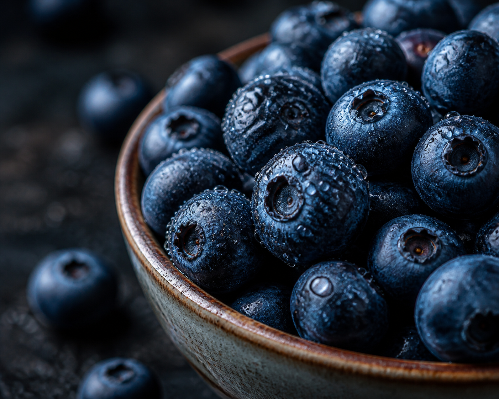

*▲ 블루베리 껍질의 보라색에는 안토시아닌이 관여합니다.*

한 줄 결론 <strong>생블루베리 100g은 57kcal, 식이섬유 2.4g, 비타민C 9.7mg입니다.</strong> 급속 냉동 블루베리는 안토시아닌 손실이 작아 생과와 영양 차이가 크지 않고, 하루 100g 안팎이면 폴리페놀을 충분히 챙길 수 있습니다.

**생블루베리 100g은 약 57 kcal, 당류는 약 10g입니다.** 생과는 바로 먹기 좋고, 무가당 냉동 블루베리는 오래 두고 필요한 만큼 꺼내 쓰기 편합니다.

아래에서 **블루베리 영양 성분**, **냉동과 생과의 차이**, 그리고 제품을 고를 때 확인할 점을 살펴봅니다.

---

## 1. 블루베리 칼로리와 영양성분은? (식이섬유 2.4g·비타민C 9.7mg)

[USDA FoodData Central의 생블루베리](https://fdc.nal.usda.gov/food-details/171711/nutrients) 기준입니다. 가당 제품이나 잼의 영양 성분은 상품마다 다릅니다.

| 영양 성분 | 100 g당 함량 | 미국 %DV |
| :--- | ---: | ---: |
| 열량 | 57 kcal | 기준치 없음 |
| 수분 | 84.2 g | 기준치 없음 |
| 탄수화물 | 14.5 g | 5.3% |
| 식이섬유 | 2.4 g | 8.6% |
| 당류 | 9.96 g | 기준치 없음 |
| 단백질 | 0.74 g | 별도 표기¹ |
| 지방 | 0.33 g | 0.4% |
| 비타민 C | 9.7 mg | 10.8% |
| 비타민 K | 19.3 µg | 16.1% |
| 망간 | 0.336 mg | 14.6% |
| 칼륨 | 77 mg | 1.6% |

미국 %DV는 [FDA 일일기준치](https://www.fda.gov/food/nutrition-facts-label/how-understand-and-use-nutrition-facts-label) 대비 비율입니다. ¹ 단백질은 g으로 표시했습니다.

---

## 2. 블루베리 효능은 무엇일까? 과학으로 입증된 4대 효과

블루베리에는 식이섬유와 비타민 C, 안토시아닌이 들어 있습니다. **안토시아닌**은 보라색과 푸른색을 띠는 식물 색소의 한 종류입니다.

[야생 블루베리 인체 연구를 정리한 리뷰](https://pubmed.ncbi.nlm.nih.gov/41579395/)는 심혈관·대사 건강 관련 지표에서 긍정적인 결과와 뚜렷한 차이가 없었던 결과를 함께 보고합니다. 연구마다 참가자, 섭취량, 제품 형태가 다르므로 식품을 고를 때에는 맛과 식단에 맞는지도 함께 고려하세요.

---

## 3. 블루베리는 생과가 좋을까, 냉동이 좋을까? 안토시아닌 보존 비교

| 구분 | 고를 때 보는 점 | 활용 예 |
| :--- | :--- | :--- |
| 생블루베리 | 알이 단단하고 곰팡이나 물러진 부분이 없는지 봅니다. | 간식, 샐러드 |
| 냉동 블루베리 | 원재료명에서 설탕이나 시럽 첨가 여부를 확인합니다. | 오트밀, 요거트 토핑 |

[냉동과 저장에 따른 블루베리 안토시아닌 변화를 조사한 연구](https://pubmed.ncbi.nlm.nih.gov/15577185/)에서는 시험한 냉동·저장 조건에서 총 안토시아닌 함량의 유의한 감소가 관찰되지 않았습니다. 생과와 냉동 제품 중 어느 쪽의 함량이 더 높은지는 품종과 보관 조건에 따라 달라집니다.

---

## 4. 블루베리 부작용과 주의할 점은?

- 냉동 제품은 포장지의 세척·가열 안내를 따르세요. 잼이나 시럽 제품과 비교할 때는 영양표의 당류와 1회 제공량을 확인하세요.
- 와파린을 복용 중이라면 식단을 크게 바꾸기 전에 의료진과 상의하세요. [미국 NIH 영양보충제국](https://ods.od.nih.gov/factsheets/VitaminK-Consumer/)은 와파린 복용 중 비타민 K 섭취량을 일정하게 유지하는 것이 중요하다고 안내합니다.

---

## 5. 블루베리 하루 얼마나 먹을까? 핵심 요약

씹는 식감을 원하면 생과를, 자주 꺼내 쓰려면 무가당 냉동 제품을 고르세요. 생과는 먹을 만큼 씻어 바로 쓰고, 냉동 제품은 상품에 적힌 보관법을 따르세요.

---

## 6. 블루베리와 함께 먹으면 좋은 음식은?

- 플레인 요거트에 블루베리를 넣으면 간단한 간식이 됩니다.
- [바나나](/posts/banana-nutrition-benefits/)와 함께 오트밀에 넣으면 단맛과 식감을 더할 수 있습니다.
- [딸기](/posts/strawberry-nutrition-benefits/)나 [오렌지](/posts/orange-nutrition-benefits/)와 함께 먹으면 비타민C와 안토시아닌을 한 끼에 함께 챙길 수 있습니다.

---

## 7. 자주 묻는 질문

### 냉동 블루베리가 생블루베리보다 영양이 더 좋나요?

냉동 제품의 안토시아닌이 생과보다 항상 많다고 볼 수 없습니다. 품종과 보관 조건이 다르고, 제품별 첨가당 여부도 확인해야 합니다.

### 블루베리 100g의 칼로리와 당류는 얼마인가요?

USDA 생블루베리 기준으로 100g당 57 kcal, 당류 약 10g입니다. 가당 냉동 제품이나 잼은 상품 영양표를 확인하세요.

### 블루베리를 하루에 얼마나 먹으면 되나요?

이 글의 100g은 영양 성분을 비교하는 기준입니다. 실제 섭취량은 다른 과일을 얼마나 먹는지와 개인 식단에 맞추면 됩니다.

  
📌 관련 순위 가이드

  <ul>
    <li><a href="/posts/antioxidant-anti-aging-foods-guide/">항산화·노화 방지 음식 TOP 10: 폴리페놀·카로티노이드 순위</a></li>
    <li><a href="/posts/low-gi-foods-blood-sugar-guide/">혈당 낮추는 음식 TOP 10: 저혈당 지수(GI) 순위표</a></li>
  </ul>

