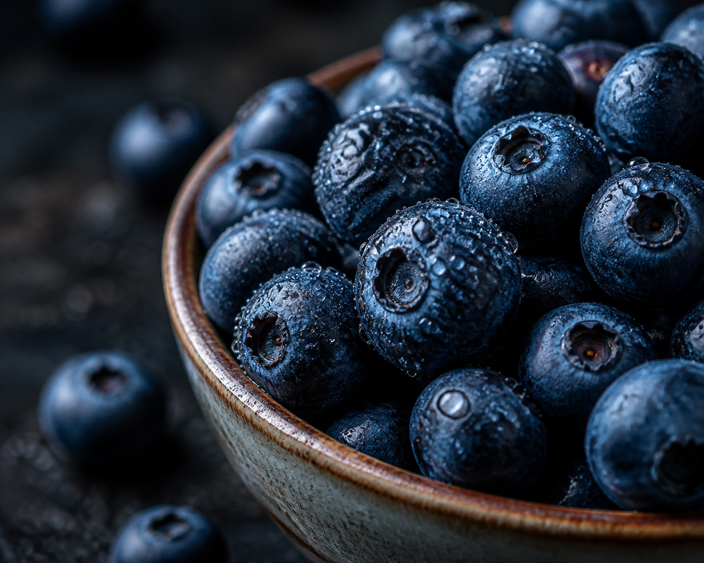

*▲ 신선한 야생 블루베리는 강력한 폴리페놀계 항산화 색소인 안토시아닌(Anthocyanin)의 보고로 전 세계 임상 영양학계의 집중 조명을 받고 있습니다.*

북미 원산의 진달래과 베리류 열매인 **블루베리(Blueberry, *Vaccinium corymbosum*)**는 미국 타임(TIME)지가 선정한 세계 10대 슈퍼푸드 중 하나로, 현대 기능성 영양학에서 가장 광범위하게 연구된 천연 항산화 식품입니다.

특유의 짙은 보랏빛 껍질에는 식물성 플라보노이드의 일종인 **안토시아닌(Anthocyanins)**이 고농도로 응축되어 있습니다. 이 강력한 파이토케미컬은 활성산소로 인한 세포 손상을 방어하고 신경 세포 간의 신호 전달을 촉진하는 핵심 인자입니다. 오늘은 현대 의학 및 영양학 연구를 바탕으로 블루베리의 과학적 건강 효능과 영양 성분, 그리고 흡수율을 극대화하는 섭취법을 체계적으로 분석합니다.

---

## 1. 블루베리의 핵심 영양 성분표 (100g 기준)

미국 농무부(USDA FoodData Central) 분석 기준, 생 블루베리 100g당 함유된 주요 거대 영양소와 생리활성 미량 영양소 수치는 다음과 같습니다.

| 영양 성분 | 100 g당 함량 | 미국 %DV |
| :--- | ---: | ---: |
| 열량 | 57 kcal | 기준치 없음 |
| 수분 | 84.2 g | 기준치 없음 |
| 탄수화물 | 14.5 g | 5.3% |
| 식이섬유 | 2.4 g | 8.6% |
| 당류 | 9.96 g | 기준치 없음 |
| 단백질 | 0.74 g | 별도 표기¹ |
| 지방 | 0.33 g | 0.4% |
| **안토시아닌** | **163~387 mg** | 기준치 없음 |
| 비타민 C | 9.7 mg | 10.8% |
| 비타민 K | 19.3 µg | 16.1% |
| 망간 | 0.336 mg | 14.6% |
| 칼륨 | 77 mg | 1.6% |

**표 읽는 법.** 미국 %DV는 생것 100 g이 [FDA 일일기준치](https://www.fda.gov/food/nutrition-facts-label/how-understand-and-use-nutrition-facts-label)의 몇 퍼센트인지 보여줍니다. ‘기준치 없음’은 성분이 없다는 뜻이 아닙니다. ¹ 단백질은 일반 식품 영양표시 관행에 따라 g으로 표시했습니다.

*데이터 출처: USDA FoodData Central & Journal of Agricultural and Food Chemistry*

---

## 2. 과학적으로 입증된 블루베리의 4대 건강 효능

### ① 뇌 인지기능 향상 및 신경 퇴행성 손상 억제
블루베리의 안토시아닌과 프로안토시아니딘 화합물은 뇌혈관 장벽(Blood-Brain Barrier, BBB)을 직접 통과하는 드문 식물성 화합물입니다. 하버드 의과대학 간호사 건강 코호트 연구(Nurses' Health Study)에 따르면, 주 2회 이상 정기적으로 베리류를 섭취한 성인은 인지기능 저하 속도가 평균 2.5년 지연되었습니다. 안토시아닌은 해마(Hippocampus) 부위의 뇌 유래 신경영양인자(BDNF) 발현을 유도하여 시냅스 가소성을 유지하고 기억력 감퇴를 방어합니다.

### ② 혈관 내피세포 기능 개선 및 심혈관 보호
블루베리에 함유된 폴리페놀은 혈관 내피세포에서 산화질소(NO, Nitric Oxide) 생성을 촉진하여 동맥 경화를 완화하고 혈관을 이완시킵니다. 임상 시험에서 6주간 매일 동결건조 블루베리 분말을 섭취한 고혈압 전단계 환자군은 수축기 혈압이 유의미하게 감소하고 동맥 경직도가 완화되는 결과가 확인되었습니다. 또한 혈중 산화된 저밀도 지질단백질(Oxidized LDL) 수치를 억제하여 죽상동맥경화증의 발생 위험을 낮춥니다.

### ③ 망막 로돕신 재합성 및 시각 피로 개선
디지털 기기 노출이 많은 현대인에게 블루베리는 망막 세포를 지키는 보호막 역할을 합니다. 안토시아닌 분자는 망막의 간상세포에 존재하는 시각 수용체 단백질인 **로돕신(Rhodopsin)**의 재합성을 촉진합니다. 이는 장시간 화면 응시로 인한 안구 건조감과 조도 적응 지연 현상을 완화하고, 노인성 황반변성(AMD) 위험 인자를 억제하는 데 기여합니다.

### ④ 인슐린 감수성 개선 및 대사 균형 유지
블루베리는 당류를 함유하고 있음에도 혈당지수(GI)가 53으로 낮고, 풍부한 수용성 식이섬유와 펙틴 성분이 포도당의 급격한 혈관 흡수를 지연시킵니다. 영국 영양학 저널(British Journal of Nutrition) 연구에 따르면, 비만 및 인슐린 저항성이 있는 성인이 매일 블루베리 바이오액티브 성분을 섭취했을 때 위약군 대비 인슐린 감수성이 22% 향상되어 제2형 당뇨병 예방에 긍정적인 역할을 하는 것으로 나타났습니다.

---

## 3. 영양소 흡수율을 극대화하는 조리 및 섭취 가이드

블루베리의 유효 파이토케미컬을 손실 없이 체내로 흡수하기 위해서는 올바른 보관 및 섭취법이 필수적입니다.

1. **냉동 블루베리의 놀라운 안토시아닌 농축 효과:**
   - 블루베리는 수확 직후 급속 냉동할 경우 세포벽 구조가 미세하게 붕괴되면서 안토시아닌의 용출 및 체내 생체이용률(Bioavailability)이 생과 대비 오히려 증가합니다. 제철이 아닐 때는 냉동 제품을 활용하는 것이 경제적이면서도 영양학적으로 우수합니다.
2. **건강한 지질(지방)과의 시너지 섭취:**
   - 블루베리의 항산화 플라보노이드 및 지용성 비타민 K는 그릭 요거트, 아몬드, 호두 등 건강한 불포화 지방산과 함께 섭취할 때 소화 흡수율이 최대 2~3배까지 증가합니다.
3. **가열 조리 시 주의점:**
   - 안토시아닌은 열에 민감하여 섭씨 100도 이상의 고온에서 장시간 가열할 경우 색소 구조가 분해될 수 있습니다. 잼이나 베이킹보다는 생식, 스무디, 저온 토핑 형태로 섭취하는 것이 좋습니다.

---

## 4. 섭취 시 주의사항 및 부작용

자연 식재료로서 안전성이 매우 높으나, 다음의 경우에는 적절한 주의가 권장됩니다.

- **과다 섭취 시 당류 및 복통 주의:** 하루 300g 이상의 과다 섭취는 과당과 불용성 식이섬유의 과도한 유입으로 인해 복부 팽만감이나 설사를 유발할 수 있습니다.
- **수산염(Oxalate) 결석 소인:** 요로결석이나 신장 결석 병력이 있는 환자는 과도한 양을 한 번에 섭취하지 않는 것이 안전합니다.
- **혈액 응고제 복용 환자:** 비타민 K 성분이 함유되어 있으므로 와파린 등 항응고제를 복용 중인 환자는 식단 변화 전 주치의와 상의해야 합니다.

---

## 5. 최종 요약 및 실천 팁

블루베리는 적은 칼로리로 강력한 항산화 및 신경 보호 영양소를 응축해 담아낸 최고의 자연 영양제입니다.

- **일일 권장 섭취량:** 성인 기준 하루 종이컵 1컵 분량 (약 120~150g, 80~100알 내외).
- **최적의 섭취 방법:** 아침 식사 시 플레인 요거트나 오트밀 위에 생과 또는 해동한 냉동 블루베리를 얹어 건강한 지방과 함께 섭취.
- **선도 보관 요령:** 섭취 직전에만 가볍게 세척하고, 보관 시에는 물기가 없는 상태로 밀폐 용기에 담아 냉장 보관(5일 이내)하거나 장기 보관 시 냉동실에 보관합니다.

---

## 6. 함께 먹으면 시너지가 폭발하는 식재료 궁합

- **[연어 (Salmon)]({{ site.baseurl }}/posts/salmon-nutrition-benefits/)**: 블루베리의 안토시아닌과 연어의 오메가-3 DHA·EPA가 뇌혈관 장벽(BBB)을 통과하여 신경세포막 산화 손상을 이중으로 방어하고 인지 기능 감퇴를 방지합니다.
- **[사과 (Apple)]({{ site.baseurl }}/posts/apple-nutrition-benefits/)**: 사과의 수용성 펙틴과 블루베리의 안토시아닌이 결합하여 장내 유익균의 아세테이트 생성을 촉진하고 항염증 면역 환경을 극대화합니다.
- **[브로콜리 (Broccoli)]({{ site.baseurl }}/posts/broccoli-nutrition-benefits/)**: 비타민 C와 안토시아닌의 결합으로 세포질 내 글루타치온 환원 효소 활성을 유도하여 강력한 전신 항산화 네트워크를 형성합니다.

---

## 7. 자주 묻는 질문 (FAQ)

### Q1. 냉동 블루베리가 생블루베리보다 안토시아닌 함량이 더 높다는 것이 사실인가요?
**A:** 네, 사실입니다. 수확 직후 급속 냉동 과정에서 세포벽이 팽창·미세 균열을 일으켜 껍질 속에 응축된 안토시아닌과 폴리페놀이 소화관 내에서 훨씬 더 쉽게 용출되어 생체이용률이 최대 20% 증가합니다.

### Q2. 블루베리 껍질 표면의 하얀 가루는 잔류 농약인가요?
**A:** 아닙니다. '과분(Bloom)'이라 불리는 천연 식물성 왁스 보호막입니다. 과실 스스로 수분 증발을 막고 외부 미생물 침입을 방어하기 위해 분비하는 물질로, 과분이 균일하게 덮여 있을수록 신선하고 당도가 높은 최상품입니다.

### Q3. 성인 기준 블루베리의 가장 이상적인 하루 섭취량은 얼마인가요?
**A:** 임상 연구에서 유의미한 항산화 및 혈관 확장 효과를 나타낸 권장 섭취량은 하루 약 100~130g(종이컵 1컵 분량, 약 50~70알) 내외입니다. 과다 섭취 시 과당으로 인한 장내 가스 팽만을 유발할 수 있습니다.

