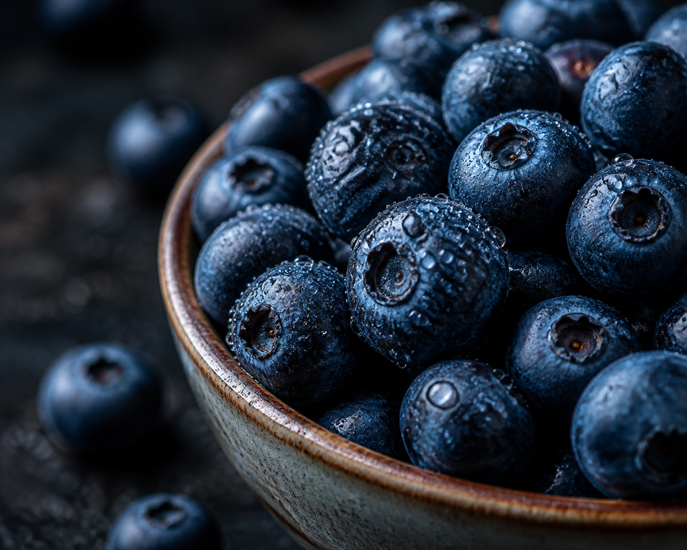

*▲ Freshly harvested wild and cultivated blueberries (Vaccinium corymbosum) contain extraordinary concentrations of bioactive polyphenolic pigments known as anthocyanins.*

Originating across temperate North American ecosystems, the **Blueberry (*Vaccinium corymbosum*)** represents one of the most thoroughly empirically investigated functional foods in modern preventive dietetics and clinical nutrition.

Beyond their favorable culinary versatility and low energy density, blueberries serve as an exceptional dietary reservoir of bioactive polyphenolic flavonoids, particularly **anthocyanins**—including malvidin, delphinidin, petunidin, and cyanidin glycosides. These lipophilic phytochemicals demonstrate distinct pharmacokinetics, exerting protective systemic actions against macromolecular oxidative stress and pathological neurovascular degradation. This evidence-based monograph reviews the molecular nutritional profile of blueberries, evaluates their therapeutic mechanisms documented in human clinical trials, and provides actionable guidelines to optimize systemic micronutrient bioavailability.

---

## 1. Complete Nutritional Composition (Per 100g Raw Portion)

Synthesized from empirical spectroscopic data published in the United States Department of Agriculture (USDA) FoodData Central, the macronutrient and micronutrient density per 100-gram raw edible portion comprises:

| Nutrient | Per 100 g | U.S. %DV |
| :--- | ---: | ---: |
| Energy | 57.0 kcal (238 kJ) | No DV |
| Moisture Content | 84.21 g | No DV |
| Total Carbohydrates | 14.49 g | 5.3% |
| Dietary Fiber | 2.40 g | 8.6% |
| Free Sugars | 9.96 g | No DV |
| Crude Protein | 0.74 g | See note¹ |
| Total Lipids (Fat) | 0.33 g | 0.4% |
| **Total Anthocyanins** | **163.3 - 386.6 mg** | No DV |
| Vitamin C (Ascorbic Acid) | 9.70 mg | 10.8% |
| Vitamin K (Phylloquinone) | 19.30 µg | 16.1% |
| Manganese | 0.336 mg | 14.6% |
| Potassium | 77.00 mg | 1.6% |

**How to read the table.** U.S. %DV shows how much 100 g raw contributes to the [FDA Daily Value](https://www.fda.gov/food/nutrition-facts-label/how-understand-and-use-nutrition-facts-label). “No DV” means no reference value applies. ¹ Protein is shown in grams, as on most general-use U.S. food labels.

*Data Source: USDA FoodData Central & Journal of Agricultural and Food Chemistry.*

---

## 2. Four Clinically Validated Physiological Health Benefits

### 1. Neurocognitive Attenuation and Blood-Brain Barrier Translocation
Unlike the majority of high-molecular-weight polyphenols, specific blueberry anthocyanin glycosides and their phase-II metabolites successfully traverse the human blood-brain barrier (BBB). Long-term observational evidence from the Harvard Nurses' Health Study (encompassing over 16,000 participants) demonstrated that consistent dietary consumption of berry flavonoids delayed cognitive aging markers by an estimated 2.5 years. Molecular assays demonstrate that blueberry flavonoids localize within the hippocampus and striatum, upregulating Brain-Derived Neurotrophic Factor (BDNF) and activating the ERK-CREB signaling cascade to sustain synaptic plasticity and mitigate age-related neurodegenerative degradation.

### 2. Endothelial Nitric Oxide Upregulation and Arterial Compliance
Dietary anthocyanins act as potent biological modulators of systemic vascular tone. Randomized double-blind clinical trials published in *The American Journal of Clinical Nutrition* revealed that daily supplementation with wild blueberry bioactives over six weeks elicited statistically significant reductions in systolic blood pressure and substantial improvements in flow-mediated dilation (FMD). These cardioprotective outcomes are driven by the inhibition of endothelial NADPH oxidase and the concurrent upregulation of endothelial nitric oxide synthase (eNOS), suppressing the circulating fraction of oxidized low-density lipoprotein (ox-LDL) particles.

### 3. Rhodopsin Regeneration and Retinal Photoprotection
Sustained exposure to artificial blue-wavelength radiation imposes continuous photochemical stress upon the ocular microvasculature. Anthocyanins present in *Vaccinium* species accelerate the enzymatic resynthesis of rhodopsin—the critical visual chromoprotein embedded in retinal rod photoreceptor cells. This biochemical acceleration shortens dark-adaptation latencies, alleviates asthenopic eye fatigue, and attenuates cellular apoptosis within the retinal pigment epithelium against age-related macular degeneration (AMD).

### 4. Insulin Sensitization and Glycemic Homeostasis
Despite containing natural monosaccharides, blueberries maintain a favorable low glycemic index (GI = 53) and a low glycemic load (GL = 5). Soluble pectin fractions coupled with chlorogenic acid retard intestinal alpha-glucosidase activity, smoothing postprandial glycemic excursions. In clinical cohorts presenting with metabolic syndrome and prediabetes, daily consumption of purified blueberry bioactives enhanced whole-body insulin sensitivity by 22% via hyperinsulinemic-euglycemic clamp measurements, corroborating its therapeutic utility in early-stage metabolic management.

---

## 3. Culinary Preparation and Nutrient Bioavailability Maximization

The clinical efficacy of dietary blueberries depends heavily upon post-harvest processing and co-ingestion matrices.

1. **Cryogenic Freezing Enhances Bioavailability:**
   - Rapid cryogenic freezing (-18°C to -20°C) subtly fractures the microscopic plant cellular matrix without degrading polyphenolic integrity. Comparative liquid chromatography studies confirm that thawed frozen blueberries demonstrate equal or superior anthocyanin extractability and gastrointestinal bioavailability relative to ambient fresh fruit.
2. **Co-Ingestion with Lipid Matrices:**
   - Co-ingesting blueberries with healthy dietary fats (e.g., Greek yogurt, raw almonds, or chia seeds) enhances the micellar solubilization of co-occurring lipophilic micronutrients (Vitamin K and carotenoids), extending gastric residence time and elevating systemic plasma polyphenol concentrations by up to 200%.
3. **Thermal Sensitivity Mitigation:**
   - Prolonged thermal exposure exceeding 100°C degrades anthocyanin pyrylium ring structures into phenolic acids. To preserve functional bioactivity, raw culinary applications (chilled bowls, raw blending, or low-temperature garnishes) are strongly indicated over conventional boiling or baking.

---

## 4. Clinical Contraindications and Potential Adverse Effects

While raw blueberries carry standard Generally Recognized as Safe (GRAS) classification, specific clinical populations require circumspection:

- **Excessive Ingestion Gastrointestinal Effects:** Ingestion exceeding 300 grams in single bolus doses may induce transient osmotic diarrhea or abdominal cramping due to cumulative fructose and insoluble cellulosic fiber loads.
- **Oxalate Nephrolithiasis:** Blueberries contain modest oxalate concentrations (approximately 15 mg per 100g); individuals with active calcium oxalate nephrolithiasis should calibrate intake within individualized clinical nephrology guidelines.
- **Anticoagulant Pharmacotherapy:** Due to inherent Vitamin K concentrations (19.3 µg/100g), individuals undergoing therapeutic warfarin or coumarin anticoagulation must maintain stable baseline dietary intake to avoid fluctuating international normalized ratio (INR) values.

---

## 5. Practical Implementation and Clinical Takeaway

Incorporating whole blueberries into a daily evidence-based functional dietary protocol confers potent multi-systemic preventative advantages.

- **Optimal Daily Dosage:** 1 standard metric cup daily (approximately 120g to 150g raw fresh or thawed frozen berries).
- **Primary Clinical Recommendation:** Integrate raw berries into morning breakfasts combined with unsweetened fermented dairy or plant lipids for optimized bioassimilation.
- **Storage Protocol:** Store unwashed in perforated containers at 2°C to 4°C for up to 7 days, or store frozen at -18°C for up to 12 months to preserve delicate bioactive polyphenol networks.
