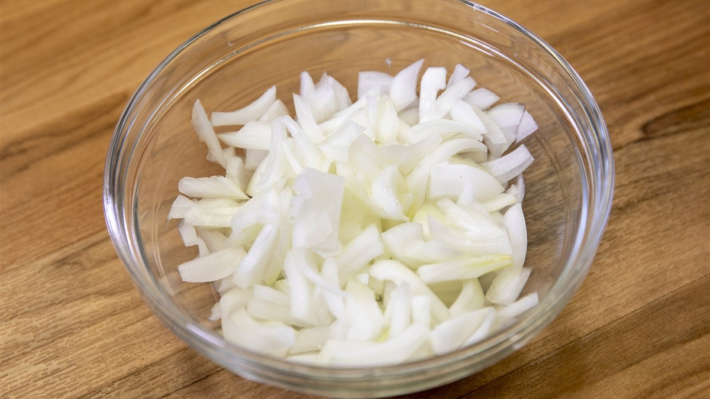

*▲ Raw onions add crunch, while gentle cooking softens their pungency. Photo by Alabama Extension via [Wikimedia Commons](https://commons.wikimedia.org/wiki/File:Sliced_Onions.jpg), CC0.*

A raw onion can dominate a salad, while the same bulb cooked gently can become the mellow base of a stew. Even a spoonful of chopped onion can change a dish's flavour and texture.

Onions also deliver quercetin, a flavonoid studied for its absorption and metabolism, and fructans, carbohydrates that intestinal bacteria can ferment. These constituents raise different questions. A blood sample can show how much quercetin reaches circulation, while a feeding study can test whether the diet changes gut bacteria or blood pressure. The type of experiment determines what its results can tell us about a serving of onions.

---

## 1. Key Nutrients in Raw Onion (Per 100 g)

The table refers to the edible portion of raw onion. A recipe with 200 g divided among four servings supplies about half the listed amounts of each nutrient per plate before cooking. Water loss and added fat can change the values per 100 g of the finished dish.

| Nutrient | Per 100 g | U.S. %DV |
| :--- | ---: | ---: |
| Energy | 40 kcal | No DV |
| Water | 89.11 g | No DV |
| Total carbohydrate | 9.34 g | 3.4% |
| Dietary fibre | 1.7 g | 6.1% |
| Total sugars | 4.24 g | No DV |
| Protein | 1.1 g | See note¹ |
| Total fat | 0.10 g | 0.1% |
| Vitamin C | 7.4 mg | 8.2% |
| Potassium | 146 mg | 3.1% |

**How to read the table.** U.S. %DV shows how much 100 g raw contributes to the [FDA Daily Value](https://www.fda.gov/food/nutrition-facts-label/how-understand-and-use-nutrition-facts-label). “No DV” means no reference value applies. ¹ Protein is shown in grams, as on most general-use U.S. food labels.

*Source: [USDA FoodData Central, Onions, raw](https://fdc.nal.usda.gov/food-search/?query=170000). Quercetin concentrations vary by cultivar and tissue, so a single reference value is omitted.*

---

## 2. Four Nutrition Findings and the Evidence Behind Them

### ① Quercetin glycosides and absorption kinetics

Much of the quercetin in onion occurs as glycosides, molecules in which the flavonoid is attached to one or more sugar units. In a study of nine adults, blood concentrations peaked sooner after participants consumed onions than after apples or purified rutin, and relative bioavailability was higher in the onion condition. The result helps explain how the sugar attached to a flavonoid and the food that carries it can affect absorption. The experiment measured short-term blood exposure after single doses. [Hollman et al., human bioavailability study](https://pubmed.ncbi.nlm.nih.gov/9414116/)

### ② Blood pressure and the limits of an extract trial

In a placebo-controlled crossover trial, adults with overweight or obesity and elevated blood pressure received onion skin extract supplying 162 mg of quercetin daily. The full study group had no significant change in blood pressure relative to placebo. A subgroup with hypertension had a modest reduction in 24-hour systolic pressure. The study tested a standardised dose from onion skins. A normal serving of the bulb has a different composition, and its effect on blood pressure cannot be inferred from that subgroup result. [Brüll et al., randomised crossover trial](https://pubmed.ncbi.nlm.nih.gov/26328470/)

### ③ Fructans as substrates for gut bacteria

Fructans can reach the colon, where some bacteria use them as fermentable substrates. A small single-group study in healthy adults found that a diet containing multiple vegetables rich in inulin-type fructans increased the abundance of bifidobacteria. Since participants ate a mixture of vegetables and the study had no parallel control group, the change cannot be assigned to onion alone. Fermentation also generates gas, which helps explain why tolerance matters when choosing a portion. [Hiel et al., dietary intervention](https://pubmed.ncbi.nlm.nih.gov/31108510/)

### ④ Vitamin C in collagen formation and iron absorption

Vitamin C supports the enzyme reactions involved in collagen production and improves absorption of nonheme iron, the form found in plant foods. At 7.4 mg per 100 g raw, an onion used mainly as a garnish supplies only a small share of daily vitamin C needs. In a meal with beans or lentils, raw sweet pepper or a squeeze of lemon can add more vitamin C alongside the onion. [NIH Office of Dietary Supplements](https://ods.od.nih.gov/factsheets/VitaminC-HealthProfessional/)

---

## 3. Culinary Preparation and Nutrient Bioavailability

- **Raw for crunch and vitamin C.** Thinly sliced onion suits salads, sandwiches and toppings. Skipping prolonged heat helps retain heat-sensitive vitamin C. Slice just before serving if you want a crisp texture.
- **Cooked for a milder flavour.** A short sauté over medium heat softens the onion without prolonged simmering. A five-cultivar study found that measured quercetin content differed after boiling, baking and sautéing. When boiling, you can serve the cooking liquid as part of a soup or stew to keep water-soluble compounds that enter it. [Lombard et al., comparison of home cooking methods](https://www.sciencedirect.com/science/article/pii/S0889157504000675)
- **Oil for flavour and even cooking.** A little olive oil helps onion slices soften in a pan. A human crossover study found greater blood exposure to quercetin when a high dose of free quercetin was given with a higher-fat meal. The study provides evidence for a food-matrix effect under those conditions. The size of the effect from dressing or sautéing ordinary onion remains uncertain. [Guo et al., dietary fat and quercetin study](https://pubmed.ncbi.nlm.nih.gov/23319447/)

---

## 4. Tolerance, Adverse Effects, and Medication Considerations

- **IBS and FODMAPs.** Onion fructans can trigger bloating, gas or abdominal discomfort in people with irritable bowel syndrome. Fructans dissolve in water, so removing onion pieces from soup leaves fructans in the broth. During a low-FODMAP elimination phase, the green tops of spring onions can provide a similar aroma. Portion size during reintroduction depends on individual tolerance. [Monash University FODMAP cooking guide](https://www.monashfodmap.com/blog/cooking-with-onion-and-garlic-myths-and/)
- **Concentrated products.** Keep taking prescribed blood pressure medication as directed. If you are considering an onion skin extract or a quercetin supplement, discuss the product and dose with a pharmacist or clinician who can review your medications.

---

## 5. Practical Portions and Storage

- **Portion.** There is no recommended daily dose for onion. If you tolerate it, start with about 30–50 g in a meal and adjust for taste and comfort.
- **Storage.** Keep whole dry onions in a cool, dry and ventilated place. Refrigerate cut onion in a sealed container within two hours of cutting. [USDA produce storage guidance](https://www.fna.usda.gov/fs/produce-safety/storage), [FDA guidance for cut vegetables](https://www.fda.gov/media/77279/download)
- **Try it today.** Sauté a small handful of sliced onion in olive oil, then add mushrooms for a simple side dish.

---

## 6. Synergistic Food Pairings for Maximum Nutrient Absorption

- **[Beef Sirloin]({{ site.baseurl }}/en/posts/beef-sirloin-nutrition-benefits/)**: Allyl sulfides in onions conjugate with thiamine (vitamin B1) from beef to synthesize allithiamine, an active lipid-soluble molecule accelerating ATP cellular energy generation.
- **[Apple]({{ site.baseurl }}/en/posts/apple-nutrition-benefits/)**: Pairing onions and apples consolidates premier dietary quercetin reserves, delivering potent mast cell stabilization and bronchial anti-inflammatory relief.
- **[Salmon]({{ site.baseurl }}/en/posts/salmon-nutrition-benefits/)**: Organosulfur compounds in onions synergize with eicosapentaenoic acid (EPA) in salmon to inhibit platelet aggregation and reduce vascular thrombus susceptibility.

---

## 7. Frequently Asked Questions (FAQ)

### Q1. Does cooking onions destroy their fundamental cardioprotective nutrients?
**A:** No. Quercetin exhibits remarkable thermal stability, retaining over 85% of its molecular integrity through sautéing and boiling. Heat converts volatile lachrymatory alliinase products into sweet-tasting, stomach-friendly propyl mercaptans.

### Q2. Is brewing onion skins into tea scientifically backed for health benefits?
**A:** Yes. The outer pigmented tunic of onions contains 30 to 50 times higher concentrations of quercetin aglycones compared to the inner edible fleshy scales, serving as an exceptional cardioprotective elixir.

### Q3. What biochemical technique effectively minimizes crying when slicing onions?
**A:** Chilling onions for 15 to 30 minutes before cutting depresses lachrymatory factor synthase enzyme kinetics. Utilizing a razor-sharp, moist blade minimizes mechanical cell rupture and subsequent airborne aerosolization.

