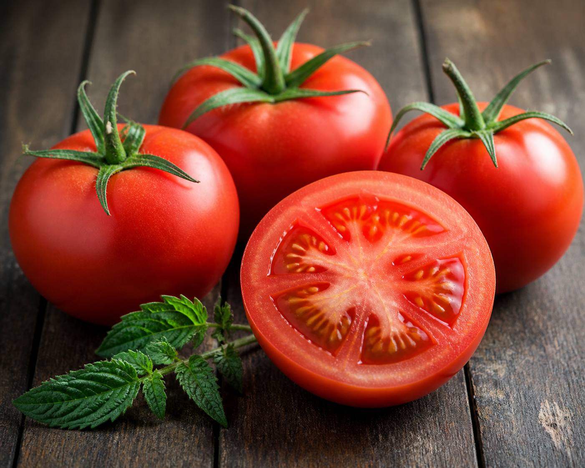

*▲ Freshly harvested ripe red tomatoes serve as an exceptional dietary reservoir of bioactive lycopene.*

As one of the most widely consumed functional foods across global cuisines, the **tomato (Solanum lycopersicum)** holds a prominent status in contemporary clinical nutritional science.

Originating from western South America and popularized through Mediterranean dietary traditions, the tomato is far more than a versatile culinary ingredient. It serves as an exceptional dietary reservoir of **lycopene**, an acyclic carotenoid responsible for its vibrant red hue and an array of documented physiological advantages. This comprehensive analysis evaluates the biochemical profile of tomatoes, explores their scientific therapeutic mechanisms, and provides practical dietary strategies to optimize nutrient assimilation.

---

## 1. Complete Nutritional Composition (Per 100g Raw Red Ripe Tomato)

Data synthesized from the United States Department of Agriculture (USDA) FoodData Central reveals the macronutrient and micronutrient density per 100-gram serving:

| Nutrient | Concentration | % Daily Value (DV) |
| :--- | :--- | :--- |
| Energy | 18 kcal (75 kJ) | < 1% |
| Moisture Content | 94.5 g | - |
| Total Carbohydrates | 3.9 g | 1.4% |
| Dietary Fiber | 1.2 g | 4.3% |
| Protein | 0.9 g | 1.8% |
| Total Lipids (Fat) | 0.2 g | 0.3% |
| **Lycopene** | **3,040 – 7,100 µg** | **Extremely High** |
| Vitamin C (L-Ascorbic Acid) | 13.7 mg | 15.2% |
| Vitamin K1 (Phylloquinone) | 7.9 µg | 6.6% |
| Potassium (K) | 237 mg | 5.0% |
| Folate (Vitamin B9) | 15 µg | 3.8% |

---

## 2. Four Clinically Validated Physiological Mechanisms

### ① Superior Radical Scavenging & Endothelial Integrity
Lycopene features an extended conjugated polyene system comprising 11 conjugated and 2 non-conjugated double bonds. This distinctive molecular configuration renders it one of the most potent singlet oxygen ($^1\text{O}_2$) quenchers in nature—exhibiting twice the quenching capacity of $\beta$-carotene and ten times that of $\alpha$-tocopherol (Vitamin E). By mitigating lipid peroxidation within low-density lipoprotein (LDL) fractions and preserving vascular endothelial function, regular tomato intake is strongly correlated with a reduced incidence of atherosclerosis and myocardial infarction.

### ② Prostate Epithelial Protection and Oncological Research
Extensive prospective cohort data from the Harvard School of Public Health indicate that individuals consuming two or more servings of processed tomato products weekly demonstrate a 21% to 34% reduction in prostate cancer risk. Mechanistically, lycopene modulates insulin-like growth factor-1 (IGF-1) signaling pathways, upregulates phase II antioxidant enzymes, and suppresses aberrant cellular proliferation in prostatic tissue.

### ③ Hemodynamic Regulation and Electrolyte Balance
With 237 mg of potassium per 100 grams alongside negligible sodium levels, tomatoes promote optimal cellular osmolarity. Dietary potassium antagonizes aldosterone-mediated sodium retention in renal tubules, fostering vasodilation and stabilizing systolic blood pressure.

### ④ Dermatological Photoprotection and Collagen Defense
Accumulation of dietary carotenoids within cutaneous tissues mitigates UV-induced erythema. Lycopene suppresses the activity of matrix metalloproteinases (MMPs), enzymes responsible for degrading extracellular matrix collagen, thereby attenuating photoaging and supporting dermal resilience.

---

## 3. Bioavailability Optimization: "The Power of Heat and Dietary Lipids"

A widespread assumption suggests that raw plant foods universally offer superior nutritional value. In the context of tomato carotenoids, however, **thermal processing and concurrent lipid consumption drastically amplify bioaccessibility**.

### 🔬 Isomerization: Converting All-Trans to Cis-Lycopene
- In fresh, uncooked tomatoes, lycopene exists predominantly in a linear, crystalline **all-trans conformation**, firmly embedded within chromoplast matrices.
- Applying moderate thermal energy (such as simmering between 80°C and 90°C) disrupts plant cellular walls and induces thermodynamic **trans-to-cis isomerization**.
- The resulting *cis*-isomers possess higher solubility in mixed bile-acid micelles, facilitating substantially higher transport across intestinal enterocytes.

### 🫒 Synergistic Lipid Partitioning with Extra Virgin Olive Oil
Because lycopene is intensely hydrophobic, efficient absorption necessitates micellar incorporation during upper gastrointestinal digestion. Clinical pharmacokinetic trials indicate that co-ingesting cooked tomato products with monounsaturated fatty acids (such as extra virgin olive oil) enhances circulating plasma lycopene concentrations by **over 400%** compared to fat-free consumption.

---

## 4. Potential Contraindications and Clinical Considerations

- **Gastroesophageal Reflux Disease (GERD):** Abundant malic and citric acids stimulate gastric secretion. Individuals with erosive esophagitis or peptic ulcer disease should minimize intake on an empty stomach.
- **Glycoalkaloid Toxicity (Solanine):** Unripe green tomatoes contain toxic glycoalkaloids, primarily tomatine and solanine, which can cause gastrointestinal distress, cephalalgia, and nausea. Always select thoroughly ripened specimens.
- **Chronic Kidney Disease (CKD):** Due to high potassium density, patients undergoing dialysis or managing severe renal insufficiency must monitor portion sizes to prevent hyperkalemia.

---

## 5. Summary & Culinary Recommendation

For optimal therapeutic and nutritional yield, prepare tomatoes lightly stewed or sautéd in cold-pressed olive oil (e.g., tomato-based sauces, soups, or Mediterranean ratatouille) accompanied by quality protein. An average intake of one to two medium cooked tomatoes daily provides sufficient bioactive carotenoids to support systemic health.
