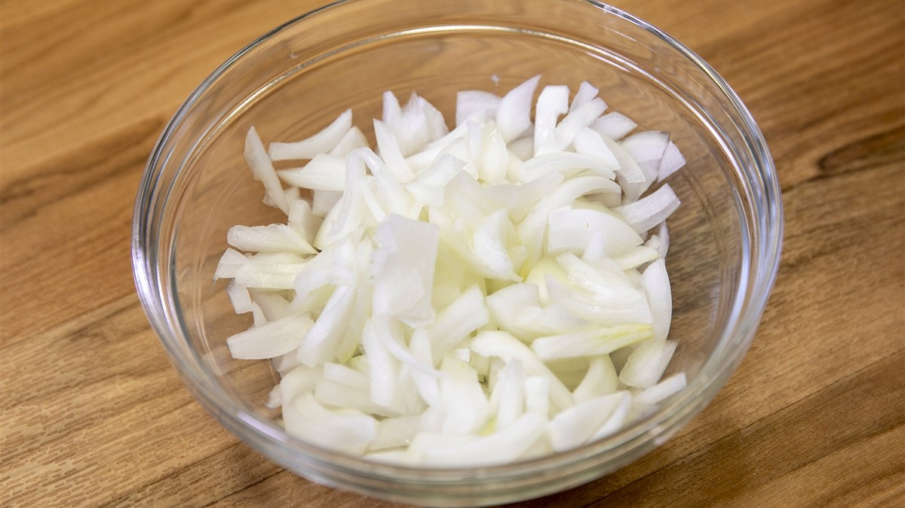

*▲ 양파는 생으로 썰면 아삭하고, 익히면 매운맛이 줄어듭니다. 사진은 [Wikimedia Commons](https://commons.wikimedia.org/wiki/File:Sliced_Onions.jpg), CC0.*

칼을 댄 순간 눈이 따가운 양파도 팬에서 천천히 익히면 부드럽고 달게 느껴집니다. 같은 양파 한 알도 썰어서 바로 넣을 때와 천천히 익힐 때 요리의 식감과 향을 다르게 만듭니다.

영양 연구에서는 플라보노이드인 **퀘르세틴(quercetin)**과 장내 세균이 발효하는 **프럭탄(fructan)**에 주목합니다. 두 성분이 우리 몸에서 작용하는 경로는 서로 다릅니다. 생양파의 영양 성분부터 인체 연구에서 실제로 측정한 결과까지 살펴보고, 조리할 때 어떤 선택이 실용적인지 정리했습니다.

---

## 1. 양파의 핵심 영양 성분표 (100g 기준)

껍질을 제외한 생양파의 기준값입니다. 실제 한 끼에 50g을 넣으면 표에 나온 영양소의 약 절반을 섭취합니다. 볶은 양파는 수분이 줄고 조리유가 더해질 수 있어 같은 무게의 생양파와 열량이 달라집니다.

| 영양 성분 | 100 g당 함량 | 미국 %DV |
| :--- | ---: | ---: |
| 열량 | 40 kcal | 기준치 없음 |
| 수분 | 89.11 g | 기준치 없음 |
| 탄수화물 | 9.34 g | 3.4% |
| 식이섬유 | 1.7 g | 6.1% |
| 총당류 | 4.24 g | 기준치 없음 |
| 단백질 | 1.1 g | 별도 표기¹ |
| 지방 | 0.10 g | 0.1% |
| 비타민 C | 7.4 mg | 8.2% |
| 칼륨 | 146 mg | 3.1% |

**표 읽는 법.** 미국 %DV는 생것 100 g이 [FDA 일일기준치](https://www.fda.gov/food/nutrition-facts-label/how-understand-and-use-nutrition-facts-label)의 몇 퍼센트인지 보여줍니다. ‘기준치 없음’은 성분이 없다는 뜻이 아닙니다. ¹ 단백질은 일반 식품 영양표시 관행에 따라 g으로 표시했습니다.

*자료: [USDA FoodData Central 생양파 표준 데이터](https://fdc.nal.usda.gov/food-search/?query=170000). 퀘르세틴은 품종과 분석 부위에 따라 함량 차이가 커 표에서 제외했습니다.*

---

## 2. 양파의 4가지 영양 작용과 인체 연구

### ① 퀘르세틴의 형태가 흡수 속도에 미치는 영향

양파의 퀘르세틴 일부는 포도당이 붙은 배당체 형태로 존재합니다. 성인 9명의 단회 섭취 연구에서 양파를 먹은 뒤 혈중 퀘르세틴 농도가 사과나 루틴을 섭취했을 때보다 빠르게 정점에 도달했습니다. 장에서 처리되는 방식이 화학적 형태에 따라 다를 수 있음을 보여줍니다. 연구가 비교한 지표는 혈중 노출량과 시간입니다. [Hollman 등 인체 흡수 연구](https://pubmed.ncbi.nlm.nih.gov/9414116/)

### ② 혈압에 관한 양파 껍질 추출물 연구

과체중 또는 비만이면서 혈압이 높은 성인에게 퀘르세틴을 하루 162mg 공급하는 껍질 추출물을 투여한 교차시험에서, 전체 참가자의 혈압은 위약 대비 유의하게 달라지지 않았습니다. 고혈압 하위집단에서는 24시간 수축기 혈압이 소폭 낮아졌습니다. 실험 재료는 정량화한 추출물이므로 일반적인 양파 반찬의 혈압 효과는 이 시험에서 판단할 수 없습니다. [Brüll 등 무작위 대조시험](https://pubmed.ncbi.nlm.nih.gov/26328470/)

### ③ 프럭탄 발효와 장내 미생물

프럭탄은 소장에서 충분히 분해되지 않아 대장에 도달하고, 일부 장내 미생물이 이를 발효합니다. 건강한 성인이 이눌린형 프럭탄이 많은 여러 채소를 섭취한 소규모 연구에서 비피도박테리움이 증가했습니다. 여러 채소를 함께 먹은 단일군 연구여서 양파 자체의 효과 크기는 알기 어렵습니다. 발효 과정에서 가스가 생기므로 같은 양을 먹어도 사람마다 반응이 다릅니다. [Hiel 등 식이 개입 연구](https://pubmed.ncbi.nlm.nih.gov/31108510/)

### ④ 비타민 C의 콜라겐 합성과 철 흡수 보조

비타민 C는 콜라겐 합성에 필요한 효소 반응을 돕고, 식물성 식품에 들어 있는 비헴철의 흡수를 높입니다. 생양파 100g의 비타민 C는 7.4mg으로, 양파를 고명처럼 조금 쓰는 식사에서는 기여량도 작습니다. 콩이나 렌틸을 곁들일 때는 비타민 C가 더 많은 파프리카나 레몬즙을 함께 쓰면 식단을 구성하기 쉽습니다. [미국 국립보건원 비타민 C 자료](https://ods.od.nih.gov/factsheets/VitaminC-HealthProfessional/)

---

## 3. 영양소 흡수를 고려한 조리 및 섭취 가이드

- **생으로 먹을 때** 얇게 썰어 샐러드나 샌드위치에 넣으면 아삭함이 살아납니다. 가열을 피하면 열에 민감한 비타민 C를 보존하는 데 유리합니다. 물에 오래 담가두기보다 먹기 직전에 썰면 준비도 간단합니다.
- **익혀 먹을 때** 중불에서 소량의 기름에 짧게 볶으면 매운 향이 누그러지고 수분이 빠지면서 단맛이 두드러집니다. 다섯 품종의 양파를 비교한 연구에서는 삶기, 굽기, 볶기에 따라 퀘르세틴 함량 변화가 달랐습니다. 물에 녹는 성분을 함께 먹고 싶다면 삶은 물을 버리는 대신 국물 요리에 활용할 수 있습니다. [가정식 조리법 비교 연구](https://www.sciencedirect.com/science/article/pii/S0889157504000675)
- **기름과 함께 먹을 때** 올리브유는 양파를 고르게 익히고 향을 내는 데 쓸 수 있습니다. 지방을 곁들였을 때 혈중 퀘르세틴 노출이 늘어난 인체 시험은 고용량의 유리형 퀘르세틴을 사용했습니다. 생양파에 기름을 더했을 때 같은 효과가 얼마나 나타나는지는 이 결과로 계산할 수 없습니다. [Guo 등 지방 동시 섭취 연구](https://pubmed.ncbi.nlm.nih.gov/23319447/)

---

## 4. 섭취 시 주의사항 및 부작용

- **과민성장증후군과 복부 팽만**. 양파의 프럭탄은 일부 사람에게 가스, 팽만, 복통을 유발할 수 있습니다. 국물에서는 프럭탄이 물로 이동하므로 건더기만 건져도 남습니다. 저포드맵 식사를 진행 중이라면 양파 대신 쪽파의 초록 부분으로 향을 내고, 재도입 양은 개인의 내성에 맞춰 조절하세요. [모나시대 FODMAP 조리 가이드](https://www.monashfodmap.com/blog/cooking-with-onion-and-garlic-myths-and/)
- **약을 복용 중인 경우**. 혈압약은 처방대로 복용하세요. 식사용 양파와 퀘르세틴 농축 제품은 섭취량이 크게 다릅니다. 보충제나 양파 껍질 추출물을 새로 복용할 계획이라면 사용 중인 약과 함께 의사나 약사에게 확인하세요.

---

## 5. 최종 요약 및 실천 팁

- **한 끼 분량**. 양파에 별도의 하루 권장량은 없습니다. 요리에 30~50g 정도 넣어 보고 맛과 소화 반응에 따라 조절하세요.
- **보관법**. 자르지 않은 마른 양파는 서늘하고 건조하며 통풍이 되는 곳에 두세요. 자른 양파는 밀폐 용기에 담아 2시간 안에 냉장하세요. [USDA 농산물 보관 안내](https://www.fna.usda.gov/fs/produce-safety/storage), [FDA 손질 채소 안내](https://www.fda.gov/media/77279/download)
- **오늘의 실천**. 얇게 썬 양파 한 줌을 올리브유에 가볍게 볶아 버섯과 함께 먹어 보세요.
