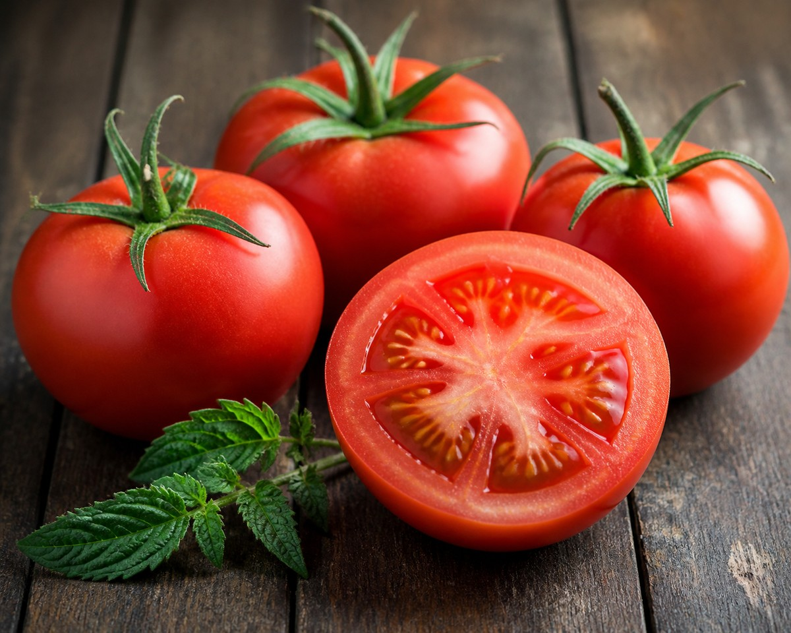

*▲ 완숙 토마토의 붉은색을 내는 색소 중 하나가 라이코펜입니다.*

**생토마토 100g은 약 18 kcal입니다.** 생으로는 샐러드에, 익혀서는 볶음이나 소스에 활용하기 좋습니다. 라이코펜 흡수만 비교하면, 한 소규모 연구에서는 토마토 페이스트가 생토마토보다 유리했습니다.

아래에서 **토마토 영양 성분**, **생토마토와 익힌 토마토의 차이**, 그리고 식사에 넣는 방법을 살펴봅니다.

---

## 1. 토마토 칼로리와 영양 성분 (100g 기준)

[USDA FoodData Central의 붉은 완숙 생토마토](https://fdc.nal.usda.gov/food-details/170457/nutrients) 기준입니다. 크기와 품종에 따라 실제 수치는 달라질 수 있습니다.

| 영양 성분 | 100 g당 함량 | 미국 %DV |
| :--- | ---: | ---: |
| 열량 | 18 kcal | 기준치 없음 |
| 수분 | 94.5 g | 기준치 없음 |
| 탄수화물 | 3.9 g | 1.4% |
| 식이섬유 | 1.2 g | 4.3% |
| 단백질 | 0.9 g | 별도 표기¹ |
| 지방 | 0.2 g | 0.3% |
| 비타민 C | 13.7 mg | 15.2% |
| 비타민 K | 7.9 µg | 6.6% |
| 칼륨 | 237 mg | 5.0% |

미국 %DV는 [FDA 일일기준치](https://www.fda.gov/food/nutrition-facts-label/how-understand-and-use-nutrition-facts-label) 대비 비율입니다. ¹ 단백질은 g으로 표시했습니다.

---

## 2. 토마토 효능과 라이코펜 연구

토마토에는 라이코펜과 비타민 C, 칼륨 등이 들어 있습니다. **라이코펜**은 카로티노이드 계열의 색소로, 토마토를 어떤 형태로 먹었는지에 따라 흡수 연구 결과가 달라질 수 있습니다.

토마토 섭취와 전립선 건강의 관계를 조사한 연구도 있습니다. [미국 국립암연구소의 근거 검토](https://www.cancer.gov/types/prostate/hp/prostate-prevention-pdq)는 라이코펜이 전립선암 위험 감소와 관련된다는 근거가 약하다고 평가합니다.

---

## 3. 생토마토와 익힌 토마토, 어떻게 먹을까?

| 먹는 방법 | 특징 | 활용 예 |
| :--- | :--- | :--- |
| 생토마토 | 식감이 선명하고 조리 없이 먹기 쉽습니다. | 샐러드, 샌드위치 |
| 익힌 토마토 | 부드러워지고 소스나 국물에 섞기 쉽습니다. | 토마토 달걀볶음, 파스타 소스 |

[토마토 페이스트와 생토마토를 비교한 인체 연구](https://pubmed.ncbi.nlm.nih.gov/9209178/)에서는 같은 양의 라이코펜을 제공했을 때 페이스트 쪽의 흡수 지표가 더 높았습니다. 이 결과는 해당 연구에서 비교한 식품과 섭취 조건에 해당합니다.

---

## 4. 먹을 때 주의할 점

토마토를 먹고 속쓰림이 반복된다면 먹은 양과 함께 먹은 음식을 살펴보세요. [미국 NIDDK](https://www.niddk.nih.gov/health-information/digestive-diseases/acid-reflux-ger-gerd-adults/eating-diet-nutrition)는 토마토처럼 산성인 식품이 일부 위식도 역류 환자의 증상을 유발할 수 있다고 안내합니다.

---

## 5. 요약과 추천 조리법

바로 먹을 때는 썰어 샐러드에 넣고, 따뜻한 한 끼에는 토마토를 달걀과 가볍게 볶아보세요. 100g은 영양 비교 단위이며 토마토나 라이코펜의 하루 권장량을 뜻하지 않습니다.

---

## 6. 함께 쓰기 좋은 식재료

- [양파](/posts/onion-nutrition-benefits/)를 먼저 볶고 토마토를 넣으면 파스타나 스튜의 기본 소스로 쓸 수 있습니다.
- [닭가슴살](/posts/chicken-breast-nutrition-benefits/)과 생토마토는 샐러드나 샌드위치에 함께 넣기 좋습니다.

---

## 7. 자주 묻는 질문

### 토마토는 생으로 먹는 것과 익혀 먹는 것 중 어느 쪽이 좋나요?

라이코펜 흡수를 비교한 소규모 연구에서는 토마토 페이스트를 먹었을 때 생토마토보다 흡수 지표가 높았습니다. 생토마토는 샐러드로, 익힌 토마토는 소스나 볶음으로 즐길 수 있습니다.

### 토마토 100g의 칼로리는 얼마인가요?

USDA의 붉은 완숙 생토마토 기준으로 약 18 kcal입니다. 토마토 소스나 볶음은 기름, 설탕 등 추가 재료에 따라 달라집니다.

### 토마토를 먹으면 속쓰림이 생길 수 있나요?

토마토는 일부 위식도 역류 환자에게 증상을 유발하는 식품으로 알려져 있습니다. 먹을 때마다 증상이 나타난다면 본인에게 맞는 섭취 방법을 의료진과 상의할 수 있습니다.

