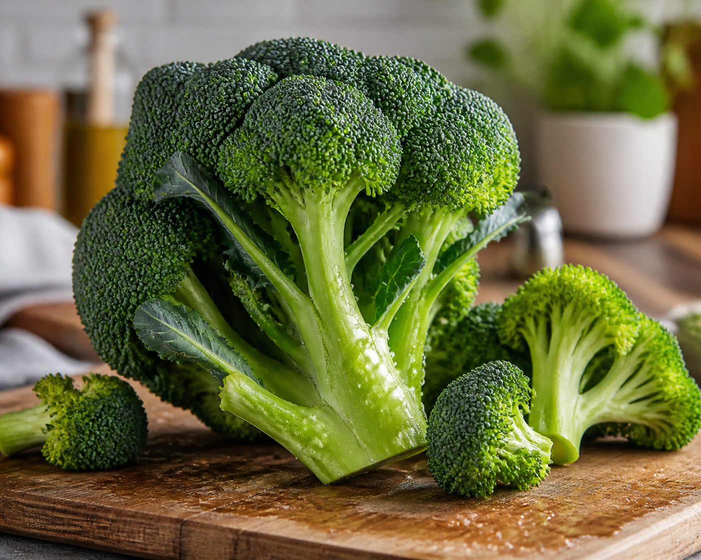

*▲ 브로콜리(Brassica oleracea var. italica)는 글루코시놀레이트가 많아 씹거나 썰 때 설포라판(Sulforaphane)이 생기는 십자화과 채소입니다. 영양 수치는 USDA FoodData Central FDC 170379(생것) 기준입니다.*

한 줄 결론 <strong>브로콜리 100g은 34kcal, 비타민C 89.2mg, 비타민K 101.6mcg입니다.</strong> 설포라판은 데치는 시간이 길수록 줄어들어 3~5분 이내가 적당하고, 다진 뒤 5~10분 두었다 조리하면 활성 성분이 더 남습니다.

지중해 동북부가 원산지인 십자화과(Brassicaceae) 채소 **브로콜리(Broccoli, *Brassica oleracea* var. *italica*)**는 비타민 C·K와 엽산, 식이섬유가 많은 채소입니다. 설포라판 성분이 연구되면서 관심이 커졌지만, 암 예방 효과가 사람에서 확립된 것은 아닙니다.

꽃봉오리와 줄기에는 비타민 C, 비타민 K, 엽산과 함께 황 화합물인 글루코시놀레이트(Glucosinolate)가 들어 있습니다. 이 전구체는 씹거나 썰 때 활성화되는 미로시나아제(Myrosinase)와 만나 **설포라판(Sulforaphane)**으로 전환됩니다.

브로콜리의 영양 성분과, 연구에서 보고된 범위의 건강 효과, 유효 성분 손실을 줄이는 조리법을 정리합니다. 효과는 사람 대상 연구에서 어디까지 확인됐는지를 함께 적었습니다.

---

## 1. 브로콜리 칼로리와 영양성분은? (비타민C 89.2mg·비타민K 101.6mcg)

미국 농무부(USDA FoodData Central) 생 브로콜리 100g 기준 주요 영양소는 다음과 같습니다.

| 영양 성분 | 100 g당 함량 | 미국 %DV |
| :--- | ---: | ---: |
| 열량 | 34 kcal | 기준치 없음 |
| 수분 | 89.3 g | 기준치 없음 |
| 탄수화물 | 6.64 g | 2.4% |
| 식이섬유 | 2.6 g | 9.3% |
| 당류 | 1.7 g | 기준치 없음 |
| 단백질 | 2.82 g | 별도 표기¹ |
| 지방 | 0.37 g | 0.5% |
| **글루코라파닌(설포라판 전구체)** | **20~70 mg** | 기준치 없음 |
| 비타민 C | 89.2 mg | 99.1% |
| 비타민 K | 101.6 µg | 84.7% |
| 엽산 (비타민 B9) | 63 µg | 15.8% |
| 칼륨 | 316 mg | 6.7% |
| 칼슘 | 47 mg | 3.6% |

### 1회 섭취량 환산: 브로콜리 한 송이·한 접시는 몇 kcal인가?

브로콜리는 100g을 한 번에 먹지 않습니다. USDA 1회 섭취량 자료의 무게로 환산했습니다.

| 섭취 단위 | 가식부 무게 | 열량 | 단백질 |
| :--- | :--- | :--- | :--- |
| 작은 송이 1개 | 31 g | 10.5 kcal | 0.87 g |
| 다진 것 한 컵 | 91 g | 30.9 kcal | 2.57 g |
| 중간 줄기 1개 | 151 g | 51.3 kcal | 4.26 g |
| 데친 것 한 접시 | 100 g | 34 kcal | 2.82 g |

*※ 익히면 수분이 빠져 같은 무게의 열량이 조금 올라가지만, 실제 접시에 담기는 양은 줄어듭니다. 설포라판을 살리려면 3분 이내로 데치고 물은 적게 쓰십시오.*

**표 읽는 법.** 미국 %DV는 생것 100 g이 [FDA 일일기준치](https://www.fda.gov/food/nutrition-facts-label/how-understand-and-use-nutrition-facts-label)의 몇 퍼센트인지 보여줍니다. ‘기준치 없음’은 성분이 없다는 뜻이 아닙니다. ¹ 단백질은 일반 식품 영양표시 관행에 따라 g으로 표시했습니다.

*데이터 출처: [USDA FoodData Central FDC 170379](https://fdc.nal.usda.gov/food-details/170379/nutrients) — Broccoli, raw. 글루코라파닌 함량은 품종·재배 조건에 따라 크게 달라 범위로 표기했습니다.*

---

## 2. 브로콜리 효능은 무엇일까? 과학으로 입증된 4대 효과

### ① Nrf2 경로와 항산화 효소 유도 — 세포·동물 실험 근거
설포라판은 세포와 동물 모델에서 **Nrf2** 전사 인자를 활성화해 글루타치온, 헴옥시게나제-1(HO-1) 같은 항산화 효소 생성을 늘리는 것으로 보고됐습니다. 사람에서 이 효과가 질병을 줄이는지까지 확인된 것은 아니며, '체내 독소를 배출한다'는 표현은 검증된 바 없습니다.

### ② 헬리코박터 파일로리 — 소규모 연구 단계
시험관 실험에서 설포라판이 **헬리코박터 파일로리**에 항균 작용을 보인다는 보고가 있고, 브로콜리 새싹을 먹인 소규모 임상시험에서 헬리코박터 표지가 다소 감소했다는 결과도 있습니다. 다만 연구 규모가 작고 재현이 충분하지 않아, 제균 치료를 대신할 수 없습니다. 위 증상이 있으면 검사와 표준 치료를 먼저 받으십시오.

### ③ 혈관 염증 — 기전 연구 수준
설포라판과 플라보노이드(케르세틴, 켐페롤)는 세포 실험에서 NF-κB 신호와 산화 스트레스를 줄이는 방향으로 보고됐습니다. 사람에서 브로콜리 섭취가 동맥경화나 혈전을 줄인다는 임상 결과는 아직 없습니다. 비타민 K 101.6µg(성인 기준치의 약 85%)은 혈액 응고 인자 합성에 필요합니다.

### ④ 혈당 — 한 소규모 시험의 결과, 일반화는 이르다
스웨덴 룬드 대학 연구팀이 비만한 제2형 당뇨 환자를 대상으로 한 소규모 시험에서 농축 설포라판 추출물이 일부 지표를 개선했다는 보고가 있습니다. 참가자 수가 적고 결과가 일관되지 않아, 브로콜리를 먹으면 혈당이 내려간다고 일반화할 수 없습니다. 식이섬유는 식후 혈당 상승을 완만하게 하는 데 도움이 됩니다.

---

## 3. 브로콜리는 몇 분 데쳐야 할까? 설포라판 흡수율 높이는 법

설포라판 생성량은 조리 방식에 따라 크게 달라집니다. 연구마다 차이가 커서 특정 배수로 단정하기는 어렵습니다.

1. **끓는 물 데치기 금지, 3~4분 스팀 찜 조리:**
   - 브로콜리를 물에 넣고 끓이면 열에 약한 미로시나아제 효소가 1분 이내에 불활성화되고 수용성 비타민 C와 설포라판이 조리수에 전부 용출됩니다. 찜기에서 김이 오른 후 **3~4분간만 살짝 찌는 것(Steaming)**이 미로시나아제 활성을 보존하고 설포라판 생성을 최대화하는 골든 룰입니다.
2. **조리 전 30분 '썰어두기(Hack and Hold)' 기법:**
   - 브로콜리를 먹기 좋은 크기로 자른 후 실온에 30분에서 90분 정도 방치하면, 손상된 세포 조직에서 미로시나아제 효소와 글루코라파닌이 결합하여 조리 전에 이미 다량의 설포라판이 미리 생성됩니다.
3. **겨자·와사비·무순과의 시너지 배합:**
   - 조리 중 미로시나아제가 일부 손실됐더라도, 생겨자·와사비·무순·홀그레인 머스터드 등 다른 십자화과 식물의 미로시나아제를 곁들이면 설포라판 생성이 늘어난다는 연구가 있습니다.

---

## 4. 브로콜리 부작용과 갑상선 주의점은?

브로콜리는 대부분의 사람에게 문제가 없는 식품이지만, 특정 조건에서는 섭취 방식을 조절할 필요가 있습니다.

- **갑상선 기능 저하증 환자의 과다 생식 주의:** 십자화과 채소에는 요오드 흡수를 방해할 수 있는 고이트로겐 물질이 미량 들어 있습니다. 요오드 섭취가 충분한 일반인에서는 통상적인 섭취량으로 문제가 보고된 바 없지만, 갑상선 기능 저하증이 있다면 생브로콜리즘을 대량으로 마시는 습관은 피하고 주치의와 상의하십시오.
- **비타민 K와 와파린 항응고제 상호작용:** 브로콜리 100g에는 일일 권장량의 85%에 이르는 비타민 K가 함유되어 있습니다. 혈전 치료를 위해 와파린 등 항응고제를 복용 중인 환자는 급격한 섭취량 변동을 피하고 주치의와 상담해야 합니다.
- **소화기 가스 및 복부 팽만:** 불용성 섬유질과 복합 다당류(라피노오스)가 풍부하여 평소 위장이 약하거나 과민대장증후군이 있는 경우 과다 섭취 시 가스 생성이 늘어날 수 있으므로 충분히 익혀서 천천히 양을 늘려야 합니다.

---

## 5. 브로콜리 하루 얼마나 먹을까? 핵심 요약

브로콜리는 비타민 C·K, 엽산, 식이섬유를 한 번에 채우기 좋은 채소입니다. 설포라판의 질병 예방 효과는 사람에서 아직 확립되지 않았습니다.

- **하루 섭취량:** 브로콜리에 별도 공식 권장량은 없습니다. 채소를 하루 500g 안팎 먹는 것을 목표로 할 때 100~150g을 한 끼 반찬으로 쓰는 정도가 무난합니다.
- **영양 버리지 않는 줄기 섭취:** 꽃송이보다 줄기 부위에 식이섬유와 비타민 C 함량이 오히려 더 풍부하므로, 질긴 겉껍질만 살짝 벗겨내어 함께 조리해 드시는 것이 좋습니다.
- **최상의 섭취 루틴:** 잘게 썬 브로콜리를 30분간 실온에 두었다가 찜기에 3분간 가볍게 찐 후, 올리브 오일과 홀그레인 머스터드를 곁들여 섭취하세요.

---

## 6. 브로콜리와 함께 먹으면 좋은 음식은?

- **[마늘 (Garlic)]({{ site.baseurl }}/posts/garlic-nutrition-benefits/)**: 마늘에 풍부한 유기황 화합물과 셀레늄이 브로콜리의 설포라판(Sulforaphane)과 상호작용하여 간 해독 2단계 효소(글루타치온-S-전이효소)를 강력하게 유도합니다.
- **[토마토 (Tomato)]({{ site.baseurl }}/posts/tomato-nutrition-benefits/)**: 토마토의 리코펜과 브로콜리의 설포라판은 각각 다른 항산화 경로를 다루는 성분으로, 함께 먹으면 영양 균형에 도움이 됩니다. '항암 시너지'가 사람에서 증명된 것은 아닙니다.
- **[연어 (Salmon)]({{ site.baseurl }}/posts/salmon-nutrition-benefits/)**: 브로콜리의 비타민 K와 연어의 비타민 D는 뼈 건강에 필요한 영양소입니다. 다만 이 조합이 골다공증을 예방한다고 단정할 수는 없습니다.
- **[아스파라거스 (Asparagus)](/posts/asparagus-nutrition-benefits/):** 브로콜리의 설포라판과 아스파라거스의 글루타치온으로 2상 해독 경로를 함께 활성화할 수 있습니다.

---

## 7. 자주 묻는 질문 (FAQ)

### Q1. 브로콜리를 조리할 때 설포라판 파괴를 막는 가장 이상적인 방법은?
**A:** 끓는 물에 오래 삶지 말고 찜기에 올려 1~3분간 가볍게 찌는 편이 좋습니다. 미로시나아제(Myrosinase)는 열에 약하므로, 조리 후 고추냉이나 겨자 같은 생 십자화과 양념을 곁들이면 설포라판 생성이 늘어난다는 연구가 있습니다.

### Q2. 브로콜리 줄기 부분도 버리지 않고 먹는 것이 영양상 이득인가요?
**A:** 줄기에도 식이섬유와 칼슘, 비타민 C가 들어 있어 버릴 이유가 없습니다. 단단한 겉껍질만 벗겨 얇게 썰어 조리하면 됩니다. 다만 ‘꽃송이보다 더 많다’는 정도는 품종과 부위에 따라 달라 단정하기 어렵습니다.

### Q3. 갑상선 질환 환자가 브로콜리를 섭취하면 요오드 흡수가 저해되나요?
**A:** 요오드를 충분히 먹는 일반인이라면 통상적인 섭취량으로 문제가 보고된 바 없습니다. 고이트로겐은 가열하면 상당 부분 줄어들지만, 갑상선 기능 저하증이 있다면 생브로콜리즙을 대량으로 마시지 말고 주치의와 상의하십시오.

  
📌 관련 순위 가이드

  <ul>
    <li><a href="/posts/low-calorie-high-satiety-foods/">저칼로리 포만감 다이어트 음식 TOP 10: 100g 비교</a></li>
    <li><a href="/posts/low-gi-foods-blood-sugar-guide/">혈당 낮추는 음식 TOP 10: 저혈당 지수(GI) 순위표</a></li>
  </ul>

