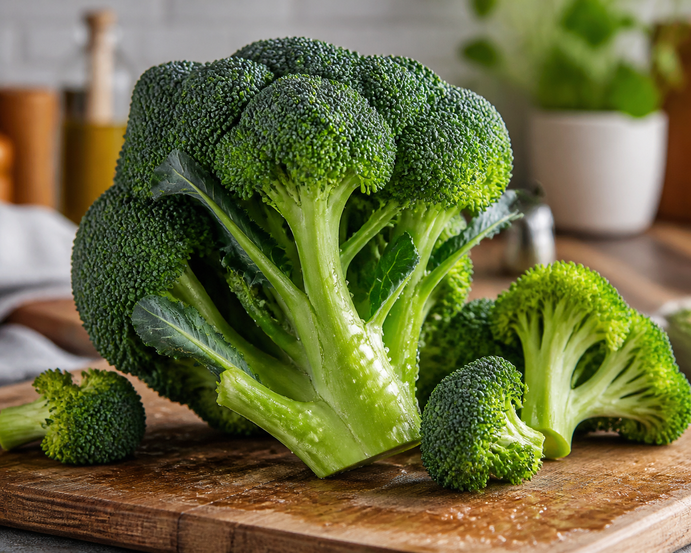

*▲ 신선한 브로콜리(Brassica oleracea var. italica)는 십자화과 채소의 대표 주자로, 강력한 세포 해독 및 항염증 생리활성 물질인 설포라판(Sulforaphane)의 천연 보고입니다.*

지중해 동북부가 원산지인 십자화과(Brassicaceae) 채소 **브로콜리(Broccoli, *Brassica oleracea* var. *italica*)**는 미국 국립암연구소(NCI)와 유수 의학계가 가장 주목해 온 천연 기능성 식품 중 하나입니다.

특유의 오밀조밀한 꽃봉오리와 줄기 속에는 비타민 C, 비타민 K, 엽산뿐만 아니라 식물성 황 화합물인 글루코시놀레이트(Glucosinolate)가 풍부하게 농축되어 있습니다. 이 전구체는 씹거나 절단할 때 활성화되는 미로시나아제(Myrosinase) 효소와 만나 강력한 해독 물질인 **설포라판(Sulforaphane)**으로 전환됩니다.

오늘은 존스홉킨스 의과대학을 비롯한 최신 임상 생화학 연구를 바탕으로, 브로콜리의 영양 성분 구성과 과학적으로 검증된 4대 건강 효능, 그리고 유효 성분 파괴를 막는 최적의 조리법을 완벽하게 정리해 드립니다.

---

## 1. 브로콜리의 핵심 영양 성분표 (생것 100g 기준)

미국 농무부(USDA FoodData Central) 공인 분석 기준, 생 브로콜리 100g당 함유된 주요 영양소와 생리활성 미량 성분 함량은 다음과 같습니다.

| 영양 성분 | 100 g당 함량 | 미국 %DV |
| :--- | ---: | ---: |
| 열량 | 34 kcal | 기준치 없음 |
| 수분 | 89.3 g | 기준치 없음 |
| 탄수화물 | 6.64 g | 2.4% |
| 식이섬유 | 2.6 g | 9.3% |
| 당류 | 1.7 g | 기준치 없음 |
| 단백질 | 2.82 g | 별도 표기¹ |
| 지방 | 0.37 g | 0.5% |
| **글루코라파닌(설포라판 전구체)** | **20~70 mg** | 기준치 없음 |
| 비타민 C | 89.2 mg | 99.1% |
| 비타민 K | 101.6 µg | 84.7% |
| 엽산 (비타민 B9) | 63 µg | 15.8% |
| 칼륨 | 316 mg | 6.7% |
| 칼슘 | 47 mg | 3.6% |

**표 읽는 법.** 미국 %DV는 생것 100 g이 [FDA 일일기준치](https://www.fda.gov/food/nutrition-facts-label/how-understand-and-use-nutrition-facts-label)의 몇 퍼센트인지 보여줍니다. ‘기준치 없음’은 성분이 없다는 뜻이 아닙니다. ¹ 단백질은 일반 식품 영양표시 관행에 따라 g으로 표시했습니다.

*데이터 출처: USDA FoodData Central & Johns Hopkins University Chemoprotection Center.*

---

## 2. 과학적으로 입증된 브로콜리의 4대 건강 효능

### ① Nrf2 경로 활성화를 통한 세포 항산화 및 해독 유도
브로콜리의 설포라판은 인체 세포 내부의 2단계 해독 효소를 자극하는 가장 강력한 천연 유도체입니다. 세포 내 **Nrf2(Nuclear factor erythroid 2-related factor 2)** 전사 인자를 활성화하여 글루타치온(Glutathione), 헴옥시게나제-1(HO-1) 등 체내 자가 항산화 효소 군단을 폭발적으로 합성시킵니다.

이는 외부에서 투입되는 일회성 항산화제와 달리, 세포 스스로 활성산소와 발암성 독성 물질을 수일간 지속적으로 중화·배출하게 만드는 근본적인 세포 방어 메커니즘을 구축합니다.

### ② 위점막 보호 및 헬리코박터 파일로리균 증식 억제
설포라판 성분은 위궤양과 만성 위염, 위암의 주요 원인균인 **헬리코박터 파일로리(Helicobacter pylori)** 균주에 대해 직접적인 항균 작용을 발휘합니다.

존스홉킨스 의과대학의 임상 시험에 따르면, 매일 브로콜리 새싹 분말을 섭취한 피험자군은 위점막의 감염 지수와 염증성 사이토카인 수치가 현저히 감소했습니다. 항생제 내성 균주에 대해서도 우수한 세포 보호 및 항염 효과를 나타내는 것으로 보고되었습니다.

### ③ 심혈관 내피세포 염증 완화 및 동맥 건강 보호
브로콜리에 풍부한 설포라판과 플라보노이드(케르세틴, 켐페롤)는 동맥경화의 시발점이 되는 혈관 내피세포의 염증 반응을 직접 차단합니다.

혈관 염증성 신호 전달 체계인 NF-κB를 억제하고 혈전 형성을 억제함으로써 동맥벽의 산화 스트레스를 경감시킵니다. 또한 100g당 101.6µg에 달하는 비타민 K는 칼슘이 혈관벽에 침착되는 석회화 현상을 방어하여 혈관 탄력성을 정상적으로 유지하는 데 기여합니다.

### ④ 포도당 대사 조절 및 제2형 당뇨 완화 지원
스웨덴 룬드 대학교(Lund University) 당뇨병 센터의 유전자 분석 및 임상 시험에 따르면, 농축된 설포라판 추출물을 복용한 제2형 당뇨 환자군은 간의 과도한 포도당 신생 합성(Gluconeogenesis)이 억제되어 공복 혈당과 당화혈색소(HbA1c) 수치가 유의미하게 개선되었습니다.

또한 브로콜리의 풍부한 식이섬유는 장내 유익균의 먹이가 되는 프리바이오틱스로 작용하여 장벽 기능을 강화하고 인슐린 감수성을 향상시킵니다.

---

## 3. 영양소 흡수율을 극대화하는 조리 및 섭취 가이드

브로콜리의 핵심 성분인 설포라판은 조리 방식에 따라 체내 생성량과 흡수율이 최대 5배 이상 차이납니다.

1. **끓는 물 데치기 금지, 3~4분 스팀 찜 조리:**
   - 브로콜리를 물에 넣고 끓이면 열에 약한 미로시나아제 효소가 1분 이내에 불활성화되고 수용성 비타민 C와 설포라판이 조리수에 전부 용출됩니다. 찜기에서 김이 오른 후 **3~4분간만 살짝 찌는 것(Steaming)**이 미로시나아제 활성을 보존하고 설포라판 생성을 최대화하는 골든 룰입니다.
2. **조리 전 30분 '썰어두기(Hack and Hold)' 기법:**
   - 브로콜리를 먹기 좋은 크기로 자른 후 실온에 30분에서 90분 정도 방치하면, 손상된 세포 조직에서 미로시나아제 효소와 글루코라파닌이 결합하여 조리 전에 이미 다량의 설포라판이 미리 생성됩니다.
3. **겨자·와사비·무순과의 시너지 배합:**
   - 조리 중 미로시나아제 효소가 일부 손실되었더라도, 생겨자·와사비·무순·홀그레인 머스터드 등 다른 십자화과 식물에 든 미로시나아제를 함께 곁들이면 체내 설포라판 전환율이 급격히 회복됩니다.

---

## 4. 섭취 시 주의사항 및 부작용

브로콜리는 세계적으로 안전한 식품이나, 특수한 신체 조건에서는 섭취 방식의 조절이 필요합니다.

- **갑상선 기능 저하증 환자의 과다 생식 주의:** 십자화과 채소에는 요오드 흡수를 방해할 수 있는 고이트로겐(Goitrogen) 물질이 미량 존재합니다. 일반적인 섭취량이나 살짝 익혀 조리한 경우에는 불활성화되므로 안심해도 되나, 심한 갑상선 환자는 매일 대량의 생브로콜리를 착즙해 마시는 것은 피해야 합니다.
- **비타민 K와 와파린 항응고제 상호작용:** 브로콜리 100g에는 일일 권장량의 85%에 이르는 비타민 K가 함유되어 있습니다. 혈전 치료를 위해 와파린 등 항응고제를 복용 중인 환자는 급격한 섭취량 변동을 피하고 주치의와 상담해야 합니다.
- **소화기 가스 및 복부 팽만:** 불용성 섬유질과 복합 다당류(라피노오스)가 풍부하여 평소 위장이 약하거나 과민대장증후군이 있는 경우 과다 섭취 시 가스 생성이 늘어날 수 있으므로 충분히 익혀서 천천히 양을 늘려야 합니다.

---

## 5. 최종 요약 및 실천 팁

브로콜리는 세포 자가 해독 능력을 활성화하고 위장 및 심혈관계를 종합적으로 지켜주는 자연 최고의 항산화 백신입니다.

- **일일 권장 섭취량:** 성인 기준 하루 100g~150g (꽃송이 3~5조각 및 부드러운 줄기 부분).
- **영양 버리지 않는 줄기 섭취:** 꽃송이보다 줄기 부위에 식이섬유와 비타민 C 함량이 오히려 더 풍부하므로, 질긴 겉껍질만 살짝 벗겨내어 함께 조리해 드시는 것이 좋습니다.
- **최상의 섭취 루틴:** 잘게 썬 브로콜리를 30분간 실온에 두었다가 찜기에 3분간 가볍게 찐 후, 올리브 오일과 홀그레인 머스터드를 곁들여 섭취하세요.

---

## 6. 함께 먹으면 시너지가 폭발하는 식재료 궁합

- **[마늘 (Garlic)]({{ site.baseurl }}/posts/garlic-nutrition-benefits/)**: 마늘에 풍부한 유기황 화합물과 셀레늄이 브로콜리의 설포라판(Sulforaphane)과 상호작용하여 간 해독 2단계 효소(글루타치온-S-전이효소)를 강력하게 유도합니다.
- **[토마토 (Tomato)]({{ site.baseurl }}/posts/tomato-nutrition-benefits/)**: 토마토의 지용성 리코펜과 브로콜리의 수용성 설포라판은 인체 내 암세포 증식 경로를 다각도로 억제하는 상호 보완적 항암 시너지를 냅니다.
- **[연어 (Salmon)]({{ site.baseurl }}/posts/salmon-nutrition-benefits/)**: 브로콜리의 풍부한 칼슘과 비타민 K가 연어의 비타민 D와 결합하여 조골세포의 골기질 형성을 촉진하고 골다공증을 예방합니다.

---

## 7. 자주 묻는 질문 (FAQ)

### Q1. 브로콜리를 조리할 때 설포라판 파괴를 막는 가장 이상적인 방법은?
**A:** 끓는 물에 삶지 말고 찜기에 올려 1~3분간 가볍게 찌는 방식이 최선입니다. 미로시나아제(Myrosinase) 효소는 고열에 취약하므로 스팀 조리 후 고추냉이나 겨자, 다진 마늘을 곁들이면 설포라판 생성을 2배 이상 촉진할 수 있습니다.

### Q2. 브로콜리 줄기 부분도 버리지 않고 먹는 것이 영양상 이득인가요?
**A:** 그렇습니다. 줄기 부분에는 꽃송이보다 식이섬유와 칼슘, 비타민 C 함량이 더 높습니다. 단단한 겉껍질을 살짝 벗겨내고 얇게 썰어 조리하면 풍부한 식감과 영양소를 온전히 섭취할 수 있습니다.

### Q3. 갑상선 질환 환자가 브로콜리를 섭취하면 요오드 흡수가 저해되나요?
**A:** 생으로 매일 대량(1kg 이상) 섭취하지 않는 한 일반적인 섭취량은 안전합니다. 브로콜리의 고이트로겐(Goitrogen) 성분은 가열 조리 시 80% 이상 불활성화되므로 익혀서 섭취하면 아무런 문제가 없습니다.

