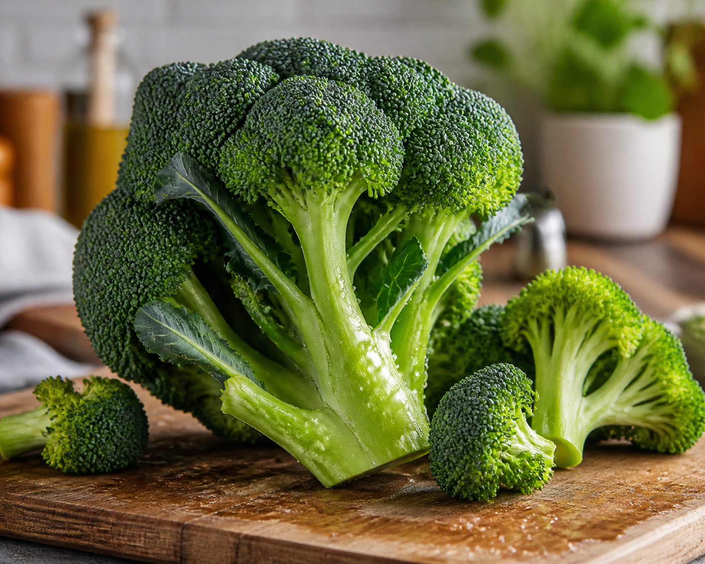

*▲ Broccoli (Brassica oleracea var. italica) is a cruciferous vegetable rich in glucoraphanin, which becomes sulforaphane when the tissue is chopped or chewed. Nutrient figures use USDA FoodData Central FDC 170379 (raw).*

Quick answer <strong>Broccoli has 34 calories, 89.2 mg vitamin C and 101.6 mcg vitamin K per 100 g.</strong> Sulforaphane formation falls as cooking time rises, so steaming for about 3 to 5 minutes, with a short rest after chopping, keeps more of it. How large that difference is varies between studies, so no multiple is claimed.

Native to the northeastern Mediterranean, **broccoli (*Brassica oleracea* var. *italica*)** is a common cruciferous vegetable, high in vitamin C, vitamin K, folate and fibre. Sulforaphane has attracted research interest, but a cancer-preventive effect in humans has not been established.

Along with ascorbic acid and phylloquinone, broccoli contains sulfur-rich glucosinolates, mainly **glucoraphanin**. Chewing or cutting releases plant **myrosinase**, which converts glucoraphanin into the isothiocyanate **sulforaphane**.

This guide covers the nutrient profile, the effects reported in research with a note on how far human trials go, and cooking methods that limit sulforaphane loss.

---

## 1. How Long Should You Steam Broccoli to Keep Sulforaphane?

Synthesized from empirical spectroscopic assays cataloged in the United States Department of Agriculture (USDA) FoodData Central, the comprehensive macronutrient and micronutrient density per 100-gram raw edible portion comprises:

| Nutrient | Per 100 g | U.S. %DV |
| :--- | ---: | ---: |
| Energy | 34.0 kcal (142 kJ) | No DV |
| Moisture Content | 89.30 g | No DV |
| Total Carbohydrates | 6.64 g | 2.4% |
| Dietary Fiber | 2.60 g | 9.3% |
| Free Sugars | 1.70 g | No DV |
| Crude Protein | 2.82 g | See note¹ |
| Total Lipids (Fat) | 0.37 g | 0.5% |
| **Glucoraphanin (Precursor)** | **20.0 - 70.0 mg** | No DV |
| Vitamin C (Ascorbic Acid) | 89.20 mg | 99.1% |
| Vitamin K (Phylloquinone) | 101.60 µg | 84.7% |
| Folate (Vitamin B9) | 63.00 µg | 15.8% |
| Potassium | 316.00 mg | 6.7% |
| Calcium | 47.00 mg | 3.6% |

### What one spear, one stalk and one cup deliver

Nobody eats broccoli by the 100 g. Weights below are USDA portion weights.

| Portion | Edible weight | Energy | Protein |
| :--- | :--- | :--- | :--- |
| 1 spear | 31 g | 10.5 kcal | 0.87 g |
| 1 cup chopped | 91 g | 30.9 kcal | 2.57 g |
| 1 stalk | 151 g | 51.3 kcal | 4.26 g |
| 1 side-dish portion, cooked | 100 g | 34 kcal | 2.82 g |

*Note: cooking drives off water, so cooked broccoli is slightly denser per gram while the pile on the plate shrinks. Blanch for three minutes or less to keep sulforaphane.*

**How to read the table.** U.S. %DV shows how much 100 g raw contributes to the [FDA Daily Value](https://www.fda.gov/food/nutrition-facts-label/how-understand-and-use-nutrition-facts-label). “No DV” means no reference value applies. ¹ Protein is shown in grams, as on most general-use U.S. food labels.

*Data source: [USDA FoodData Central FDC 170379](https://fdc.nal.usda.gov/food-details/170379/nutrients) — broccoli, raw. Glucoraphanin content varies widely by cultivar and growing conditions, so a range is given.*

---

## 2. What Are the Benefits of Broccoli? Four Evidence-Backed Effects

### 1. Nrf2 pathway activation: laboratory evidence
In cell and animal models, sulforaphane reacts with cysteine residues on Keap1, releasing **Nrf2** to move into the nucleus, where it drives transcription of antioxidant enzymes. Whether this translates into lower disease risk in people has not been shown. Claims that broccoli "flushes toxins" are not supported by measurement.

Among the enzymes induced in these models are glutathione S-transferase, NAD(P)H:quinone oxidoreductase 1 and heme oxygenase-1. Enzyme induction lasts longer than a direct antioxidant dose, but the "72 hours" figure comes from specific experiments and is not a general claim about eating broccoli.

### 2. Helicobacter pylori: small studies only
Laboratory work, including at Johns Hopkins, shows sulforaphane can inhibit *H. pylori*, including antibiotic-resistant strains, in culture. Small human trials with broccoli sprouts reported lower urease activity and bacterial load, but the studies were small, largely single-centre and not consistently replicated. Broccoli cannot replace eradication therapy; anyone with stomach symptoms needs testing and standard treatment.

### 3. Blood vessels: mechanism studies, not outcomes
In cell models, sulforaphane and the flavonols kaempferol and quercetin reduce NF-κB inflammatory signalling and oxidative stress in endothelial cells. No human trial shows that eating broccoli reduces atherosclerosis or thrombosis. Vitamin K (101.6 µg per 100 g, about 85% of the adult reference intake) activates matrix Gla protein, which inhibits vascular calcification; that is a function of adequate vitamin K, not a proven benefit of extra broccoli.

### 4. Blood glucose: one small trial, not a general effect
Research from Lund University, published in *Science Translational Medicine*, identified sulforaphane as a modulator of hepatic gluconeogenesis gene expression in type 2 diabetes. In a small randomised trial of concentrated broccoli sprout extract in people with obesity and type 2 diabetes, HbA1c fell in a subgroup; results were not consistent across all participants, and the preparation was a concentrated extract rather than a portion of vegetables. Eating broccoli is not a treatment for diabetes. Its fibre does help blunt post-meal glucose rises.

---

## 3. Storing and Portioning Broccoli

The clinical efficacy and therapeutic bioassimilation of broccoli-derived phytochemicals depend profoundly upon culinary heating kinetics and food preparation matrices.

1. **Light Steaming (3 to 4 Minutes) Preserves Myrosinase:**
   - Boiling inactivates most myrosinase within about a minute and leaches water-soluble vitamin C and glucosinolates into the water. Steaming for 3 to 4 minutes keeps more myrosinase active, so more sulforaphane can form.
2. **The "Hack and Hold" Pre-Preparation Technique:**
   - Mechanically dicing raw broccoli florets and stems into small 1-centimeter segments and allowing them to rest at ambient room temperature for 30 to 45 minutes prior to thermal exposure induces extensive cellular disruption. This latency period allows plant myrosinase to hydrolyze glucoraphanin into stable sulforaphane before any subsequent culinary heat application occurs.
3. **Exogenous Myrosinase Pairing (Mustard Seed Synergism):**
   - If broccoli has been boiled or over-steamed, adding cold-ground mustard seed powder, fresh wasabi, raw daikon or arugula supplies myrosinase from another plant, which raises sulforaphane formation. The size of the increase depends on the amount used and the study, so no percentage is claimed.

---

## 4. Who Should Avoid Broccoli? Side Effects and Cautions

Broccoli is safe for most people, but some groups should take care:

- **Thyroid Function and Goitrogenic Glucosinolates:** Cruciferous plants contain trace progoitrins which can competitively inhibit thyroidal iodine organification under extreme iodine-deficient conditions. While moderate culinary intake presents negligible risk, individuals diagnosed with severe hypothyroidism should avoid consuming excessive daily volumes of raw, uncooked juiced brassicas.
- **Phylloquinone Interactions with Warfarin Anticoagulation:** Because a 100-gram portion supplies nearly 85% of the daily Vitamin K recommendation, individuals prescribed coumarin anticoagulants (e.g., Warfarin) must maintain consistent weekly dietary intake to avoid precipitous alterations in target INR parameters.
- **Gastrointestinal Gas and Fermentation:** High concentrations of non-digestible oligosaccharides (raffinose) and prebiotic soluble fiber can trigger transient abdominal distention or flatulence in individuals presenting with irritable bowel syndrome (IBS); gradual dietary titration and thermal softening alleviate these symptoms.

---

## 5. Broccoli per Day: How Much Do You Need?

Broccoli is a convenient way to add vitamin C, vitamin K, folate and fibre to a meal. Its disease-prevention effects in humans are not established.

- **How much:** there is no official broccoli recommendation. If you aim for around 500 g of vegetables a day, 100 to 150 g of broccoli as one serving fits easily.
- **Utilize Stems and Stalks:** The fibrous stalk exhibits comparable or superior ascorbic acid and soluble fiber density relative to floral buds; peel tough outer skins and dice stalks finely alongside florets.
- **Practical routine:** dice fresh broccoli, rest 30 minutes, steam gently for about 3 minutes, and dress with olive oil and mustard. The rest and the mustard support sulforaphane formation; the oil helps with fat-soluble vitamins.

---

## 6. Storing and Portioning Broccoli

- **[Garlic]({{ site.baseurl }}/en/posts/garlic-nutrition-benefits/)**: Garlic supplies organosulfur compounds and selenium, nutrients involved in the same antioxidant pathways studied for sulforaphane. The pair has not been shown to prevent disease.
- **[Tomato]({{ site.baseurl }}/en/posts/tomato-nutrition-benefits/)**: Tomato lycopene and broccoli isothiocyanates act through different antioxidant pathways, so the pair broadens nutrient coverage. A combined anti-cancer effect in humans has not been demonstrated.
- **[Salmon]({{ site.baseurl }}/en/posts/salmon-nutrition-benefits/)**: Broccoli supplies vitamin K and salmon supplies vitamin D, both needed for bone health. That combination is not a proven osteoporosis preventive.

---

## 7. Frequently Asked Questions (FAQ)

### Q1. What is the optimal culinary preparation to preserve sulforaphane in broccoli?
**A:** Steaming for 1 to 3 minutes keeps more of the heat-sensitive myrosinase active than boiling does. Adding myrosinase-rich condiments such as mustard seed powder or fresh wasabi after cooking increases sulforaphane formation, though the size of the increase varies with how much you add.

### Q2. Should broccoli stems be consumed alongside the florets for nutritional value?
**A:** Yes. Stalks contain fibre, calcium and vitamin C and need not be discarded; peel the tough outer layer and slice them. Whether they contain more than the florets depends on the cultivar and the part measured.

### Q3. Does broccoli consumption interfere with thyroid endocrine function in patients with goiter?
**A:** With adequate iodine intake, ordinary servings have not been linked to thyroid problems. Cooking reduces a large share of goitrogens, but if you have hypothyroidism, avoid large volumes of raw brassica juice and ask your clinician.

  
📌 Related ranking guide

  <ul>
    <li><a href="/en/posts/low-calorie-high-satiety-foods/">Top 10 Low-Calorie High-Satiety Foods: 100g Calories</a></li>
    <li><a href="/en/posts/low-gi-foods-blood-sugar-guide/">Top 10 Low-GI Foods to Lower Blood Sugar: GI and GL Chart</a></li>
    <li><a href="/en/posts/asparagus-nutrition-benefits/">Asparagus Nutrition: 20 Calories, Folate, Inulin, Glutathione</a></li>
  </ul>

