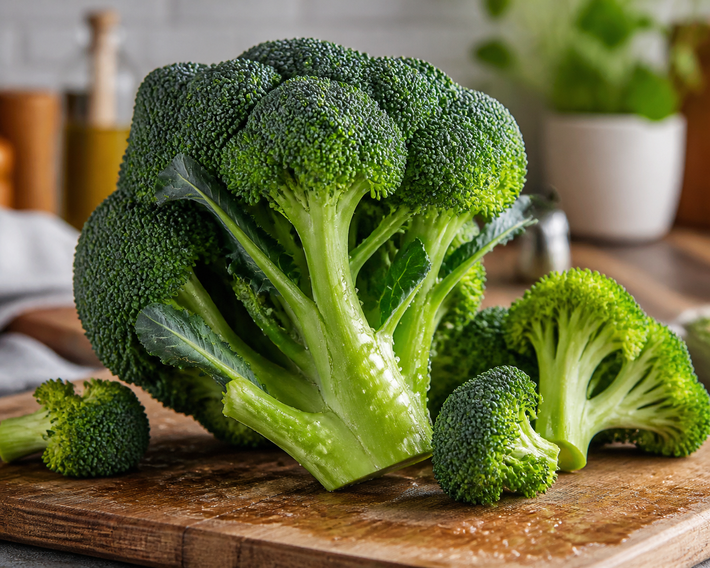

*▲ Fresh broccoli (Brassica oleracea var. italica) represents the quintessential cruciferous superfood, functioning as the premier dietary reservoir of glucoraphanin and enzymatically derived sulforaphane.*

Indigenous to the northeastern Mediterranean basin, the cruciferous vegetable **Broccoli (*Brassica oleracea* var. *italica*)** occupies a preeminent position within modern clinical nutrition and chemoprotective medicine.

Beyond its favorable macronutrient composition and high micronutrient density (particularly ascorbic acid and phylloquinone), broccoli contains elevated concentrations of sulfur-rich glucosinolates, predominantly **glucoraphanin**. Upon cellular mastication or mechanical shearing, this precursor undergoes rapid enzymatic hydrolysis mediated by plant-derived **myrosinase** (thioglucoside glucohydrolase), yielding the potent electrophilic isothiocyanate known as **sulforaphane**.

This peer-reviewed nutritional monograph provides an exhaustive biochemical breakdown of broccoli's nutrient density, evaluates four clinically validated therapeutic mechanisms across human randomized controlled trials, and outlines precision culinary strategies to optimize sulforaphane bioavailability.

---

## 1. Complete Nutritional Composition (Per 100g Raw Portion)

Synthesized from empirical spectroscopic assays cataloged in the United States Department of Agriculture (USDA) FoodData Central, the comprehensive macronutrient and micronutrient density per 100-gram raw edible portion comprises:

| Nutrient | Per 100 g | U.S. %DV |
| :--- | ---: | ---: |
| Energy | 34.0 kcal (142 kJ) | No DV |
| Moisture Content | 89.30 g | No DV |
| Total Carbohydrates | 6.64 g | 2.4% |
| Dietary Fiber | 2.60 g | 9.3% |
| Free Sugars | 1.70 g | No DV |
| Crude Protein | 2.82 g | See note¹ |
| Total Lipids (Fat) | 0.37 g | 0.5% |
| **Glucoraphanin (Precursor)** | **20.0 - 70.0 mg** | No DV |
| Vitamin C (Ascorbic Acid) | 89.20 mg | 99.1% |
| Vitamin K (Phylloquinone) | 101.60 µg | 84.7% |
| Folate (Vitamin B9) | 63.00 µg | 15.8% |
| Potassium | 316.00 mg | 6.7% |
| Calcium | 47.00 mg | 3.6% |

**How to read the table.** U.S. %DV shows how much 100 g raw contributes to the [FDA Daily Value](https://www.fda.gov/food/nutrition-facts-label/how-understand-and-use-nutrition-facts-label). “No DV” means no reference value applies. ¹ Protein is shown in grams, as on most general-use U.S. food labels.

*Data Source: USDA FoodData Central & Johns Hopkins University Chemoprotection Center.*

---

## 2. Four Clinically Validated Physiological Health Benefits

### 1. Robust Nrf2-ARE Upregulation and Phase-II Enzymatic Detoxification
Sulforaphane stands recognized as the most potent naturally occurring inducer of the mammalian **Nrf2 (Nuclear factor erythroid 2-related factor 2)** cytoprotective signaling cascade. Under basal physiologic conditions, Nrf2 remains sequestered in the cytoplasm by actin-bound Keap1 protein. Upon cellular entry, sulforaphane reacts with critical cysteine residues on Keap1, facilitating Nrf2 dissociation and nuclear translocation.

Within the nucleus, Nrf2 binds to Antioxidant Response Elements (ARE), upregulating transcription of de novo endogenous antioxidant enzymes including glutathione S-transferase (GST), NAD(P)H:quinone oxidoreductase 1 (NQO1), and heme oxygenase-1 (HO-1). Unlike exogenous non-enzymatic antioxidants (e.g., Vitamin E or C), which are rapidly expended in 1:1 stoichiometric reactions, sulforaphane-mediated phase-II enzyme induction establishes sustained catalytic cellular defenses persisting for up to 72 hours.

### 2. Suppression of Helicobacter pylori Colonization and Gastric Mucosal Cytoprotection
Chronic gastrointestinal colonization by *Helicobacter pylori* represents a principal etiological factor in atrophic gastritis, peptic ulceration, and gastric adenocarcinoma. Pharmacological studies conducted at the Johns Hopkins University School of Medicine revealed that sulforaphane demonstrates bactericidal potency against both extracellular and intracellular antibiotic-resistant strains of *H. pylori*.

In controlled clinical trials, daily dietary supplementation with glucoraphanin-rich broccoli sprout bioactives significantly suppressed urease biomarker activity, decreased bacterial density in gastric biopsies, and attenuated systemic circulating pro-inflammatory interleukin concentrations (TNF-alpha and IL-8).

### 3. Vascular Endothelial Anti-Inflammatory Signaling and Arterial Compliance
Atherogenesis initiates primarily via localized endothelial oxidative stress and subsequent leukocyte recruitment. Broccoli's unique synergy of bioactive isothiocyanates and flavonol glycosides (kaempferol and quercetin) suppresses the canonical NF-κB inflammatory pathway within vascular endothelial tissue.

Concurrently, sulforaphane prevents hyperglycemia-induced endothelial microvascular damage by downregulating mitochondrial reactive oxygen species (ROS) overproduction. Furthermore, with 101.6 µg of phylloquinone per 100 grams, dietary broccoli activates matrix Gla protein (MGP), an indispensable vascular calcification inhibitor, preserving arterial wall compliance and elastance.

### 4. Hepatic Gluconeogenesis Attenuation and Glycemic Modulation
 ग्राउंडbreaking translational research published in *Science Translational Medicine* by investigators at Lund University identified sulforaphane as a prime small-molecule modulator capable of reversing the genetic signature of hepatic gluconeogenesis in type 2 diabetes mellitus.

In double-blind, placebo-controlled human intervention trials, patients receiving concentrated broccoli extract exhibited statistically significant reductions in fasting plasma glucose and glycated hemoglobin (HbA1c) compared to baseline controls. Concurrently, broccoli's soluble and insoluble fiber fractions enhance prebiotic microbial fermentation, augmenting short-chain fatty acid (SCFA) synthesis and elevating systemic peripheral insulin sensitivity.

---

## 3. Culinary Preparation and Sulforaphane Bioavailability Maximization

The clinical efficacy and therapeutic bioassimilation of broccoli-derived phytochemicals depend profoundly upon culinary heating kinetics and food preparation matrices.

1. **Light Steaming (3 to 4 Minutes) Preserves Myrosinase:**
   - Water immersion boiling rapidly thermal-denatures the heat-labile myrosinase enzyme within 60 seconds while leaching water-soluble ascorbic acid and glucosinolates into discarded cooking liquid. Gentle steam-cooking for precisely 3 to 4 minutes preserves enzymatic viability, optimizing maximum gastrointestinal sulforaphane conversion.
2. **The "Hack and Hold" Pre-Preparation Technique:**
   - Mechanically dicing raw broccoli florets and stems into small 1-centimeter segments and allowing them to rest at ambient room temperature for 30 to 45 minutes prior to thermal exposure induces extensive cellular disruption. This latency period allows plant myrosinase to hydrolyze glucoraphanin into stable sulforaphane before any subsequent culinary heat application occurs.
3. **Exogenous Myrosinase Pairing (Mustard Seed Synergism):**
   - If broccoli has been boiled or over-steamed, adding cold-ground mustard seed powder, fresh wasabi, raw daikon radish, or arugula restores active exogenous myrosinase, dramatically rescuing sulforaphane yields by over 300% in human bioavailability assays.

---

## 4. Clinical Contraindications and Potential Adverse Effects

Although whole raw or culinary-prepared broccoli carries exceptional toxicological safety, particular clinical cohorts require tailored precautions:

- **Thyroid Function and Goitrogenic Glucosinolates:** Cruciferous plants contain trace progoitrins which can competitively inhibit thyroidal iodine organification under extreme iodine-deficient conditions. While moderate culinary intake presents negligible risk, individuals diagnosed with severe hypothyroidism should avoid consuming excessive daily volumes of raw, uncooked juiced brassicas.
- **Phylloquinone Interactions with Warfarin Anticoagulation:** Because a 100-gram portion supplies nearly 85% of the daily Vitamin K recommendation, individuals prescribed coumarin anticoagulants (e.g., Warfarin) must maintain consistent weekly dietary intake to avoid precipitous alterations in target INR parameters.
- **Gastrointestinal Gas and Fermentation:** High concentrations of non-digestible oligosaccharides (raffinose) and prebiotic soluble fiber can trigger transient abdominal distention or flatulence in individuals presenting with irritable bowel syndrome (IBS); gradual dietary titration and thermal softening alleviate these symptoms.

---

## 5. Practical Implementation and Clinical Takeaway

Integrating whole culinary broccoli into a preventative nutritional regimen confers systemic metabolic, gastrointestinal, and cellular chemoprotective advantages.

- **Optimal Clinical Target:** 100g to 150g cooked or lightly steamed florets and stems daily (approximately 1 standard culinary cup).
- **Utilize Stems and Stalks:** The fibrous stalk exhibits comparable or superior ascorbic acid and soluble fiber density relative to floral buds; peel tough outer skins and dice stalks finely alongside florets.
- **Evidence-Based Daily Protocol:** Dice fresh broccoli, rest 30 minutes, steam gently for 3 minutes, and dress with extra virgin cold-pressed olive oil, cracked black pepper, and whole-grain Dijon mustard to maximize lipophilic and isothiocyanate absorption kinetics.
