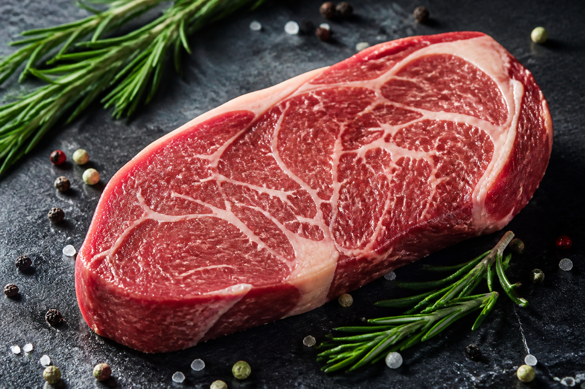

*▲ 신선한 소고기 등심(Beef Sirloin)은 완벽한 아미노산 스코어를 자랑하는 양질의 동물성 단백질이자, 고생체이용률 헴철과 세포 에너지 대사 촉진 물질의 천연 보고입니다.*

한 줄 결론 <strong>소고기 등심 100g은 201kcal, 단백질 20.3g, 헴철 1.48mg입니다.</strong> 헴철은 식물성 철분보다 흡수율이 높은 편이지만 실제 흡수량은 식사 구성과 개인 상태에 따라 달라지며, 지방을 줄이려면 눈에 보이는 지방을 다듬어 굽는 편이 좋습니다.

육류 단백질의 대표 주자이자 전 세계 미식가와 스포츠 영양학계가 가장 주목하는 식재료는 단연 **소고기 등심(Beef Sirloin)**입니다.

등심은 소의 등 부위에 위치하여 결이 곱고 마블링이 적절히 조화를 이루며, 흡수율이 비교적 높은 **헴철(Heme Iron)**, 골격근 단백질 합성을 촉발하는 분지쇄아미노산(BCAA 특히 **류신**), 그리고 세포 내 ATP 재생을 돕는 **크레아틴(Creatine)**과 지방산 연소를 유도하는 **L-카르니틴(L-Carnitine)**이 집약되어 있습니다.

식물성 식단에서 부족해지기 쉬운 헴철·비타민 B12·아연을 한 번에 채울 수 있다는 점은 영양학 연구에서 반복적으로 다뤄져 왔습니다. 다만 이 글은 특정 질병의 치료나 예방 효과를 주장하지 않습니다.

미국 농무부(USDA FoodData Central) 수치를 기준으로 소고기 등심의 영양 성분 구성과 영양학적으로 의미 있는 4가지 포인트, 그리고 영양소 손실을 줄이는 조리법을 정리합니다.

---

## 1. 소고기 등심 칼로리와 영양성분은? (단백질 20.3g·헴철 1.48mg)

미국 농무부(USDA FoodData Central, FDC 168726) 표준 공인 분석 기준, 생 소고기 등심(Top Sirloin, trimmed to 1/8" fat, all grades, raw) 100g당 함유된 주요 영양소와 생리활성 미량 성분 함량은 다음과 같습니다.

| 영양 성분 | 100 g당 함량 | 미국 %DV |
| :--- | ---: | ---: |
| 열량 | 201 kcal | 기준치 없음 |
| 수분 | 66.1 g | 기준치 없음 |
| 탄수화물 | 0 g | 0.0% |
| 식이섬유 | 0 g | 0.0% |
| 당류 | 0 g | 기준치 없음 |
| 단백질 | 20.3 g | 별도 표기¹ |
| 지방 | 12.7 g | 16.3% |
| 헴철 (생체이용 철분) | 1.48 mg | 8.2% |
| 아연 (Zinc) | 3.55 mg | 32.3% |
| 비타민 B12 (코발라민) | 1.05 µg | 43.8% |
| 비타민 B3 (나이아신) | 5.99 mg | 37.4% |
| 비타민 B6 (피리독신) | 0.55 mg | 32.4% |
| 셀레늄 | 22.9 µg | 41.6% |
| 인 (Phosphorus) | 187 mg | 15.0% |
| 칼륨 (Potassium) | 315 mg | 6.7% |

**표 읽는 법.** 미국 %DV는 생것 100 g이 [FDA 일일기준치](https://www.fda.gov/food/nutrition-facts-label/how-understand-and-use-nutrition-facts-label)의 몇 퍼센트인지 보여줍니다. ‘기준치 없음’은 성분이 없다는 뜻이 아닙니다. ¹ 단백질은 일반 식품 영양표시 관행에 따라 g으로 표시했습니다.

*데이터 출처: USDA FoodData Central (FDC ID: 168726) & National Cattlemen's Beef Association.*

---

## 2. 소고기 등심은 영양학적으로 어떤 점이 중요한가? 4가지 포인트

### ① 완전 단백질과 류신: 골격근 단백질 합성 신호
소고기 등심은 체내에서 합성되지 않는 9가지 필수 아미노산을 이상적인 비율로 공급하는 **완전 단백질(Complete Protein)**입니다. 

특히 100g당 약 1.62g에 달하는 분지쇄아미노산 **류신(Leucine)**은 세포 내 **mTORC1(mammalian Target of Rapamycin Complex 1)** 신호 경로를 자극해 근육 단백질 합성(MPS, Muscle Protein Synthesis)을 촉진하는 것으로 알려져 있습니다. 단백질 섭취량과 운동을 함께 관리할 때 근육량 유지에 도움이 된다는 연구가 있으며, 이는 근감소증 치료 효과와는 다른 이야기입니다. 류신 1.62g은 FDC 표의 아미노산 값에서 계산한 참고치입니다.

### ② 흡수율이 높은 헴철(Heme Iron)과 철 섭취
식물성 식품(시금치, 콩 등)에 들어 있는 비헴철(Non-heme Iron)은 흡수율이 대체로 낮고(식사 구성에 따라 수 %대), 피틴산이나 탄닌이 흡수를 더 떨어뜨릴 수 있습니다. 그래서 채식 위주 식단에서는 철 섭취량이 같아도 실제 흡수되는 양이 적을 수 있습니다.

소고기 등심의 철분은 포르피린 고리에 둘러싸인 **헴철(Heme Iron)** 형태로 존재해 비헴철보다 흡수가 잘 되는 것으로 보고됩니다. 다만 실제 흡수율은 개인과 식사 구성에 따라 차이가 크고, 헴철 1.48mg은 FDC 168726 표준값입니다. 철은 헤모글로빈·미오글로빈 구성 성분으로 산소 운반에 관여합니다. 철 결핍성 빈혈이 의심된다면 식품으로 해결하려 하지 말고 병원에서 진단과 치료를 먼저 받아야 합니다.

### ③ 크레아틴과 L-카르니틴: 에너지 대사에 관여하는 성분
붉은 살코기는 **크레아틴(Creatine)**과 **L-카르니틴(L-Carnitine)**을 함께 섭취할 수 있는 식품입니다.

- **크레아틴:** 골격근에서 크레아틴 인산(PCr)으로 저장되어 고강도 활동 시 ATP 재합성을 돕습니다. 고기 100g으로 얻는 크레아틴은 보충제 1회분(3~5g)보다 적다는 점도 함께 봐야 합니다.
- **L-카르니틴:** 장쇄 지방산을 미토콘드리아로 운반해 베타 산화(Beta-oxidation)에 관여합니다. 식품으로 먹는 양만으로 체지방이 줄어든다는 근거는 부족하며, 체중 감량 효과를 기대하기는 어렵습니다.

### ④ 아연과 비타민 B12: 면역과 신경 기능에 관여하는 미량 영양소
소고기 등심 100g에는 일일 권장량의 32%를 상회하는 3.55mg의 **생체이용성 아연(Zinc)**과 44%에 달하는 **비타민 B12(코발라민)**가 집약되어 있습니다.

아연은 T세포를 비롯한 면역세포의 기능과 상처 회복, 미각 유지에 관여하는 필수 미네랄입니다. 아연이 부족하면 면역 기능이 떨어질 수 있지만, 충분히 먹고 있는 사람이 더 먹는다고 면역력이 세지는 것은 아닙니다. 비타민 B12는 식물성 식품에 거의 없어 채식 위주 식단에서 부족해지기 쉬운 영양소로, 신경 수초 형성과 호모시스테인 대사에 관여합니다.

---

## 3. 소고기 등심은 어떻게 구워야 좋을까? 헴철 흡수와 지방 줄이는 법

- **마이야르 반응과 온도 제어 (과열 주의):**
  표면을 고온에서 단시간에 시어링(Searing)하여 육즙을 가두는 조리는 풍미를 극대화하지만, 200℃ 이상의 직화에서 검게 태울 경우 헤테로사이클릭아민(HCA)과 다환방향족탄화수소(PAH) 같은 발암성 변이 물질이 생성됩니다. 심부 온도(약 55~60℃)로 조리하면 과열 조리보다 수분 손실이 적고 B군 비타민 손실도 적습니다. 다만 덜 익힌 고기는 세균 위험이 있으므로 신선한 원육을 사용하고, 임산부·면역저하자·노약자는 충분히 익혀 먹어야 합니다.

- **비타민 C 식품과의 이상적인 페어링:**
  파프리카, 브로콜리, 레몬즙 등 비타민 C가 많은 채소를 곁들이면 식사 안의 비헴철 흡수를 돕습니다(육류 자체의 흡수 촉진 효과는 Meat Factor로 불립니다).

- **레스팅(Resting) 기법:**
  구운 직후 고기를 바로 자르지 않고 5~7분간 따뜻한 곳에서 휴지시키면, 중앙으로 몰렸던 육즙이 근섬유 전체로 고르게 재분배되어 수용성 B군 비타민과 미네랄(칼륨, 인, 아연)의 손실을 막을 수 있습니다.

---

## 4. 소고기 등심 부작용과 주의할 점은?

- **심혈관 질환 위험군 포화지방 관리:**
  등심 100g에는 약 5.13g의 포화지방과 75mg의 콜레스테롤이 포함되어 있습니다. 고지혈증이나 동맥경화 병력이 있는 경우 눈에 보이는 겉지방(Fat cap)을 1/8인치 이하로 깔끔하게 정미하여 살코기 위주로 섭취하는 것이 바람직합니다.

- **통풍(Gout) 환자 퓨린 주의:**
  붉은 육류는 세포핵이 풍부하여 대사 과정에서 요산(Uric acid)을 생성하는 퓨린 함량이 중등도 이상입니다. 고요산혈증이나 급성 통풍 발작 병력이 있는 경우 1회 섭취량을 100~150g 내외로 제한하고 충분한 수분을 섭취해야 합니다.

- **일일 권장 섭취 빈도:**
  세계암연구기금(WCRF) 및 주요 임상 가이드라인에서는 붉은 살코기의 주간 섭취량을 조리 후 기준 350~500g(주 2~3회) 수준으로 유지할 것을 권장하며, 가공육(소시지, 햄) 대신 신선한 원육 등심을 선택하는 것이 심혈관 건강에 최선입니다.

---

## 5. 소고기 등심 하루 얼마나 먹을까? 핵심 요약

1. **부족해지기 쉬운 영양소를 한 번에:** 헴철 1.48mg, 비타민 B12 1.05µg, 아연 3.55mg을 201kcal에 담고 있습니다.
2. **단백질 20.3g:** 한 끼 단백질 목표를 채우는 데 실용적인 양이며, 완전 단백질이라 필수 아미노산을 고르게 얻습니다.
3. **조리 원칙:** 직화로 태우지 않고 속까지 적당히 익히고 5분 레스팅하기, 비타민 C 채소를 곁들이기.

---

## 6. 소고기 등심과 함께 먹으면 좋은 음식은?

- **[양파 (Onion)]({{ site.baseurl }}/posts/onion-nutrition-benefits/)**: 양파의 유황 화합물은 조리 중 비타민 B1 손실을 줄이는 데 도움이 되고, 퀘르세틴 같은 플라보노이드를 함께 섭취할 수 있습니다.
- **[마늘 (Garlic)]({{ site.baseurl }}/posts/garlic-nutrition-benefits/)**: 마늘을 곁들이면 나트륨을 줄이고도 맛을 낼 수 있으며, 고온 조리 시 HCA 생성을 줄이는 조리법(중불·뒤집기)을 함께 실천하는 것이 좋습니다.
- **[토마토 (Tomato)]({{ site.baseurl }}/posts/tomato-nutrition-benefits/)**: 토마토의 비타민 C는 식사 안의 비헴철 흡수를 돕고, 토마토의 칼륨은 나트륨 배출에 관여합니다.

---

## 7. 자주 묻는 질문 (FAQ)

### Q1. 붉은 고기(적색육) 섭취 시 대장암 발병 위험을 낮추는 과학적인 섭취법은?
**A:** 고기를 직화로 태우지 않고 수육, 찜, 중불 팬 조리로 조리하고, 마늘·양파·브로콜리 같은 채소를 곁들이는 편이 좋습니다. 타지 않은 부분을 먹고 검게 탄 부분은 피하는 것이 현실적인 방법입니다. 적색육은 주 350~500g(조리 후 기준) 이내로 두는 것이 각국 가이드의 공통된 권고입니다. 이는 발병 위험을 낮추는 생활 습관일 뿐 특정 효과를 보장하지 않습니다.

### Q2. 소고기 등심의 지방(마블링)은 건강에 무조건 해로운가요?
**A:** 등심의 지방산에는 올레산(Oleic acid, 단일불포화지방산)이 상당 부분을 차지합니다. 다만 포화지방도 5.13g 들어 있어 총량과 조리법이 중요합니다. 지방은 에너지원이며 지용성 비타민 흡수를 돕지만, 많이 먹으면 열량이 늘어납니다.

### Q3. 소고기를 레어나 미디엄으로 덜 익혀 먹을 때의 영양학적 이점은?
**A:** 오래 익히지 않으면 수용성 B군 비타민 손실이 적습니다. 다만 55~60℃는 미국 USDA 기준(가금류 제외 쇠고기 권장 63℃ 이상, 3분 휴지)보다 낮으므로, 신선한 원육이라도 임산부·노약자·면역저하자는 충분히 익혀 드세요.

  
📌 관련 순위 가이드

  <ul>
    <li><a href="/posts/high-protein-foods-ranking/">단백질 많은 음식 TOP 10: 100g당 함량과 흡수율 비교</a></li>
    <li><a href="/posts/liver-immunity-fatigue-recovery-foods/">피로 회복·면역력 음식 TOP 10: 비타민C·아연 함량 순위</a></li>
  </ul>

