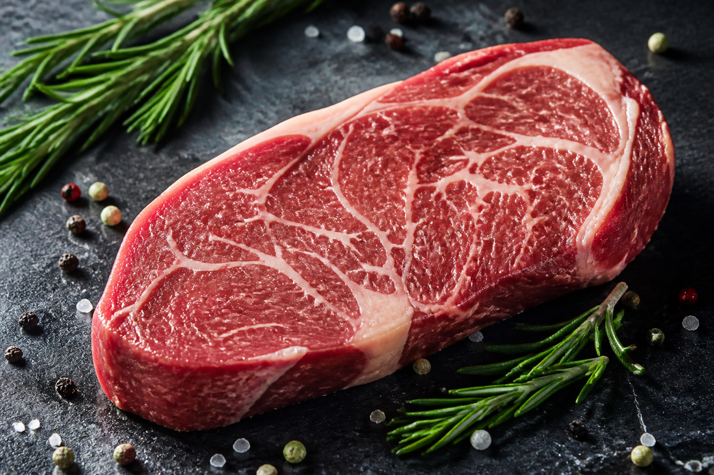

*▲ 신선한 소고기 등심(Beef Sirloin)은 완벽한 아미노산 스코어를 자랑하는 양질의 동물성 단백질이자, 고생체이용률 헴철과 세포 에너지 대사 촉진 물질의 천연 보고입니다.*

육류 단백질의 대표 주자이자 전 세계 미식가와 스포츠 영양학계가 가장 주목하는 식재료는 단연 **소고기 등심(Beef Sirloin)**입니다.

등심은 소의 등 부위에 위치하여 결이 곱고 마블링이 적절히 조화를 이루며, 인체 흡수율이 압도적으로 높은 **헴철(Heme Iron)**, 골격근 단백질 합성을 촉발하는 분지쇄아미노산(BCAA 특히 **류신**), 그리고 세포 내 ATP 재생을 돕는 **크레아틴(Creatine)**과 지방산 연소를 유도하는 **L-카르니틴(L-Carnitine)**이 집약되어 있습니다.

식물성 단백질만으로는 충족하기 어려운 미량 영양소 결핍을 방어하고, 활력 증진과 면역계 유지에 필수적인 소고기 등심의 생화학적 가치는 현대 임상 영양학에서도 확고히 입증되어 있습니다.

오늘은 미국 농무부(USDA FoodData Central)와 글로벌 스포츠 영양학 연구를 토대로, 소고기 등심의 영양 성분 구성과 과학적으로 검증된 4대 건강 효능, 그리고 영양소 파괴를 최소화하는 건강 조리 가이드를 완벽하게 정리해 드립니다.

---

## 1. 소고기 등심의 핵심 영양 성분표 (생것 100g 기준)

미국 농무부(USDA FoodData Central, FDC 168726) 표준 공인 분석 기준, 생 소고기 등심(Top Sirloin, trimmed to 1/8" fat, all grades, raw) 100g당 함유된 주요 영양소와 생리활성 미량 성분 함량은 다음과 같습니다.

| 영양 성분 | 100 g당 함량 | 미국 %DV |
| :--- | ---: | ---: |
| 열량 | 201 kcal | 기준치 없음 |
| 수분 | 66.1 g | 기준치 없음 |
| 탄수화물 | 0 g | 0.0% |
| 식이섬유 | 0 g | 0.0% |
| 당류 | 0 g | 기준치 없음 |
| 단백질 | 20.3 g | 별도 표기¹ |
| 지방 | 12.7 g | 16.3% |
| 헴철 (생체이용 철분) | 1.48 mg | 8.2% |
| 아연 (Zinc) | 3.55 mg | 32.3% |
| 비타민 B12 (코발라민) | 1.05 µg | 43.8% |
| 비타민 B3 (나이아신) | 5.99 mg | 37.4% |
| 비타민 B6 (피리독신) | 0.55 mg | 32.4% |
| 셀레늄 | 22.9 µg | 41.6% |
| 인 (Phosphorus) | 187 mg | 15.0% |
| 칼륨 (Potassium) | 315 mg | 6.7% |

**표 읽는 법.** 미국 %DV는 생것 100 g이 [FDA 일일기준치](https://www.fda.gov/food/nutrition-facts-label/how-understand-and-use-nutrition-facts-label)의 몇 퍼센트인지 보여줍니다. ‘기준치 없음’은 성분이 없다는 뜻이 아닙니다. ¹ 단백질은 일반 식품 영양표시 관행에 따라 g으로 표시했습니다.

*데이터 출처: USDA FoodData Central (FDC ID: 168726) & National Cattlemen's Beef Association.*

---

## 2. 과학적으로 입증된 소고기 등심의 4대 건강 효능

### ① mTOR 경로 활성화 및 골격근 단백질 합성 극대화
소고기 등심은 체내에서 합성되지 않는 9가지 필수 아미노산을 이상적인 비율로 공급하는 **완전 단백질(Complete Protein)**입니다. 

특히 100g당 약 1.62g에 달하는 분지쇄아미노산 **류신(Leucine)**은 세포 내 **mTORC1(mammalian Target of Rapamycin Complex 1)** 신호 경로를 직접 스위치-온(Switch-on)하여 근육 단백질 합성(MPS, Muscle Protein Synthesis)을 폭발적으로 촉발합니다. 노화에 따른 근감소증(Sarcopenia) 예방과 운동 후 근섬유 재생에 가장 이상적인 생물학적 활성도를 제공합니다.

### ② 생체이용률 1위 헴철(Heme Iron)과 빈혈 및 만성 피로 회복
식물성 식품(시금치, 콩 등)에 들어 있는 비헴철(Non-heme Iron)은 체내 흡수율이 2~7%에 불과하고 피틴산이나 탄닌에 의해 쉽게 흡수가 저해됩니다.

반면 소고기 등심의 철분은 포르피린 고리에 둘러싸인 **헴철(Heme Iron)** 형태로 존재하여 소장 상피세포의 헴 수송체(HCP1)를 통해 15~35%라는 압도적인 효율로 체내에 직접 흡수됩니다. 헤모글로빈과 미오글로빈의 핵심 구성 요소로 작용하여 전신 산소 공급 능력을 극대화하고 적혈구 생성을 지원하여 만성 무기력증과 빈혈을 근본적으로 개선합니다.

### ③ 고농도 크레아틴과 L-카르니틴을 통한 세포 ATP 및 지방 대사 촉진
소고기 붉은 살코기는 자연계에서 가장 강력한 **크레아틴(Creatine)**과 **L-카르니틴(L-Carnitine)**의 식이상 급원입니다.

- **크레아틴:** 골격근과 뇌세포 내에서 크레아틴 인산(PCr)으로 전환되어, 고강도 신체 활동이나 두뇌 집중 시 순간적으로 고갈되는 ATP 에너지를 초고속으로 재합성합니다.
- **L-카르니틴:** 장쇄 지방산(Long-chain fatty acids)을 세포 내 미토콘드리아 기질 내부로 운반하여 베타 산화(Beta-oxidation)를 거쳐 에너지로 태우는 필수 셔틀 역할을 수행합니다. 이는 체지방 감소와 심근 에너지 대사 안정화에 직결됩니다.

### ④ 아연과 비타민 B12 시너지 기반의 면역계 방어 및 신경 보호
소고기 등심 100g에는 일일 권장량의 32%를 상회하는 3.55mg의 **생체이용성 아연(Zinc)**과 44%에 달하는 **비타민 B12(코발라민)**가 집약되어 있습니다.

아연은 T세포와 NK세포(자연살해세포)의 분열과 성숙을 지휘하는 핵심 조효소로 바이러스 침입 시 최전방 면역 방어벽을 구축합니다. 또한 식물성 식단에서는 절대 섭취할 수 없는 비타민 B12는 신경 섬유를 둘러싸는 미엘린 수초(Myelin sheath)를 보호하고 혈관 손상 독소인 호모시스테인을 메티오닌으로 전환하여 뇌신경계 퇴행과 심혈관 손상을 동시에 차단합니다.

---

## 3. 영양소 흡수율을 극대화하는 조리 및 섭취 가이드

- **마이야르 반응과 온도 제어 (과열 주의):**
  표면을 고온에서 단시간에 시어링(Searing)하여 육즙을 가두는 조리는 풍미를 극대화하지만, 200℃ 이상의 직화에서 검게 태울 경우 헤테로사이클릭아민(HCA)과 다환방향족탄화수소(PAH) 같은 발암성 변이 물질이 생성됩니다. 미디엄 레어에서 미디엄 수준의 심부 온도(약 55~60℃)로 조리할 때 단백질 변성과 수분 손실이 적고 유효 성분이 가장 잘 보존됩니다.

- **비타민 C 식품과의 이상적인 페어링:**
  소고기 등심을 섭취할 때 파프리카, 브로콜리, 레몬즙 등 신선한 채소를 곁들이면 채소의 비타민 C가 함께 섭취한 비헴철의 체내 흡수율까지 추가로 끌어올리는 상승효과(Meat Factor Effect)를 냅니다.

- **레스팅(Resting) 기법:**
  구운 직후 고기를 바로 자르지 않고 5~7분간 따뜻한 곳에서 휴지시키면, 중앙으로 몰렸던 육즙이 근섬유 전체로 고르게 재분배되어 수용성 B군 비타민과 미네랄(칼륨, 인, 아연)의 손실을 막을 수 있습니다.

---

## 4. 섭취 시 주의사항 및 건강한 권장량

- **심혈관 질환 위험군 포화지방 관리:**
  등심 100g에는 약 5.13g의 포화지방과 75mg의 콜레스테롤이 포함되어 있습니다. 고지혈증이나 동맥경화 병력이 있는 경우 눈에 보이는 겉지방(Fat cap)을 1/8인치 이하로 깔끔하게 정미하여 살코기 위주로 섭취하는 것이 바람직합니다.

- **통풍(Gout) 환자 퓨린 주의:**
  붉은 육류는 세포핵이 풍부하여 대사 과정에서 요산(Uric acid)을 생성하는 퓨린 함량이 중등도 이상입니다. 고요산혈증이나 급성 통풍 발작 병력이 있는 경우 1회 섭취량을 100~150g 내외로 제한하고 충분한 수분을 섭취해야 합니다.

- **일일 권장 섭취 빈도:**
  세계암연구기금(WCRF) 및 주요 임상 가이드라인에서는 붉은 살코기의 주간 섭취량을 조리 후 기준 350~500g(주 2~3회) 수준으로 유지할 것을 권장하며, 가공육(소시지, 햄) 대신 신선한 원육 등심을 선택하는 것이 심혈관 건강에 최선입니다.

---

## 5. 최종 요약: 건강을 위한 핵심 실천 팁

1. **식물성 식단의 한계 돌파:** 소고기 등심은 헴철, 비타민 B12, 크레아틴 등 식물성 식품에서 결핍되기 쉬운 핵심 활력 영양소를 한 번에 완벽 공급합니다.
2. **근육과 에너지의 엔진:** 류신 기반의 강력한 mTOR 단백질 합성 자극과 L-카르니틴의 지방산 연소 작용으로 피로 회복과 신체 활력을 동시에 끌어올립니다.
3. **건강한 조리 원칙:** 직화로 태우지 않고 겉바속촉 미디엄 굽기와 5분 레스팅을 실천하며, 신선한 비타민 C 채소와 곁들여 최상의 영양 시너지를 누리세요.

---

## 6. 함께 먹으면 시너지가 폭발하는 식재료 궁합

- **[양파 (Onion)]({{ site.baseurl }}/posts/onion-nutrition-benefits/)**: 양파의 알릴 화합물이 소고기의 비타민 B1 흡수율을 10배 높여 활성형 알리티아민을 생성하며, 퀘르세틴이 육류 섭취로 인한 산화 콜레스테롤 생성을 차단합니다.
- **[마늘 (Garlic)]({{ site.baseurl }}/posts/garlic-nutrition-benefits/)**: 마늘의 알리신 성분이 소고기 지방 대사를 원활하게 하고 고온 조리 시 발생하는 발암물질인 헤테로사이클릭아민(HCA) 생성을 억제합니다.
- **[토마토 (Tomato)]({{ site.baseurl }}/posts/tomato-nutrition-benefits/)**: 토마토의 비타민 C와 사과산이 소고기 속 헴철(Heme Iron)의 흡수율을 3배 이상 끌어올리고 소화 효소 분비를 돕습니다.

---

## 7. 자주 묻는 질문 (FAQ)

### Q1. 붉은 고기(적색육) 섭취 시 대장암 발병 위험을 낮추는 과학적인 섭취법은?
**A:** 고기를 직화로 태우지 않고 수육, 찜, 중불 팬 조리로 조리하며, 마늘·양파·브로콜리 등 항산화 채소를 1:2 비율로 곁들여 헤테로사이클릭아민(HCA)과 다환방향족탄화수소(PAH) 흡수를 방어하는 것이 핵심입니다.

### Q2. 소고기 등심의 지방(마블링)은 건강에 무조건 해로운가요?
**A:** 그렇지 않습니다. 소고기 지방산의 약 50%는 혈중 유익한 HDL을 높이고 LDL을 낮추는 올레산(Oleic acid, 단일불포화지방산)으로 구성되어 있습니다. 적정량 섭취 시 에너지 대사와 지용성 비타민 흡수에 긍정적입니다.

### Q3. 소고기를 레어나 미디엄으로 덜 익혀 먹을 때의 영양학적 이점은?
**A:** 단백질 변성률이 낮아 아미노산 손실이 적고 비타민 B군과 헴철의 열 손상이 최소화됩니다. 신선도가 보장된 소고기는 중심부 온도 55~60℃ 수준에서 조리할 때 소화 흡수율과 영양 밀도가 가장 우수합니다.

