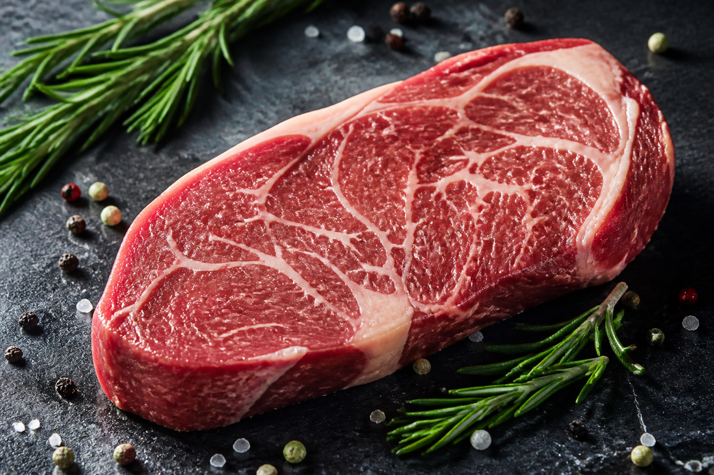

*▲ Fresh beef sirloin (top loin/top sirloin) serves as an exceptionally dense reservoir of complete animal protein, high-bioavailability heme iron, and bioenergetic cofactors essential for cellular metabolism.*

Within sports nutrition and clinical dietetics, **Beef Sirloin (*Bos taurus*)** occupies an indispensable therapeutic position as a premier nutrient-dense animal protein. 

Positioned along the posterior dorsal musculature, sirloin provides a highly favorable lean-to-fat profile while delivering complete essential amino acid adequacy. Crucially, red meat muscle tissue contains concentrated quantities of bioactive compounds rarely accessible in plant foods: **heme iron** with superior absorption kinetics, the essential branched-chain amino acid **leucine** for anabolic signaling, **creatine** for phosphagen resynthesis, and **L-carnitine** for mitochondrial fatty acid oxidation.

This peer-reviewed nutritional monograph provides an empirical biochemical breakdown of beef sirloin based on USDA FoodData Central standards, delineates four clinically validated metabolic mechanisms, and details culinary precision strategies to optimize micronutrient retention.

---

## 1. Complete Nutritional Composition (Per 100g Raw Portion)

Synthesized from standardized analytical spectroscopic determinations cataloged in the United States Department of Agriculture (USDA) FoodData Central (FDC ID: 168726, Top Sirloin, trimmed to 1/8" fat, raw), the comprehensive macronutrient and micronutrient density per 100-gram edible portion comprises:

| Nutrient | Per 100 g | U.S. %DV |
| :--- | ---: | ---: |
| Energy | 201.0 kcal (841 kJ) | No DV |
| Moisture Content | 66.10 g | No DV |
| Total Carbohydrates | 0.00 g | 0.0% |
| Dietary Fiber | 0.00 g | 0.0% |
| Free Sugars | 0.00 g | No DV |
| Crude Protein | 20.30 g | See note¹ |
| Total Lipids (Fat) | 12.70 g | 16.3% |
| Heme Iron (Fe) | 1.48 mg | 8.2% |
| Zinc (Zn) | 3.55 mg | 32.3% |
| Vitamin B12 (Cobalamin) | 1.05 µg | 43.8% |
| Niacin (Vitamin B3) | 5.99 mg | 37.4% |
| Vitamin B6 (Pyridoxine) | 0.55 mg | 32.4% |
| Selenium (Se) | 22.90 µg | 41.6% |
| Phosphorus (P) | 187.00 mg | 15.0% |
| Potassium (K) | 315.00 mg | 6.7% |

**How to read the table.** U.S. %DV shows how much 100 g raw contributes to the [FDA Daily Value](https://www.fda.gov/food/nutrition-facts-label/how-understand-and-use-nutrition-facts-label). “No DV” means no reference value applies. ¹ Protein is shown in grams, as on most general-use U.S. food labels.

*Data Source: USDA FoodData Central (FDC ID: 168726) & National Cattlemen's Beef Association.*

---

## 2. Four Clinically Validated Physiological Health Benefits

### 1. Robust mTORC1 Pathway Activation and Myofibrillar Protein Synthesis
Beef sirloin provides a definitive DIAAS (Digestible Indispensable Amino Acid Score) exceeding 1.0, supplying all nine essential amino acids in optimal physiological proportions. 

Crucially, sirloin yields approximately 1.62 g of **leucine** per 100 grams. Leucine functions not merely as a structural substrate but as an intracellular signaling agonist, binding Sestrin2 and facilitating Rag GTPase translocation to phosphorylate and activate the **mTORC1 (mammalian Target of Rapamycin Complex 1)** kinase cascade. This triggers the phosphorylation of p70S6K and 4E-BP1, maximizing myofibrillar protein synthesis (MPS) to attenuate age-related sarcopenia and accelerate post-exercise tissue remodeling.

### 2. High-Efficiency Heme Iron Bioavailability and Systemic Oxygen Transport
Non-heme iron derived from botanical sources exhibits modest intestinal absorption kinetics (typically 2% to 7%) due to chelation by dietary phytates, polyphenols, and oxalates. 

Conversely, the iron in beef sirloin is coordinated within a protoporphyrin IX ring structure as **heme iron**, transported intact across enterocyte apical membranes via the heme carrier protein 1 (HCP1) with an absorption efficiency of 15% to 35%. Once internalized, it directly incorporates into erythroid hemoglobin and skeletal myoglobin, preventing microcytic hypochromic anemia and supporting optimal systemic cellular oxygenation.

### 3. Endogenous Creatine and L-Carnitine Bioenergetic Enhancement
Skeletal muscle tissue from red meat represents nature's richest whole-food source of organic bioenergetic intermediaries:

- **Creatine:** Absorbed via dedicated SLC6A8 transporters and phosphorylated into phosphocreatine (PCr) within muscle and neuronal tissue. It buffers adenosine triphosphate (ATP) depletion during high-intensity cellular demands, regenerating ATP from ADP via creatine kinase.
- **L-Carnitine:** Acts as an obligatory rate-limiting cofactor for carnitine palmitoyltransferase-1 (CPT-1), conjugating long-chain fatty acids into acylcarnitine esters to facilitate mitochondrial inner-membrane transport for beta-oxidation and cellular energy yield.

### 4. Synergistic Zinc and Cobalamin Immune Defense and Neuroprotection
A 100-gram serving of sirloin delivers 32% of the Daily Value for elemental **zinc** and 44% for **vitamin B12 (cyanocobalamin/methylcobalamin)**. 

Zinc functions as an indispensable structural cofactor for over 300 metalloenzymes and zinc-finger transcription factors governing T-lymphocyte clonal expansion, macrophage phagocytosis, and cytokine modulation. Concurrently, cobalamin participates in the remethylation of homocysteine to methionine via methionine synthase, preventing hyperhomocysteinemia-mediated endothelial injury while preserving the structural integrity of neuronal myelin sheaths.

---

## 3. Precision Culinary and Bioavailability Optimization Guidelines

- **Thermal Kinetics and Mutagen Control:**
  High-heat surface searing (the Maillard reaction) elevates sensory palatability through melanoidin formation. However, prolonged exposure to open flames exceeding 200°C (392°F) induces pyrolysis of amino acids and creatine, generating carcinogenic heterocyclic amines (HCAs) and polycyclic aromatic hydrocarbons (PAHs). Internal core cooking temperatures should be regulated between 55°C and 60°C (medium-rare to medium) to minimize collagen contracture and retain moisture without extensive protein carbonization.

- **The "Meat Factor" Synergy:**
  Co-ingesting beef sirloin with dietary ascorbic acid (fresh citrus, bell peppers, or steamed cruciferous vegetables) produces a well-documented nutritional synergy termed the "meat factor," whereby organic meat-derived peptides enhance the luminal solubility and uptake of concurrent dietary non-heme iron.

- **Post-Thermal Resting Equilibrium:**
  Resting cooked sirloin under gentle ambient thermal conditions for 5 to 7 minutes before slicing allows myofibrillar pressure gradients to equilibrate, preventing the irreversible extrusion of water-soluble B-complex vitamins, potassium, and zinc within purged sarcoplasmic fluids.

---

## 4. Clinical Cautions and Dietary Modulation

- **Saturated Fatty Acid Profile in Cardiometabolic Cohorts:**
  Per 100 grams of trimmed sirloin, saturated fatty acids account for approximately 5.13 g (primarily palmitic and stearic acids). Patients with familial hypercholesterolemia or established atherosclerotic cardiovascular disease (ASCVD) should select closely trimmed cuts (retaining ≤1/8-inch subcutaneous fat) to align with American Heart Association dietary thresholds.

- **Purine Metabolism in Hyperuricemia and Gout:**
  High concentrations of cellular nucleoproteins in red meat yield intermediate purine metabolites. Individuals experiencing acute gouty arthritis or renal uric acid clearance impairment should modulate single-meal portion sizes to 100–150 g and ensure adequate systemic hydration.

- **Global Dietary Intake Frameworks:**
  Authoritative clinical consensus guidelines, including the World Cancer Research Fund (WCRF), recommend maintaining aggregate fresh red meat consumption within 350 to 500 grams weekly (approximately 2–3 portions), while strictly prioritizing fresh, minimally processed muscle cuts over cured or processed meats.

---

## 5. Clinical Synthesis and Practical Implementation

1. **Unrivaled Micronutrient Density:** Beef sirloin overcomes the clinical bioavailability limitations of purely plant-derived diets by delivering preformed heme iron, bioavailable zinc, cobalamin, and endogenous creatine.
2. **Cellular Anabolism & Energy:** High leucine concentrations stimulate rapid mTORC1-mediated muscle protein synthesis, while L-carnitine optimizes mitochondrial lipid substrate oxidation.
3. **Culinary Best Practice:** Employ controlled medium thermal searing with a mandatory 5-minute rest, paired with antioxidant-rich vegetables for peak nutrient bioavailability.

---

## 6. Synergistic Food Pairings for Maximum Nutrient Absorption

- **[Onion]({{ site.baseurl }}/en/posts/onion-nutrition-benefits/)**: Onion allyl sulfides bind thiamine from beef into lipophilic allithiamine, while quercetin scavenges oxidized lipid radicals during gastric digestion.
- **[Garlic]({{ site.baseurl }}/en/posts/garlic-nutrition-benefits/)**: Allicin and diallyl trisulfide suppress heterocyclic amine (HCA) formation during meat searing while supporting postprandial lipid metabolism.
- **[Tomato]({{ site.baseurl }}/en/posts/tomato-nutrition-benefits/)**: Ascorbic and malic acids in tomatoes convert ferric iron into highly absorbable ferrous heme iron, tripling systemic iron bioavailability.

---

## 7. Frequently Asked Questions (FAQ)

### Q1. How can one scientifically mitigate carcinogenic risks associated with red meat consumption?
**A:** Avoid direct flame charring; cook with indirect moist heat, and co-ingest cruciferous vegetables and allium vegetables at a 2:1 ratio to neutralize heterocyclic amines and preserve intestinal mucosal health.

### Q2. Is the intermuscular marbling fat in beef sirloin detrimental to cardiovascular health?
**A:** Not entirely. Approximately 50% of the fatty acids in quality beef sirloin consist of oleic acid, a monounsaturated fatty acid known to optimize HDL-to-LDL cholesterol ratios when eaten in moderation.

### Q3. Does cooking beef to rare or medium-rare preserve micronutrient integrity better than well-done?
**A:** Yes. Cooking meat to core temperatures of 55°C to 60°C minimizes amino acid cross-linking and prevents thermal denaturation of thiamine, cobalamin, and bioactive heme iron complexes.

