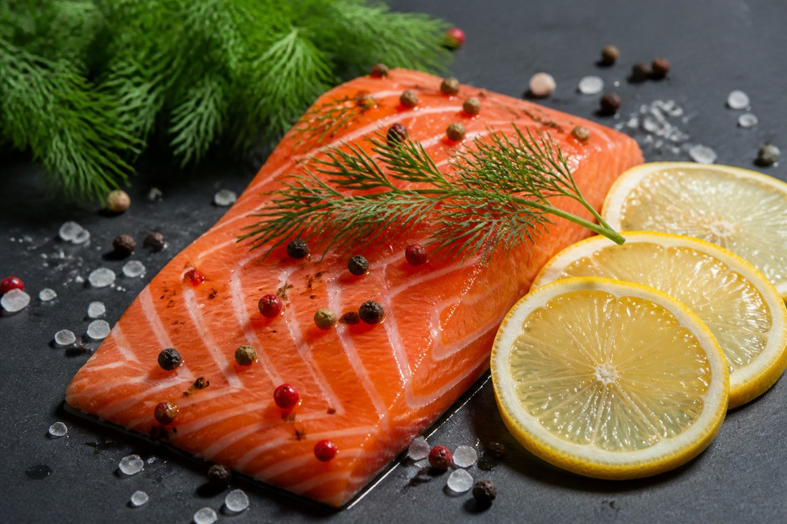

*▲ Atlantic salmon (Salmo salar) is a practical source of long-chain omega-3 fatty acids (EPA and DHA), vitamin D and astaxanthin. Nutrient figures use USDA FoodData Central FDC 175167 (raw).*

Quick answer <strong>Salmon provides 208 calories, 20.4 g protein and 2,150 mg EPA plus DHA per 100 g.</strong> Two 100 g servings a week cover omega-3 targets, and smoked salmon carries several times the sodium of raw fillet.

**Salmon** is often recommended for EPA, DHA and vitamin D. How much benefit it delivers depends on the amount eaten and the person, and no single food guarantees cardiovascular or brain protection.

Adapted to thrive in cold ocean depths, salmon stores high concentrations of long-chain polyunsaturated fatty acids, specifically **eicosapentaenoic acid (EPA)** and **docosahexaenoic acid (DHA)**. These essential lipids integrate directly into human phospholipid bilayers, governing cellular membrane fluidity and signaling cascades.

Furthermore, salmon’s distinctive crimson pigmentation is derived from **astaxanthin**, a potent marine xanthophyll carotenoid exhibiting hundreds of times greater singlet-oxygen quenching capacity than alpha-tocopherol (vitamin E). 

Using **USDA FoodData Central entry 175167**, this guide covers salmon's nutrient profile, how far human evidence supports each effect, and cooking methods that limit nutrient loss.

---

## 1. How Many Calories Are in Salmon? (20.4 g protein, 2,150 mg EPA and DHA per 100 g)

According to standardized laboratory data from the USDA FoodData Central (FDC ID: 175167), a 100 g edible portion of raw Atlantic salmon (Salmo salar, wild/farmed composite) provides the following macro- and micronutrients:

| Nutrient | Per 100 g | U.S. %DV |
| :--- | ---: | ---: |
| Energy | 208 kcal | No DV |
| Water | 64.8 g | No DV |
| Total Carbohydrate | 0 g | 0.0% |
| Dietary Fiber | 0 g | 0.0% |
| Total Sugars | 0 g | No DV |
| Protein | 20.4 g | See note¹ |
| Total Lipid (Fat) | 13.4 g | 17.2% |
| Omega-3 Fatty Acids (EPA + DHA) | 2,150 mg | No DV |
| Vitamin D (Cholecalciferol) | 11.0 µg (440 IU) | 55.0% |
| Vitamin B12 (Cobalamin) | 3.23 µg | 134.6% |
| Vitamin B3 (Niacin) | 8.53 mg | 53.3% |
| Vitamin B6 (Pyridoxine) | 0.64 mg | 37.6% |
| Selenium | 36.5 µg | 66.4% |
| Phosphorus | 252 mg | 20.2% |
| Potassium | 363 mg | 7.7% |
| Astaxanthin (Carotenoid) | 1.80 mg | No DV |

**How to read the table.** U.S. %DV shows how much 100 g raw contributes to the [FDA Daily Value](https://www.fda.gov/food/nutrition-facts-label/how-understand-and-use-nutrition-facts-label). “No DV” means no reference value applies. ¹ Protein is shown in grams, as on most general-use U.S. food labels.

*Data Source: USDA FoodData Central (FDC ID: 175167) & European Journal of Clinical Nutrition.*

---

## 2. What Are the Benefits of Salmon? Four Evidence-Backed Effects

### ① Resolution of Systemic Inflammation and Cardiovascular Endothelial Integrity
The long-chain omega-3 fatty acids EPA and DHA displace pro-inflammatory arachidonic acid from cellular membranes. 

Through enzymatic oxygenation, they serve as biological precursors for **specialized pro-resolving mediators (SPMs)**—namely resolvins, protectins, and maresins. These bioactive lipids actively extinguish chronic inflammatory signaling, dampen nuclear factor-kappa B (NF-κB) transcription, and downregulate adhesion molecules on vascular endothelial surfaces.

Trials giving 2 to 4 g of EPA plus DHA a day report fasting triglycerides falling by 20% to 30%. A 100 g portion of salmon supplies about 2 g of EPA plus DHA, so two servings a week will not reproduce that reduction. Trials of omega-3 intake and cardiovascular events have given mixed results, so salmon cannot be described as preventing atherosclerosis or heart attack.

### ② Astaxanthin Crossing the Blood-Brain Barrier (BBB) for Neuroprotection
Unlike terrestrial carotenoids, the unique polar-nonpolar molecular structure of **astaxanthin** allows it to span cellular lipid bilayers entirely, preventing oxidative degradation both within and across cell membranes.

In animal and cell models astaxanthin reduces oxidative stress in neural tissue. Whether eating salmon delivers enough astaxanthin to cross the human blood-brain barrier and improve memory or protect against Alzheimer's or Parkinson's disease has not been shown in clinical studies.

### ③ Immunomodulatory Synergy via Cholecalciferol (Vitamin D) and Selenium
A single 100 g serving of fresh salmon fulfills over 50% of the baseline physiological vitamin D requirement. 

Acting as a potent seco-steroid hormone, active vitamin D (1,25-dihydroxyvitamin D3) binds to nuclear Vitamin D Receptors (VDR) across monocytes, macrophages, and dendritic cells, inducing transcription of endogenous antimicrobial peptides such as cathelicidin and defensins.

Concurrently, salmon delivers 66% DV of **selenium**, an essential structural component of selenoproteins including glutathione peroxidase and thioredoxin reductase, defending thyroid hormone homeostasis and safeguarding leukocytes during systemic immunological challenges.

### ④ Enhancement of Peripheral Insulin Sensitivity and Metabolic Homeostasis
Incorporating salmon lipids into peripheral cell membranes increases receptor mobility and optimizes glucose transporter-4 (GLUT4) translocation in skeletal muscle tissue.

Replacing saturated fat with fish fat can modestly improve insulin sensitivity in some trials, but salmon is not a treatment for insulin resistance or fatty liver disease.

---

## 3. Raw or Cooked Salmon? Keeping Omega-3s Intact

Long-chain polyunsaturated fatty acids and marine carotenoids are inherently susceptible to thermal and oxidative breakdown. Adopting targeted culinary protocols is paramount to preserving structural bioactivity.

- **Low-Temperature Sous-Vide or Gentle Pan-Poaching:** High-heat deep frying or direct open-flame charring accelerates lipid peroxidation and degradation of delicate double bonds. Preparing salmon at controlled temperatures between 55°C and 65°C preserves fatty acid integrity and prevents protein over-coagulation.
- **Synergy with Ascorbic Acid (Lemon & Citrus):** Drizzling freshly squeezed lemon juice over cooked salmon supplies ascorbic acid, which acts as a secondary antioxidant, sequestering free radicals and stabilizing marine carotenoids.
- **Lipid-Carotenoid Co-Ingestion:** Pairing salmon with olive oil and leafy vegetables supports micelle formation and absorption of fat-soluble vitamin D and carotenoids. The size of the increase depends on the meal, so no multiple is claimed.

---

## 4. Who Should Avoid Salmon? Side Effects and Cautions

- **Wild Alaskan vs. Responsibly Farmed Salmon:** While sustainably farmed salmon often provides slightly higher total lipid densities, verified wild catches (such as Sockeye or King salmon) feature superior natural astaxanthin concentrations and lower omega-6 to omega-3 ratios. Select certified organic or ASC/MSC-certified sources.
- **Trace Metal Safety Profile (Mercury):** Due to its moderate trophic level, salmon exhibits exceptionally low mercury bioaccumulation (typically below 0.02 ppm), well beneath FDA action levels. It is designated as a "Best Choice" seafood for pregnant and lactating women.
- **Parasitic Precautions for Raw Preparations:** When preparing salmon as sashimi or crudo, ensure the fish has undergone industrial blast freezing at -20°C for at least 24 hours (or -35°C for 15 hours) to eliminate potential *Anisakis* nematodes.

---

## 5. Salmon per Day: How Much Do You Need?

1. **Optimal Intake Frequency:** Consuming two servings (approximately 150 g to 200 g each) of fresh salmon per week fulfills international cardiovascular health guidelines, delivering over 4,000 mg of combined EPA and DHA weekly.
2. **Quality Assessment:** Look for firm flesh with vibrant marbling, clear moisture without milky exudate, and a clean, fresh marine aroma.
3. **Clinical Recommendation:** Incorporate salmon into a diversified Mediterranean dietary pattern alongside leafy greens, cold-pressed oils, and prebiotic fiber for comprehensive metabolic optimization.

---

## 6. Storing and Portioning Salmon

- **[Broccoli]({{ site.baseurl }}/en/posts/broccoli-nutrition-benefits/)**: Cholecalciferol (vitamin D3) in salmon maximizes intestinal absorption of dietary calcium from broccoli, while ascorbic acid recycles astaxanthin radicals.
- **[Garlic]({{ site.baseurl }}/en/posts/garlic-nutrition-benefits/)**: Allium sulfur compounds protect delicate double-bond polyunsaturated fatty acids from peroxidative breakdown during cooking and circulation.
- **[Onion]({{ site.baseurl }}/en/posts/onion-nutrition-benefits/)**: Flavonoid quercetin enhances fatty acid beta-oxidation, facilitating postprandial triglyceride clearance and vascular tonus optimization.

---

## 7. Frequently Asked Questions (FAQ)

### Q1. What nutritional disparities distinguish fresh raw salmon from commercial smoked salmon?
**A:** Fresh salmon keeps heat-sensitive omega-3 and vitamin B12 without added salt. Smoked and cured salmon are salted during processing and carry substantially more sodium than a raw fillet; if you have high blood pressure, keep portions small and choose grilled or raw salmon more often.

### Q2. Does consuming crispy salmon skin provide tangible biochemical advantages?
**A:** Yes. The subdermal adipose layer immediately beneath the salmon epidermis concentrates long-chain marine omega-3s and bioavailable marine collagen peptides supporting connective tissue.

### Q3. Is bioaccumulated methylmercury a realistic safety concern when consuming salmon regularly?
**A:** No. Salmon feeds relatively low on the marine trophic pyramid, exhibiting negligible methylmercury accumulation compared to apex predatory pelagic fish like swordfish or albacore tuna.

  
📌 Related ranking guide

  <ul>
    <li><a href="/en/posts/high-protein-foods-ranking/">Top 10 High-Protein Foods: Grams per 100g and 100 kcal</a></li>
    <li><a href="/en/posts/heart-blood-pressure-cholesterol-foods/">Top 10 Foods for Blood Pressure, Cholesterol & Heart</a></li>
  </ul>

