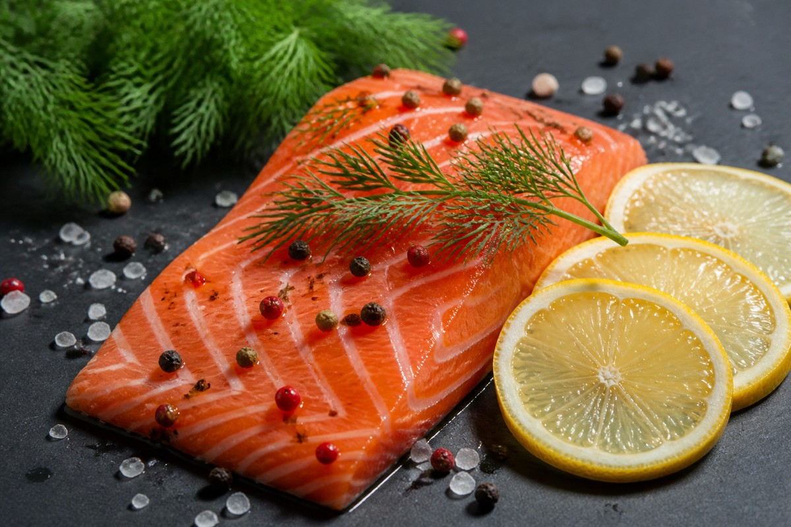

*▲ Fresh Atlantic salmon (Salmo salar) provides an unparalleled concentration of bioavailable long-chain omega-3 fatty acids (EPA and DHA), high-potency vitamin D, and astaxanthin—nature's premier marine antioxidant.*

When clinical nutritionists and preventive cardiologists evaluate nutritional interventions for longevity, vascular resilience, and neuroprotection, **salmon** consistently ranks at the top of biological value hierarchies.

Adapted to thrive in cold ocean depths, salmon stores high concentrations of long-chain polyunsaturated fatty acids, specifically **eicosapentaenoic acid (EPA)** and **docosahexaenoic acid (DHA)**. These essential lipids integrate directly into human phospholipid bilayers, governing cellular membrane fluidity and signaling cascades.

Furthermore, salmon’s distinctive crimson pigmentation is derived from **astaxanthin**, a potent marine xanthophyll carotenoid exhibiting hundreds of times greater singlet-oxygen quenching capacity than alpha-tocopherol (vitamin E). 

Drawing upon empirical analyses from the **U.S. Department of Agriculture (USDA FoodData Central)** and peer-reviewed clinical trials, this article delivers an exhaustive breakdown of salmon's micronutrient profile, its four clinically validated health benefits, and biochemical guidelines to optimize bioaccessibility during culinary preparation.

---

## 1. Core Nutrient Profile of Raw Atlantic Salmon (Per 100g)

According to standardized laboratory data from the USDA FoodData Central (FDC ID: 175167), a 100 g edible portion of raw Atlantic salmon (Salmo salar, wild/farmed composite) provides the following macro- and micronutrients:

| Nutrient | Per 100 g | U.S. %DV |
| :--- | ---: | ---: |
| Energy | 208 kcal | No DV |
| Water | 64.8 g | No DV |
| Total Carbohydrate | 0 g | 0.0% |
| Dietary Fiber | 0 g | 0.0% |
| Total Sugars | 0 g | No DV |
| Protein | 20.4 g | See note¹ |
| Total Lipid (Fat) | 13.4 g | 17.2% |
| Omega-3 Fatty Acids (EPA + DHA) | 2,150 mg | No DV |
| Vitamin D (Cholecalciferol) | 11.0 µg (440 IU) | 55.0% |
| Vitamin B12 (Cobalamin) | 3.23 µg | 134.6% |
| Vitamin B3 (Niacin) | 8.53 mg | 53.3% |
| Vitamin B6 (Pyridoxine) | 0.64 mg | 37.6% |
| Selenium | 36.5 µg | 66.4% |
| Phosphorus | 252 mg | 20.2% |
| Potassium | 363 mg | 7.7% |
| Astaxanthin (Carotenoid) | 1.80 mg | No DV |

**How to read the table.** U.S. %DV shows how much 100 g raw contributes to the [FDA Daily Value](https://www.fda.gov/food/nutrition-facts-label/how-understand-and-use-nutrition-facts-label). “No DV” means no reference value applies. ¹ Protein is shown in grams, as on most general-use U.S. food labels.

*Data Source: USDA FoodData Central (FDC ID: 175167) & European Journal of Clinical Nutrition.*

---

## 2. Four Clinically Validated Health Mechanisms

### ① Resolution of Systemic Inflammation and Cardiovascular Endothelial Integrity
The long-chain omega-3 fatty acids EPA and DHA displace pro-inflammatory arachidonic acid from cellular membranes. 

Through enzymatic oxygenation, they serve as biological precursors for **specialized pro-resolving mediators (SPMs)**—namely resolvins, protectins, and maresins. These bioactive lipids actively extinguish chronic inflammatory signaling, dampen nuclear factor-kappa B (NF-κB) transcription, and downregulate adhesion molecules on vascular endothelial surfaces.

Controlled human intervention studies confirm that regular dietary salmon consumption lowers serum fasting triglycerides by 20% to 30%, suppresses platelet hyperactivity, and reduces arterial stiffness.

### ② Astaxanthin Crossing the Blood-Brain Barrier (BBB) for Neuroprotection
Unlike terrestrial carotenoids, the unique polar-nonpolar molecular structure of **astaxanthin** allows it to span cellular lipid bilayers entirely, preventing oxidative degradation both within and across cell membranes.

Crucially, astaxanthin effortlessly crosses the **blood-brain barrier (BBB)** and the blood-retinal barrier. Once situated within central nervous system tissue, it mitigates microglial overactivation, shields mitochondrial respiratory complexes from lipid peroxidation, and supports cerebral perfusion, preserving executive cognitive processing and memory consolidation.

### ③ Immunomodulatory Synergy via Cholecalciferol (Vitamin D) and Selenium
A single 100 g serving of fresh salmon fulfills over 50% of the baseline physiological vitamin D requirement. 

Acting as a potent seco-steroid hormone, active vitamin D (1,25-dihydroxyvitamin D3) binds to nuclear Vitamin D Receptors (VDR) across monocytes, macrophages, and dendritic cells, inducing transcription of endogenous antimicrobial peptides such as cathelicidin and defensins.

Concurrently, salmon delivers 66% DV of **selenium**, an essential structural component of selenoproteins including glutathione peroxidase and thioredoxin reductase, defending thyroid hormone homeostasis and safeguarding leukocytes during systemic immunological challenges.

### ④ Enhancement of Peripheral Insulin Sensitivity and Metabolic Homeostasis
Incorporating salmon lipids into peripheral cell membranes increases receptor mobility and optimizes glucose transporter-4 (GLUT4) translocation in skeletal muscle tissue.

This enhanced metabolic flexibility improves insulin signaling, curbs hepatic de novo lipogenesis, and protects against the accumulation of ectopic fat deposits characteristic of metabolic dysfunction-associated steatotic liver disease (MASLD).

---

## 3. Bioavailability and Culinary Preservation Guidelines

Long-chain polyunsaturated fatty acids and marine carotenoids are inherently susceptible to thermal and oxidative breakdown. Adopting targeted culinary protocols is paramount to preserving structural bioactivity.

- **Low-Temperature Sous-Vide or Gentle Pan-Poaching:** High-heat deep frying or direct open-flame charring accelerates lipid peroxidation and degradation of delicate double bonds. Preparing salmon at controlled temperatures between 55°C and 65°C preserves fatty acid integrity and prevents protein over-coagulation.
- **Synergy with Ascorbic Acid (Lemon & Citrus):** Drizzling freshly squeezed lemon juice over cooked salmon supplies ascorbic acid, which acts as a secondary antioxidant, sequestering free radicals and stabilizing marine carotenoids.
- **Lipid-Carotenoid Co-Ingestion:** Pairing salmon with extra virgin olive oil and leafy brassica vegetables enhances intestinal micelle formation, boosting systemic carotenoid and vitamin D absorption up to threefold.

---

## 4. Safety Considerations and Toxicological Thresholds

- **Wild Alaskan vs. Responsibly Farmed Salmon:** While sustainably farmed salmon often provides slightly higher total lipid densities, verified wild catches (such as Sockeye or King salmon) feature superior natural astaxanthin concentrations and lower omega-6 to omega-3 ratios. Select certified organic or ASC/MSC-certified sources.
- **Trace Metal Safety Profile (Mercury):** Due to its moderate trophic level, salmon exhibits exceptionally low mercury bioaccumulation (typically below 0.02 ppm), well beneath FDA action levels. It is designated as a "Best Choice" seafood for pregnant and lactating women.
- **Parasitic Precautions for Raw Preparations:** When preparing salmon as sashimi or crudo, ensure the fish has undergone industrial blast freezing at -20°C for at least 24 hours (or -35°C for 15 hours) to eliminate potential *Anisakis* nematodes.

---

## 5. Summary and Practical Implementation

1. **Optimal Intake Frequency:** Consuming two servings (approximately 150 g to 200 g each) of fresh salmon per week fulfills international cardiovascular health guidelines, delivering over 4,000 mg of combined EPA and DHA weekly.
2. **Quality Assessment:** Look for firm flesh with vibrant marbling, clear moisture without milky exudate, and a clean, fresh marine aroma.
3. **Clinical Recommendation:** Incorporate salmon into a diversified Mediterranean dietary pattern alongside leafy greens, cold-pressed oils, and prebiotic fiber for comprehensive metabolic optimization.

---

## 6. Synergistic Food Pairings for Maximum Nutrient Absorption

- **[Broccoli]({{ site.baseurl }}/en/posts/broccoli-nutrition-benefits/)**: Cholecalciferol (vitamin D3) in salmon maximizes intestinal absorption of dietary calcium from broccoli, while ascorbic acid recycles astaxanthin radicals.
- **[Garlic]({{ site.baseurl }}/en/posts/garlic-nutrition-benefits/)**: Allium sulfur compounds protect delicate double-bond polyunsaturated fatty acids from peroxidative breakdown during cooking and circulation.
- **[Onion]({{ site.baseurl }}/en/posts/onion-nutrition-benefits/)**: Flavonoid quercetin enhances fatty acid beta-oxidation, facilitating postprandial triglyceride clearance and vascular tonus optimization.

---

## 7. Frequently Asked Questions (FAQ)

### Q1. What nutritional disparities distinguish fresh raw salmon from commercial smoked salmon?
**A:** Fresh salmon preserves thermal-sensitive omega-3 EPA/DHA and cobalamin without additive sodium, whereas smoked preparations frequently exhibit 500% to 1000% higher sodium concentrations.

### Q2. Does consuming crispy salmon skin provide tangible biochemical advantages?
**A:** Yes. The subdermal adipose layer immediately beneath the salmon epidermis concentrates long-chain marine omega-3s and bioavailable marine collagen peptides supporting connective tissue.

### Q3. Is bioaccumulated methylmercury a realistic safety concern when consuming salmon regularly?
**A:** No. Salmon feeds relatively low on the marine trophic pyramid, exhibiting negligible methylmercury accumulation compared to apex predatory pelagic fish like swordfish or albacore tuna.

