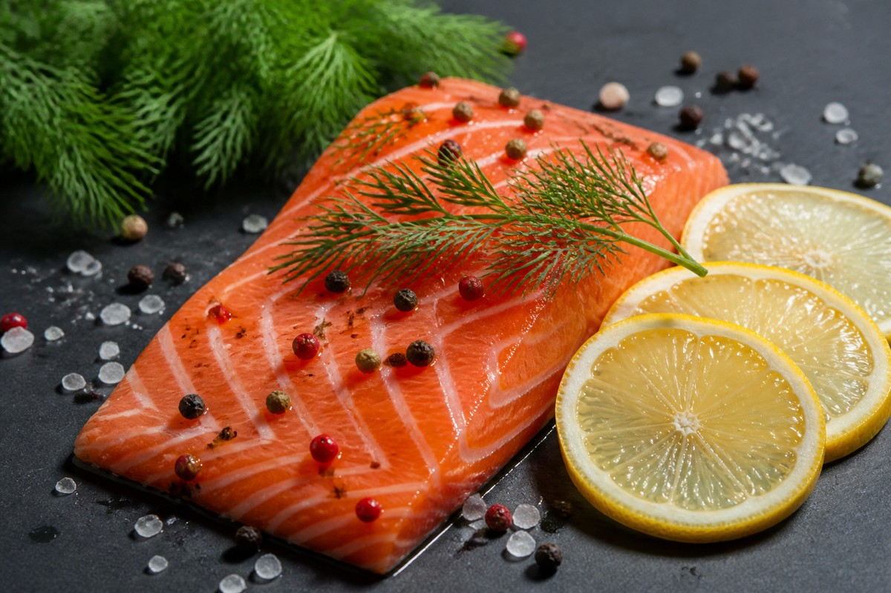

*▲ 선홍빛 결을 자랑하는 신선한 연어(Salmon)는 체내 흡수율이 탁월한 장쇄 오메가-3 지방산(EPA·DHA)과 비타민 D, 그리고 자연계 최강의 카로티노이드 항산화 물질인 아스타잔틴의 보고입니다.*

전 세계 의학계와 임상 영양학자들이 장수와 뇌 건강, 심혈관 보호를 논할 때 가장 먼저 꼽는 슈퍼푸드는 단연 **연어(Salmon)**입니다.

연어는 차가운 심해를 거슬러 오르는 강인한 생명력을 지닌 어종으로, 인체 세포막의 유연성을 결정짓는 필수 다가불포화지방산인 **EPA(에이코사펜타엔산)**와 **DHA(도코사헥사엔산)**가 농축되어 있습니다. 

뿐만 아니라 연어 특유의 매혹적인 붉은빛을 띠게 만드는 **아스타잔틴(Astaxanthin)**은 비타민 E의 수백 배에 달하는 강력한 활성산소 소거 능력을 지녀, 혈관 내피세포 손상과 뇌신경 퇴행을 방어하는 핵심 방패 역할을 수행합니다.

오늘은 미국 농무부(USDA FoodData Central)의 표준 공인 데이터와 글로벌 의학 저널 연구를 바탕으로, 연어의 영양 성분 프로파일과 과학적으로 검증된 4대 건강 효능, 그리고 영양소 파괴를 막는 최적의 섭취 가이드를 정밀하게 분석해 드립니다.

---

## 1. 연어의 핵심 영양 성분표 (생것 100g 기준)

미국 농무부(USDA FoodData Central, FDC 175167) 공인 분석 기준, 생 대서양 연어(Atlantic Salmon, raw) 100g당 함유된 주요 영양소와 생리활성 미량 성분 함량은 다음과 같습니다.

| 영양 성분 | 100 g당 함량 | 미국 %DV |
| :--- | ---: | ---: |
| 열량 | 208 kcal | 기준치 없음 |
| 수분 | 64.8 g | 기준치 없음 |
| 탄수화물 | 0 g | 0.0% |
| 식이섬유 | 0 g | 0.0% |
| 당류 | 0 g | 기준치 없음 |
| 단백질 | 20.4 g | 별도 표기¹ |
| 총 지방 | 13.4 g | 17.2% |
| 오메가-3 지방산 (EPA+DHA) | 2,150 mg | 기준치 없음 |
| 비타민 D | 11.0 µg (440 IU) | 55.0% |
| 비타민 B12 (코발라민) | 3.23 µg | 134.6% |
| 비타민 B3 (나이아신) | 8.53 mg | 53.3% |
| 비타민 B6 (피리독신) | 0.64 mg | 37.6% |
| 셀레늄 (Selenium) | 36.5 µg | 66.4% |
| 인 (Phosphorus) | 252 mg | 20.2% |
| 칼륨 (Potassium) | 363 mg | 7.7% |
| 아스타잔틴 (카로티노이드) | 1.80 mg | 기준치 없음 |

**표 읽는 법.** 미국 %DV는 생것 100 g이 [FDA 일일기준치](https://www.fda.gov/food/nutrition-facts-label/how-understand-and-use-nutrition-facts-label)의 몇 퍼센트인지 보여줍니다. ‘기준치 없음’은 성분이 없다는 뜻이 아닙니다. ¹ 단백질은 일반 식품 영양표시 관행에 따라 g으로 표시했습니다.

*데이터 출처: USDA FoodData Central (FDC ID: 175167) & European Journal of Clinical Nutrition.*

---

## 2. 과학적으로 입증된 연어의 4대 건강 효능

### ① 오메가-3 지방산(EPA·DHA)의 전신 만성 염증 억제 및 심혈관 보호
연어에 풍부한 장쇄 오메가-3 지방산(EPA와 DHA)은 세포막 인지질 구조에 직접 결합하여 프로스타글란딘, 류코트리엔 등 염증 촉진 에이코사노이드의 생성을 차단합니다.

임상 연구에 따르면 규칙적인 연어 섭취는 혈중 중성지방(Triglyceride) 수치를 20~30% 감소시키고, 혈관 내피 기능 장애를 개선하여 혈전 형성을 억제합니다. 이는 동맥경화, 고혈압, 심근경색 등 치명적인 심혈관계 질환의 발병 위험을 현저히 낮추는 근간이 됩니다.

### ② 아스타잔틴의 뇌혈관 장벽(BBB) 통과 및 인지 기능 강화
연어의 붉은 살에 존재하는 해양 카로티노이드 **아스타잔틴**은 지용성과 수용성 성질을 모두 갖추어 뇌혈관 장벽(Blood-Brain Barrier)을 자유롭게 통과합니다.

뇌세포 지질 이중층에 깊숙이 침투한 아스타잔틴은 뇌 신경세포의 산화 스트레스를 직접 제거하고, 신경염증성 반응을 차단하여 뇌 피로 회복과 기억력 증진을 도모합니다. 알츠하이머와 파킨슨병 등 퇴행성 뇌 질환 모델에서도 신경 보호 효과가 일관되게 관찰되고 있습니다.

### ③ 고밀도 비타민 D와 셀레늄의 면역계 항상성 조절
연어 100g은 성인 하루 권장 비타민 D 요구량의 50% 이상을 단번에 공급합니다. 

비타민 D는 단순한 비타민이 아니라 인체 면역 세포(T세포, 대식세포)의 수용체와 결합하여 항균 펩타이드 발현을 자극하는 면역 호르몬으로 작용합니다. 여기에 강력한 항산화 효소 글루타치온 퍼옥시다제의 핵심 보조인자인 **셀레늄**이 결합하여 갑상선 호르몬 대사를 돕고 바이러스 감염에 대한 방어력을 극대화합니다.

### ④ 인슐린 감수성 개선 및 대사 질환 방어
연어의 오메가-3는 세포막 수용체의 유동성을 높여 인슐린 신호 전달 체계의 효율성을 극적으로 끌어올립니다.

근육과 지방 조직에서 포도당 흡수를 촉진하고, 간세포의 중성지방 축적을 유발하는 지질 합성 경로를 억제하여 비알코올성 지방간(NAFLD)과 제2형 당뇨병 위험 인자를 종합적으로 개선합니다.

---

## 3. 흡수율 극대화 조리·섭취 가이드

오메가-3 지방산과 아스타잔틴은 열과 산소에 매우 취약한 구조를 가지고 있습니다. 따라서 영양소 파괴를 막고 생체이용률을 끌어올리기 위한 정밀한 조리법이 요구됩니다.

- **저온 조리 (수비드 및 약불 구이):** 고온에서 바짝 튀기거나 직화로 구우면 불포화지방산이 산화되어 과산화지질로 변할 수 있습니다. 60~70℃ 수준의 저온 수비드나 약불에서 뚜껑을 덮고 찌듯이 굽는(Steamed-Pan Sear) 방식을 권장합니다.
- **레몬 및 비타민 C 소스 결합:** 레몬즙의 아스코르브산(비타민 C)과 구연산은 연어 지방산의 산패를 억제하고, 어취를 유발하는 트리메틸아민(TMA)을 중화하여 소화 흡수를 촉진합니다.
- **녹색 잎채소·올리브유와의 시너지:** 케일, 시금치 등 루테인이 풍부한 채소와 엑스트라 버진 올리브유를 곁들이면 지용성 비타민 D와 아스타잔틴의 유화 작용이 촉진되어 장내 흡수율이 최대 3배까지 상승합니다.

---

## 4. 섭취 시 주의사항 및 잠재적 부작용

- **자연산 vs 양식 연어 선택 기준:** 양식 연어는 오메가-3 함량이 높은 편이지만 오메가-6 비율도 함께 높을 수 있습니다. 항생제와 사료 안전성이 인증된 양식 연어나 알래스카산 자연산 연어를 선별하는 것이 바람직합니다.
- **중금속(수은) 축적도:** 연어는 참치 등 대형 포식성 어종에 비해 먹이사슬 하단에 위치하여 수은(Mercury) 농도가 0.02 ppm 이하로 매우 안전한 편입니다. 임산부와 수유부도 안심하고 섭취할 수 있는 저수은 어종에 속합니다.
- **생식 시 기생충 주의:** 생연어(사시미, 초밥)를 섭취할 때는 영하 20℃ 이하에서 24시간 이상 급속 냉동 처리된 횟감용 연어를 선택해야 고래회충(아니사키스) 감염을 완벽히 예방할 수 있습니다.

---

## 5. 최종 요약 및 실천 팁

1. **주 2~3회 섭취 루틴:** 일주일에 150~200g 분량의 연어를 2회 정기적으로 섭취하면 미국심장협회(AHA)가 권장하는 주간 오메가-3 권장량을 완벽히 충족할 수 있습니다.
2. **신선도 확인:** 살이 탄력 있고 선명한 주황-선홍색을 띠며, 흰색 지방선이 고르고 비린내가 나지 않는 제품을 고릅니다.
3. **완벽한 페어링:** 구운 아스파라거스, 올리브유 드레싱을 곁들인 샐러드와 함께 섭취하여 대사 건강 시너지를 완성하세요.

---

## 6. 함께 먹으면 시너지가 폭발하는 식재료 궁합

- **[브로콜리 (Broccoli)]({{ site.baseurl }}/posts/broccoli-nutrition-benefits/)**: 연어의 비타민 D3가 브로콜리의 칼슘과 인 흡수를 촉진하고, 비타민 C가 연어의 강력한 카로티노이드 항산화제인 아스타잔틴을 보호합니다.
- **[마늘 (Garlic)]({{ site.baseurl }}/posts/garlic-nutrition-benefits/)**: 마늘의 유기황 화합물이 연어의 EPA·DHA 불포화지방산 산화를 막고 혈관 내피세포 혈류 개선 시너지를 배가합니다.
- **[양파 (Onion)]({{ site.baseurl }}/posts/onion-nutrition-benefits/)**: 양파의 케르세틴이 연어의 지방질 소화를 돕고 비린내를 중화하며 혈중 중성지방 배출을 유도합니다.

---

## 7. 자주 묻는 질문 (FAQ)

### Q1. 생연어와 훈제연어의 영양학적 차이는 무엇인가요?
**A:** 생연어는 열에 취약한 오메가-3 지방산과 비타민 B군이 온전히 보존되어 있는 반면, 훈제연어는 가공 과정에서 나트륨 함량이 5~10배 증가하므로 고혈압 환자는 생연어나 구이 형태 섭취가 훨씬 안전합니다.

### Q2. 연어 껍질도 버리지 않고 함께 먹는 것이 좋은가요?
**A:** 매우 권장됩니다. 연어 껍질 바로 밑의 피하지방층에는 오메가-3 불포화지방산과 저분자 어류 콜라겐이 고농도로 농축되어 있어, 바삭하게 구워 드시면 관절과 피부 건강에 최상의 영양을 제공합니다.

### Q3. 대형 어류인 연어의 중금속(수은) 축적 위험은 안전한 수준인가요?
**A:** 연어는 먹이사슬 하위 단계의 소형 플랑크톤과 어류를 주로 섭취하므로 참치나 상어 등 최상위 포식자에 비해 수은 농도가 현저히 낮아 임산부와 수유부도 주 2~3회 안심하고 섭취할 수 있는 안전 어종입니다.

