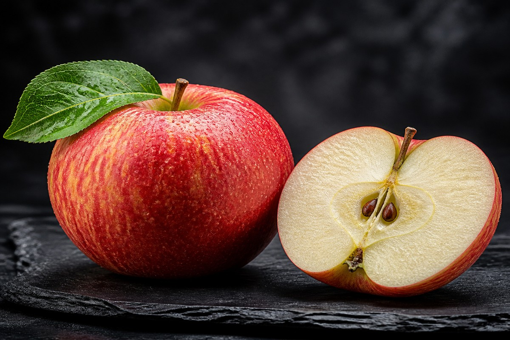

*▲ 아삭한 과육과 붉은 껍질을 지닌 신선한 사과(Apple)는 장내 유익균의 핵심 먹이가 되는 수용성 펙틴(Pectin)과 강력한 플라보노이드 항산화제인 케르세틴(Quercetin)의 집약체입니다.*

"하루 사과 한 알이면 의사를 멀리한다(An apple a day keeps the doctor away)"는 서양의 오랜 격언은 단순한 민간요법의 과장이 아닌 현대 분자생물학과 임상 영양학이 입증해 낸 생화학적 진실입니다.

사과는 인류가 수천 년간 재배해 온 가장 친숙한 과일이지만, 그 속에는 장점막 장벽을 강화하는 고순도 수용성 식이섬유 **펙틴(Pectin)**과 강력한 항염증·항알레르기 활성을 나타내는 폴리페놀 **케르세틴(Quercetin)**이 고농도로 농축되어 있습니다.

특히 사과 껍질에 다량 분포하는 **우르솔산(Ursolic Acid)**과 폴리페놀 화합물은 갈색지방 활성화와 근육 소실 억제, 그리고 혈관 내피세포의 산화질소(NO) 생성을 유도하여 전신 대사 건강을 근본적으로 개선합니다.

오늘은 미국 농무부(USDA FoodData Central)의 공인 영양 성분 분석과 국제 임상 연구들을 기반으로, 사과의 정밀 영양 조성과 4대 핵심 건강 효능, 그리고 유효 성분 흡수율을 극대화하는 섭취 가이드를 정밀하게 분석해 드립니다.

---

## 1. 사과 영양 성분 정밀 분석표 (생과 100g 기준)

사과는 수분 함량이 약 85.6%에 달하여 즉각적인 세포 수분 공급을 돕고, 소화 흡수 속도가 완만한 복합 탄수화물과 천연 유기산(사과산, 구연산)이 최적의 밸런스를 이루고 있습니다.

| 영양 성분 (Nutrient) | 함량 (100g당) | 1일 권장 섭취량 비율 (한국인 성인 기준) |
| :--- | :--- | :--- |
| **열량 (Energy)** | 52 kcal | 2.6% |
| **탄수화물 (Carbohydrates)** | 13.81 g | 4.3% |
| - 당류 (Total Sugars) | 10.39 g | 10.4% |
| - 식이섬유 (Dietary Fiber) | 2.40 g | 9.6% |
| **단백질 (Protein)** | 0.26 g | 0.5% |
| **지방 (Total Fat)** | 0.17 g | 0.3% |
| **비타민 C (Ascorbic Acid)** | 4.60 mg | 4.6% |
| **비타민 K (Phylloquinone)** | 2.20 mcg | 3.1% |
| **비타민 B6 (Pyridoxine)** | 0.041 mg | 2.7% |
| **칼륨 (Potassium, K)** | 107.00 mg | 3.1% |
| **마그네슘 (Magnesium, Mg)** | 5.00 mg | 1.6% |
| **칼슘 (Calcium, Ca)** | 6.00 mg | 0.9% |
| **총 폴리페놀 (Total Polyphenols)** | 약 110.00 mg | 기준치 없음 |
| **케르세틴 (Quercetin, 껍질 포함)** | 약 4.40 mg | 기준치 없음 |
| **수분 (Water)** | 85.56 g | 별도 표기¹ |

*※ 출처: 미국 농무부(USDA FoodData Central) 표준 분석 데이터.*  
*¹ 수분은 1일 권장 규정치 대신 체내 체액 항상성 유지를 위한 기본 용매로 분류됩니다.*  
*※ '기준치 없음' 표기는 인체 필수 항상성 유지 지표이나 국가별 공인 영양소 섭취 기준(DRI)상 일일 권장 백분율(%DV)이 아직 법적으로 책정되지 않은 기능성 파이토케미컬을 명시한 것입니다.*

---

## 2. 과학적으로 입증된 사과의 4대 건강 효능

### ① 장내 미생물총 생태계 복원 및 단쇄지방산(SCFA) 생성
사과의 가장 독보적인 가치는 수용성 식이섬유인 **펙틴(Pectin)**에서 나옵니다. 펙틴은 상부 위장관에서 소화 효소에 의해 분해되지 않고 대장으로 안전하게 도달하는 프리바이오틱스(Prebiotics) 물질입니다. 

대장에 도달한 펙틴은 유익균인 비피도박테리아(Bifidobacteria)와 유박테리움(Eubacterium)의 최상급 먹이로 발효되어 **부티레이트(Butyrate)**, 아세테이트, 프로피오네이트 등 단쇄지방산(SCFA)을 다량 생성합니다. 부티레이트는 대장 상피세포의 주 에너지원으로 작용하여 장점막 결합 단백질(Tight Junction)을 견고하게 복구하고, '장누수 증후군'과 체내 만성 전신 염증(Endotoxemia)을 근본적으로 차단합니다.

### ② 케르세틴 기반 혈관 내피세포 보호 및 혈압 조절
사과 껍질에 집중된 플라보놀 화합물 **케르세틴(Quercetin)**은 혈관벽의 산화 스트레스를 직접 제거하는 강력한 스캐빈저입니다. 케르세틴은 혈관 내피세포에서 산화질소 합성효소(eNOS)의 발현을 자극하여 혈관 확장 물질인 산화질소(NO)의 생체이용률을 증가시킵니다.

이는 혈관벽의 평활근을 이완시켜 말초 혈관 저항을 낮추고 고혈압 위험을 유의미하게 경감시킵니다. 또한 LDL 콜레스테롤이 활성산소에 의해 산화되어 혈관 내벽에 플라크를 형성하는 과정을 억제하여 죽상동맥경화증을 선제적으로 예방합니다.

### ③ 인슐린 감수성 개선 및 혈당 스파이크 완충
사과는 단맛을 지니고 있음에도 불구하고 **혈당지수(GI)가 약 36, 혈당부하(GL)가 5 안팎**에 불과한 대표적인 저혈당 식품입니다. 

사과에 풍부한 수용성 섬유질 겔(Gel) 복합체는 소장에서 포도당이 혈류로 흡수되는 속도를 물리적으로 지연시킵니다. 또한 사과의 고유 파이토케미컬인 **플로리진(Phloridzin)**은 소장 융모막의 나트륨-포도당 공동 수송체(SGLT1)를 선택적으로 억제하여 식후 혈당 급상승을 막고 췌장 베타세포의 인슐린 과다 분비 부담을 획기적으로 덜어줍니다.

### ④ 폐 기능 보호 및 알레르기·천식 반응 완화
대규모 역학 조사 연구(Epidemiological Studies)에 따르면 주 5회 이상 정기적으로 사과를 섭취한 집단은 그렇지 않은 집단에 비해 1초간 노력성 호기량(FEV1) 등 전반적인 폐 기능 지표가 현저히 높게 유지되는 것으로 나타났습니다. 

이는 케르세틴이 비만세포(Mast cells)와 호염구에서 염증 전달 물질인 히스타민(Histamine)과 류코트리엔의 유출을 차단하는 천연 항히스타민 막 안정화 작용을 발휘하기 때문입니다. 미세먼지와 대기 오염 물질로 인한 기관지 염증 및 천식 증상 완화에 직접적인 생화학적 방어선을 제공합니다.

---

## 3. 유효 성분 흡수율을 극대화하는 섭취 가이드

### 반드시 껍질째 통째로 섭취하십시오
사과의 핵심 항산화 물질인 케르세틴과 우르솔산, 그리고 총 폴리페놀의 약 50% 이상이 **과육이 아닌 껍질과 껍질 바로 밑의 아표피층**에 집약되어 있습니다. 껍질을 깎아내고 과육만 섭취할 경우 항산화 활성의 절반 이상을 스스로 폐기하는 셈입니다. 

베이킹소다나 칼슘파우더를 희석한 물에 사과를 3~5분간 담근 뒤 흐르는 미온수에 세척하면 잔류 농약과 표면 왁스를 99% 이상 안전하게 제거할 수 있습니다.

### 착즙 주스가 아닌 원물 그대로 씹어서 섭취
사과를 믹서기에 갈거나 착즙 주스로 섭취하면 불용성·수용성 식이섬유 구조가 물리적으로 파괴됩니다. 섬유질 망 구조가 깨지면 액상 과당과 포도당이 간 문맥으로 폭발적으로 흡수되어 인슐린 스파이크와 지방간 형성을 촉진합니다. 펙틴의 온전한 정장 작용과 장내 유익균 발효 이점을 온전히 누리기 위해서는 반드시 원형 상태로 천천히 저작(Mastication)하여 섭취해야 합니다.

---

## 4. 섭취 시 주의사항 및 잠재적 부작용

### 사과 씨앗의 아미그달린 독성
사과 중심부의 씨앗에는 청산 배당체인 **아미그달린(Amygdalin)**이 함유되어 있습니다. 체내 소화 효소와 반응하면 유독 물질인 시안화수소(HCN, 청산가리 계열)를 생성할 수 있으므로, 씨앗 부분은 완전히 도려내고 섭취해야 합니다. 무심코 서너 개의 씨앗을 씹어 삼켰다고 해서 치명적인 중독이 일어나는 것은 아니나, 다량 분쇄 섭취는 엄격히 금해야 합니다.

### 위산 역류 질환(GERD) 환자의 늦은 밤 섭취 주의
사과에는 말산(Malic acid) 등 천연 유기산이 풍부하여 위액 분비를 촉진합니다. 위벽이 약하거나 역류성 식도염을 앓고 있는 분이 취침 직전 빈속에 사과를 다량 섭취할 경우 위산 과다로 인한 속쓰림과 수면 장애를 유발할 수 있습니다. 위장이 민감하신 분은 공복 아침보다는 식후 디저트나 낮 시간대 간식으로 섭취하는 것이 좋습니다.

---

## 5. 최종 요약 및 실천 팁

1. **펙틴과 케르세틴의 시너지:** 사과는 대장 장점막을 치유하는 단쇄지방산(부티레이트)을 생성하고, 혈관 내피세포 산화 손상을 방어하는 최상급 항산화 과일입니다.
2. **영양의 절반은 껍질에:** 핵심 파이토케미컬은 껍질에 집약되어 있으므로 깨끗이 세척 후 껍질째 섭취해야 완전한 효능을 얻습니다.
3. **가공 주스 지양, 원물 저작:** 혈당 조절과 펙틴의 프리바이오틱스 효과를 위해 갈지 않고 그대로 아삭하게 씹어 드시는 것이 최고의 복용법입니다.
