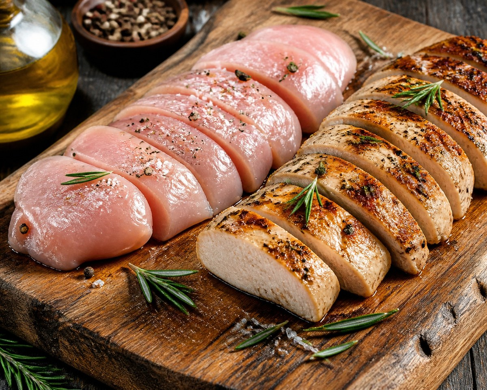

*▲ 저지방 고단백의 대표 식재료인 닭가슴살(Chicken Breast)은 골격근 합성에 관여하는 류신(Leucine)을 비롯한 BCAA가 풍부한 식품입니다. 이 글의 영양 수치는 USDA FoodData Central FDC 171077(생것·껍질·뼈 제거) 기준입니다.*

한 줄 결론 <strong>닭가슴살 100g(생것·껍질·뼈 제거)은 120kcal, 단백질 22.5g, 지방 2.62g입니다.</strong> 단백질 비중이 높아 지방을 줄이면서 단백질을 채울 때 기준 식품이 되고, 60~65℃에서 익히면 수분 손실이 적어 퍽퍽함이 줄어듭니다. 국내 국가표준식품성분표의 '닭고기, 가슴, 생것'은 106kcal·단백질 22.97g으로, 시료와 손질 부위가 달라 값이 조금 다릅니다.

현대 스포츠 영양학과 임상 식이요법에서 **닭가슴살(Chicken Breast)**은 단순한 다이어트 식품을 넘어 세포 재생과 근육 대사의 표준(Gold Standard) 단백질 급원으로 자리매김하고 있습니다.

닭가슴살은 수분을 제외한 건조 중량의 대부분이 단백질로 구성되어 있으며(FDC 171077 기준 단백질 22.5g, 수분 73.9g), 체내 합성이 불가능한 필수아미노산(EAA) 중에서도 근단백질 합성(MPS) 신호에 관여하는 **분지쇄아미노산(BCAA: 류신, 이소류신, 발린)**이 들어 있습니다.

닭고기에는 **이미다졸 디펩티드(카르노신, 안세린)**도 들어 있습니다. 시험관·동물 연구에서는 근육 내 산도 완충과 산화 스트레스 감소가 보고됐지만, 닭가슴살을 먹었을 때 사람의 피로가 얼마나 개선되는지는 임상적으로 확립되지 않았습니다. 함량은 부위와 조리법에 따라 크게 달라 공인 분석값을 확인하지 못해 아래 표에서는 제외했습니다.

미국 농무부(USDA FoodData Central) FDC 171077의 분석 데이터를 기준으로 닭가슴살의 영양 성분과, 근육 합성·피로와 관련해 실제로 확인된 범위, 퍽퍽함 없이 수분을 보존하는 조리법을 정리합니다.

---

## 1. 닭가슴살 칼로리와 영양성분은? (단백질 22.5g·칼륨 334mg)

닭가슴살은 지방 함량이 1.5% 미만으로 극히 낮으며, 탄수화물이 전혀 없는 고순도 저열량 고단백 식품입니다.

| 영양 성분 (Nutrient) | 함량 (100g당) | 1일 권장 섭취량 비율 (한국인 성인 기준) |
| :--- | :--- | :--- |
| **열량 (Energy)** | 120 kcal | 6.0% |
| **탄수화물 (Carbohydrates)** | 0.00 g | 0.0% |
| - 당류 (Total Sugars) | 0.00 g | 0.0% |
| - 식이섬유 (Dietary Fiber) | 0.00 g | 0.0% |
| **단백질 (Protein)** | 22.50 g | 40.9% |
| - 류신 (Leucine, BCAA) | 1.86 g | 기준치 없음 |
| - 이소류신 (Isoleucine, BCAA) | 1.10 g | 기준치 없음 |
| - 발린 (Valine, BCAA) | 1.17 g | 기준치 없음 |
| **지방 (Total Fat)** | 2.62 g | 4.9% |
| - 포화지방산 (Saturated Fat) | 0.56 g | 3.7% |
| - 단일불포화지방산 (MUFA) | 0.69 g | 기준치 없음 |
| - 다가불포화지방산 (PUFA) | 0.42 g | 기준치 없음 |
| **비타민 B3 (나이아신)** | 9.60 mg | 64.0% |
| **비타민 B6 (피리독신)** | 0.81 mg | 54.1% |
| **비타민 B12 (코발라민)** | 0.21 mcg | 8.8% |
| **인 (Phosphorus, P)** | 213.00 mg | 30.4% |
| **칼륨 (Potassium, K)** | 334.00 mg | 9.5% |
| **셀레늄 (Selenium, Se)** | 22.80 mcg | 41.5% |
| **수분 (Water)** | 73.90 g | 별도 표기¹ |

*※ 출처: [USDA FoodData Central FDC 171077](https://fdc.nal.usda.gov/food-details/171077/nutrients) — 닭고기 가슴, 생것, 껍질·뼈 제거(SR Legacy). 국내 국가표준식품성분표의 '닭고기, 가슴, 생것'(식품코드 I008000D020a, 농진청 '15)은 106kcal·단백질 22.97g·지방 0.97g으로 시료와 손질 기준이 다릅니다.*  

*¹ 수분은 체액 항상성 유지를 위한 기본 용매로 분류됩니다.*  
*※ '기준치 없음' 표기는 기능성 아미노산 및 펩타이드로 DRI상 일일 권장 백분율(%DV)이 법적으로 규정되지 않은 항목입니다.*

### 같은 닭가슴살인데 왜 미국 자료는 120kcal, 국내 자료는 106kcal인가?

닭가슴살 100g 열량은 자료에 따라 120kcal와 106kcal로 갈립니다. 나란히 놓으면 차이가 어디서 생기는지 바로 보입니다.

| 기준 | 열량 | 단백질 | 지방 | 칼륨 | 수분 |
| :--- | :--- | :--- | :--- | :--- | :--- |
| USDA FoodData Central, 닭고기 가슴, 생것, 껍질·뼈 제거 (FDC 171077) | 120 kcal | 22.5 g | 2.62 g | 334 mg | 73.9 g |
| 농진청 국가표준식품성분표, 닭고기 가슴, 생것 (식품코드 I008000D020a, 농진청 '15) | 106 kcal | 22.97 g | 0.97 g | 371 mg | 76.2 g |

단백질은 거의 같고(22.5g과 22.97g), **지방이 1.65g 적은 것이 열량 차이의 대부분**을 설명합니다. 지방 1g은 약 9kcal이므로 1.65g은 약 15kcal이고, 두 값의 차이 14kcal와 거의 일치합니다. 다시 말해 **국내 시료는 붙은 지방을 더 많이 도려낸 살코기**이고, USDA 항목은 같은 '껍질·뼈 제거'라도 지방이 조금 더 남아 있는 시료입니다.

두 값 모두 **생것**이며 삶거나 구운 값이 아닙니다. 익히면 수분이 빠져 100g당 열량과 단백질이 함께 올라갑니다. 같은 USDA 자료의 구운 닭가슴살 항목(FDC 171477)은 100g당 165kcal·단백질 31.0g·지방 3.57g입니다. 그러므로 **생것 120kcal, 익힌 것 165kcal은 서로 다른 단계의 값**이고, 조리 후 무게가 줄어든 만큼 100g에 든 영양소가 농축된 결과입니다.

정리하면, 이 글의 표는 USDA 생것(171077) 기준이고, 국내 성분표로 식단을 계산할 때는 100g 106kcal을 쓰시면 됩니다. 두 값을 섞어 쓰면 같은 닭가슴살 100g이 106kcal도 120kcal도 되는 모순이 생깁니다.

### 1회 섭취량 환산: 닭가슴살 한 토막·한 팩은 몇 kcal인가?

닭가슴살은 생것과 익힌 것의 무게가 다릅니다. 생것은 USDA 생닭가슴살(FDC 171077), 익힌 것은 같은 자료의 구운 항목(FDC 171477, 100g당 165kcal·단백질 31.0g)으로 따로 적었습니다.

| 섭취 단위 | 무게 | 열량 | 단백질 |
| :--- | :--- | :--- | :--- |
| 생것 한 토막 | 100 g | 120 kcal | 22.50 g |
| 생것 4 oz(113 g) | 113 g | 136 kcal | 25.43 g |
| 생것 한 팩(2조각) | 200 g | 240 kcal | 45.00 g |
| 익힌 것 100 g(FDC 171477) | 100 g | 165 kcal | 31.02 g |

*※ 생것 200g을 익히면 무게가 150g 안팎으로 줄지만 단백질 총량은 45g 그대로입니다. 식단에 적을 때는 **익힌 뒤 무게가 아니라 생것 무게로 계산해야** 단백질을 과소평가하지 않습니다.*

---

## 2. 닭가슴살 효능은 무엇일까? 과학으로 입증된 4대 효과

### ① 류신에 의한 골격근 단백질 합성(MPS) 신호
닭가슴살 100g에는 류신(Leucine)이 약 1.86g 들어 있습니다(FDC 171077). 류신 농도가 일정 수준을 넘으면 세스트린2(Sestrin2) 센서를 거쳐 **mTORC1** 신호가 켜지고 단백질 합성이 늘어난다는 것이 근육 생리 연구에서 반복 확인됐습니다. 다만 이는 식사 한 끼의 류신 양과 함께 총 단백질 섭취량, 저항운동 여부, 개인 상태에 따라 달라지며, 닭가슴살만으로 근감소증을 예방한다고 단정할 수는 없습니다.

### ② 이미다졸 디펩티드의 산도 완충 — 인체 근거는 제한적
**카르노신(Carnosine)**과 **안세린(Anserine)**은 베타-알라닌과 히스티딘이 결합된 디펩티드입니다. 시험관 및 동물 실험에서는 근육 내 산도 완충과 지질 과산화 억제가 보고됐습니다. 그러나 닭가슴살 섭취로 근육 카르노신 농도가 얼마나 오르는지, 운동 후 회복 시간이 얼마나 줄어드는지는 사람 대상 연구에서 확립되지 않았으므로 '회복 시간 단축' 같은 수치로 약속하지 않습니다.

### ③ 비타민 B군 공급
닭가슴살 100g은 나이아신 9.6mg(성인 기준치의 약 64%), 비타민 B6 0.81mg(약 54%)를 공급합니다(FDC 171077, 한국인 영양성분 기준치 환산). 나이아신은 탄수화물·지방 대사에 관여하는 조효소 NAD의 구성 성분이고, 비타민 B6는 아미노산 대사와 신경전달물질 합성에 필요합니다. 결핍을 채우는 의미이며, 충분히 먹는 사람에게 '무기력증 개선' 효과를 보장하는 것은 아닙니다.

### ④ 셀레늄과 갑상선 호르몬 대사
닭가슴살 100g에는 셀레늄이 22.8mcg(성인 기준치의 약 42%) 들어 있습니다. 셀레늄은 글루타치온 과산화효소와 탈요오드화효소의 구성 성분으로, 갑상선 호르몬 전환(T4 → T3)에 관여합니다. 셀레늄이 부족하면 갑상선 기능에 문제가 생길 수 있지만, 충분한 사람이 더 먹는다고 대사율이 높아지거나 노화가 늦춰진다는 근거는 없습니다.

---

## 3. 닭가슴살은 어떻게 삶아야 퍽퍽하지 않을까? 온도와 시간

### 저온 조리(수비드) 또는 스팀 가열 권장
단백질은 65℃를 넘으면 미오신과 액틴 섬유가 수축하면서 세포 내 수분을 밖으로 밀어내 식감이 질겨집니다. 60~64℃에서 1~2시간 천천히 가열하는 수비드나 짧은 스팀 조리를 쓰면 육즙 손실이 줄어 촉촉하게 익습니다. 조리 후 단백질 소화율은 조리법에 따라 조금 달라지지만, 특정 수치(%)로 약속할 만큼 근거가 정리되어 있지 않습니다.

### 레몬즙이나 파인애플 즙을 활용한 연육 처리
닭가슴살 조리 전 레몬즙(구연산)이나 파인애플(브로멜라인 단백질 분해 효소) 즙에 20~30분간 재워두면 단단한 단백질 결합이 부드럽게 분해되어 위장관 내 소화 효소 침투가 용이해집니다.

---

## 4. 닭가슴살 부작용과 주의할 점은?

### 과도한 단백질 과다 섭취와 신장 여과 부담
건강한 성인이라면 체중 1kg당 1.2~2.0g 범위의 단백질 섭취가 흔히 권장되지만, 이는 개인의 신장 기능과 활동량에 따라 달라지는 일반적 범위이며 모든 사람에게 적용되는 '안전 상한'은 아닙니다. 그러나 이미 신장 질환(신부전, 사구체신염)을 앓고 있는 환자가 과량의 닭가슴살을 지속 섭취할 경우 질소 노폐물(요소 질소, BUN) 배출을 위한 사구체 과여과(Hyperfiltration)가 유발되어 신기능이 악화될 수 있으므로 주치의와 상담 후 섭취량을 조절해야 합니다.

### 채소와 수분 섭취 부족 시 변비 유발
닭가슴살은 식이섬유가 0g인 순수 단백질 식품입니다. 충분한 식이섬유와 수분 없이 닭가슴살만 섭취할 경우 장내 수분이 흡수되어 대변이 단단해지고 변비가 발생하기 쉽습니다. 반드시 풍부한 잎채소나 수용성 펙틴이 풍부한 과일을 곁들여야 합니다.

---

## 5. 닭가슴살 하루 얼마나 먹을까? 핵심 요약

1. **단백질 밀도:** 100g에 단백질 22.5g·지방 2.62g으로, 같은 열량에서 단백질 비중이 높습니다(FDC 171077).
2. **이미다졸 디펩티드:** 카르노신·안세린이 들어 있으나 인체 피로 회복 효과는 아직 확립되지 않았습니다.
3. **저온 조리와 채소 병용:** 수비드나 약불 조리로 수분을 지키고, 식이섬유가 없으므로 채소와 함께 먹는 편이 좋습니다.

---

## 6. 닭가슴살과 함께 먹으면 좋은 음식은?

- **[마늘 (Garlic)]({{ site.baseurl }}/posts/garlic-nutrition-benefits/)**: 마늘의 알리신 성분이 닭가슴살의 풍부한 비타민 B6와 결합하여 아미노산 대사 효율을 극대화하고 단백질의 체내 축적을 돕습니다.
- **[닭다리살 (Chicken Thigh)]({{ site.baseurl }}/posts/chicken-thigh-nutrition-benefits/)**: 껍질을 벗긴 닭다리살은 119kcal·단백질 19.7g으로 닭가슴살과 열량이 같고, 철분·아연·비타민B12가 더 많습니다. 단백질 효율은 가슴살, 미네랄은 다리살로 번갈아 쓰면 좋습니다.
- **[브로콜리 (Broccoli)]({{ site.baseurl }}/posts/broccoli-nutrition-benefits/)**: 브로콜리의 풍부한 비타민 C와 칼륨이 닭가슴살 단백질 섭취 후 발생하는 유해 활성산소를 억제하고 나트륨-칼륨 펌프 균형을 맞춥니다.
- **[토마토 (Tomato)]({{ site.baseurl }}/posts/tomato-nutrition-benefits/)**: 토마토의 유기산(구연산, 사과산)이 위산 분비를 촉진해 고단백 닭가슴살의 소화 흡수를 가속하고 닭고기 특유의 잡내를 완벽히 잡아냅니다.

---

## 7. 자주 묻는 질문 (FAQ)

### Q1. 매일 닭가슴살만 먹으면 신장에 무리가 가거나 통풍이 생기나요?
**A:** 신장 기능이 정상인 사람이 하루 200~300g을 나눠 먹는 사례는 흔하지만, 이 양이 ‘누구에게나 안전한 상한’으로 확립된 수치는 아닙니다. 닭가슴살은 붉은 고기나 내장육보다 퓨린이 적은 편이지만 통풍 위험이 없다는 뜻은 아니며, 신장 질환이 있다면 섭취량을 주치의와 상의해야 합니다. 수분 섭취는 평소 갈증에 맞춰 충분히 하는 것으로 충분합니다.

### Q2. 퍽퍽한 닭가슴살을 부드럽고 촉촉하게 먹는 과학적인 조리법은 무엇인가요?
**A:** 조리 전 10% 염수(물 1L에 소금 10g, 설탕 5g)에 30분간 담그는 브라이닝이나, 60~64℃ 저온 진공 수비드로 조리하면 근섬유 수축이 줄어 육즙 손실이 적습니다. 다만 염수는 나트륨을 더하므로 저염 식사 중이라면 소금 양을 줄이십시오.

### Q3. 한 끼 식사에서 단백질은 30g까지만 흡수된다는 말이 사실인가요?
**A:** 널리 퍼진 오해입니다. 한 끼에 30g을 넘겨 먹어도 소화관에서 대부분 흡수됩니다. 다만 근단백질 합성을 최대로 자극하는 류신 양은 대략 2.5~3g(단백질 25~35g 분량)으로 보고되므로, 한 번에 몰아 먹기보다 3~4시간 간격으로 20~30g씩 나눠 먹는 방식이 근육 합성에 유리하다는 연구가 많습니다. 총 섭취량이 우선이고, 분배는 그다음 문제입니다.

  
📌 관련 순위 가이드

  <ul>
    <li><a href="/posts/high-protein-foods-ranking/">단백질 많은 음식 TOP 10: 100g당 함량과 흡수율 비교</a></li>
    <li><a href="/posts/low-calorie-high-satiety-foods/">저칼로리 포만감 다이어트 음식 TOP 10: 100g 비교</a></li>
  </ul>

