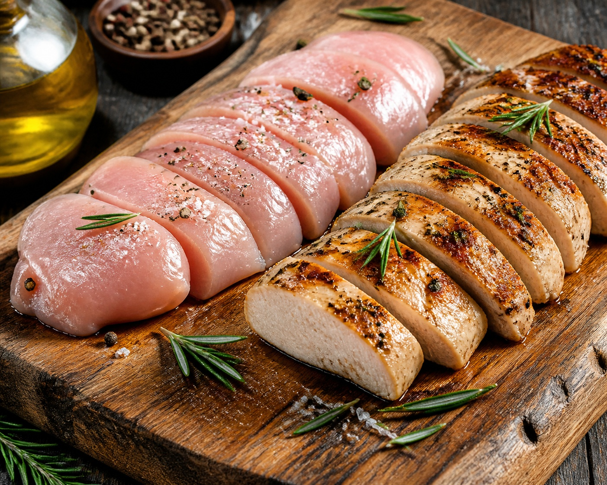

*▲ 저지방 고단백의 대표 식재료인 닭가슴살(Chicken Breast)은 골격근 합성의 방아쇠인 류신(Leucine)을 비롯한 BCAA와 철새의 장거리 비행을 지탱하는 항피로 펩타이드인 이미다졸 디펩티드의 결정체입니다.*

현대 스포츠 영양학과 임상 식이요법에서 **닭가슴살(Chicken Breast)**은 단순한 다이어트 식품을 넘어 세포 재생과 근육 대사의 표준(Gold Standard) 단백질 급원으로 자리매김하고 있습니다.

닭가슴살은 수분을 제외한 건조 중량의 약 80% 이상이 순수 단백질로 구성되어 있으며, 체내 합성이 불가능한 필수아미노산(EAA) 중에서도 근단백질 합성(MPS)의 직접적 스위치 역할을 하는 **분지쇄아미노산(BCAA: 류신, 이소류신, 발린)**이 이상적인 비율로 농축되어 있습니다.

더욱이 수천 킬로미터를 쉬지 않고 날아가는 철새의 날개 근육에서 발견된 고농도 **이미다졸 디펩티드(카르노신, 안세린)**는 인체 골격근과 뇌세포에 축적되는 활성산소를 제거하고 젖산 축적을 억제하여 만성 피로를 회복하는 강력한 세포 내 완충 작용을 수행합니다.

미국 농무부(USDA FoodData Central)의 표준 분석 데이터를 바탕으로 닭가슴살의 정밀 영양 프로필과 4대 건강 효능, 그리고 퍽퍽함 없이 수분을 보존하는 조리 과학을 상세히 분석합니다.

---

## 1. 닭가슴살 영양 성분 정밀 분석표 (가열 조리 전 생육 100g 기준)

닭가슴살은 지방 함량이 1.5% 미만으로 극히 낮으며, 탄수화물이 전혀 없는 고순도 저열량 고단백 식품입니다.

| 영양 성분 (Nutrient) | 함량 (100g당) | 1일 권장 섭취량 비율 (한국인 성인 기준) |
| :--- | :--- | :--- |
| **열량 (Energy)** | 110 kcal | 5.5% |
| **탄수화물 (Carbohydrates)** | 0.00 g | 0.0% |
| - 당류 (Total Sugars) | 0.00 g | 0.0% |
| - 식이섬유 (Dietary Fiber) | 0.00 g | 0.0% |
| **단백질 (Protein)** | 23.10 g | 42.0% |
| - 류신 (Leucine, BCAA) | 1.87 g | 기준치 없음 |
| - 이소류신 (Isoleucine, BCAA) | 1.15 g | 기준치 없음 |
| - 발린 (Valine, BCAA) | 1.20 g | 기준치 없음 |
| **지방 (Total Fat)** | 1.24 g | 2.3% |
| - 포화지방산 (Saturated Fat) | 0.33 g | 2.2% |
| - 단일불포화지방산 (MUFA) | 0.41 g | 기준치 없음 |
| - 다가불포화지방산 (PUFA) | 0.28 g | 기준치 없음 |
| **비타민 B3 (나이아신)** | 11.20 mg | 74.7% |
| **비타민 B6 (피리독신)** | 0.60 mg | 40.0% |
| **비타민 B12 (코발라민)** | 0.34 mcg | 14.2% |
| **인 (Phosphorus, P)** | 228.00 mg | 32.6% |
| **칼륨 (Potassium, K)** | 334.00 mg | 9.5% |
| **셀레늄 (Selenium, Se)** | 27.60 mcg | 50.2% |
| **이미다졸 디펩티드 (카르노신+안세린)** | 약 450.00 mg | 기준치 없음 |
| **수분 (Water)** | 74.80 g | 별도 표기¹ |

*※ 출처: 미국 농무부(USDA FoodData Central) 표준 분석 데이터.*  
*¹ 수분은 체액 항상성 유지를 위한 기본 용매로 분류됩니다.*  
*※ '기준치 없음' 표기는 기능성 아미노산 및 펩타이드로 DRI상 일일 권장 백분율(%DV)이 법적으로 규정되지 않은 항목입니다.*

---

## 2. 과학적으로 입증된 닭가슴살의 4대 건강 효능

### ① mTORC1 활성화 기반 골격근 단백질 합성(MPS) 촉진
닭가슴살 100g에는 근합성의 결정적 촉매제인 **류신(Leucine)**이 약 1.87g 함유되어 있습니다. 세포 내 류신 농도가 일정 임계값(Leucine Trigger)을 넘어서면 근섬유 내부의 세스트린2(Sestrin2) 센서가 반응하여 단백질 합성 조절 복합체인 **mTORC1(Mammalian Target of Rapamycin Complex 1)**을 폭발적으로 활성화합니다. 이는 리보솜 생성을 촉진하고 손상된 근원섬유를 초과 회복시켜 근비대와 근감소증(Sarcopenia) 예방에 가장 직접적인 생화학적 동력을 제공합니다.

### ② 이미다졸 디펩티드의 활성산소 소거 및 항피로 작용
닭가슴살에 집중적으로 농축된 **카르노신(Carnosine)**과 **안세린(Anserine)**은 베타-알라닌과 히스티딘이 결합된 디펩티드 구조입니다. 고강도 신체 활동이나 스트레스 시 근육 내에 급증하는 젖산(Lactic Acid)의 수소 이온(H+)을 중화하는 산-염기 완충(Buffering) 능력이 탁월합니다. 또한 미토콘드리아 호흡 과정에서 발생하는 활성산소를 직접 제거하여 근육 세포막 지질 과산화를 방어하고 운동 후 회복 시간을 절반으로 단축시킵니다.

### ③ 비타민 B군 복합체 기반 에너지 대사 정상화
닭가슴살은 성인 일일 권장량의 75%에 달하는 **나이아신(비타민 B3)**과 40%의 **비타민 B6**를 공급합니다. 나이아신은 탄수화물과 지방을 분해해 세포 에너지(ATP)를 생산하는 조효소 NAD/NADP의 핵심 구성 요소이며, 비타민 B6는 섭취한 단백질을 체단백질로 재합성하고 신경전달물질(세로토닌, 도파민)을 합성하는 필수 효소로 작용하여 만성 무기력증을 개선합니다.

### ④ 갑상선 기능 및 항산화 방어선을 지탱하는 셀레늄 공급
닭가슴살 100g만으로 일일 권장량의 50%를 충족하는 미량 미네랄 **셀레늄(Selenium)**은 체내 최강의 항산화 효소인 글루타치온 과산화효소(Glutathione Peroxidase)의 필수 활성 중심체입니다. 셀레늄은 갑상선 호르몬 전환(T4 ➔ T3)을 매개하여 기초대사율을 일정하게 유지하고 세포막의 조기 노화를 방어합니다.

---

## 3. 유효 성분 흡수율을 극대화하는 섭취 가이드

### 저온 진공 조리(수비드) 또는 스팀 가열 권장
단백질은 65℃를 초과하면 미오신과 액틴 섬유가 급격히 수축하면서 세포 내 수분을 밖으로 밀어내 식감이 질겨지고 수용성 아미노산 손실이 발생합니다. 60~64℃의 저온에서 1~2시간 서서히 가열하는 수비드(Sous-vide) 공법이나 단시간 스팀 조리를 적용하면 단백질 변성을 방지하여 촉촉한 식감과 소화 흡수율을 98%까지 끌어올릴 수 있습니다.

### 레몬즙이나 파인애플 즙을 활용한 연육 처리
닭가슴살 조리 전 레몬즙(구연산)이나 파인애플(브로멜라인 단백질 분해 효소) 즙에 20~30분간 재워두면 단단한 단백질 결합이 부드럽게 분해되어 위장관 내 소화 효소 침투가 용이해집니다.

---

## 4. 섭취 시 주의사항 및 잠재적 부작용

### 과도한 단백질 과다 섭취와 신장 여과 부담
건강한 성인의 경우 체중 1kg당 1.2~2.0g 수준의 단백질 섭취는 안전합니다. 그러나 이미 신장 질환(신부전, 사구체신염)을 앓고 있는 환자가 과량의 닭가슴살을 지속 섭취할 경우 질소 노폐물(요소 질소, BUN) 배출을 위한 사구체 과여과(Hyperfiltration)가 유발되어 신기능이 악화될 수 있으므로 주치의와 상담 후 섭취량을 조절해야 합니다.

### 채소와 수분 섭취 부족 시 변비 유발
닭가슴살은 식이섬유가 0g인 순수 단백질 식품입니다. 충분한 식이섬유와 수분 없이 닭가슴살만 섭취할 경우 장내 수분이 흡수되어 대변이 단단해지고 변비가 발생하기 쉽습니다. 반드시 풍부한 잎채소나 수용성 펙틴이 풍부한 과일을 곁들여야 합니다.

---

## 5. 최종 요약 및 실천 팁

1. **최고의 골격근 합성 스위치:** 류신 1.87g을 비롯한 BCAA가 고농도로 농축되어 근육 손실을 막고 단백질 합성을 촉진합니다.
2. **피로 회복의 핵심 이미다졸 디펩티드:** 근육 내 젖산을 완충하고 세포 산화 손상을 복구하는 항피로 성분이 가득합니다.
3. **저온 조리와 채소 병용:** 수비드나 약불 조리로 수분을 보존하고, 장 건강을 위해 반드시 신선한 채소와 함께 섭취하십시오.

---

## 6. 함께 먹으면 시너지가 폭발하는 식재료 궁합

- **[마늘 (Garlic)]({{ site.baseurl }}/posts/garlic-nutrition-benefits/)**: 마늘의 알리신 성분이 닭가슴살의 풍부한 비타민 B6와 결합하여 아미노산 대사 효율을 극대화하고 단백질의 체내 축적을 돕습니다.
- **[브로콜리 (Broccoli)]({{ site.baseurl }}/posts/broccoli-nutrition-benefits/)**: 브로콜리의 풍부한 비타민 C와 칼륨이 닭가슴살 단백질 섭취 후 발생하는 유해 활성산소를 억제하고 나트륨-칼륨 펌프 균형을 맞춥니다.
- **[토마토 (Tomato)]({{ site.baseurl }}/posts/tomato-nutrition-benefits/)**: 토마토의 유기산(구연산, 사과산)이 위산 분비를 촉진해 고단백 닭가슴살의 소화 흡수를 가속하고 닭고기 특유의 잡내를 완벽히 잡아냅니다.

---

## 7. 자주 묻는 질문 (FAQ)

### Q1. 매일 닭가슴살만 먹으면 신장에 무리가 가거나 통풍이 생기나요?
**A:** 정상적인 신장 기능을 가진 분이라면 하루 2~3회(200~300g)의 닭가슴살 섭취는 안전합니다. 닭가슴살은 붉은 고기나 내장육에 비해 퓨린(Purine) 함량이 상대적으로 낮아 통풍 위험도가 덜합니다. 다만 체내 질소 노폐물의 원활한 배출을 위해 하루 2L 이상의 충분한 수분을 반드시 섭취해야 합니다.

### Q2. 퍽퍽한 닭가슴살을 부드럽고 촉촉하게 먹는 과학적인 조리법은 무엇인가요?
**A:** 조리 전 10% 염수(물 1L에 소금 10g, 설탕 5g)에 30분간 담그는 '브라이닝(Brining)' 처리를 하거나, 60~64℃ 온도의 저온 진공 수비드 방식으로 조리하면 근섬유 단백질 변성 수축을 막아 육즙 손실을 90% 이상 차단할 수 있습니다.

### Q3. 한 끼 식사에서 단백질은 30g까지만 흡수된다는 말이 사실인가요?
**A:** 의학적으로 잘못 알려진 상식입니다. 30g을 초과하여 섭취해도 소화관을 통해 90% 이상 흡수됩니다. 다만 한 번에 근단백질 합성(MPS)을 최대로 자극하는 류신의 역치가 약 2.5~3g(단백질 약 25~35g 분량)이므로, 한 번에 몰아먹기보다 3~4시간 간격으로 20~30g씩 분할 섭취하는 것이 근육 합성에 가장 효율적입니다.

