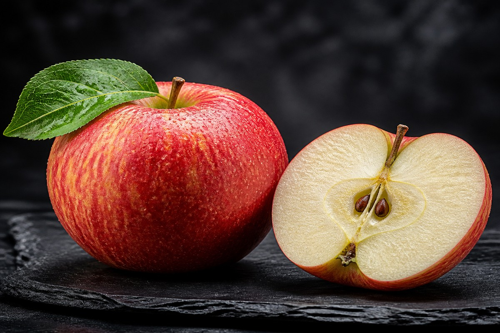

*▲ Fresh whole apples (Malus domestica) provide an extraordinary density of fermentable soluble pectin and peel-concentrated quercetin flavonoids, establishing a powerful prebiotic and endothelial defense network.*

The timeless aphorism *"An apple a day keeps the doctor away"* has evolved from an empirical folk observation into a firmly validated biological reality within contemporary molecular nutrition.

Cultivated for millennia across temperate biomes, the common apple (**Malus domestica**) harbors an intricate biochemical architecture. Far from being merely a simple source of fructose and hydration, it functions as a potent therapeutic matrix containing highly fermentable **pectin**—a high-molecular-weight soluble polysaccharide—and a rich spectrum of bioactive polyphenols led by the flavonol **quercetin**.

Furthermore, the epicuticular wax and sub-epidermal cellular layers of the apple peel concentrate substantial quantities of **ursolic acid** and oligomeric proanthocyanidins. These compounds activate brown adipose thermogenesis, attenuate skeletal muscle atrophy, and upregulate vascular endothelial nitric oxide synthase (eNOS).

Drawing upon rigorous standardized data from the **U.S. Department of Agriculture (USDA FoodData Central)** alongside peer-reviewed clinical trials, this article provides an exhaustive examination of the apple’s macro- and micronutrient profile, its four clinically substantiated health benefits, and empirical strategies to maximize phytochemical bioaccessibility.

---

## 1. Standardized Nutritional Profile of Raw Apple (Per 100 g with Skin)

Composed of approximately 85.6% biological cellular water, the raw whole apple delivers a modest glycemic load balanced by low-density energetic substrates and structural dietary fibers.

| Nutrient | Per 100 g | U.S. %DV |
| :--- | :--- | :--- |
| **Energy** | 52 kcal | 2.6% |
| **Total Carbohydrates** | 13.81 g | 5.0% |
| - Total Dietary Fiber | 2.40 g | 8.6% |
| - Total Sugars | 10.39 g | No DV |
| **Total Fat** | 0.17 g | 0.2% |
| **Protein** | 0.26 g | 0.5% |
| **Vitamin C (Ascorbic Acid)** | 4.60 mg | 5.1% |
| **Vitamin K (Phylloquinone)** | 2.20 mcg | 1.8% |
| **Vitamin B6 (Pyridoxine)** | 0.041 mg | 2.4% |
| **Potassium (K)** | 107.00 mg | 2.3% |
| **Magnesium (Mg)** | 5.00 mg | 1.2% |
| **Calcium (Ca)** | 6.00 mg | 0.5% |
| **Total Polyphenols** | ~110.00 mg | No DV |
| **Quercetin (Peel-associated)** | ~4.40 mg | No DV |
| **Water Content** | 85.56 g | See note¹ |

*※ Source: USDA FoodData Central (Standard Reference Legacy Release).*  
*¹ Water content is recognized as essential cellular solvent; standard daily dietary reference values are established independently of caloric intake.*  
*※ "No DV" denotes bioactive phytochemicals that confer profound clinical benefits but lack formal legal Daily Value percentages in current federal guidelines.*

---

## 2. Four Clinically Validated Biological Mechanisms of Apples

### ① Prebiotic Fermentation and Colonic Epithelial Barrier Integrity
The preeminent functional component of the apple is **pectin**, a complex D-galacturonic acid polymer that completely resists upper gastrointestinal hydrolysis by human digestive enzymes. 

Upon transit into the cecum and ascending colon, pectin undergoes selective microbial fermentation by saccharolytic gut commensals, particularly *Bifidobacterium spp.* and *Faecalibacterium prausnitzii*. This metabolic pathway generates high concentrations of **short-chain fatty acids (SCFAs)**, with an emphasis on **butyrate** and propionate. Butyrate serves as the primary metabolic fuel for colonocytes, upregulating tight junction protein assemblies (claudin-1, occludin, and zonula occludens-1). By sealing the intestinal epithelial barrier, apple pectin directly mitigates metabolic endotoxemia and systemic low-grade inflammation.

### ② Endothelial Protection via Quercetin and Nitric Oxide Bioavailability
The flavonol **quercetin**, alongside its glycosidic conjugates (quercetin-3-galactoside and quercetin-3-rhamnoside), exerts profound vasoprotective effects. 

Mechanistically, quercetin acts as a direct scavenger of superoxide anions ($O_2^{\bullet-}$), preventing the oxidative degradation of endothelial-derived **nitric oxide (NO)** into cytotoxic peroxynitrite ($ONOO^-$). Furthermore, quercetin stimulates phosphorylation of endothelial nitric oxide synthase (eNOS) at Ser1177, promoting smooth muscle vasorelaxation and attenuating systemic peripheral vascular resistance. Clinical trials demonstrate that habitual apple consumption significantly improves flow-mediated dilation (FMD) and lowers circulating oxidized LDL (oxLDL) particles.

### ③ Modulation of Postprandial Glycemia via SGLT1 Inhibition
Despite its palpable natural sweetness, the whole apple possesses a remarkably low **glycemic index (GI ~36)** and **glycemic load (GL ~5)**. 

The three-dimensional viscous matrix formed by hydrated soluble pectin delays gastric emptying and physically entraps luminal monosaccharides, retarding their transit across the brush border membrane. Concurrently, the unique apple dihydrochalcone **phloridzin** acts as a competitive inhibitor of the **sodium-glucose cotransporter 1 (SGLT1)** located on enterocyte apical membranes. This dual action blunts postprandial glucose surges and reduces compensatory insulin hypersecretion by pancreatic beta cells.

### ④ Pulmonary Protection and Mast Cell Stabilization
Extensive longitudinal cohort studies reveal an inverse relationship between regular apple intake (exceeding 5 servings weekly) and the decline of forced expiratory volume in one second (FEV1). 

This pulmonary protective action is primarily mediated by quercetin’s ability to inhibit calcium influx into mast cells and basophils, effectively stabilizing cell membranes against degranulation and suppressing the downstream release of histamine, leukotrienes, and pro-inflammatory interleukins (IL-4, IL-13). As a result, dietary apple intake serves as an efficacious nutritional buffer against airborne particulates and allergic airway hyperresponsiveness.

---

## 3. Evidence-Based Optimization of Nutritional Ingestion

### Mandatory Consumption of Unpeeled Whole Fruit
Phytochemical quantification reveals that **over 50% of an apple’s total polyphenols, and virtually all of its quercetin and ursolic acid, reside within the peel and immediate sub-epidermal strata**. Peeling an apple discards the majority of its cardioprotective and metabolic value. 

To eliminate exogenous surface agricultural residues without stripping nutrient-dense waxy layers, submerge whole fruit in a 1% sodium bicarbonate (baking soda) aqueous solution for 3 to 5 minutes, followed by a thorough mechanical rinse under warm running water.

### Prioritize Whole Matrix Chewing Over Centrifugal Juicing
Subjecting whole apples to mechanical juicing or high-shear blending shears the delicate pectin polymer chains and completely removes insoluble hemicellulose. 

Deprived of its protective fiber architecture, the isolated liquid carbohydrate fraction is rapidly absorbed via the hepatic portal vein, promoting de novo lipogenesis and hepatic steatosis. To preserve the satiety-inducing and microbiota-nourishing properties of the food matrix, apples should always be consumed whole, chewed thoroughly to stimulate salivary amylase and release bound polyphenols gradually.

---

## 4. Toxicological Caveats and Clinical Precautions

### Cyanogenic Glycosides in Apple Seeds (Amygdalin)
Apple core seeds contain **amygdalin**, a cyanogenic glycoside that releases hydrogen cyanide (HCN) upon enzymatic contact with intestinal beta-glucosidases. 

While accidental ingestion of a few intact seeds poses zero clinical threat due to the indigestible outer seed coat, deliberate mastication or pulverized blending of entire apple cores in high volume must be strictly avoided to prevent subclinical cyanide toxicosis.

### Nocturnal Gastroesophageal Reflux (GERD) Vulnerability
Apples possess substantial concentrations of organic malic and citric acids (pH ~3.3–4.0), which stimulate gastric acid secretion. Individuals with pre-existing gastroesophageal reflux disease or erosive gastritis should avoid consuming raw apples on an empty stomach immediately before retiring to bed, as horizontal recumbency can exacerbate nocturnal reflux and epigastric burning.

---

## 5. Concluding Clinical Summary

1. **Prebiotic SCFA Driver:** Soluble pectin acts as an indispensable substrate for colonic butyrate generation, reinforcing gut barrier integrity and suppressing systemic endotoxemia.
2. **Endothelial & Vascular Shield:** Peel-bound quercetin upregulates nitric oxide bioavailability, attenuating arterial stiffness and lowering systemic blood pressure.
3. **Preserve the Whole Matrix:** Always consume unpeeled, mechanically unadulterated whole fruit to secure the full spectrum of phytochemical synergy.

---

## 6. Synergistic Food Pairings for Maximum Nutrient Absorption

- **[Salmon]({{ site.baseurl }}/en/posts/salmon-nutrition-benefits/)**: Soluble pectin and quercetin protect long-chain polyunsaturated fatty acids from oxidation and stimulate endothelial nitric oxide bioavailability.
- **[Onion]({{ site.baseurl }}/en/posts/onion-nutrition-benefits/)**: Combining apples and onions merges dietary quercetin fractions, elevating systemic anti-inflammatory resilience and microcirculatory integrity.
- **[Broccoli]({{ site.baseurl }}/en/posts/broccoli-nutrition-benefits/)**: Cross-synergy between apple flavonoids and cruciferous sulforaphane activates intracellular Nrf2-ARE antioxidant response elements.

---

## 7. Frequently Asked Questions (FAQ)

### Q1. Is there scientific truth behind the proverb 'Gold in the morning, poison at night' regarding apples?
**A:** It is a clinical myth. Apples are never toxic at night. However, organic malic acids stimulate gastric secretions, which might exacerbate acid reflux in sensitive recumbent individuals, making morning ingestion preferable.

### Q2. Can diabetic individuals safely consume apples without provoking glycemic volatility?
**A:** Yes, one small-to-medium apple (GI ~36) daily is metabolically beneficial. Soluble pectin matrices decelerate intestinal carbohydrate uptake, smoothing postprandial glucose transitions.

### Q3. Does enzymatic browning on sliced apples pose metabolic or toxic risks?
**A:** No. Polyphenol oxidase turns exposed polyphenols into brown melanoid pigments. While this marginally depletes antioxidant potency, no cellular toxicity occurs. A lemon water dip prevents this enzymic oxidation.

