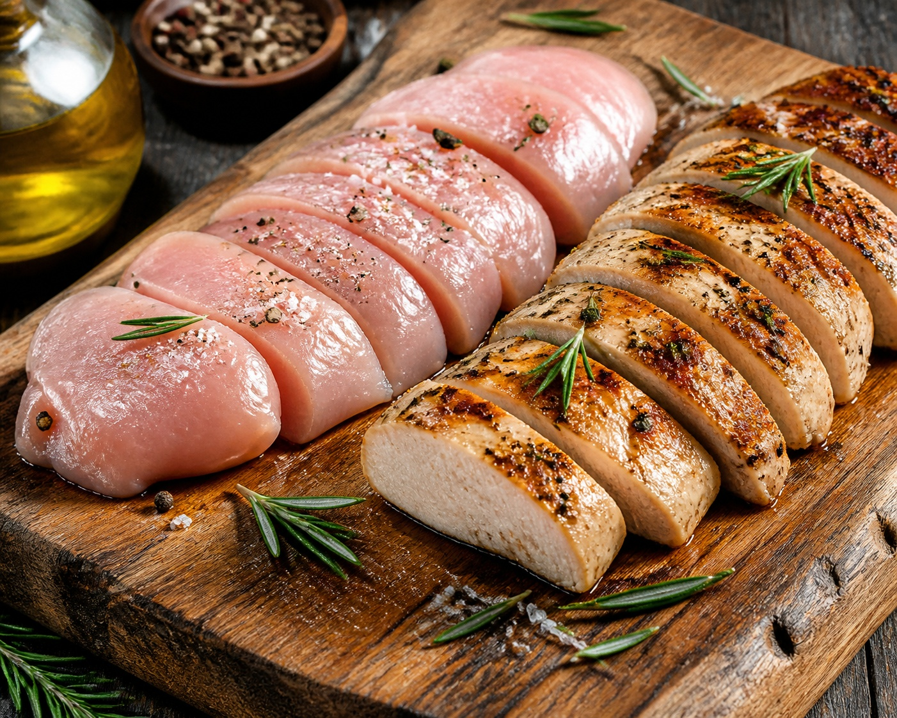

*▲ Low-fat and dense in essential amino acids, chicken breast serves as the gold standard protein source, providing leucine triggers for myofibrillar protein synthesis and anti-fatigue imidazole dipeptides.*

In the domains of exercise physiology and clinical dietetics, **chicken breast** stands as the definitive nutritional benchmark for lean muscle hypertrophy and cellular repair.

Comprising over 80% dry-weight protein with less than 2% lipids, chicken breast delivers an optimal spectrum of essential amino acids (EAAs). Most notably, it supplies concentrated levels of **branched-chain amino acids (BCAAs: leucine, isoleucine, and valine)**, which serve as direct molecular regulators for muscle protein synthesis (MPS).

Furthermore, chicken breast muscle tissue houses elevated reserves of **imidazole dipeptides (carnosine and anserine)**—the identical biochemical buffers discovered in the flight muscles of migratory birds that suppress intracellular lactic acidosis and scavenge cytotoxic free radicals during prolonged physical exertion.

Synthesizing verified empirical data from the USDA FoodData Central and sports medicine trials, this monograph delineates the biochemical profile of chicken breast, its therapeutic systemic benefits, and molecular culinary guidelines.

---

## 1. Comprehensive Nutritional Composition (Per 100g Raw Boneless, Skinless Breast)

Chicken breast delivers ultra-dense amino acid matrices alongside vital B-complex micronutrients with near-zero carbohydrate presence.

| Nutrient | Amount (per 100g) | Daily Value (% DV) |
| :--- | :--- | :--- |
| **Energy** | 110 kcal | 5.5% |
| **Carbohydrates** | 0.00 g | 0.0% |
| - Total Sugars | 0.00 g | 0.0% |
| - Dietary Fiber | 0.00 g | 0.0% |
| **Protein** | 23.10 g | 46.2% |
| - Leucine (BCAA) | 1.87 g | Daily value not established |
| - Isoleucine (BCAA) | 1.15 g | Daily value not established |
| - Valine (BCAA) | 1.20 g | Daily value not established |
| **Total Fat** | 1.24 g | 1.6% |
| - Saturated Fat | 0.33 g | 1.7% |
| - Monounsaturated Fat (MUFA) | 0.41 g | Daily value not established |
| - Polyunsaturated Fat (PUFA) | 0.28 g | Daily value not established |
| **Niacin (Vitamin B3)** | 11.20 mg | 70.0% |
| **Vitamin B6 (Pyridoxine)** | 0.60 mg | 35.3% |
| **Vitamin B12 (Cobalamin)** | 0.34 mcg | 14.2% |
| **Phosphorus (P)** | 228.00 mg | 18.2% |
| **Potassium (K)** | 334.00 mg | 7.1% |
| **Selenium (Se)** | 27.60 mcg | 50.2% |
| **Imidazole Dipeptides (Carnosine + Anserine)** | ~450.00 mg | Daily value not established |
| **Water** | 74.80 g | Special classification¹ |

*※ Source: USDA FoodData Central Standard Reference.*  
*¹ Water serves as the fundamental physiological fluid matrix rather than a regulated dietary reference intake.*

---

## 2. Four Clinically Validated Biological Benefits

### ① Induction of mTORC1 and Muscle Protein Synthesis (MPS)
Each 100-gram serving of chicken breast delivers approximately 1.87 grams of **leucine**, the primary branched-chain amino acid driving anabolic signaling. Once intracellular leucine saturates Sestrin2 nutrient sensors, it triggers **mTORC1 (Mechanistic Target of Rapamycin Complex 1)** phosphorylation, driving ribosomal biogenesis and counteracting age-associated sarcopenia.

### ② Intracellular Lactic Acid Buffering via Imidazole Dipeptides
The dipeptides **carnosine** and **anserine** (synthesized from beta-alanine and histidine) function as robust physicochemical proton (H+) buffers in skeletal muscle sarcoplasm. By attenuating exercise-induced intracellular acidosis, these peptides delay neuromuscular fatigue and mitigate delayed onset muscle soreness (DOMS).

### ③ Cellular Bioenergetics via B-Complex Coenzymes
Supplying over 70% of the daily niacin requirement and over 35% of pyridoxine, chicken breast fuels NAD/NADH hydrogen-transfer pathways essential for mitochondrial ATP synthesis, glycogenolysis, and transamination reactions.

### ④ Selenoprotein Biosynthesis and Thyroid Hormone Homeostasis
Selenium functions as an indispensable cofactor for glutathione peroxidase enzymes and iodothyronine deiodinases, promoting hepatic conversion of inactive thyroxine (T4) into bioactive triiodothyronine (T3).

---

## 3. Optimizing Bioavailability and Culinary Physics

### Precision Sous-Vide or Low-Temperature Poaching
Myofibrillar proteins begin contracting and expelling bound water at temperatures exceeding 65°C (149°F). Cooking vacuum-sealed chicken breasts between 60°C and 64°C preserves cytoplasmic water retention, yielding tender textures while retaining 98% of native amino acid integrity.

### Citrus or Enzymatic Pre-Marination
Acidic marinades (lemon juice, citric acid) and proteolytic enzymes (bromelain from pineapple) partially cleave surface cross-linked peptide bonds, accelerating gastric proteolytic breakdown and systemic absorption.

---

## 4. Potential Adverse Reactions and Considerations

### Excessive Nitrogenous Load in Pre-Existing Renal Impairment
In individuals with compromised glomerular filtration rates, hyper-protein intake accelerates intraglomerular hypertension. Clinical hydration (minimum 2.5 liters daily) is paramount to support renal excretion of urea nitrogen.

### Zero Fiber Density Requiring Plant Co-Ingestion
Pure poultry muscle contains zero dietary fiber. Unbalanced intake devoid of leafy greens or prebiotic pectin may impair peristaltic transit, mandating balanced vegetable pairings.

---

## 5. Synergistic Food Pairings for Maximum Nutrient Absorption

- **[Garlic]({{ site.baseurl }}/en/posts/garlic-nutrition-benefits/)**: Allicin derivatives conjugate with chicken breast's pyridoxine cofactors, maximizing intracellular amino acid transamination and glycogen replenishment.
- **[Broccoli]({{ site.baseurl }}/en/posts/broccoli-nutrition-benefits/)**: Vitamin C and sulforaphane in broccoli attenuate exercise-induced lipid peroxidation while balancing post-exercise nitrogenous metabolites.
- **[Tomato]({{ site.baseurl }}/en/posts/tomato-nutrition-benefits/)**: Natural malic and citric acids accelerate gastric acid secretion, optimizing hydrochloric breakdown of dense poultry actomyosin fibers.

---

## 6. Frequently Asked Questions (FAQ)

### Q1. Does daily chicken breast consumption strain renal function or promote gout?
**A:** In individuals with healthy kidneys, daily intake of 200 to 300 grams is safe. Chicken breast contains substantially lower purine concentrations than organ meats or small pelagic fish. Maintaining adequate hydration (2L+ daily) ensures efficient renal nitrogen clearance.

### Q2. What culinary technique scientifically eliminates dryness in chicken breast?
**A:** Submerging breasts in a 6% saline solution (brining) prior to cooking hydrates actomyosin fibers through osmotic equilibrium. Furthermore, gentle low-temperature sous-vide (60°C to 64°C) prevents severe protein thermal shrinkage, retaining cellular moisture.

### Q3. Is the widespread claim that humans can only absorb 30g of protein per meal true?
**A:** It is a persistent physiological misconception. The human gut absorbs nearly all digested amino acids regardless of bolus size. However, the maximal anabolic signaling threshold for muscle protein synthesis (the leucine trigger) saturates around 25 to 35 grams per meal, making distributed feedings optimal.

