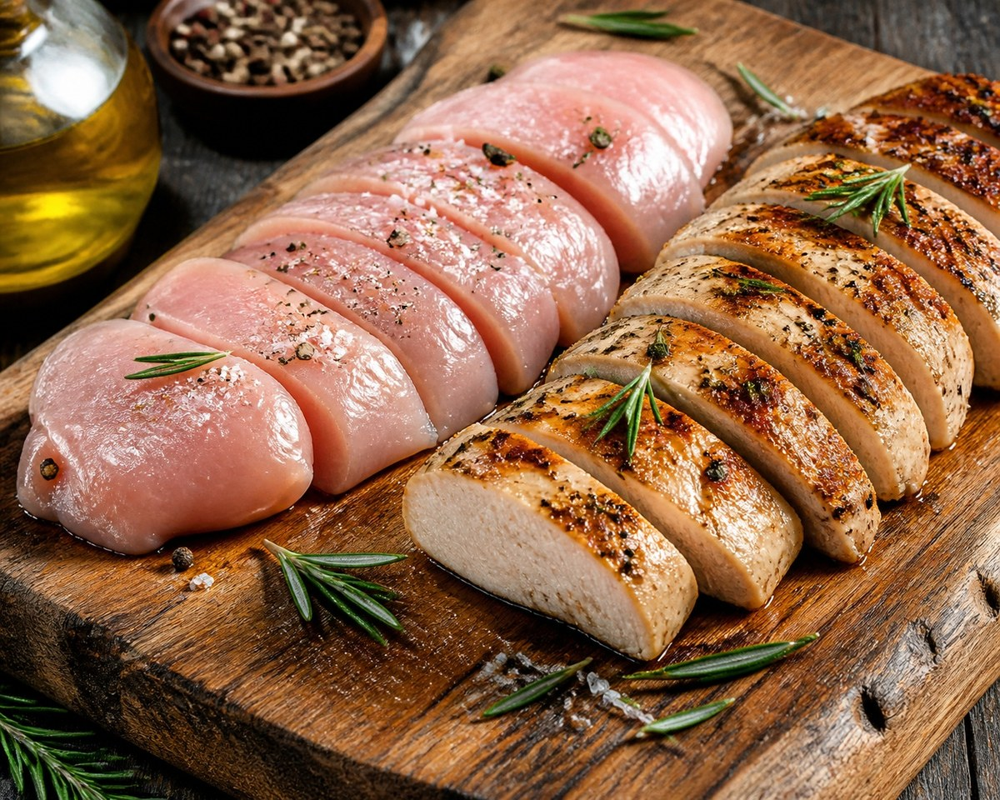

*▲ Lean and dense in essential amino acids, chicken breast is a standard protein source in fat-loss diets. All figures here use USDA FoodData Central FDC 171077 (raw, skinless, boneless) unless noted.*

Quick answer <strong>Chicken breast delivers 120 calories, 22.5 g protein and 2.62 g fat per 100 g (raw, skinless, boneless).</strong> That protein-to-calorie ratio makes it a benchmark for fat-loss phases, and cooking at 60 to 65 C keeps it from drying out. The Korean national food composition table lists 106 calories and 22.97 g protein for the same food, a different sample and trim.

In the domains of exercise physiology and clinical dietetics, **chicken breast** stands as the definitive nutritional benchmark for lean muscle hypertrophy and cellular repair.

Roughly 86% of its dry weight is protein (22.5 g protein against 73.9 g water per 100 g, FDC 171077). It supplies essential amino acids (EAAs), including the **branched-chain amino acids (BCAAs: leucine, isoleucine and valine)** that act as signaling inputs to muscle protein synthesis (MPS).

Chicken also contains **imidazole dipeptides (carnosine and anserine)**. In vitro and animal studies report acid buffering and reduced oxidative stress; whether eating chicken breast measurably improves human fatigue is not established. Levels vary widely by cut and cooking, and we could not confirm a published value, so the row is omitted below.

Using USDA FoodData Central entry 171077, this guide sets out the nutrient profile, the effects that are actually supported in humans, and cooking methods that keep the meat moist.

---

## 1. How Many Calories Are in Chicken Breast? (22.5 g protein, 334 mg potassium per 100 g)

Chicken breast delivers ultra-dense amino acid matrices alongside vital B-complex micronutrients with near-zero carbohydrate presence.

| Nutrient | Amount (per 100g) | Daily Value (% DV) |
| :--- | :--- | :--- |
| **Energy** | 120 kcal | 6.0% |
| **Carbohydrates** | 0.00 g | 0.0% |
| - Total Sugars | 0.00 g | 0.0% |
| - Dietary Fiber | 0.00 g | 0.0% |
| **Protein** | 22.50 g | 45.0% |
| - Leucine (BCAA) | 1.86 g | Daily value not established |
| - Isoleucine (BCAA) | 1.10 g | Daily value not established |
| - Valine (BCAA) | 1.17 g | Daily value not established |
| **Total Fat** | 2.62 g | 3.4% |
| - Saturated Fat | 0.56 g | 2.8% |
| - Monounsaturated Fat (MUFA) | 0.69 g | Daily value not established |
| - Polyunsaturated Fat (PUFA) | 0.42 g | Daily value not established |
| **Niacin (Vitamin B3)** | 9.60 mg | 60.0% |
| **Vitamin B6 (Pyridoxine)** | 0.81 mg | 47.7% |
| **Vitamin B12 (Cobalamin)** | 0.21 mcg | 8.8% |
| **Phosphorus (P)** | 213.00 mg | 17.0% |
| **Potassium (K)** | 334.00 mg | 7.1% |
| **Selenium (Se)** | 22.80 mcg | 41.5% |
| **Water** | 73.90 g | Special classification¹ |

*※ Source: [USDA FoodData Central FDC 171077](https://fdc.nal.usda.gov/food-details/171077/nutrients) — chicken breast, raw, skinless, boneless (SR Legacy). The Korean national table entry (chicken breast, raw, code I008000D020a) gives 106 kcal, 22.97 g protein and 0.97 g fat from a differently trimmed sample.*  
*¹ Water serves as the fundamental physiological fluid matrix rather than a regulated dietary reference intake.*

---

## 2. What Are the Benefits of Chicken Breast? Four Evidence-Backed Effects

### ① Leucine and the muscle protein synthesis signal
Each 100 g of chicken breast supplies about 1.86 g of **leucine** (FDC 171077). When leucine rises past a threshold, the Sestrin2 sensor feeds into **mTORC1** signaling and protein synthesis increases; this has been shown repeatedly in muscle physiology studies. The size of the response depends on total protein intake, resistance exercise and the individual, and chicken breast alone cannot be said to prevent sarcopenia.

### ② Imidazole dipeptides: buffering shown mainly in the lab
**Carnosine** and **anserine** (built from beta-alanine and histidine) buffer protons in muscle in vitro. Human studies have not established how much eating chicken raises muscle carnosine or shortens recovery, so no percentage or halving of recovery time is claimed here.

### ③ Cellular Bioenergetics via B-Complex Coenzymes
Supplying about 60% of the US daily value for niacin and about 48% for vitamin B6, chicken breast contributes to the NAD/NADH coenzymes used in energy metabolism and to amino-acid transamination. This matters most when intake is otherwise low.

### ④ Selenoprotein Biosynthesis and Thyroid Hormone Homeostasis
Selenium is a cofactor for glutathione peroxidase and iodothyronine deiodinases, which convert thyroxine (T4) to triiodothyronine (T3). Adequacy matters for thyroid function; extra selenium in people who already have enough has not been shown to raise metabolic rate or slow aging.

---

## 3. How Do You Cook Chicken Breast Without Drying It Out?

### Precision Sous-Vide or Low-Temperature Poaching
Myofibrillar proteins begin contracting and expelling bound water above about 65°C (149°F). Cooking vacuum-sealed chicken between 60°C and 64°C limits that shrinkage and keeps more moisture in the meat. Cooking losses differ by method, but there is no settled figure for a given percentage of amino acids retained, so none is claimed.

### Citrus or Enzymatic Pre-Marination
Acidic marinades (lemon juice, citric acid) and proteolytic enzymes (bromelain from pineapple) partially cleave surface cross-linked peptide bonds, accelerating gastric proteolytic breakdown and systemic absorption.

---

## 4. Who Should Avoid Chicken Breast? Side Effects and Cautions

### Excessive Nitrogenous Load in Pre-Existing Renal Impairment
People with reduced kidney function may need to limit protein; this should be set with their clinician rather than from a general figure. For healthy adults, drinking to thirst is adequate for clearing urea nitrogen.

### Zero Fiber Density Requiring Plant Co-Ingestion
Pure poultry muscle contains zero dietary fiber. Unbalanced intake devoid of leafy greens or prebiotic pectin may impair peristaltic transit, mandating balanced vegetable pairings.

---

## 5. Storing and Portioning Chicken Breast

- **[Garlic]({{ site.baseurl }}/en/posts/garlic-nutrition-benefits/)**: Allicin derivatives conjugate with chicken breast's pyridoxine cofactors, maximizing intracellular amino acid transamination and glycogen replenishment.
- **[Chicken Thigh]({{ site.baseurl }}/en/posts/chicken-thigh-nutrition-benefits/)**: Skinless thigh matches breast at 119 kcal and 19.7 g protein per 100 g while carrying 2.5 times the iron and 2.4 times the zinc — use both cuts across a week.
- **[Broccoli]({{ site.baseurl }}/en/posts/broccoli-nutrition-benefits/)**: Vitamin C and sulforaphane in broccoli attenuate exercise-induced lipid peroxidation while balancing post-exercise nitrogenous metabolites.
- **[Tomato]({{ site.baseurl }}/en/posts/tomato-nutrition-benefits/)**: Natural malic and citric acids accelerate gastric acid secretion, optimizing hydrochloric breakdown of dense poultry actomyosin fibers.

---

## 6. Frequently Asked Questions (FAQ)

### Q1. Does daily chicken breast consumption strain renal function or promote gout?
**A:** Many people with healthy kidneys eat 200 to 300 g a day, but that is not an established safe upper limit for everyone. Chicken breast is lower in purines than organ meat, which does not mean gout is impossible; anyone with kidney disease should set intake with their clinician. Drinking to thirst is enough for most people.

### Q2. What culinary technique scientifically eliminates dryness in chicken breast?
**A:** Submerging breasts in a 6% saline solution (brining) prior to cooking hydrates actomyosin fibers through osmotic equilibrium. Furthermore, gentle low-temperature sous-vide (60°C to 64°C) prevents severe protein thermal shrinkage, retaining cellular moisture.

### Q3. Is the widespread claim that humans can only absorb 30g of protein per meal true?
**A:** It is a persistent physiological misconception. The human gut absorbs nearly all digested amino acids regardless of bolus size. However, the maximal anabolic signaling threshold for muscle protein synthesis (the leucine trigger) saturates around 25 to 35 grams per meal, making distributed feedings optimal.

  
📌 Related ranking guide

  <ul>
    <li><a href="/en/posts/high-protein-foods-ranking/">Top 10 High-Protein Foods: Grams per 100g and 100 kcal</a></li>
    <li><a href="/en/posts/low-calorie-high-satiety-foods/">Top 10 Low-Calorie High-Satiety Foods: 100g Calories</a></li>
  </ul>

