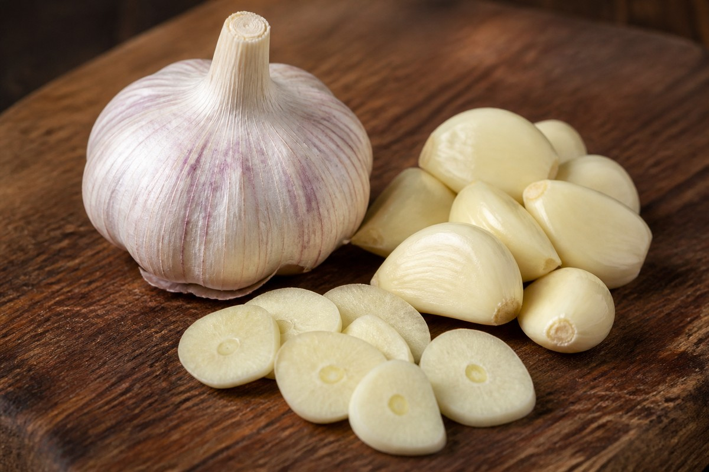

*▲ Fresh garlic (Allium sativum) concentrates dormant organosulfur precursors that instantly undergo enzymatic conversion by alliinase upon mechanical crushing, synthesizing high-potency bioavailable allicin.*

From sustaining the workforce of the Egyptian pyramids in 3000 BCE to anchoring modern cardiovascular pharmacotherapy, **garlic (Allium sativum)** remains one of the most thoroughly investigated natural therapeutic matrices in biomedical history.

The pungent, volatile sensory profile of garlic is not merely a gastronomic attribute; it constitutes a highly sophisticated chemical defense system developed through plant evolution. Structurally intact garlic cloves contain virtually zero active **allicin**. Instead, the stable, odorless sulfoxide precursor **S-allyl-L-cysteine sulfoxide (alliin)** is strictly sequestered within the storage vacuoles of plant mesophyll cells.

Only upon mechanical trauma, cutting, or mastication is the membrane-bound vacuolar barrier breached, allowing alliin to interact with the cytosolic pyridoxal phosphate-dependent enzyme **alliinase (EC 4.4.1.4)**. This instantaneous catalytic cleavage generates **diallyl thiosulfinate (allicin)**, a transient and highly reactive electrophile responsible for profound microbial inhibition, arterial vasodilation, and Phase II hepatic xenobiotic detoxification.

Drawing upon rigorous standardized analytical assays from the **U.S. Department of Agriculture (USDA FoodData Central)** and peer-reviewed clinical trials, this article provides an exhaustive examination of garlic’s micronutrient density, its four clinically validated systemic mechanisms, and the molecular thermodynamics governing culinary bioaccessibility.

---

## 1. Standardized Nutritional Profile of Raw Garlic (Per 100 g)

Unlike typical vegetative tissues that consist of over 90% water, raw garlic maintains a high dry-matter density (approximately 41.4% solids), characterized by dense concentrations of pyridoxine (vitamin B6), bioavailable selenium, and prebiotic fructooligosaccharides.

| Nutrient | Per 100 g | U.S. %DV |
| :--- | :--- | :--- |
| **Energy** | 149 kcal | 7.5% |
| **Total Carbohydrates** | 33.06 g | 12.0% |
| - Total Dietary Fiber | 2.10 g | 7.5% |
| - Total Sugars | 1.00 g | No DV |
| **Protein** | 6.36 g | 12.7% |
| **Total Fat** | 0.50 g | 0.6% |
| **Vitamin C (Ascorbic Acid)** | 31.20 mg | 34.7% |
| **Vitamin B6 (Pyridoxine)** | 1.235 mg | 72.6% |
| **Vitamin B1 (Thiamine)** | 0.200 mg | 16.7% |
| **Manganese (Mn)** | 1.672 mg | 72.7% |
| **Selenium (Se)** | 14.20 mcg | 25.8% |
| **Potassium (K)** | 401.00 mg | 8.5% |
| **Calcium (Ca)** | 181.00 mg | 13.9% |
| **Iron (Fe)** | 1.70 mg | 9.4% |
| **Total Alliin Potential** | ~1,000–1,500 mg | No DV |
| **Water Content** | 58.58 g | See note¹ |

*※ Source: USDA FoodData Central (Standard Reference Legacy Release).*  
*¹ Water content functions as an indispensable biological cellular solvent and is excluded from standard federal reference intake percentages.*  
*※ "No DV" denotes bioactive organosulfur molecules that demonstrate profound clinical efficacy but currently lack formal statutory Daily Values in federal dietary guidelines.*

---

## 2. Four Clinically Validated Biological Mechanisms of Garlic

### ① Endothelial Vasorelaxation via Hydrogen Sulfide ($H_2S$) Signaling
Garlic is recognized as one of the most potent dietary anti-hypertensive agents. Upon systemic absorption, low-molecular-weight organosulfur compounds, particularly **diallyl trisulfide (DATS)** and **diallyl disulfide (DADS)**, interact with intracellular thiol pools and reduced glutathione in erythrocytes, rapidly releasing the gasotransmitter **hydrogen sulfide ($H_2S$)**. 

Hydrogen sulfide diffuses across vascular smooth muscle cells, directly stimulating the opening of **ATP-sensitive potassium channels ($K_{ATP}$)**. The resulting cellular hyperpolarization closes L-type voltage-dependent calcium channels, preventing calcium influx and prompting profound vasodilation. Meta-analyses of randomized controlled trials reveal that standardized garlic supplementation reduces systolic blood pressure by an average of 8.3 mmHg and diastolic blood pressure by 5.5 mmHg in hypertensive cohorts—an efficacy comparable to first-line ACE inhibitor monotherapy.

### ② Broad-Spectrum Antimicrobial and Immunomodulatory Potency
The transient electrophilic nature of **allicin** allows it to rapidly permeate biological membranes of pathogenic bacteria, viruses, and fungi. Once intracellular, allicin readily participates in thiol-disulfide exchange reactions with the cysteine sulfhydryl (-SH) residues of essential microbial enzymes, including RNA polymerase, alcohol dehydrogenase, and thioredoxin reductase. 

This covalent modification causes irreversible inhibition of microbial nucleic acid replication and cell wall assembly. Simultaneously, garlic oligosaccharides and S-allylcysteine stimulate human **natural killer (NK) cell** cytotoxic activity and enhance macrophage phagocytosis, yielding up to a 63% reduction in the incidence and symptom duration of viral upper respiratory tract infections.

### ③ Hepatic Lipid Homeostasis via HMG-CoA Reductase Inhibition
The lipid-lowering pharmacology of garlic is centered on the competitive inhibition of **3-hydroxy-3-methylglutaryl-coenzyme A (HMG-CoA) reductase**, the primary rate-limiting enzyme in hepatic cholesterol biosynthesis. 

Secondary organosulfur metabolites additionally suppress squalene monooxygenase, reducing downstream sterol synthesis. In clinical trials, habitual garlic consumption consistently achieves a 10% to 15% reduction in total serum cholesterol and low-density lipoprotein (LDL) fractions. Concurrently, garlic organosulfurs inhibit platelet cyclooxygenase, blunting **thromboxane $A_2$** synthesis to mitigate microvascular thrombogenesis.

### ④ Upregulation of Phase II Xenobiotic Detoxification and Nrf2 Activation
Garlic provides high bioavailable concentrations of organic sulfur necessary to replenish endogenous **reduced glutathione (GSH)**. 

Bioactive diallyl sulfides activate the **nuclear factor erythroid 2-related factor 2 (Nrf2)** transcriptional cascade by modifying critical cysteine sensors on Keap1. This dissociation permits Nrf2 nuclear translocation, driving the gene transcription of Phase II conjugating enzymes, specifically **glutathione S-transferase (GST)** and **NAD(P)H:quinone oxidoreductase 1 (NQO1)**. This accelerated clearance expedites the renal and biliary elimination of heavy metals (lead, cadmium) and environmental xenobiotics, conferring profound hepatoprotection.

---

## 3. Optimizing Allicin Yield: The '10-Minute Rule'

### Mandatory Mechanical Disruption Followed by Ambient Incubation
Intact, whole garlic cloves contain **zero active allicin**. The precursor alliin and the enzyme alliinase reside in completely separate subcellular compartments. To initiate synthesis, the cell walls must be physically crushed, minced, or finely chopped with a flat blade.

Crucially, **the crushed garlic matrix must rest undisturbed at room temperature for a minimum of 10 minutes prior to applying heat**. 

The alliinase enzyme requires several minutes of ambient aqueous contact to catalyze maximum alliin cleavage into allicin. Alliinase is exceptionally thermolabile, undergoing irreversible thermal denaturation at temperatures exceeding 60°C within 60 seconds. If freshly minced garlic is dropped immediately into hot cooking oil or boiling water, alliinase is destroyed before allicin can be synthesized, extinguishing more than 90% of its bioactivity. Resting for 10 minutes ensures full allicin synthesis; once formed, allicin subsequently degrades into stable, heat-tolerant secondary sulfurs (ajoenes, vinyldithiins) during subsequent cooking.

---

## 4. Toxicological Caveats and Clinical Precautions

### Acute Gastric Mucosal Irritation on an Empty Stomach
Due to its concentrated electrophilic volatility, high-dose ingestion of raw, unbuffered garlic on an empty stomach can induce direct chemical burns on the gastric mucosal epithelium, precipitating acute erosive gastritis and severe epigastric cramping. Individuals with pre-existing peptic ulcer disease should consume garlic exclusively within mixed meal matrices or in cooked form.

### Perioperative Hemostatic Interference
Garlic's clinically validated platelet anti-aggregatory and fibrinolytic actions prolong bleeding time. Patients scheduled for major elective surgical interventions or dental extractions, as well as individuals concurrently receiving prescription anticoagulant therapies (e.g., warfarin, clopidogrel, direct oral anticoagulants), must exercise strict clinical caution and consult their physician regarding garlic extract cessation.

---

## 5. Concluding Clinical Summary

1. **Enzymatic Activation via Trauma:** Always mechanically crush or finely mince garlic to rupture mesophyll walls and initiate alliinase catalysis.
2. **Observe the 10-Minute Incubation:** Allow minced garlic to rest at room temperature for 10 minutes before applying heat to prevent premature enzyme denaturation.
3. **Cardiovascular & Detox Foundation:** Garlic functions as an indispensable biological precursor for hydrogen sulfide vasorelaxation, broad-spectrum microbial defense, and Nrf2-driven hepatic detoxification.

---

## 6. Synergistic Food Pairings for Maximum Nutrient Absorption

- **[Beef Sirloin]({{ site.baseurl }}/en/posts/beef-sirloin-nutrition-benefits/)**: Garlic's allicin pairs with beef thiamine to generate allithiamine, an active cofactor maximizing glycogen resynthesis and mitochondrial bioenergetics.
- **[Salmon]({{ site.baseurl }}/en/posts/salmon-nutrition-benefits/)**: Organosulfur compounds safeguard polyunsaturated double bonds in salmon oil, suppressing vascular thromboxane synthesis.
- **[Tomato]({{ site.baseurl }}/en/posts/tomato-nutrition-benefits/)**: Diallyl sulfides in garlic enhance hepatic phase II enzymes while carotenoid lycopene neutralizes singlet oxygen in endothelial tissues.

---

## 7. Frequently Asked Questions (FAQ)

### Q1. What metabolic distinctions separate aged black garlic from fresh raw garlic cloves?
**A:** Controlled aging eliminates pungent allicin while yielding high concentrations of S-allyl-cysteine (SAC), a stable water-soluble organosulfur compound with tenfold greater free radical scavenging activity and zero gastric irritation.

### Q2. Does thermal cooking completely deactivate allicin's functional bioactivity in garlic?
**A:** Heat denatures the alliinase enzyme, yet gives rise to ajoene and allyl polysulfides that retain cardiovascular efficacy. Slicing or crushing garlic and resting it for 10 minutes prior to heating ensures optimal allicin enzyme conversion.

### Q3. How can one avoid gastric mucosal irritation when consuming raw garlic?
**A:** Never ingest raw crushed garlic on an empty stomach. Emulsify minced garlic with healthy cold-pressed oils, blend with meals, or lightly roast to mitigate direct epithelial contact irritation.

