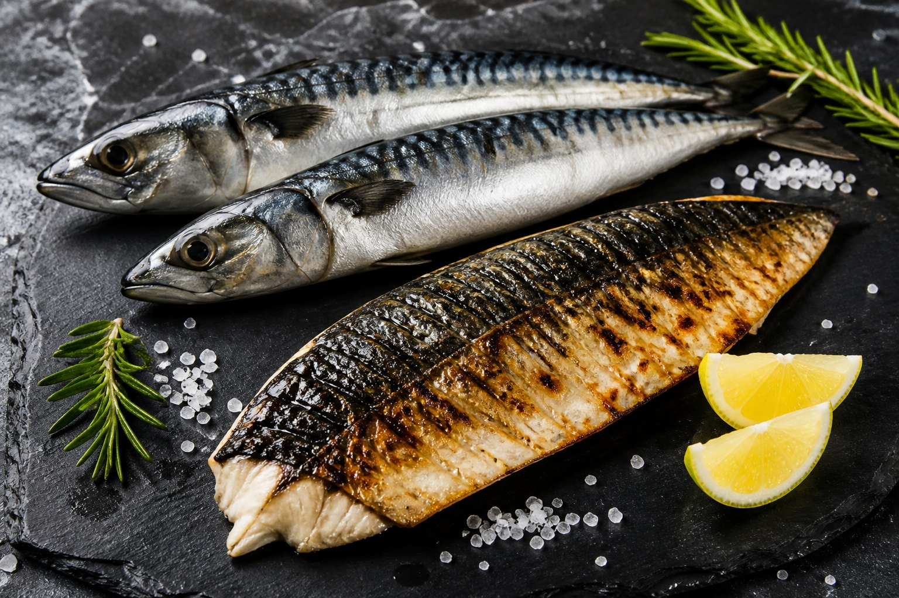

*▲ Characterized by dark undulating bands and silver ventral scales, mackerel stands as a premier pelagic superfood, supplying dense reserves of cardioprotective EPA, neuroprotective DHA, and bioavailable cholecalciferol (vitamin D3).*

In clinical lipidology and marine nutritional biochemistry, **mackerel (Scomber scombrus)** represents one of nature’s most concentrated vectors of long-chain polyunsaturated fatty acids (LCPUFAs).

Surpassing farmed Atlantic salmon in omega-3 density per serving, mackerel delivers substantial payloads of **eicosapentaenoic acid (EPA)** and **docosahexaenoic acid (DHA)**. EPA competes biochemically with arachidonic acid, suppressing pro-thrombotic thromboxane A2 (TXA2) formation to maintain arterial patency and endothelial health. Concurrently, DHA integrates into neuronal cerebral and retinal cell membranes, fortifying synaptic transmission and cognitive resilience.

Moreover, mackerel's dark lateral muscle (chiai) concentrates **bioavailable heme iron**, **nucleic acid precursors**, and **natural vitamin D3 (cholecalciferol)** at levels surpassing standard terrestrial protein sources.

Drawing upon USDA FoodData Central empirical standards and clinical cardiology literature, this guide analyzes mackerel’s nutrient architecture, clinical benefits, and molecular culinary guidelines.

---

## 1. Quantitative Nutritional Composition (Per 100g Raw Fillet)

Mackerel provides dense macronutrient energy supported by exceptional omega-3 profiles and fat-soluble vitamin complexes.

| Nutrient | Amount (per 100g) | Daily Value (% DV) |
| :--- | :--- | :--- |
| **Energy** | 205 kcal | 10.3% |
| **Carbohydrates** | 0.00 g | 0.0% |
| - Total Sugars | 0.00 g | 0.0% |
| - Dietary Fiber | 0.00 g | 0.0% |
| **Protein** | 18.60 g | 37.2% |
| **Total Fat** | 13.89 g | 17.8% |
| - Saturated Fat | 3.26 g | 16.3% |
| - Monounsaturated Fat (MUFA) | 5.45 g | Daily value not established |
| - Polyunsaturated Fat (PUFA) | 3.35 g | Daily value not established |
| **EPA (Omega-3)** | 898.00 mg | Daily value not established |
| **DHA (Omega-3)** | 1,401.00 mg | Daily value not established |
| **Vitamin D3 (Cholecalciferol)** | 16.10 mcg (644 IU) | 107.3% |
| **Vitamin B12 (Cobalamin)** | 8.71 mcg | 362.9% |
| **Niacin (Vitamin B3)** | 9.08 mg | 56.8% |
| **Selenium (Se)** | 44.10 mcg | 80.2% |
| **Iron (Fe, Heme)** | 1.57 mg | 8.7% |
| **Potassium (K)** | 314.00 mg | 6.7% |
| **Water** | 66.20 g | Special classification¹ |

*※ Source: USDA FoodData Central Standard Reference.*  
*¹ Water serves as the biological solvent matrix rather than a regulated dietary reference intake.*

---

## 2. Four Clinically Validated Biological Benefits

### ① EPA-Driven Thromboxane Suppression and Arterial Vasodilation
With nearly 900 mg of **EPA** per 100g, mackerel consumption downregulates cyclooxygenase-1 (COX-1) mediated thromboxane synthesis in human platelets. Concurrently, it upregulates anti-aggregatory prostacyclin (PGI3), dramatically lowering ischemic stroke vulnerability and arterial plaque formation.

### ② DHA Blood-Brain Barrier (BBB) Transport and Synaptic Plasticity
Delivering over 1,400 mg of **DHA**, mackerel supports neurogenesis and brain-derived neurotrophic factor (BDNF) synthesis. DHA maintains the fluidity of phospholipid bilayers in synaptic membranes, attenuating beta-amyloid neurotoxicity and age-associated cognitive decline.

### ③ Immunomodulation via Dense Natural Cholecalciferol (Vitamin D3)
Mackerel yields over 640 IU of natural **vitamin D3** per serving, stimulating intestinal calbindin synthesis to optimize calcium uptake. Vitamin D3 binds nuclear VDR receptors across macrophages, orchestrating antimicrobial peptide production.

### ④ Heavy Metal Antagonism through Selenoproteins
Mackerel is exceptionally rich in **selenium (80% DV)**, which binds trace marine methylmercury to form inert bis(methylmercuric) selenide complexes, neutralizing heavy metal cytotoxicity while supercharging glutathione peroxidase antioxidant defenses.

---

## 3. Optimizing Bioavailability and Culinary Physics

### Baking, Gentle Poaching, or Indirect Convection Over Frying
Deep-frying at extreme oil temperatures (>180°C) oxidizes long-chain unsaturated double bonds, generating lipid peroxides and destroying native EPA/DHA. Baking at moderate temperatures or poaching preserves up to 88% of native omega-3 fatty acids.

### Acidic Chelation of Trimethylamine (TMA)
The signature fishy aroma in pelagic fish arises from alkaline trimethylamine. Squeezing fresh lemon juice (citric acid) converts volatile TMA into non-volatile, odorless salts prior to cooking.

---

## 4. Potential Adverse Reactions and Considerations

### Elevated Purine Density in Clinical Gout
Mackerel contains significant cellular purine concentrations (>150 mg/100g). Patients suffering from hyperuricemia or acute gouty arthritis must limit intake to prevent monosodium urate crystal precipitation in peripheral joints.

### Histamine Scombroid Toxicity from Inadequate Refrigeration
Pelagic scombroid fish degrade rapidly at ambient temperatures, converting endogenous histidine into toxic **histamine**. Rapid post-catch icing and continuous cold-chain integrity are imperative.

---

## 5. Synergistic Food Pairings for Maximum Nutrient Absorption

- **[Onion]({{ site.baseurl }}/en/posts/onion-nutrition-benefits/)**: Quercetin in onions retards lipid peroxidation of mackerel omega-3s during culinary heating while amplifying vascular anti-thrombotic defenses.
- **[Garlic]({{ site.baseurl }}/en/posts/garlic-nutrition-benefits/)**: Organosulfur compounds eliminate amine volatiles while working in tandem with EPA to optimize vascular nitric oxide production.
- **[Apple]({{ site.baseurl }}/en/posts/apple-nutrition-benefits/)**: Soluble pectin and ascorbic acid cleanse the palate and enhance micellar solubilization of fat-soluble vitamins.

---

## 6. Frequently Asked Questions (FAQ)

### Q1. Should mackerel skin and dark red lateral flesh (chiai) be eaten?
**A:** Yes, absolutely. The subcutaneous lipid layer under the skin houses concentrated marine collagen and omega-3s, while the dark red lateral muscle contains three times more heme iron, vitamin B12, and taurine than the white muscle tissue.

### Q2. How can one reduce sodium levels in commercial salted mackerel?
**A:** Submerging salted fillets in cold rice-washing water or mild vinegar water for 20 minutes leverages osmotic diffusion to draw out excess sodium chloride while tenderizing the flesh. Avoid adding table salt during cooking.

### Q3. Is mackerel safe for individuals managing gout or hyperuricemia?
**A:** Caution is warranted. Mackerel is classified as a high-purine food (>150mg purines per 100g). While beneficial for heart disease, individuals with active clinical gout flares should avoid consumption until serum uric acid normalizes.

