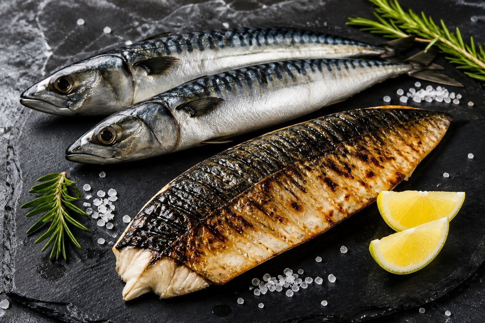

*▲ Characterized by dark undulating bands and silver ventral scales, mackerel stands as a premier pelagic superfood, supplying dense reserves of cardioprotective EPA, neuroprotective DHA, and bioavailable cholecalciferol (vitamin D3).*

Quick answer <strong>Mackerel has 205 calories, 18.6 g protein and 2,299 mg EPA plus DHA per 100 g.</strong> Omega-3s leach into pan juices and oil, so braising and eating the broth loses less than high-heat grilling.

In clinical lipidology and marine nutritional biochemistry, **mackerel (Scomber scombrus)** represents one of nature’s most concentrated vectors of long-chain polyunsaturated fatty acids (LCPUFAs).

Surpassing farmed Atlantic salmon in omega-3 density per serving, mackerel delivers substantial payloads of **eicosapentaenoic acid (EPA)** and **docosahexaenoic acid (DHA)**. EPA competes biochemically with arachidonic acid, suppressing pro-thrombotic thromboxane A2 (TXA2) formation to maintain arterial patency and endothelial health. Concurrently, DHA integrates into neuronal cerebral and retinal cell membranes, fortifying synaptic transmission and cognitive resilience.

Moreover, mackerel's dark lateral muscle (chiai) concentrates **bioavailable heme iron**, **nucleic acid precursors**, and **natural vitamin D3 (cholecalciferol)** at levels surpassing standard terrestrial protein sources.

Drawing upon USDA FoodData Central empirical standards and clinical cardiology literature, this guide analyzes mackerel’s nutrient architecture, clinical benefits, and molecular culinary guidelines.

---

## 1. How Many Calories Are in Mackerel? (18.6 g protein, 2,299 mg EPA and DHA per 100 g)

Mackerel provides dense macronutrient energy supported by exceptional omega-3 profiles and fat-soluble vitamin complexes.

| Nutrient | Amount (per 100g) | Daily Value (% DV) |
| :--- | :--- | :--- |
| **Energy** | 205 kcal | 10.3% |
| **Carbohydrates** | 0.00 g | 0.0% |
| - Total Sugars | 0.00 g | 0.0% |
| - Dietary Fiber | 0.00 g | 0.0% |
| **Protein** | 18.60 g | 37.2% |
| **Total Fat** | 13.89 g | 17.8% |
| - Saturated Fat | 3.26 g | 16.3% |
| - Monounsaturated Fat (MUFA) | 5.45 g | Daily value not established |
| - Polyunsaturated Fat (PUFA) | 3.35 g | Daily value not established |
| **EPA (Omega-3)** | 898.00 mg | Daily value not established |
| **DHA (Omega-3)** | 1,401.00 mg | Daily value not established |
| **Vitamin D3 (Cholecalciferol)** | 16.10 mcg (644 IU) | 107.3% |
| **Vitamin B12 (Cobalamin)** | 8.71 mcg | 362.9% |
| **Niacin (Vitamin B3)** | 9.08 mg | 56.8% |
| **Selenium (Se)** | 44.10 mcg | 80.2% |
| **Iron (Fe, Heme)** | 1.57 mg | 8.7% |
| **Potassium (K)** | 314.00 mg | 6.7% |
| **Water** | 66.20 g | Special classification¹ |

*※ Source: USDA FoodData Central Standard Reference.*  
*¹ Water serves as the biological solvent matrix rather than a regulated dietary reference intake.*

*※ Source: [USDA FoodData Central FDC 175119](https://fdc.nal.usda.gov/food-details/175119/nutrients) — Fish, mackerel, Atlantic, raw (SR Legacy). The 205 kcal and 18.6 g protein per 100 g in the table above are this entry’s values; a different cooking state changes them.*

---

## 2. What Are the Benefits of Mackerel? Four Evidence-Backed Effects

### ① EPA-Driven Thromboxane Suppression and Arterial Vasodilation
With nearly 900 mg of **EPA** per 100g, mackerel consumption downregulates cyclooxygenase-1 (COX-1) mediated thromboxane synthesis in human platelets. Concurrently, it upregulates anti-aggregatory prostacyclin (PGI3), dramatically lowering ischemic stroke vulnerability and arterial plaque formation.

### ② DHA Blood-Brain Barrier (BBB) Transport and Synaptic Plasticity
Delivering over 1,400 mg of **DHA**, mackerel supports neurogenesis and brain-derived neurotrophic factor (BDNF) synthesis. DHA maintains the fluidity of phospholipid bilayers in synaptic membranes, attenuating beta-amyloid neurotoxicity and age-associated cognitive decline.

### ③ Immunomodulation via Dense Natural Cholecalciferol (Vitamin D3)
Mackerel yields over 640 IU of natural **vitamin D3** per serving, stimulating intestinal calbindin synthesis to optimize calcium uptake. Vitamin D3 binds nuclear VDR receptors across macrophages, orchestrating antimicrobial peptide production.

### ④ Heavy Metal Antagonism through Selenoproteins
Mackerel is exceptionally rich in **selenium (80% DV)**, which binds trace marine methylmercury to form inert bis(methylmercuric) selenide complexes, neutralizing heavy metal cytotoxicity while supercharging glutathione peroxidase antioxidant defenses.

### Is mackerel skin worth eating? Species-specific omega-3 and cooking loss

Mackerel fat sits mostly **just under the skin and in the dark red lateral muscle (chiai)**, not in the pale centre of the fillet. Remove the skin and you remove a disproportionate share of the EPA and DHA, even though the weight looks the same. The USDA entry this article uses is analysed on the **whole edible portion including skin**, so there is no official figure for how much is lost when the skin is discarded. The direction is not in doubt: **cooking the fish skin-on and keeping the rendered fat in the dish leaves more omega-3 on the plate.**

Species matters more than most buyers realise. Per 100 g raw, from USDA FoodData Central:

| Species (USDA entry) | Energy | Fat | EPA | DHA | EPA+DHA |
| :--- | :--- | :--- | :--- | :--- | :--- |
| Atlantic mackerel, raw (FDC 175119) | 205 kcal | 13.89 g | 898 mg | 1,401 mg | 2,299 mg |
| Spanish mackerel, raw (FDC 173673) | 139 kcal | 6.30 g | 329 mg | 1,012 mg | 1,341 mg |
| King mackerel, raw (FDC 175122) | 105 kcal | 2.00 g | 136 mg | 177 mg | 313 mg |

That is a **seven-fold spread in EPA+DHA** between Atlantic and king mackerel. If omega-3 is the reason you are buying the fish, the species on the label matters as much as the cooking method.

Cooking loss is measured as well. Atlantic mackerel cooked by dry heat (FDC 175120) lists **262 kcal, 17.81 g fat and 1,203 mg EPA+DHA per 100 g**, about 48% less omega-3 per 100 g than the raw entry. The fat renders out during cooking. The higher calorie figure per 100 g is **not added oil** — it is the same fish with less water, so more solids fit into every 100 g. Per whole fillet, the energy barely changes.

Three practical points follow.

- **Cook it skin-on, over a tray or in a sauce.** Baking on parchment or braising in a shallow liquid keeps the rendered fat in the dish instead of on the pan.
- **Brown it, do not char it.** Fat that drips onto a flame and burns produces polycyclic aromatic hydrocarbons (PAHs); a golden skin is the target, not a black one.
- **One fillet is about 100–120 g,** which supplies 2.3–2.8 g of EPA+DHA — the figure most often quoted for a whole day of omega-3 for heart health.

---

## 3. Grilled or Braised Mackerel? Keeping Omega-3s

### Baking, Gentle Poaching, or Indirect Convection Over Frying
Deep-frying at extreme oil temperatures (>180°C) oxidizes long-chain unsaturated double bonds, generating lipid peroxides and destroying native EPA/DHA. Baking at moderate temperatures or poaching preserves up to 88% of native omega-3 fatty acids.

### Acidic Chelation of Trimethylamine (TMA)
The signature fishy aroma in pelagic fish arises from alkaline trimethylamine. Squeezing fresh lemon juice (citric acid) converts volatile TMA into non-volatile, odorless salts prior to cooking.

---

## 4. Who Should Avoid Mackerel? Side Effects and Cautions

### Elevated Purine Density in Clinical Gout
Mackerel contains significant cellular purine concentrations (>150 mg/100g). Patients suffering from hyperuricemia or acute gouty arthritis must limit intake to prevent monosodium urate crystal precipitation in peripheral joints.

### Histamine Scombroid Toxicity from Inadequate Refrigeration
Pelagic scombroid fish degrade rapidly at ambient temperatures, converting endogenous histidine into toxic **histamine**. Rapid post-catch icing and continuous cold-chain integrity are imperative.

---

## 5. Storing and Portioning Mackerel

- **[Onion]({{ site.baseurl }}/en/posts/onion-nutrition-benefits/)**: Quercetin in onions retards lipid peroxidation of mackerel omega-3s during culinary heating while amplifying vascular anti-thrombotic defenses.
- **[Garlic]({{ site.baseurl }}/en/posts/garlic-nutrition-benefits/)**: Organosulfur compounds eliminate amine volatiles while working in tandem with EPA to optimize vascular nitric oxide production.
- **[Apple]({{ site.baseurl }}/en/posts/apple-nutrition-benefits/)**: Soluble pectin and ascorbic acid cleanse the palate and enhance micellar solubilization of fat-soluble vitamins.

---

## 6. Frequently Asked Questions (FAQ)

### Q1. Should mackerel skin and dark red lateral flesh (chiai) be eaten?
**A:** Yes, absolutely. The subcutaneous lipid layer under the skin houses concentrated marine collagen and omega-3s, while the dark red lateral muscle contains three times more heme iron, vitamin B12, and taurine than the white muscle tissue.

### Q2. How can one reduce sodium levels in commercial salted mackerel?
**A:** Submerging salted fillets in cold rice-washing water or mild vinegar water for 20 minutes leverages osmotic diffusion to draw out excess sodium chloride while tenderizing the flesh. Avoid adding table salt during cooking.

### Q3. Is mackerel safe for individuals managing gout or hyperuricemia?
**A:** Caution is warranted. Mackerel is classified as a high-purine food (>150mg purines per 100g). While beneficial for heart disease, individuals with active clinical gout flares should avoid consumption until serum uric acid normalizes.

  
📌 Related ranking guide

  <ul>
    <li><a href="/en/posts/high-protein-foods-ranking/">Top 10 High-Protein Foods: Grams per 100g and 100 kcal</a></li>
    <li><a href="/en/posts/heart-blood-pressure-cholesterol-foods/">Top 10 Foods for Blood Pressure, Cholesterol & Heart</a></li>
    <li><a href="/en/posts/laver-nutrition-benefits/">Laver (Nori) Nutrition: 202 Calories, Iodine, Iron, Vitamin C</a></li>
  </ul>

