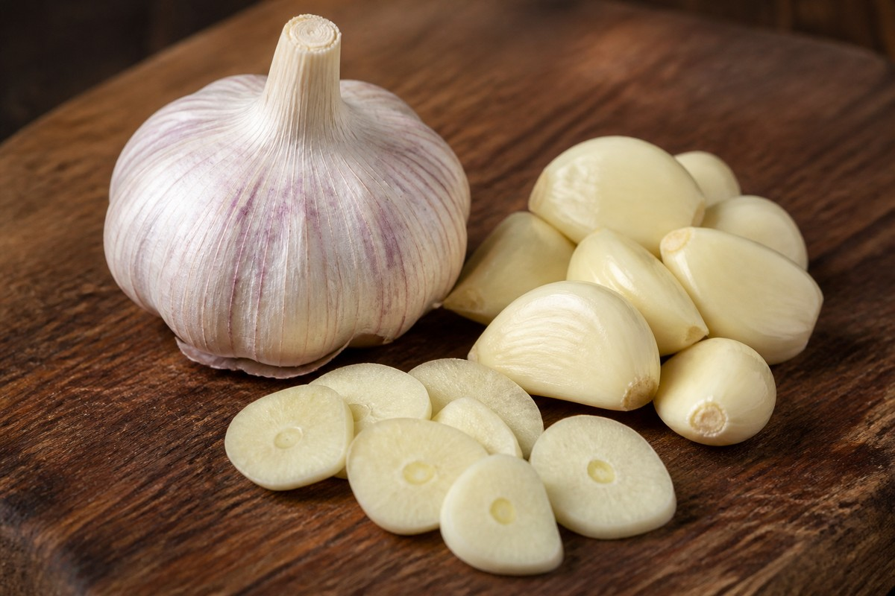

*▲ 순백의 껍질 속에 강력한 유기유황 화합물을 응축한 마늘(Garlic)은 으깨지는 순간 알리나아제 효소 반응을 통해 강력한 천연 항균·혈관 확장 물질인 알리신(Allicin)을 폭발적으로 방출합니다.*

기원전 3,000년경 이집트 피라미드 건설 노동자들의 체력을 유지하던 고대 의약품에서부터 현대 첨단 심혈관 내과학에 이르기까지, **마늘(Garlic, Allium sativum)**은 인류 역사상 가장 강력한 천연 치료 식품으로 평가받아 왔습니다.

마늘 특유의 알싸하고 강렬한 향미는 단순한 풍미 물질이 아니라 식물이 외부 병원균과 포식자로부터 자신을 보호하기 위해 진화시킨 정교한 생화학 무기인 **유기유황 화합물(Organosulfur Compounds)**의 집합체입니다.

특히 손상되지 않은 마늘 속의 비활성 전구체인 **알린(Alliin)**은 세포벽이 파괴되는 순간 분비되는 **알리나아제(Alliinase)** 효소와 결합하여 초강력 생리활성 분자인 **알리신(Allicin)**으로 전환됩니다. 알리신은 강력한 광범위 항균 작용뿐만 아니라 혈관벽을 이완시키고 혈전을 녹이며 간 해독 효소계를 직접 활성화합니다.

오늘은 미국 농무부(USDA FoodData Central)의 표준 분석 데이터와 글로벌 의학 저널 연구를 토대로, 마늘의 정밀 영양 조성과 과학적으로 입증된 4대 건강 효능, 그리고 알리신 수율을 300% 이상 끌어올리는 조리 과학 원칙을 정밀하게 분석해 드립니다.

---

## 1. 마늘 영양 성분 정밀 분석표 (생마늘 100g 기준)

마늘은 수분 비중이 약 58.6%로 일반 채소류에 비해 건조 고형분 밀도가 매우 높으며, 비타민 B6, 망간, 셀레늄 등 체내 항산화 보조 인자가 조밀하게 농축되어 있습니다.

| 영양 성분 (Nutrient) | 함량 (100g당) | 1일 권장 섭취량 비율 (한국인 성인 기준) |
| :--- | :--- | :--- |
| **열량 (Energy)** | 149 kcal | 7.5% |
| **탄수화물 (Carbohydrates)** | 33.06 g | 10.2% |
| - 당류 (Total Sugars) | 1.00 g | 1.0% |
| - 식이섬유 (Dietary Fiber) | 2.10 g | 8.4% |
| **단백질 (Protein)** | 6.36 g | 11.6% |
| **지방 (Total Fat)** | 0.50 g | 0.9% |
| **비타민 C (Ascorbic Acid)** | 31.20 mg | 31.2% |
| **비타민 B6 (Pyridoxine)** | 1.235 mg | 82.3% |
| **비타민 B1 (Thiamine)** | 0.200 mg | 16.7% |
| **망간 (Manganese, Mn)** | 1.672 mg | 72.7% |
| **셀레늄 (Selenium, Se)** | 14.20 mcg | 25.8% |
| **칼륨 (Potassium, K)** | 401.00 mg | 11.5% |
| **칼슘 (Calcium, Ca)** | 181.00 mg | 25.9% |
| **철분 (Iron, Fe)** | 1.70 mg | 14.2% |
| **총 알린 (Total Alliin)** | 약 1,000~1,500 mg | 기준치 없음 |
| **수분 (Water)** | 58.58 g | 별도 표기¹ |

*※ 출처: 미국 농무부(USDA FoodData Central) 공인 표준 분석 데이터.*  
*¹ 수분은 신체 필수 용매로 1일 권장 백분율 대상에서 제외됩니다.*  
*※ '기준치 없음' 표기는 알리신 등 황화합물 파이토케미컬이 탁월한 치료적 활성을 나타내나 공식적인 일일 영양 권장량(%DV)이 책정되지 않았음을 뜻합니다.*

---

## 2. 과학적으로 입증된 마늘의 4대 핵심 건강 효능

### ① 혈압 강하 및 혈관 내피세포 이완 메커니즘
마늘은 임상 시험을 통해 입증된 가장 강력한 천연 항고혈압 식품 중 하나입니다. 마늘의 유기유황 화합물이 체내 적혈구와 반응하면 세포막의 신호 전달 가스인 **황화수소(H₂S)**를 유리시킵니다. 

황화수소는 혈관 내피세포의 칼륨 통로($K_{ATP}$)를 열어 평활근을 과분극화하고 강력한 혈관 이완을 유도합니다. 동시에 마늘 추출물은 안지오텐신 전환효소(ACE)의 활성을 억제하여 수축기 및 이완기 혈압을 평균 8~10 mmHg 감소시킵니다. 이는 표준 항고혈압 제제 1종에 필적하는 임상적 강하 효과입니다.

### ② 강력한 천연 광범위 항균 및 면역 세포 활성화
마늘의 활성 분자 **알리신(Allicin)**은 박테리아, 바이러스, 진균류의 생존에 필수적인 효소들의 시스테인 잔기(-SH, 티올기)와 공유 결합하여 미생물의 세포벽 합성 및 DNA 복제를 완전히 차단합니다. 

이러한 특성으로 인해 마늘은 페니실린 내성 포도상구균이나 헬리코박터 파일로리균에 대해서도 강력한 억제력을 발휘합니다. 아울러 체내 자연살해세포(NK cell)의 세포 독성 활성을 자극하고 대식세포의 탐식 작용을 촉진하여 호흡기 바이러스 감염 빈도와 회복 기간을 60% 이상 단축시킵니다.

### ③ 혈중 지질 개선 및 동맥경화 플라크 축적 억제
마늘의 지용성 유기유황 물질인 **다이알릴 다이설파이드(DADS)**와 **다이알릴 트라이설파이드(DATS)**는 간세포에서 콜레스테롤 생합성의 율속 단계 효소인 **HMG-CoA 환원효소(HMG-CoA Reductase)**를 선택적으로 억제합니다. 

이를 통해 혈중 총 콜레스테롤과 저밀도 지단백(LDL) 수치를 약 10~15% 하향 조절합니다. 또한 혈소판 응집을 촉진하는 트롬복산 $A_2$의 생성을 차단하여 혈전 생성을 선제적으로 방어하고 미세혈관 순환 장애를 개선합니다.

### ④ 간 해독 2단계 활성화 및 글루타치온(GSH) 보존
마늘에 풍부한 천연 유황 분자들은 간의 **제2상 포합 해독 효소계(Phase II Detoxification Enzymes)**인 글루타치온 S-전이효소(GST)와 퀴논 환원효소(QR)의 발현을 유전체 수준(Nrf2 경로)에서 유도합니다. 

체내로 유입된 중금속(수은, 납, 카드뮴) 및 발암 물질에 유황기를 결합시켜 수용성으로 전환한 뒤 소변과 담즙으로 신속히 배출시킵니다. 이는 간세포 내의 마스터 항산화제인 환원형 글루타치온(GSH)의 고갈을 원천 차단하여 만성 피로와 간 섬유화를 강력하게 방어합니다.

---

## 3. 알리신 수율을 300% 극대화하는 조리 과학: '10분의 법칙'

### 마늘을 칼로 으깨거나 다진 후 반드시 10분간 공기 중에 두십시오
온전한 통마늘 상태에서는 알린(Alliin)과 알리나아제(Alliinase) 효소가 서로 다른 세포 구획(액포와 세포질)에 격리되어 있어 알리신이 전혀 존재하지 않습니다. 칼날로 마늘을 으깨거나 얇게 편 썰어야만 세포벽이 파괴되며 효소적 결합 반응이 촉발됩니다.

가장 중요한 과학적 핵심은 **'반드시 상온 공기 중에서 10분간 대기(10-Minute Rule)'**하는 것입니다. 알리나아제 효소가 알린을 완전한 알리신으로 합성하는 데는 약 10분의 화학 반응 시간이 소요됩니다. 

만약 마늘을 다진 즉시 뜨거운 팬에 넣어 볶거나 끓는 물에 넣으면, 열에 취약한 알리나아제 효소가 60℃ 이상에서 단번에 실활(Denaturation)되어 알리신이 90% 이상 소실됩니다. 10분간 충분히 알리신을 생성시킨 후 가열하면 이미 합성된 알리신 화합물들이 다양한 유효 유기유황 물질로 전환되어 유효 성분을 고스란히 흡수할 수 있습니다.

---

## 4. 섭취 시 주의사항 및 잠재적 부작용

### 공복 생마늘 섭취 시 위점막 화상 주의
알리신은 강력한 휘발성 자극 물질로, 위가 비어 있는 상태에서 생마늘을 고용량 섭취할 경우 위점막 상피세포에 급성 염증과 화학적 화상, 심한 속쓰림(위경련)을 유발할 수 있습니다. 위염이나 위궤양 병력이 있는 분은 반드시 익히거나 다른 음식물과 함께 섭취해야 합니다.

### 수술 전후 및 항응고제(와파린, 아스피린) 복용 환자
마늘은 혈소판 응집을 강력히 억제하여 혈류를 맑게 하는 천연 항응고 특성을 지닙니다. 대형 수술이나 치과 발치 시술을 앞두고 있는 환자, 혹은 와파린이나 아스피린 같은 항혈전제를 처방받아 복용 중인 환자는 과도한 마늘 농축액이나 생마늘의 다량 섭취 시 지혈 지연 위험이 있으므로 의료진과 상담 후 조절해야 합니다.

---

## 5. 최종 요약 및 실천 팁

1. **알리신의 마법은 파괴에서 시작:** 통으로 삼키지 말고 반드시 칼등으로 으깨거나 곱게 다져 세포벽을 파괴하십시오.
2. **조리 전 10분 대기의 원칙:** 다진 후 10분간 상온에 두어 알리나아제 효소가 알리신을 완전히 생성하도록 기다리십시오.
3. **심혈관과 해독의 최강 방패:** 혈압 조절, 면역 세포 강화, 간 해독 효소 활성화까지 일상의 가장 탁월한 천연 의약 식품입니다.

---

## 6. 함께 먹으면 시너지가 폭발하는 식재료 궁합

- **[소고기 등심 (Beef Sirloin)]({{ site.baseurl }}/posts/beef-sirloin-nutrition-benefits/)**: 마늘의 알리신이 소고기의 비타민 B1과 결합해 지용성 알리티아민을 형성하여 만성 피로를 회복하고 단백질 합성을 촉진합니다.
- **[연어 (Salmon)]({{ site.baseurl }}/posts/salmon-nutrition-benefits/)**: 마늘의 유기황 화합물이 연어의 오메가-3 지방산 산화를 방지하고 혈소판 응집을 막아 혈액 순환을 최적화합니다.
- **[토마토 (Tomato)]({{ site.baseurl }}/posts/tomato-nutrition-benefits/)**: 토마토의 지용성 리코펜과 마늘의 알릴디설파이드가 복합 작용하여 전립선 세포 및 심혈관벽의 산화 스트레스를 소거합니다.

---

## 7. 자주 묻는 질문 (FAQ)

### Q1. 흑마늘과 생마늘의 영양학적 효능 차이는 무엇인가요?
**A:** 마늘을 일정 온도·습도에서 발효·숙성시킨 흑마늘은 매운맛이 사라지는 대신 수용성 황아미노산인 S-알릴시스테인(SAC) 함량이 급증하여 항산화 활성이 생마늘보다 최대 10배까지 높아지고 위장 자극이 현저히 줄어듭니다.

### Q2. 마늘을 가열 조리하면 알리신의 효능이 전부 사라지나요?
**A:** 가열 시 알리신 생성 효소(Alliinase)가 불활성화되지만, 대신 아조엔(Ajoene)과 알릴설파이드 등 다른 혈관 확장 및 콜레스테롤 저하 물질이 새롭게 생성됩니다. 알리신을 최대한 보존하려면 마늘을 다진 후 10분간 공기 중에 방치한 뒤 조리하는 것이 비결입니다.

### Q3. 공복에 생마늘을 섭취했을 때 속쓰림을 방지하는 안전한 섭취법은?
**A:** 생마늘의 알리신은 위점막을 강력하게 자극하므로 공복 섭취를 피하고, 꿀에 절여 섭취하거나 기름에 살짝 볶아 드시거나 식사 중간에 다른 음식과 함께 섭취해야 위점막 손상을 막을 수 있습니다.

