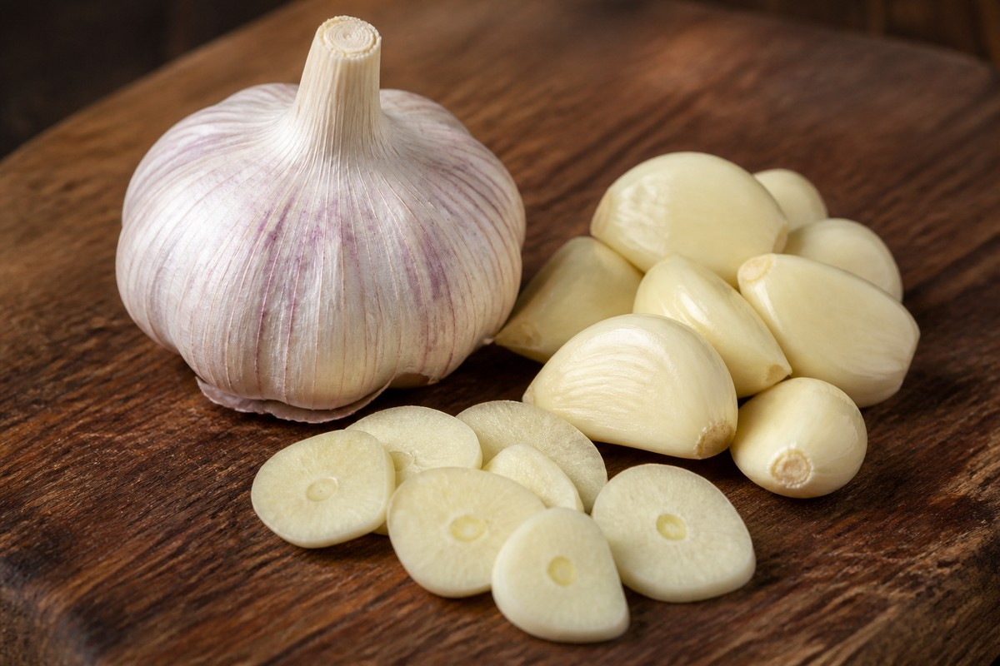

*▲ 마늘(Garlic)은 으깨거나 다질 때 알리나아제 효소 반응으로 알리신(Allicin)이 생기는 유기유황 채소입니다. 영양 수치는 USDA FoodData Central FDC 169230(생것) 기준입니다.*

한 줄 결론 <strong>생마늘 100g은 149kcal, 비타민C 31.2mg, 칼륨 401mg입니다.</strong> 알리신은 마늘을 으깨 알리나아제가 작용할 때 생기므로 다진 뒤 10분 두었다 조리하면 열에 파괴되기 전에 활성 성분이 만들어집니다.

고대 이집트에서 노동자들의 식량으로 쓰인 이래 **마늘(Garlic, Allium sativum)**은 오랫동안 건강에 좋은 향신채로 여겨져 왔습니다. 다만 '치료 식품'이라는 평가는 임상 근거보다 오랜 관습에 기대온 부분이 큽니다.

마늘 특유의 알싸하고 강렬한 향미는 단순한 풍미 물질이 아니라 식물이 외부 병원균과 포식자로부터 자신을 보호하기 위해 진화시킨 정교한 생화학 무기인 **유기유황 화합물(Organosulfur Compounds)**의 집합체입니다.

손상되지 않은 마늘 속의 비활성 전구체 **알린(Alliin)**은 세포가 파괴될 때 **알리나아제(Alliinase)**와 만나 **알리신(Allicin)**으로 전환됩니다. 알리신은 시험관에서 항균 작용이 보고된 물질이지만, 사람에서 혈전을 녹이거나 간 해독 효소를 직접 활성화한다고 확립된 것은 아닙니다.

오늘은 미국 농무부(USDA FoodData Central)의 표준 분석 데이터와 글로벌 의학 저널 연구를 토대로, 마늘의 정밀 영양 조성과 과학적으로 입증된 4대 건강 효능, 그리고 알리신 수율을 300% 이상 끌어올리는 조리 과학 원칙을 정밀하게 분석해 드립니다.

---

## 1. 마늘 칼로리와 영양성분은? (비타민C 31.2mg·칼륨 401mg)

마늘은 수분 비중이 약 58.6%로 일반 채소류에 비해 건조 고형분 밀도가 매우 높으며, 비타민 B6, 망간, 셀레늄 등 체내 항산화 보조 인자가 조밀하게 농축되어 있습니다.

| 영양 성분 (Nutrient) | 함량 (100g당) | 1일 권장 섭취량 비율 (한국인 성인 기준) |
| :--- | :--- | :--- |
| **열량 (Energy)** | 149 kcal | 7.5% |
| **탄수화물 (Carbohydrates)** | 33.06 g | 10.2% |
| - 당류 (Total Sugars) | 1.00 g | 1.0% |
| - 식이섬유 (Dietary Fiber) | 2.10 g | 8.4% |
| **단백질 (Protein)** | 6.36 g | 11.6% |
| **지방 (Total Fat)** | 0.50 g | 0.9% |
| **비타민 C (Ascorbic Acid)** | 31.20 mg | 31.2% |
| **비타민 B6 (Pyridoxine)** | 1.235 mg | 82.3% |
| **비타민 B1 (Thiamine)** | 0.200 mg | 16.7% |
| **망간 (Manganese, Mn)** | 1.672 mg | 72.7% |
| **셀레늄 (Selenium, Se)** | 14.20 mcg | 25.8% |
| **칼륨 (Potassium, K)** | 401.00 mg | 11.5% |
| **칼슘 (Calcium, Ca)** | 181.00 mg | 25.9% |
| **철분 (Iron, Fe)** | 1.70 mg | 14.2% |
| **총 알린 (Total Alliin)** | 약 1,000~1,500 mg | 기준치 없음 |
| **수분 (Water)** | 58.58 g | 별도 표기¹ |

*※ 출처: [USDA FoodData Central FDC 169230](https://fdc.nal.usda.gov/food-details/169230/nutrients) — Garlic, raw (SR Legacy).*  

*¹ 수분은 신체 필수 용매로 1일 권장 백분율 대상에서 제외됩니다.*  
*※ '기준치 없음' 표기는 알리신 등 황화합물에 공식적인 일일 영양 권장량(%DV)이 없기 때문이며, 치료 효과가 있다는 뜻이 아닙니다.*

### 1회 섭취량 환산: 마늘 한 쪽·한 통은 몇 kcal인가?

마늘은 100g 단위로 먹지 않습니다. USDA 1회 섭취량 자료의 무게로 환산했습니다.

| 섭취 단위 | 가식부 무게 | 열량 | 단백질 |
| :--- | :--- | :--- | :--- |
| 1쪽 | 3 g | 4.5 kcal | 0.19 g |
| 3쪽 | 9 g | 13.4 kcal | 0.57 g |
| 다진 1작은술 | 2.8 g | 4.2 kcal | 0.18 g |
| 다진 한 컵 | 136 g | 202.6 kcal | 8.65 g |

*※ 마늘 1쪽은 4~5kcal에 불과해 열량 걱정은 사실상 없습니다. 문제가 되는 것은 양이 아니라 **생마늘을 공복에 많이 먹을 때의 위 자극**입니다.*

---

## 2. 마늘 효능은 무엇일까? 과학으로 입증된 4대 효과

### ① 혈압 — 연구 결과가 엇갈리는 영역
마늘의 유기유황 화합물은 체내에서 황화수소(H₂S)를 거쳐 혈관 평활근을 이완시키는 경로가 세포·동물 실험에서 보고됐습니다. 사람 대상 메타분석에서는 마늘 보충제가 수축기 혈압을 몇 mmHg 낮췄다는 결과와, 고품질 시험만 모으면 효과가 작거나 없었다는 결과가 함께 나옵니다. 어느 쪽이든 항고혈압제 한 종에 필적한다고 말할 수는 없으며, 혈압약을 마늘로 대체해서는 안 됩니다.

### ② 항균 — 시험관 실험과 사람 임상의 간극
**알리신(Allicin)**은 시험관에서 세균·진균의 효소에 작용해 증식을 억제하는 것으로 보고됐습니다. 다만 알리신은 불안정해서 조리·섭취 과정에서 빠르게 분해되고, 사람을 대상으로 한 연구에서는 마늘 섭취가 감기 발생이나 회복 기간을 뚜렷하게 줄였다는 일관된 결과가 없습니다. '감염 기간 60% 단축' 같은 수치는 근거가 없습니다.

### ③ 혈중 지질 — 효과는 작고 개인차가 큼
**DADS·DATS** 같은 유기유황 물질은 세포 실험에서 콜레스테롤 합성 효소(HMG-CoA 환원효소)를 억제하는 방향으로 보고됐습니다. 사람 대상 메타분석에서는 LDL 콜레스테롤이 소폭 낮아질 수 있다는 결과가 있지만, '10~15% 감소'는 특정 소규모 연구의 값으로 일반화할 수 없습니다. 혈소판 응집에 영향을 줄 가능성은 있으나 '혈전을 녹인다'는 표현은 과장입니다.

### ④ '해독'은 측정된 적이 없습니다
마늘의 유황 화합물이 세포와 동물 모델에서 Nrf2 경로를 통해 글루타치온 S-전이효소 같은 2상 효소 발현을 늘린다는 보고는 있습니다. 그러나 마늘을 먹었을 때 체내 중금속이 얼마나 빨리 배출되는지, 간 섬유화가 억제되는지는 사람에서 측정된 바 없습니다. '해독'은 의학적 지표가 아니라 마케팅 용어에 가깝습니다.

---

## 3. 마늘은 왜 으깬 뒤 10분 두어야 할까? 알리신 생성 원리

### 마늘을 칼로 으깨거나 다진 후 반드시 10분간 공기 중에 두십시오
온전한 통마늘 상태에서는 알린(Alliin)과 알리나아제(Alliinase) 효소가 서로 다른 세포 구획(액포와 세포질)에 격리되어 있어 알리신이 전혀 존재하지 않습니다. 칼날로 마늘을 으깨거나 얇게 편 썰어야만 세포벽이 파괴되며 효소적 결합 반응이 촉발됩니다.

핵심은 **다진 뒤 상온에서 잠시 두는 것**입니다. 알리나아제가 알린을 알리신으로 바꾸는 데는 수 분이 걸리므로, 약 10분 두었다가 조리하면 알리신 생성이 늘어난다는 연구가 있습니다. 

다진 즉시 뜨거운 팬이나 끓는 물에 넣으면 열에 약한 알리나아제가 불활성화되어 알리신 생성이 크게 줄어듭니다. 10분 두었다가 가열하면 이미 만들어진 알리신이 다른 유기유황 화합물로 일부 전환됩니다.

---

## 4. 마늘 부작용과 주의할 점은?

### 공복 생마늘 섭취 시 위점막 화상 주의
알리신은 강력한 휘발성 자극 물질로, 위가 비어 있는 상태에서 생마늘을 고용량 섭취할 경우 위점막 상피세포에 급성 염증과 화학적 화상, 심한 속쓰림(위경련)을 유발할 수 있습니다. 위염이나 위궤양 병력이 있는 분은 반드시 익히거나 다른 음식물과 함께 섭취해야 합니다.

### 수술 전후 및 항응고제(와파린, 아스피린) 복용 환자
마늘은 혈소판 응집에 영향을 줄 수 있다는 보고가 있습니다. 대형 수술이나 치과 발치를 앞두고 있거나 와파린·아스피린 같은 항혈전제를 복용 중이라면, 마늘 농축액이나 생마늘을 다량 섭취하지 말고 의료진과 상의하십시오.

---

## 5. 마늘 하루 얼마나 먹을까? 핵심 요약

1. **알리신의 마법은 파괴에서 시작:** 통으로 삼키지 말고 반드시 칼등으로 으깨거나 곱게 다져 세포벽을 파괴하십시오.
2. **조리 전 10분 대기의 원칙:** 다진 후 10분간 상온에 두어 알리나아제 효소가 알리신을 완전히 생성하도록 기다리십시오.
3. **기대할 수 있는 범위:** 마늘은 향과 풍미를 더하는 채소입니다. 혈압·콜레스테롤에 대한 효과는 연구마다 엇갈리고 작으므로, 약을 대신하는 식품으로 기대하지 마십시오.

---

## 6. 마늘과 함께 먹으면 좋은 음식은?

- **[소고기 등심 (Beef Sirloin)]({{ site.baseurl }}/posts/beef-sirloin-nutrition-benefits/)**: 마늘의 알리신이 소고기의 비타민 B1과 결합해 지용성 알리티아민을 형성하여 만성 피로를 회복하고 단백질 합성을 촉진합니다.
- **[연어 (Salmon)]({{ site.baseurl }}/posts/salmon-nutrition-benefits/)**: 마늘의 유기황 화합물이 연어의 오메가-3 지방산 산화를 방지하고 혈소판 응집을 막아 혈액 순환을 최적화합니다.
- **[토마토 (Tomato)]({{ site.baseurl }}/posts/tomato-nutrition-benefits/)**: 토마토의 지용성 리코펜과 마늘의 알릴디설파이드가 복합 작용하여 전립선 세포 및 심혈관벽의 산화 스트레스를 소거합니다.

---

## 7. 자주 묻는 질문 (FAQ)

### Q1. 흑마늘과 생마늘의 영양학적 효능 차이는 무엇인가요?
**A:** 흑마늘은 숙성 과정에서 매운맛이 줄고 S-알릴시스테인(SAC) 같은 수용성 성분이 늘어납니다. 다만 ‘항산화 활성이 최대 10배’라는 수치는 제품과 제조 공정에 따라 크게 달라 일반화할 수 없고, 위장 자극이 줄었다는 것도 개인차가 큽니다.

### Q2. 마늘을 가열 조리하면 알리신의 효능이 전부 사라지나요?
**A:** 가열 시 알리신 생성 효소(Alliinase)가 불활성화되지만, 대신 아조엔(Ajoene)과 알릴설파이드 등 다른 혈관 확장 및 콜레스테롤 저하 물질이 새롭게 생성됩니다. 알리신을 최대한 보존하려면 마늘을 다진 후 10분간 공기 중에 방치한 뒤 조리하는 것이 비결입니다.

### Q3. 공복에 생마늘을 섭취했을 때 속쓰림을 방지하는 안전한 섭취법은?
**A:** 생마늘의 알리신은 위점막을 강력하게 자극하므로 공복 섭취를 피하고, 꿀에 절여 섭취하거나 기름에 살짝 볶아 드시거나 식사 중간에 다른 음식과 함께 섭취해야 위점막 손상을 막을 수 있습니다.

  
📌 관련 순위 가이드

  <ul>
    <li><a href="/posts/heart-blood-pressure-cholesterol-foods/">혈압·혈관 건강 음식 TOP 10: 콜레스테롤·중성지방 관리</a></li>
    <li><a href="/posts/liver-immunity-fatigue-recovery-foods/">피로 회복·면역력 음식 TOP 10: 비타민C·아연 함량 순위</a></li>
  </ul>

