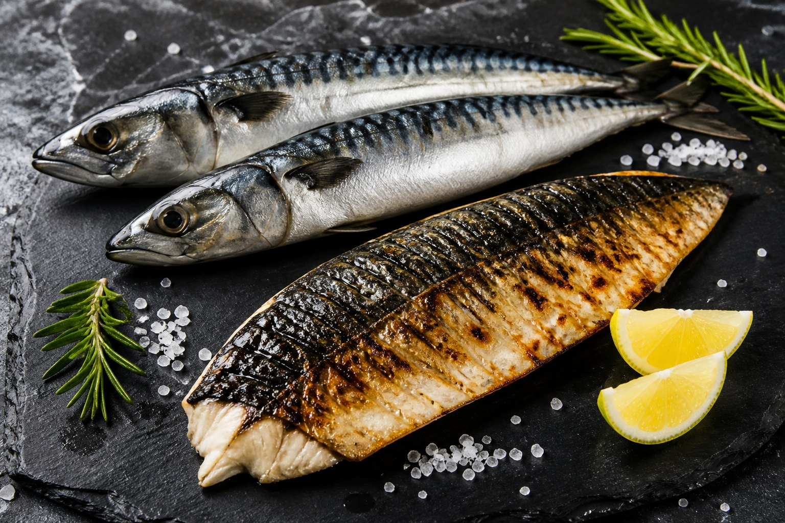

*▲ 짙푸른 등과 은백색 복부를 지닌 고등어(Mackerel)는 혈관벽의 염증을 잠재우는 EPA와 뇌신경세포 시냅스 가소성을 유지하는 DHA, 그리고 뼈 건강의 핵심인 비타민 D가 최상급으로 농축된 천연 오메가-3의 보고입니다.*

바다의 보리라 불리는 **고등어(Mackerel)**는 서민의 밥상을 지켜온 친숙한 생선이지만, 생화학적으로는 지용성 필수지방산과 항산화 미네랄이 기적적인 균형을 이루고 있는 초고농축 기능성 슈퍼푸드입니다.

고등어의 지방질에는 인체 내에서 합성되지 않는 다가불포화지방산(PUFA)인 **EPA(에이코사펜타엔산)**와 **DHA(도코사헥사엔산)**가 단위 중량당 연어를 능가하는 압도적인 농도로 함유되어 있습니다. EPA는 혈소판 응집을 유발하는 트롬복산(TXA2) 생성을 억제하여 혈전증과 심근경색을 예방하며, DHA는 뇌세포막 인지질의 핵심 구성 요소로 작용하여 기억력과 인지 기능을 강화합니다.

뿐만 아니라 고등어의 검붉은 혈합육(붉은살)에는 혈액 산소 운반을 책임지는 **헴철(Heme Iron)**과 세포 노화를 방지하는 **핵산(Nucleic Acid)**, 그리고 칼슘 흡수를 조절하는 **천연 비타민 D3**가 풍부하게 분포하고 있습니다.

미국 농무부(USDA) 표준 분석과 국제 심혈관 학술 연구들을 바탕으로 고등어의 정밀 영양 성분표와 4대 핵심 효능, 비린내 없이 유효 성분을 보존하는 조리법을 상세히 분석합니다.

---

## 1. 고등어 영양 성분 정밀 분석표 (가열 조리 전 생물 100g 기준)

고등어는 양질의 단백질과 함께 혈관을 맑게 하는 고순도 불포화지방산이 풍부한 전형적인 등푸른생선의 영양 프로필을 나타냅니다.

| 영양 성분 (Nutrient) | 함량 (100g당) | 1일 권장 섭취량 비율 (한국인 성인 기준) |
| :--- | :--- | :--- |
| **열량 (Energy)** | 205 kcal | 10.3% |
| **탄수화물 (Carbohydrates)** | 0.00 g | 0.0% |
| - 당류 (Total Sugars) | 0.00 g | 0.0% |
| - 식이섬유 (Dietary Fiber) | 0.00 g | 0.0% |
| **단백질 (Protein)** | 18.60 g | 33.8% |
| **지방 (Total Fat)** | 13.89 g | 25.7% |
| - 포화지방산 (Saturated Fat) | 3.26 g | 21.7% |
| - 단일불포화지방산 (MUFA) | 5.45 g | 기준치 없음 |
| - 다가불포화지방산 (PUFA) | 3.35 g | 기준치 없음 |
| **EPA (오메가-3)** | 898.00 mg | 기준치 없음 |
| **DHA (오메가-3)** | 1,401.00 mg | 기준치 없음 |
| **비타민 D3 (Cholecalciferol)** | 16.10 mcg (644 IU) | 161.0% |
| **비타민 B12 (코발라민)** | 8.71 mcg | 362.9% |
| **나이아신 (비타민 B3)** | 9.08 mg | 60.5% |
| **셀레늄 (Selenium, Se)** | 44.10 mcg | 80.2% |
| **철분 (Iron, Fe)** | 1.57 mg | 13.1% |
| **칼륨 (Potassium, K)** | 314.00 mg | 9.0% |
| **수분 (Water)** | 66.20 g | 별도 표기¹ |

*※ 출처: 미국 농무부(USDA FoodData Central) 표준 분석 데이터.*  
*¹ 수분은 체액 항상성 유지를 위한 기본 용매로 분류됩니다.*  
*※ '기준치 없음' 표기는 기능성 지방산으로 DRI상 일일 권장 백분율(%DV)이 법적으로 규정되지 않은 항목입니다.*

---

## 2. 과학적으로 입증된 고등어의 4대 건강 효능

### ① EPA 기반 혈소판 응집 억제 및 동맥경화 예방
고등어 100g에는 혈관 건강의 수호신이라 불리는 **EPA가 약 900mg** 집중되어 있습니다. EPA는 체내에서 염증을 유발하는 아라키돈산(Arachidonic acid)과 경쟁하여 혈관 수축 물질인 트롬복산(TXA2) 대신 항염증성 프로스타글란딘(PGI3)과 트롬복산(TXA3)을 합성하도록 유도합니다. 이는 혈소판이 엉겨 붙어 혈전(피떡)이 형성되는 것을 원천 차단하고 혈관 내피세포 염증을 잠재워 뇌졸중과 심근경색을 선제적으로 예방합니다.

### ② DHA의 뇌혈관 장벽(BBB) 통과 및 시냅스 가소성 강화
고등어 100g당 **1,400mg 이상 함유된 DHA**는 인간 뇌 회백질과 망막 광수용체 세포막 인지질의 약 30~50%를 구성하는 필수 분자입니다. DHA는 뇌혈관 장벽(BBB)을 통과하여 뇌신경세포 시냅스 간 신호 전달 속도를 극대화하고, 알츠하이머 원인 물질로 알려진 베타 아밀로이드(Amyloid-β) 플라크의 뇌내 축적을 억제하여 인지 기능 저하를 효과적으로 방어합니다.

### ③ 골다공증 예방과 면역 항상성을 지탱하는 천연 비타민 D3
고등어 100g만으로 성인 일일 권장량의 **161%에 달하는 고단위 비타민 D3(644 IU)**를 섭취할 수 있습니다. 지용성 비타민 D3는 소장에서 칼슘과 인의 능동적 흡수를 돕는 칼빈딘(Calbindin) 단백질 합성을 촉진하여 뼈 밀도를 높이고, 면역 세포인 대식세포와 T세포를 활성화하여 자가면역 질환과 바이러스 감염을 방어합니다.

### ④ 갑상선 기능 및 항산화 네트워크를 완성하는 셀레늄
고등어는 강력한 해독 미네랄인 **셀레늄(일일 권장량의 80%)**의 보고입니다. 셀레늄은 비타민 E와 시너지를 이루어 체내 과산화지질을 무해한 알코올 형태로 환원시키는 글루타치온 과산화효소 활성을 높이고, 해양 생물이 체내에 흡수할 수 있는 중금속(수은 등)과 결합해 독성을 중화 배출시키는 작용을 합니다.

---

## 3. 유효 성분 흡수율을 극대화하는 섭취 가이드

### 튀김보다는 조림, 찜, 에어프라이어 중불 구이
오메가-3 불포화지방산은 이중결합이 많아 고온의 끓는 기름에 튀길 경우 산패(Lipid Peroxidation)가 빠르게 진행되어 유익한 EPA·DHA가 파괴되고 유해한 과산화지질이 생성됩니다. 조림이나 찜 형태로 수분과 함께 조리하거나, 180℃ 이하의 중불 에어프라이어에 가볍게 구워 내는 것이 오메가-3 지방산 손실을 85% 이상 방어하는 비결입니다.

### 쌀뜨물과 레몬즙을 활용한 비린내(TMA) 중화
고등어 특유의 비린내는 수산물 내 트리메틸아민(TMA) 성분 때문입니다. 조리 전 쌀뜨물에 15분간 담가두면 전분 입자가 비린내 유발 성분을 흡착하며, 조리 직전 레몬즙(구연산)을 뿌리면 염기성인 TMA가 중화되어 담백하고 깔끔한 맛을 낼 수 있습니다.

---

## 4. 섭취 시 주의사항 및 잠재적 부작용

### 통풍(Gout) 환자의 과다 섭취 주의
등푸른생선인 고등어는 세포 분열이 활발한 핵산과 **퓨린(Purine, 100g당 약 150mg 이상)** 함량이 높은 고퓨린 식품입니다. 체내 요산(Uric Acid) 수치가 높거나 급성 통풍 발작을 겪고 있는 환자는 요산 결정 침착을 악화시킬 수 있으므로 섭취를 엄격히 제한해야 합니다.

### 신선도 저하 시 히스타민 식중독(알레르기) 위험
고등어는 부패 속도가 매우 빠릅니다. 상온에 방치할 경우 자체 효소와 세균에 의해 히스티딘 아미노산이 독성 물질인 **히스타민(Histamine)**으로 전환됩니다. 히스타민은 가열해도 파괴되지 않으며 섭취 시 두드러기, 안면 홍조, 두통, 복통 등 알레르기 반응을 유발하므로 반드시 신선한 냉장/냉동 상태의 고등어를 섭취해야 합니다.

---

## 5. 최종 요약 및 실천 팁

1. **오메가-3 최상급 공급원:** 연어를 능가하는 100g당 2,300mg의 EPA·DHA가 혈전을 녹이고 뇌기능을 활성화합니다.
2. **비타민 D와 셀레늄의 결합:** 하루 1토막으로 비타민 D 일일 요구량의 1.6배를 충족해 뼈와 면역을 지킵니다.
3. **중불 조리와 신선도 유지:** 오메가-3 산패를 막기 위해 고온 튀김 대신 찜이나 구이로 섭취하고 신선도를 반드시 확인하십시오.

---

## 6. 함께 먹으면 시너지가 폭발하는 식재료 궁합

- **[양파 (Onion)]({{ site.baseurl }}/posts/onion-nutrition-benefits/)**: 양파의 퀘르세틴 성분이 고등어 기름의 산패를 막아주고 모세혈관 탄력을 높여 심혈관 보호 시너지를 극대화합니다.
- **[마늘 (Garlic)]({{ site.baseurl }}/posts/garlic-nutrition-benefits/)**: 마늘의 유기황 화합물이 고등어의 비린내를 잡고, 혈소판 응집 억제 효과를 배가하여 혈액 순환을 최적화합니다.
- **[사과 (Apple)]({{ site.baseurl }}/posts/apple-nutrition-benefits/)**: 사과의 펙틴과 비타민 C가 고등어의 기름진 풍미를 중화하고 지용성 비타민의 장내 흡수를 촉진합니다.

---

## 7. 자주 묻는 질문 (FAQ)

### Q1. 고등어 껍질과 검붉은 살(혈합육)도 함께 먹어야 하나요?
**A:** 반드시 함께 드셔야 합니다. 고등어 껍질에는 지용성 비타민 A와 콜라겐이 풍부하며, 붉은 혈합육에는 혈액을 생성하는 헴철과 비타민 B12, 그리고 강력한 항산화 펩타이드가 흰살 부분보다 3배 이상 응축되어 있습니다.

### Q2. 자반고등어(간고등어)의 높은 염분을 줄여 건강하게 먹는 법은?
**A:** 조리 전 쌀뜨물이나 연한 식초물에 20~30분간 담가두면 삼투압 작용으로 과도한 나트륨이 빠져나가고 생선 살이 더욱 탄력 있어집니다. 조리 시 추가 소금 간을 하지 않고 채소를 듬뿍 곁들이면 칼륨이 나트륨 배출을 촉진합니다.

### Q3. 통풍 증상이 있는 사람이 고등어를 먹어도 괜찮은가요?
**A:** 통풍 환자는 주의가 필요합니다. 고등어는 100g당 퓨린 함량이 150mg을 초과하는 '고퓨린 식품'에 속합니다. 요산 수치가 잘 조절되지 않거나 급성 발작 기간에는 섭취를 피하시고, 안정기에는 주 1회 이하로 소량만 드시는 것이 바람직합니다.

