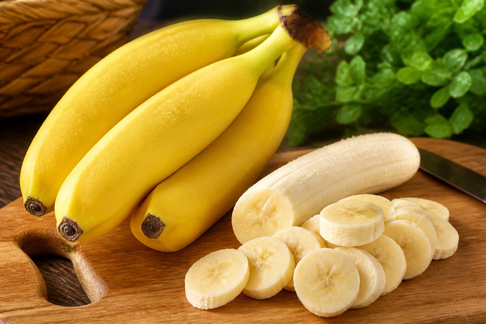

*▲ 열대 과일의 표준이자 인류의 가장 완전한 천연 에너지원인 바나나(Banana)는 세포막 전위차를 유지하는 고농도 칼륨(Potassium)과 장내 마이크로바이옴을 복원하는 프리바이오틱 저항성 전분(Resistant Starch)의 보고입니다.*

현대 임상 영양학과 대사 생화학에서 **바나나(Musa acuminata)**는 휴대하기 간편한 대중적 과일을 넘어 신경계 안정, 혈관 내피 건강, 소화기 점막 보호를 동시에 수행하는 기능성 슈퍼푸드로 재평가받고 있습니다.

바나나는 가식부 100g당 무려 358mg에 달하는 풍부한 전해질 칼륨을 함유하고 있어 가공식품 과다 섭취로 깨진 현대인의 나트륨-칼륨 균형을 즉각 회복시키는 가장 경제적이고 확실한 식재료입니다. 

특히 덜 익은 녹색 바나나와 완전히 익은 황금빛 바나나는 탄수화물의 화학적 구조가 완전히 달라지는데, 숙성 초기의 **저항성 전분(Resistant Starch)**은 소장에서 흡수되지 않고 대사성 단쇄지방산(SCFA) 생성을 자극하는 강력한 프리바이오틱스로 작동합니다. 

또한 단백질 대사의 필수 조효소인 **비타민 B6(피리독신)**와 신경전달물질의 전구물질인 **L-트립토판(Tryptophan)**이 상호 공존하여 뇌 내 세로토닌 합성을 직접 유도하는 천연 항우울·수면 유도 스위치로 기여합니다.

미국 농무부(USDA FoodData Central) 공인 표준 분석 데이터를 기반으로 바나나의 생화학적 영양 프로필과 4대 임상적 건강 효능, 그리고 당뇨 및 대사증후군 환자를 위한 올바른 섭취 과학을 상세히 분석합니다.

---

## 1. 바나나 영양 성분 정밀 분석표 (가식부 생과육 100g 기준)

바나나는 콜레스테롤과 포화지방이 전혀 없으며, 에너지 대사를 신속히 촉진하는 천연 당류와 완충 미네랄이 최적의 비율로 응축되어 있습니다.

| 영양 성분 (Nutrient) | 함량 (100g당) | 1일 권장 섭취량 비율 (한국인 성인 기준) |
| :--- | :--- | :--- |
| **열량 (Energy)** | 89 kcal | 4.5% |
| **탄수화물 (Carbohydrates)** | 22.84 g | 7.0% |
| - 당류 (Total Sugars) | 12.23 g | 12.2% |
| - 포도당 (Glucose) | 4.98 g | 기준치 없음 |
| - 과당 (Fructose) | 4.85 g | 기준치 없음 |
| - 자당 (Sucrose) | 2.39 g | 기준치 없음 |
| - 식이섬유 (Dietary Fiber) | 2.60 g | 10.4% |
| - 저항성 전분 (Green/Yellow) | 약 1.80 g | 기준치 없음 |
| **단백질 (Protein)** | 1.09 g | 2.0% |
| **지방 (Total Fat)** | 0.33 g | 0.6% |
| - 포화지방산 (Saturated Fat) | 0.11 g | 0.7% |
| - 단일불포화지방산 (MUFA) | 0.03 g | 기준치 없음 |
| - 다가불포화지방산 (PUFA) | 0.07 g | 기준치 없음 |
| **칼륨 (Potassium, K)** | 358.00 mg | 10.2% |
| **마그네슘 (Magnesium, Mg)** | 27.00 mg | 8.6% |
| **비타민 B6 (피리독신)** | 0.37 mg | 24.7% |
| **비타민 C (아스코르브산)** | 8.70 mg | 8.7% |
| **엽산 (Folate, B9)** | 20.00 mcg | 5.0% |
| **트립토판 (L-Tryptophan)** | 9.00 mg | 기준치 없음 |
| **수분 (Water)** | 74.91 g | 별도 표기¹ |

*※ 출처: 미국 농무부(USDA FoodData Central) 표준 영양 데이터.*  
*¹ 수분은 세포막 유동성과 세포 내 삼투압 조절을 위한 기본 체액 용매입니다.*  
*※ '기준치 없음' 표기는 천연 단당/이당류 및 기능성 아미노산·저항성 전분으로 일일 영양성분 기준치(%DV)가 법적으로 책정되지 않은 항목입니다.*

---

## 2. 과학적으로 입증된 바나나의 4대 건강 효능

### 1) 칼륨-나트륨 펌프 정상화 및 혈압 강하 메커니즘
현대인의 고염분 식습관은 세포외액의 나트륨 농도를 급증시켜 혈관벽의 삼투압을 높이고 만성 고혈압을 유발합니다. 바나나에 풍부한 칼륨은 신장 세뇨관에서 나트륨의 재흡수를 억제하고 소변을 통한 나트륨 배출을 강력하게 촉진합니다. 

더 나아가 혈관 평활근의 긴장도를 이완시켜 말초 혈관 저항을 감소시킴으로써 수축기 및 이완기 혈압을 동반 안정화합니다. 미국 심장협회(AHA) 임상 저널에 따르면 고칼륨 식이군은 뇌졸중 발병 위험이 최대 24% 감소하는 것으로 확인되었습니다.

### 2) 장내 유익균 증식 및 단쇄지방산(SCFA) 생성 촉진
완숙 전 바나나에 다량 함유된 **저항성 전분(Type 2 Resistant Starch)**과 수용성 섬유질인 **펙틴(Pectin)**은 인간의 소화 효소에 의해 분해되지 않고 대장까지 온전히 도달합니다. 

대장 내 상주하는 비피도박테리움 등 프로바이오틱스 유익균은 이 저항성 성분을 발효시켜 부티레이트(Butyrate), 프로피오네이트 등 단쇄지방산(SCFA)을 다량 생성합니다. 부티레이트는 대장 상피세포의 주된 에너지원으로 사용되어 장 점막 장벽을 치밀하게 재건하고 전신성 만성 염증 물질의 혈류 유입을 차단합니다.

### 3) 트립토판과 비타민 B6의 신경전달물질(세로토닌) 합성 시너지
바나나는 행복 호르몬으로 불리는 **세로토닌(Serotonin)**의 전구물질인 필수아미노산 L-트립토판을 함유하고 있을 뿐만 아니라, 트립토판이 5-HTP를 거쳐 세로토닌으로 전환될 때 반드시 필요한 핵심 조효소인 **비타민 B6(피리독신)**가 일일 필요량의 25% 이상 고농도로 함께 들어 있습니다. 

이 천연 조효소 복합체는 중추신경계의 흥분을 가라앉히고 스트레스 호르몬 코르티솔 분비를 완화하며, 야간에는 멜라토닌 분비 경로를 활성화하여 깊은 서파 수면을 유도합니다.

### 4) 신속한 글리코겐 재합성 및 마그네슘 기반 근경련 억제
바나나의 당질 프로필은 신속하게 흡수되는 포도당·과당과 지속성 복합 탄수화물이 완벽한 황금 비율을 이루고 있습니다. 고강도 운동 전 섭취 시 혈당의 급격한 붕괴 없이 지속적인 ATP 에너지를 공급하며, 운동 직후에는 고갈된 간과 골격근의 글리코겐을 신속하게 재합성합니다. 

또한 바나나에 함유된 이온화 마그네슘과 칼륨은 신경근 접합부의 칼슘 유입을 완충하여 운동 중 흔히 발생하는 골격근의 비자발적 수축과 근육 경련(쥐)을 효과적으로 방지합니다.

---

## 3. 바나나 흡수율을 극대화하는 섭취 및 숙성 과학

- **목적별 숙성도 선택 가이드:**
  - **다이어트 및 혈당 관리가 목적이라면:** 과피 양 끝에 녹색 기운이 남아 있는 반숙 바나나를 선택하십시오. 저항성 전분 비율이 최대 80%에 달해 GI 지수가 40 이하로 유지되며 인슐린 감수성을 개선합니다.
  - **소화 촉진 및 면역 항산화력이 목적이라면:** 표면에 갈색 반점인 '슈가 스팟(Sugar Spot)'이 돋아난 완숙 바나나를 섭취하십시오. 전분이 단당류로 전환되어 위장 부담이 제로에 가까우며 종양괴사인자(TNF-α) 유도 활성이 극대화됩니다.
- **냉장 보관의 생화학적 통제:** 저온 장애(Chilling Injury)로 인해 껍질이 갈변할 수 있으므로, 상온에서 후숙 후 밀폐 용기에 담아 냉장 보관하거나 한 입 크기로 썰어 냉동 보관하면 항산화 폴리페놀 성분을 장기 보존할 수 있습니다.

---

## 4. 섭취 시 주의사항 및 잠재적 부작용

- **만성 콩팥병(신부전) 환자의 고칼륨혈증 위험:** 신장 여과 기능이 저하된 환자는 바나나의 고농도 칼륨을 체외로 적절히 배출하지 못해 부정맥 및 심정지를 유발하는 고칼륨혈증(Hyperkalemia)에 노출될 수 있으므로 주치의와 상의하여 섭취량을 엄격히 제한해야 합니다.
- **공복 섭취 시 마그네슘-칼륨 일시 불균형 논란:** 건강한 일반인은 체내 항상성 조절 기전으로 인해 공복에 1~2개를 섭취해도 혈중 마그네슘 수치가 급변하지 않습니다. 다만 기저 저혈압이 있거나 심장 질환이 있는 경우 단독 공복 섭취보다 견과류나 그릭 요거트와 함께 섭취하는 것이 바람직합니다.

---

## 5. 함께 먹으면 시너지가 폭발하는 식재료 궁합

- **[사과 (Apple)]({{ site.baseurl }}/posts/apple-nutrition-benefits/)**: 사과의 수용성 펙틴과 우르솔산이 바나나의 당질 흡수 속도를 지연시켜 혈당 스파이크를 완벽하게 방어하고 포만감을 2배 이상 연장합니다.
- **[블루베리 (Blueberry)]({{ site.baseurl }}/posts/blueberry-nutrition-benefits/)**: 블루베리의 풍부한 안토시아닌 플라보노이드가 바나나의 마그네슘·칼륨과 결합하여 신경 세포막의 산화 스트레스를 억제하고 인지 기능을 향상시킵니다.
- **[토마토 (Tomato)]({{ site.baseurl }}/posts/tomato-nutrition-benefits/)**: 토마토의 지용성 라이코펜과 바나나의 고농도 칼륨이 세포외액의 염분을 신속히 소변으로 배출시켜 아침 전신 부종을 기적적으로 완화합니다.

---

## 6. 자주 묻는 질문 (FAQ)

### Q1. 당뇨 환자가 단맛이 강한 바나나를 먹어도 혈당에 무리가 없나요?
**A:** 당뇨 환자라도 하루 반 개에서 한 개 분량의 바나나 섭취는 가능합니다. 이때 슈가 스팟이 많은 완숙 바나나보다는 약간 푸른빛이 도는 덜 익은 바나나를 선택하십시오. 덜 익은 바나나는 저항성 전분 함량이 높아 혈당지수(GI)가 42 안팎으로 낮으며, 식이섬유가 포도당의 흡수를 완만하게 조절합니다.

### Q2. 공복에 바나나를 먹으면 심장 마비가 올 수 있다는 속설이 사실인가요?
**A:** 의학적 근거가 희박한 낭설입니다. 바나나 한 개에는 약 27mg의 마그네슘이 들어 있는데, 이는 성인 하루 권장량의 8% 수준에 불과합니다. 정상적인 신장 대사 기능을 가진 인체는 공복에 바나나를 섭취하더라도 혈중 칼륨-마그네슘 이온 균형을 완벽히 유지하므로 안심하고 드셔도 됩니다.

### Q3. 바나나 껍질 안쪽의 하얀 실 같은 물질은 떼어내고 먹어야 하나요?
**A:** 떼어내지 않고 함께 섭취하는 것이 좋습니다. 이 섬유질 가닥은 학술적으로 '체관부 다발(Phloem Bundles)'이라 불리며, 열매가 자라는 동안 뿌리와 잎에서 생성된 필수 영양소를 과육에 전달하던 통로입니다. 과육 자체보다 식이섬유, 칼륨, 비타민 A가 더욱 조밀하게 응축되어 있어 소화기 건강에 매우 유익합니다.

---

## 7. 최종 요약 및 실천 가이드

- **핵심 영양:** 가식부 100g당 칼륨 358mg(혈압 강하), 비타민 B6 0.37mg(세로토닌 합성), 저항성 전분 1.8g(장내 유익균 먹이).
- **최적 섭취:** 장 건강 및 혈당 관리는 단단하고 푸른 반숙 바나나, 위장 안정 및 활력 충전은 갈색 반점의 완숙 바나나.
- **영양 궁합:** [사과]({{ site.baseurl }}/posts/apple-nutrition-benefits/)의 펙틴, [블루베리]({{ site.baseurl }}/posts/blueberry-nutrition-benefits/)의 안토시아닌과 병용 시 항산화 및 혈당 완충 효과 극대화.
