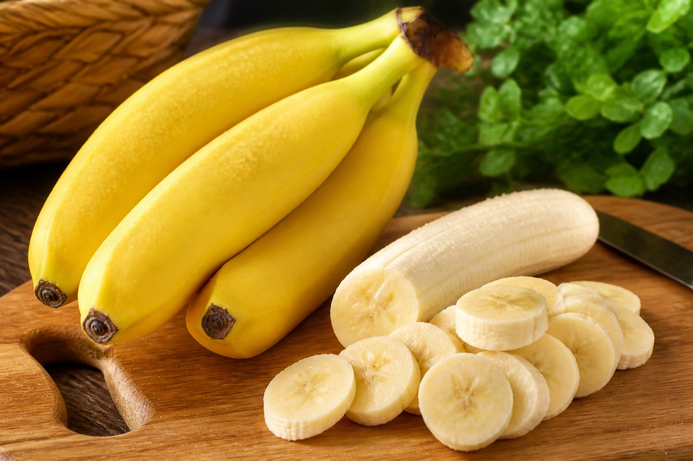

*▲ As a preeminent global nutritional staple, the banana (Musa acuminata) provides essential bioavailable potassium for maintaining cellular membrane potentials alongside prebiotic resistant starch that systematically regenerates the human colonic microbiome.*

Within clinical dietetics and metabolic biochemistry, the **banana** transcends its perception as a portable carbohydrate source, functioning as an evidence-based functional food supporting arterial compliance, neurotransmitter homeostasis, and gastrointestinal mucosal integrity.

Supplying approximately 358 mg of bioavailable elemental potassium per 100 g of edible pulp, bananas directly counteract the cytotoxic intracellular sodium retention induced by hyper-processed modern diets. 

Crucially, the chemical structure of banana carbohydrates evolves dynamically throughout ripening. In slightly underripe specimens, **type-2 resistant starch (RS2)** bypasses upper gastrointestinal enzymatic hydrolysis, acting as an elite fermentable prebiotic substrate that triggers colonic short-chain fatty acid (SCFA) biosynthesis. 

Simultaneously, the rare botanical co-localization of **vitamin B6 (pyridoxine)** with the essential amino acid **L-tryptophan** establishes an efficient biosynthetic pathway for central nervous system serotonin synthesis, mitigating neuroendocrine cortisol elevations.

Synthesizing analytical datasets from the USDA FoodData Central and clinical cardiovascular trials, this treatise delineates the quantitative nutritional profile of bananas, their systemic physiological mechanisms, and empirical dietary protocols.

---

## 1. Quantitative Nutritional Profile (Per 100g Raw Edible Pulp)

Bananas feature zero saturated lipid fractions and deliver calibrated matrices of rapid and sustained saccharides along with electrolyte cofactors.

| Nutrient | Amount (per 100g) | Daily Value (% DV) |
| :--- | :--- | :--- |
| **Energy** | 89 kcal | 4.5% |
| **Carbohydrates** | 22.84 g | 8.3% |
| - Total Sugars | 12.23 g | Daily value not established |
| - Glucose | 4.98 g | Daily value not established |
| - Fructose | 4.85 g | Daily value not established |
| - Sucrose | 2.39 g | Daily value not established |
| - Dietary Fiber | 2.60 g | 9.3% |
| - Resistant Starch (RS2) | ~1.80 g | Daily value not established |
| **Protein** | 1.09 g | 2.2% |
| **Total Fat** | 0.33 g | 0.4% |
| - Saturated Fat | 0.11 g | 0.6% |
| - Monounsaturated Fat (MUFA) | 0.03 g | Daily value not established |
| - Polyunsaturated Fat (PUFA) | 0.07 g | Daily value not established |
| **Potassium (K)** | 358.00 mg | 7.6% |
| **Magnesium (Mg)** | 27.00 mg | 6.4% |
| **Vitamin B6 (Pyridoxine)** | 0.37 mg | 21.8% |
| **Vitamin C (Ascorbic Acid)** | 8.70 mg | 9.7% |
| **Folate (Vitamin B9)** | 20.00 mcg | 5.0% |
| **L-Tryptophan** | 9.00 mg | Daily value not established |
| **Water** | 74.91 g | See note¹ |

*※ Data Source: USDA FoodData Central Analytical Repository.*  
*¹ Water functions as the primary physiological solvent governing fluid volume and intracellular osmotic gradients.*  
*※ 'Daily value not established' designates naturally occurring saccharide isomers, functional amino acids, or resistant polysaccharides lacking statutory DRI percentage benchmarks.*

---

## 2. Peer-Reviewed Systemic Health Mechanisms

### 1) Sodium-Potassium ATPase Normalization & Arterial Blood Pressure Modulation
Excessive dietary sodium expands intravascular volume, elevating peripheral vascular resistance. The substantial potassium payload in bananas directly stimulates renal natriuresis—promoting urinary sodium clearance via renal tubule modulation. 

Concurrently, potassium promotes vascular smooth muscle hyperpolarization, inducing vasodilation and dampening systemic arterial tension. Clinical meta-analyses in the *Journal of the American College of Cardiology* demonstrate that sustained dietary potassium intake correlates with up to a 24% relative risk reduction in ischemic cerebrovascular events.

### 2) Prebiotic Fermentation & Epithelial Butyrate Biosynthesis
In unripened and semi-ripe bananas, resistant starch and soluble pectin fractions resist gastric acid and alpha-amylase digestion. Entering the cecum intact, they undergo anaerobic bacterial fermentation by commensal *Bifidobacteria* and *Faecalibacterium prausnitzii*. 

This metabolic cascade produces high yields of short-chain fatty acids (SCFAs), notably **butyrate**. Butyrate serves as the primary metabolic fuel for colonocytes, upregulating tight junction protein claudin-1 expression, suppressing mucosal intestinal permeability, and mitigating systemic lipopolysaccharide translocation.

### 3) Pyridoxine-Dependent Tryptophan Decarboxylation for Serotonin Homeostasis
Bananas present a rare botanical synergy by pairing L-tryptophan with concentrated vitamin B6 (pyridoxine). Pyridoxine serves as the obligatory enzymatic cofactor for aromatic L-amino acid decarboxylase, the rate-limiting enzyme converting 5-hydroxytryptophan into active serotonin (5-HT). 

This biocatalytic alignment enhances neurochemical synthesis, alleviating depressive mood states, curbing emotional hyperphagia, and facilitating pineal melatonin synthesis for circadian sleep architecture.

### 4) Rapid Glycogen Resynthesis & Neuro-Muscular Anti-Cramping Action
The tri-saccharide profile of ripe bananas (glucose, fructose, and sucrose) ensures dual-transporter cellular uptake (via SGLT1 and GLUT5), delivering continuous cellular ATP synthesis without gastrointestinal distress. 

Furthermore, the balanced concentration of intracellular magnesium and potassium attenuates calcium-mediated neuromuscular hyperexcitability, systematically preventing exercise-induced involuntary muscular spasms.

---

## 3. Optimizing Biochemical Bioavailability by Ripening Stage

- **Prebiotic & Glycemic Control (Green/Yellow Phase):** Opt for bananas exhibiting green-tinged tips. Resistant starch constitutes over 70% of total carbohydrate mass, establishing a low glycemic index (GI < 42) that stabilizes postprandial insulin curves and optimizes glucagon sensitivity.
- **Immunological & Digestion Maximization (Sugar-Spotted Phase):** Opt for bananas displaying speckled brown lenticels. Starch depolymerizes into digestible simple sugars, and research demonstrates heightened macrophage-stimulating tumor necrosis factor-alpha (TNF-α) inducing activity.

---

## 4. Contraindications and Clinical Considerations

- **Hyperkalemia in Chronic Kidney Disease (CKD):** Individuals exhibiting impaired glomerular filtration rates cannot adequately clear potassium loads. Banana intake must be rigorously monitored in stages 4–5 renal insufficiency to avert cardiac conduction arrhythmias.
- **Fasting Ingestion Hypotheses:** In healthy adults, gastrointestinal buffering mechanisms maintain electrolyte plasma homeostasis effortlessly. Fasting ingestion poses zero cardiac risk unless severe end-stage renal impairment or adrenal hypofunction is clinically present.

---

## 5. Synergistic Food Pairings for Maximum Bioavailability

- **[Apple]({{ site.baseurl }}/en/posts/apple-nutrition-benefits/)**: Pairing the soluble pectin and ursolic acid of apples with the resistant starch of bananas decelerates gastric emptying, blunting glycemic excursion curves.
- **[Blueberry]({{ site.baseurl }}/en/posts/blueberry-nutrition-benefits/)**: Anthocyanin polyphenols in blueberries synergize with banana magnesium, suppressing neuronal oxidative lipid peroxidation.
- **[Tomato]({{ site.baseurl }}/en/posts/tomato-nutrition-benefits/)**: Combining lipophilic lycopene with high-potassium banana pulp optimizes cellular fluid drainage, resolving morning fluid retention.

---

## 6. Frequently Asked Questions (FAQ)

### Q1. Can individuals with type 2 diabetes consume bananas safely?
**A:** Yes, under structured dietary modulation. Diabetic patients should select slightly underripe bananas with green tips, as their high resistant starch content confers a low glycemic index (GI around 42), preventing acute postprandial glucose surges.

### Q2. Does eating bananas on an empty stomach disrupt cardiac magnesium levels?
**A:** This is an unsubstantiated myth. A single banana contains roughly 27 mg of magnesium (less than 8% of the Daily Value). In individuals with healthy renal filtration, physiological homeostatic mechanisms maintain plasma electrolyte equilibrium without systemic fluctuation.

### Q3. Should the stringy white strands inside banana peels be discarded?
**A:** Anatomically termed 'phloem bundles,' these vascular structures transport water and essential nutrients throughout fruit maturation. They are completely edible and contain higher relative concentrations of dietary fiber, potassium, and carotenoids than the core pulp.

---

## 7. Executive Summary & Pragmatic Takeaways

- **Clinical Benchmark:** 358 mg Potassium (natriuresis & vasodilation), 0.37 mg Vitamin B6 (serotonin synthesis), 1.8 g Prebiotic Resistant Starch (colonic integrity).
- **Targeted Application:** Select semi-green bananas for metabolic and glycemic stability; select speckled ripe bananas for rapid athletic glycogen restoration.
- **Biochemical Pairing:** Combine with [Apple]({{ site.baseurl }}/en/posts/apple-nutrition-benefits/) for glycemic blunting or [Blueberry]({{ site.baseurl }}/en/posts/blueberry-nutrition-benefits/) for neurovascular synergy.
