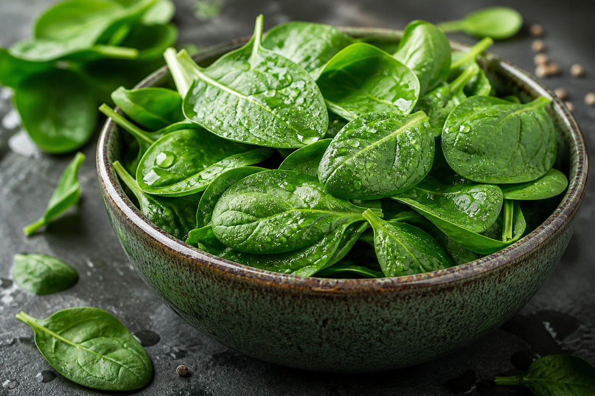

*▲ Regarded as the apex of green leafy vegetables, spinach (Spinacia oleracea) supplies concentrated inorganic dietary nitrates for vascular nitric oxide (NO) synthesis and exceptional reserves of phylloquinone (vitamin K1) for bone osteocalcin carboxylation.*

Within preventive cardiology, clinical ophthalmology, and sports nutrition, **spinach** functions as an indispensable plant matrix engineered by nature to protect vascular endothelium, bone architecture, and retinal photoreceptors from oxidative and metabolic decline.

Delivering an extraordinary 483 mcg of **phylloquinone (vitamin K1)** per 100 g of fresh leaves—surpassing 400% of the statutory adult Daily Value—spinach represents the primary dietary driver for activating osteocalcin, directing calcium mineral deposition into the skeletal matrix while preventing vascular calcification.

Moreover, spinach provides abundant stores of **inorganic nitrate (NO3-)**. Following salivary bacterial reduction to nitrite, systemic conversion yields active **nitric oxide (NO)**, which relaxes vascular smooth muscle, diminishes arterial stiffness, and enhances peripheral tissue perfusion.

Simultaneously, the dense accumulation of macular carotenoids—**lutein and zeaxanthin** exceeding 12,000 mcg per 100 g—forms a physical filtration shield against high-energy short-wave blue light, safeguarding retinal pigment epithelial integrity.

Extracting validated data from the USDA FoodData Central and biochemical literature, this monograph details the quantitative nutritional profile of spinach, its physiological bio-mechanisms, and culinary principles for minimizing oxalate interference.

---

## 1. Quantitative Nutritional Profile (Per 100g Raw Leaves)

Despite possessing an ultra-low caloric density (23 kcal/100g) with 91.4% water, spinach delivers peerless concentrations of fat-soluble vitamins and bioactive phytochemicals.

| Nutrient | Amount (per 100g) | Daily Value (% DV) |
| :--- | :--- | :--- |
| **Energy** | 23 kcal | 1.2% |
| **Carbohydrates** | 3.63 g | 1.3% |
| - Dietary Fiber | 2.20 g | 7.9% |
| - Total Sugars | 0.42 g | Daily value not established |
| **Protein** | 2.86 g | 5.7% |
| **Total Fat** | 0.39 g | 0.5% |
| - Saturated Fat | 0.06 g | 0.3% |
| **Phylloquinone (Vitamin K1)** | 483.00 mcg | 402.5% |
| **Vitamin A (Beta-Carotene Eq.)** | 469.00 mcg RAE | 52.1% |
| - Beta-Carotene | 5,626.00 mcg | Daily value not established |
| **Folate (Vitamin B9)** | 194.00 mcg | 48.5% |
| **Vitamin C (Ascorbic Acid)** | 28.10 mg | 31.2% |
| **Iron (Non-Heme Fe)** | 2.71 mg | 15.1% |
| **Calcium (Ca)** | 99.00 mg | 7.6% |
| **Potassium (K)** | 558.00 mg | 11.9% |
| **Magnesium (Mg)** | 79.00 mg | 18.8% |
| **Lutein + Zeaxanthin** | 12,198.00 mcg | Daily value not established |
| **Inorganic Dietary Nitrates** | ~250.00 mg | Daily value not established |
| **Water** | 91.40 g | See note¹ |

*※ Data Source: USDA FoodData Central Analytical Repository.*  
*¹ Water functions as the primary physiological medium dispersing lipophilic carotenoids and mineral ions.*  
*※ 'Daily value not established' designates carotenoid pigment isomers and botanical nitrate compounds lacking established percentage DV benchmarks.*

---

## 2. Peer-Reviewed Systemic Physiological Mechanisms

### 1) Endothelial Nitric Oxide Pathway & Systemic Vasodilation
Dietary inorganic nitrate (NO3-) ingested from spinach is rapidly concentrated in salivary glands and reduced to nitrite (NO2-) by commensal facultative anaerobic bacteria on the posterior tongue. 

Upon reaching the gastric acidic medium and entering systemic circulation, nitrite is reduced to bioactive **nitric oxide (NO)**. Nitric oxide activates soluble guanylyl cyclase (sGC) in vascular smooth muscle cells, elevating cyclic guanosine monophosphate (cGMP) and eliciting profound vasodilation, which lowers mean arterial pressure and improves microvascular elasticity.

### 2) Macular Pigment Optical Density (MPOD) & Photoreceptor Shielding
The retinal fovea and macular region rely exclusively on accumulated dietary carotenoids—specifically **lutein and zeaxanthin**—to form the macular pigment. 

These lipid-soluble pigments act as optical blue-light filters, neutralizing damaging reactive oxygen species (ROS) generated by intense focal illumination. Daily consumption of bioavailable spinach carotenoids systematically augments macular pigment optical density (MPOD), conferring measurable clinical protection against age-related macular degeneration (AMD).

### 3) Osteocalcin Carboxylation & Bone Mineral Density Preservation
Bone matrix homeostasis depends on the post-translational activation of **osteocalcin**, a non-collagenous protein secreted by osteoblasts. 

The abundant **vitamin K1 (phylloquinone)** in spinach acts as an essential cofactor for gamma-glutamyl carboxylase, transforming specific glutamic acid residues on osteocalcin into gamma-carboxyglutamic acid (Gla). This biochemical modification confers high-affinity binding to hydroxyapatite crystals, ensuring calcium ions embed securely into skeletal bone rather than precipitating as calcified plaques in arterial walls.

### 4) Genomic DNA Methylation & Homocysteine Clearance via Folate
Deriving its etymological root from the Latin *folium* (leaf), spinach provides dense concentrations of natural **folate (vitamin B9)**. Folate drives the 1-carbon metabolic cycle, donating methyl groups for thymidylate synthesis and erythrocyte maturation. 

Crucially, it facilitates the enzymatic remethylation of cytotoxic **homocysteine** back into methionine, suppressing endothelial vascular inflammation and microvascular thromboembolic risk.

---

## 3. Culinary Science: Oxalate Reduction & Bioavailability Enhancement

- **30-Second Blanching for Soluble Oxalate Clearance:**
  - Raw spinach contains significant concentrations of **oxalic acid (oxalates)**, which bind divalent cations (calcium and magnesium) to form insoluble calcium oxalate salts, impeding mineral absorption and posing nephrolithiasis (kidney stone) risks.
  - Submerging fresh spinach in vigorously boiling water for **30 to 60 seconds**, followed by immediate ice-water quenching and water expulsion, leaches over 80% of soluble oxalates into the cooking water while preserving heat-tolerant carotenoids and phylloquinone.
- **Lipophilic Carrier Co-Ingestion:** Lutein, beta-carotene, and phylloquinone are profoundly hydrophobic. Sautéing blanched spinach in monounsaturated lipid matrices (such as extra virgin olive oil) increases carotenoid micellarization and intestinal absorption up to fivefold.

---

## 4. Contraindications and Drug Interactions

- **Warfarin & Vitamin K Antagonist Therapy:** Patients managed on warfarin or coumarin derivatives must maintain consistent vitamin K intakes. Acute fluctuations in spinach consumption directly counteract pharmacological prothrombin time (INR) targets, precipitating thromboembolic vulnerability.
- **History of Calcium Oxalate Urolithiasis:** Individuals with verified recurrent calcium oxalate nephrolithiasis should strictly avoid raw spinach smoothies and consume only blanched, oxalate-reduced preparations paired with adequate fluid intake.

---

## 5. Synergistic Food Pairings for Maximum Bioavailability

- **[Garlic]({{ site.baseurl }}/en/posts/garlic-nutrition-benefits/)**: Organosulfur compounds in garlic enhance non-heme iron solubility and bio-absorption from blanched spinach matrices.
- **[Onion]({{ site.baseurl }}/en/posts/onion-nutrition-benefits/)**: The flavonoid quercetin in onions synergizes with spinach dietary nitrates, conferring enhanced endothelial cytoprotection.
- **[Salmon]({{ site.baseurl }}/en/posts/salmon-nutrition-benefits/)**: Marine omega-3 polyunsaturated fatty acids (EPA/DHA) in salmon optimize the intestinal micellar transport of lipophilic lutein and vitamin K1.

---

## 6. Frequently Asked Questions (FAQ)

### Q1. Does daily spinach consumption cause kidney or urinary tract stones?
**A:** Ingesting large volumes of raw spinach can indeed increase urinary oxalate excretion. However, blanching spinach in boiling water for 30–60 seconds removes over 80% of soluble oxalates. Consuming blanched spinach in dietary moderation (100–150g daily) poses minimal nephrolithiasis risk for healthy adults.

### Q2. Is raw spinach in salads nutritionally superior to blanched spinach?
**A:** Raw spinach retains higher levels of heat-sensitive vitamin C and folate. However, blanching breaks down tough plant cellular walls and purges antinutrient oxalates, significantly augmenting the intestinal bioavailability of lutein, beta-carotene, and vitamin K1.

### Q3. Does spinach genuinely enhance muscular contractile efficiency as depicted in popular culture?
**A:** Yes, modern exercise physiology validates this phenomenon. The inorganic nitrates in spinach enhance mitochondrial oxidative phosphorylation efficiency, reducing the oxygen cost of physical exercise and improving skeletal muscle force production.

---

## 7. Executive Summary & Pragmatic Takeaways

- **Clinical Benchmark:** 483 mcg Vitamin K1 (>400% DV for osteocalcin activation), 12,198 mcg Lutein/Zeaxanthin (retinal fovea protection), 250 mg Inorganic Nitrate (nitric oxide vasodilation).
- **Culinary Rule:** Blanch for 30–60 seconds to purge oxalates; serve dressed in healthy lipids (olive oil) to optimize carotenoid and phylloquinone micellar absorption.
- **Biochemical Pairing:** Pair with [Garlic]({{ site.baseurl }}/en/posts/garlic-nutrition-benefits/) for non-heme iron assimilation and [Salmon]({{ site.baseurl }}/en/posts/salmon-nutrition-benefits/) for systemic lipid-soluble synergy.
