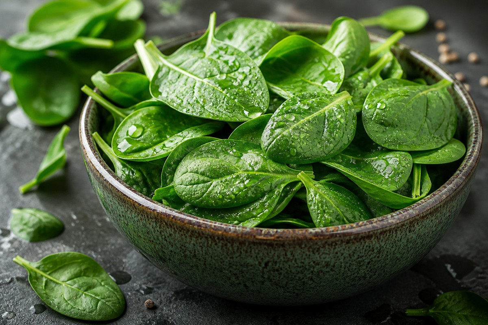

*▲ Regarded as the apex of green leafy vegetables, spinach (Spinacia oleracea) supplies concentrated inorganic dietary nitrates for vascular nitric oxide (NO) synthesis and exceptional reserves of phylloquinone (vitamin K1) for bone osteocalcin carboxylation.*

Quick answer <strong>Palak keerai (spinach) has 23 kcal, 194 mcg folate, 2.71 mg iron, 558 mg potassium and 483 mcg vitamin K per 100 g raw.</strong> The iron is non-heme and oxalate-bound, so only a small share is absorbed — pair it with vitamin C instead of counting on it as an iron food. Boiling in plenty of water leaches oxalate into the water; sauteing does not.

Palak keerai is simply spinach — the name used for it in Tamil and across South India, and the same leafy green behind palak paneer and dal palak. Per 100 g raw it gives 23 kcal, 2.71 mg iron, 194 mcg folate, 558 mg potassium, 2.2 g fiber and 483 mcg vitamin K. Those figures come from the USDA entry; Indian food composition tables and other national databases list somewhat different values, so compare a spinach table with itself rather than mixing sources.

Iron and calcium are the nutrients spinach is famous for, and the ones it delivers least reliably. Both are bound by oxalate: only a small fraction of spinach iron is absorbed, and most of its calcium passes through. Treat spinach as a folate, vitamin K and potassium food, and pair it with vitamin C (lemon, tomato, bell pepper) when you want its non-heme iron to count. For cooking, the answer to "does sauteing remove oxalates" is no — without water there is nothing to leach into. Boiling in plenty of water and discarding it removes a measurable share, which is why blanched spinach is the better choice for anyone with a history of calcium oxalate stones.

---

## 1. How Many Calories Are in Spinach? (483 mcg vitamin K, 194 mcg folate per 100 g)

Despite possessing an ultra-low caloric density (23 kcal/100g) with 91.4% water, spinach delivers peerless concentrations of fat-soluble vitamins and bioactive phytochemicals.

| Nutrient | Amount (per 100g) | Daily Value (% DV) |
| :--- | :--- | :--- |
| **Energy** | 23 kcal | 1.2% |
| **Carbohydrates** | 3.63 g | 1.3% |
| - Dietary Fiber | 2.20 g | 7.9% |
| - Total Sugars | 0.42 g | Daily value not established |
| **Protein** | 2.86 g | 5.7% |
| **Total Fat** | 0.39 g | 0.5% |
| - Saturated Fat | 0.06 g | 0.3% |
| **Phylloquinone (Vitamin K1)** | 483.00 mcg | 402.5% |
| **Vitamin A (Beta-Carotene Eq.)** | 469.00 mcg RAE | 52.1% |
| - Beta-Carotene | 5,626.00 mcg | Daily value not established |
| **Folate (Vitamin B9)** | 194.00 mcg | 48.5% |
| **Vitamin C (Ascorbic Acid)** | 28.10 mg | 31.2% |
| **Iron (Non-Heme Fe)** | 2.71 mg | 15.1% |
| **Calcium (Ca)** | 99.00 mg | 7.6% |
| **Potassium (K)** | 558.00 mg | 11.9% |
| **Magnesium (Mg)** | 79.00 mg | 18.8% |
| **Lutein + Zeaxanthin** | 12,198.00 mcg | Daily value not established |
| **Inorganic Dietary Nitrates** | ~250.00 mg | Daily value not established |
| **Water** | 91.40 g | See note¹ |

*※ Data Source: USDA FoodData Central Analytical Repository.*  
*¹ Water functions as the primary physiological medium dispersing lipophilic carotenoids and mineral ions.*  
*※ 'Daily value not established' designates carotenoid pigment isomers and botanical nitrate compounds lacking established percentage DV benchmarks.*

---

## 2. What Are the Benefits of Spinach? Four Evidence-Backed Effects

### 1) Endothelial Nitric Oxide Pathway & Systemic Vasodilation
Dietary inorganic nitrate (NO3-) ingested from spinach is rapidly concentrated in salivary glands and reduced to nitrite (NO2-) by commensal facultative anaerobic bacteria on the posterior tongue. 

Upon reaching the gastric acidic medium and entering systemic circulation, nitrite is reduced to bioactive **nitric oxide (NO)**. Nitric oxide activates soluble guanylyl cyclase (sGC) in vascular smooth muscle cells, elevating cyclic guanosine monophosphate (cGMP) and eliciting profound vasodilation, which lowers mean arterial pressure and improves microvascular elasticity.

### 2) Macular Pigment Optical Density (MPOD) & Photoreceptor Shielding
The retinal fovea and macular region rely exclusively on accumulated dietary carotenoids—specifically **lutein and zeaxanthin**—to form the macular pigment. 

These lipid-soluble pigments act as optical blue-light filters, neutralizing damaging reactive oxygen species (ROS) generated by intense focal illumination. Daily consumption of bioavailable spinach carotenoids systematically augments macular pigment optical density (MPOD), conferring measurable clinical protection against age-related macular degeneration (AMD).

### 3) Osteocalcin Carboxylation & Bone Mineral Density Preservation
Bone matrix homeostasis depends on the post-translational activation of **osteocalcin**, a non-collagenous protein secreted by osteoblasts. 

The abundant **vitamin K1 (phylloquinone)** in spinach acts as an essential cofactor for gamma-glutamyl carboxylase, transforming specific glutamic acid residues on osteocalcin into gamma-carboxyglutamic acid (Gla). This biochemical modification confers high-affinity binding to hydroxyapatite crystals, ensuring calcium ions embed securely into skeletal bone rather than precipitating as calcified plaques in arterial walls.

### 4) Genomic DNA Methylation & Homocysteine Clearance via Folate
Deriving its etymological root from the Latin *folium* (leaf), spinach provides dense concentrations of natural **folate (vitamin B9)**. Folate drives the 1-carbon metabolic cycle, donating methyl groups for thymidylate synthesis and erythrocyte maturation. 

Crucially, it facilitates the enzymatic remethylation of cytotoxic **homocysteine** back into methionine, suppressing endothelial vascular inflammation and microvascular thromboembolic risk.

---

## 3. Boil or Saute Spinach? What Actually Removes Oxalates

- **30-Second Blanching for Soluble Oxalate Clearance:**
  - Raw spinach contains significant concentrations of **oxalic acid (oxalates)**, which bind divalent cations (calcium and magnesium) to form insoluble calcium oxalate salts, impeding mineral absorption and posing nephrolithiasis (kidney stone) risks.
  - Submerging fresh spinach in vigorously boiling water for **30 to 60 seconds**, then quenching it in ice water and squeezing out the water, leaches a large share of soluble oxalates into the cooking water. The exact percentage depends on time and water volume, so no fixed figure is given.
- **Sauteing Alone Does Not Remove Oxalates:** Dry heat and oil drive off moisture, so oxalate per gram actually rises in a plain saute. If you prefer sauteed spinach, blanch and squeeze it first, then finish it in olive oil to combine oxalate reduction with carotenoid absorption.
- **Lipophilic Carrier Co-Ingestion:** Lutein, beta-carotene and phylloquinone are fat soluble. Sautéing blanched spinach in olive oil supports micelle formation and absorption of these compounds. The size of the increase varies between studies, so no multiple is claimed.

---

## 4. Spinach Cautions: Kidney Stones and Blood Thinners

- **Warfarin & Vitamin K Antagonist Therapy:** Patients managed on warfarin or coumarin derivatives must maintain consistent vitamin K intakes. Acute fluctuations in spinach consumption directly counteract pharmacological prothrombin time (INR) targets, precipitating thromboembolic vulnerability.
- **History of Calcium Oxalate Urolithiasis:** Individuals with verified recurrent calcium oxalate nephrolithiasis should strictly avoid raw spinach smoothies and consume only blanched, oxalate-reduced preparations paired with adequate fluid intake.

---

## 5. What Foods Pair Best with Spinach?

- **[Garlic]({{ site.baseurl }}/en/posts/garlic-nutrition-benefits/)**: Some studies report that garlic sulfur compounds improve non-heme iron absorption; vitamin C is the better-established enhancer.
- **[Onion]({{ site.baseurl }}/en/posts/onion-nutrition-benefits/)**: The flavonoid quercetin in onions synergizes with spinach dietary nitrates, conferring enhanced endothelial cytoprotection.
- **[Salmon]({{ site.baseurl }}/en/posts/salmon-nutrition-benefits/)**: Marine omega-3 polyunsaturated fatty acids (EPA/DHA) in salmon optimize the intestinal micellar transport of lipophilic lutein and vitamin K1.
- **[Asparagus](/en/posts/asparagus-nutrition-benefits/):** asparagus adds folate and glutathione that complement spinach detoxification pathways.

---

## 6. Frequently Asked Questions (FAQ)

### Q1. Does daily spinach consumption cause kidney or urinary tract stones?
**A:** Large amounts of raw spinach can raise urinary oxalate. Blanching for 30 to 60 seconds and discarding the water removes a substantial share of soluble oxalate, though the percentage depends on conditions. If you have had kidney stones, eat blanched spinach in moderate amounts, drink enough fluid, and ask your clinician. There is no amount that is risk-free for everyone.

### Q2. Is raw spinach in salads nutritionally superior to blanched spinach?
**A:** Raw spinach keeps more heat-sensitive vitamin C and folate. Blanching reduces oxalate and breaks down cell walls, which improves absorption of lutein, beta-carotene and vitamin K1; the increase is real but varies, so no multiple is given.

### Q3. Does spinach genuinely enhance muscular contractile efficiency as depicted in popular culture?
**A:** Yes, modern exercise physiology validates this phenomenon. The inorganic nitrates in spinach enhance mitochondrial oxidative phosphorylation efficiency, reducing the oxygen cost of physical exercise and improving skeletal muscle force production.

  
📌 Related ranking guide

  <ul>
    <li><a href="/en/posts/low-gi-foods-blood-sugar-guide/">Top 10 Low-GI Foods to Lower Blood Sugar: GI and GL Chart</a></li>
    <li><a href="/en/posts/low-calorie-high-satiety-foods/">Top 10 Low-Calorie High-Satiety Foods: 100g Calories</a></li>
  </ul>

---

## 7. Spinach per Day: How Much Do You Need?

- **Clinical Benchmark:** 483 mcg Vitamin K1 (>400% DV for osteocalcin activation), 12,198 mcg Lutein/Zeaxanthin (retinal fovea protection), 250 mg Inorganic Nitrate (nitric oxide vasodilation).
- **Culinary Rule:** Blanch for 30–60 seconds to purge oxalates; serve dressed in healthy lipids (olive oil) to optimize carotenoid and phylloquinone micellar absorption.
- **Biochemical Pairing:** Pair with [Garlic]({{ site.baseurl }}/en/posts/garlic-nutrition-benefits/) for non-heme iron assimilation and [Salmon]({{ site.baseurl }}/en/posts/salmon-nutrition-benefits/) for systemic lipid-soluble synergy.
