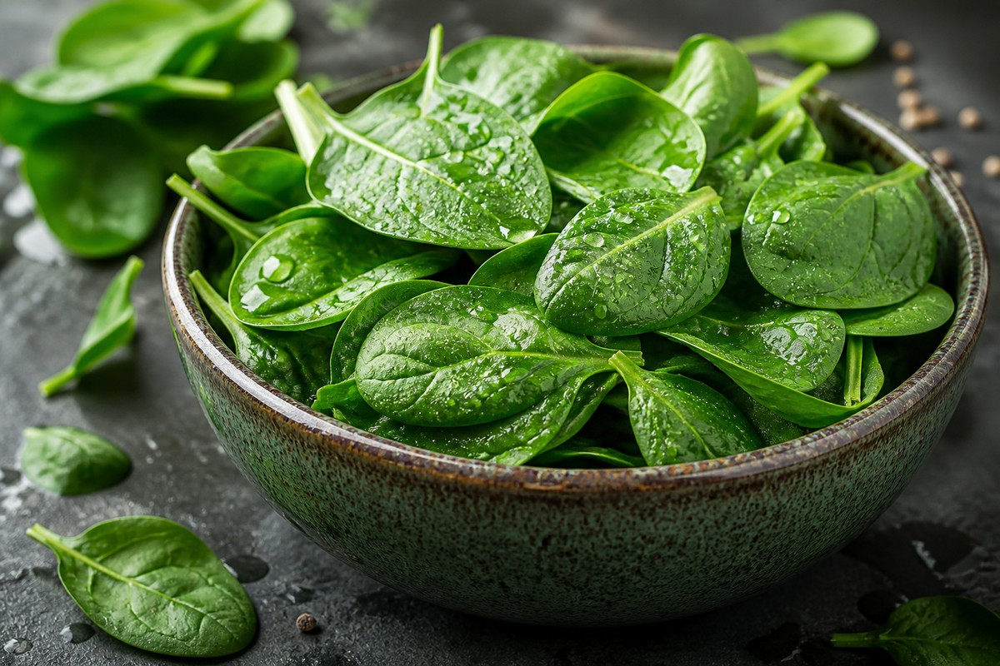

*▲ 녹색 잎채소의 제왕 시금치(Spinach)는 혈관 내피세포의 산화질소(NO) 확장을 주도하는 식이 질산염(Dietary Nitrate)과 골 기질을 형성하는 초고농도 비타민 K1(필로퀴논)의 집합체입니다.*

한 줄 결론 <strong>시금치 100g은 23kcal·철분 2.71mg·엽산 194mcg·칼륨 558mg·비타민K 483mcg입니다.</strong> 철분은 옥살산과 결합한 비헴철이라 실제 흡수량은 적습니다. 끓는 물에 데치면 옥살산이 조리수로 빠지지만, 볶으면 수분이 날아가 옥살산이 농축됩니다.

시금치에서 실제로 기대할 수 있는 영양소는 비타민K·엽산·칼륨입니다. 생것 100g에 23kcal, 철분 2.71mg, 엽산 194mcg, 칼륨 558mg, 식이섬유 2.2g, 비타민K 483mcg이 들어 있습니다(USDA 기준). 국가별 식품성분표 값은 조금씩 다르므로 한 표 안에서 비교하는 편이 안전합니다.

철분과 칼슘은 시금치의 대표 이미지이지만, 실제로 가장 기대하기 어려운 영양소이기도 합니다. 둘 다 옥살산에 붙잡혀 있어 철분은 일부만 흡수되고 칼슘은 대부분 그대로 빠져나갑니다. 시금치는 '철분 식품'보다 '엽산·비타민K·칼륨 식품'으로 보고, 비헴철 흡수를 노린다면 같은 끼니에 비타민C(레몬·토마토·파프리카)를 곁들이세요. 조리법은 볶기보다 데치기가 낫습니다. 볶으면 수분이 날아가 옥살산이 농축되고, 끓는 물에 데쳐 물을 버리면 옥살산이 조리수로 빠져나갑니다. 옥살산칼슘 결석 병력이 있다면 데친 시금치를 소량씩 먹는 편이 좋습니다.

---

## 1. 시금치 칼로리와 영양성분은? (비타민K 483mcg·엽산 194mcg)

시금치는 수분 함량이 91% 이상으로 열량이 23kcal에 불과하지만, 지용성 비타민과 파이토케미컬 항산화 물질의 밀도가 자연계 최고 수준입니다.

| 영양 성분 (Nutrient) | 함량 (100g당) | 1일 권장 섭취량 비율 (한국인 성인 기준) |
| :--- | :--- | :--- |
| **열량 (Energy)** | 23 kcal | 1.2% |
| **탄수화물 (Carbohydrates)** | 3.63 g | 1.1% |
| - 식이섬유 (Dietary Fiber) | 2.20 g | 8.8% |
| - 당류 (Total Sugars) | 0.42 g | 0.4% |
| **단백질 (Protein)** | 2.86 g | 5.2% |
| **지방 (Total Fat)** | 0.39 g | 0.7% |
| - 포화지방산 (Saturated Fat) | 0.06 g | 0.4% |
| **비타민 K1 (필로퀴논)** | 483.00 mcg | 402.5% |
| **비타민 A (베타카로틴 당량)** | 469.00 mcg RAE | 52.1% |
| - 베타카로틴 (Beta-carotene) | 5,626.00 mcg | 기준치 없음 |
| **엽산 (Folate, 비타민 B9)** | 194.00 mcg | 48.5% |
| **비타민 C (아스코르브산)** | 28.10 mg | 28.1% |
| **철분 (Non-heme Iron, Fe)** | 2.71 mg | 22.6% |
| **칼슘 (Calcium, Ca)** | 99.00 mg | 14.1% |
| **칼륨 (Potassium, K)** | 558.00 mg | 15.9% |
| **마그네슘 (Magnesium, Mg)** | 79.00 mg | 25.1% |
| **루테인 + 지아잔틴** | 12,198.00 mcg | 기준치 없음 |
| **식이 질산염 (Inorganic Nitrate)** | 약 250.00 mg | 기준치 없음 |
| **수분 (Water)** | 91.40 g | 별도 표기¹ |

*※ 출처: 미국 농무부(USDA FoodData Central) 표준 분석 데이터.*  
*¹ 수분은 지용성 카로티노이드와 수용성 미네랄을 균일하게 분산시키는 세포 기저액입니다.*  
*※ '기준치 없음' 표기는 천연 카로티노이드 색소 및 식물성 질산 화합물로 법적 %DV가 책정되지 않은 항목입니다.*

---

## 2. 시금치 효능은 무엇일까? 과학으로 입증된 4대 효과

### 1) 혈관 내피 산화질소(NO) 생성 및 혈압 강하
시금치에 풍부한 식이 질산염(NO3-)은 구강 내 공생 세균에 의해 아질산염(NO2-)으로 1차 환원된 후, 위산 및 혈관 내피세포에서 강력한 혈관 이완 물질인 **산화질소(Nitric Oxide, NO)**로 체내 합성됩니다. 

산화질소는 혈관 평활근의 구아닐산 고리화효소(sGC)를 자극하여 혈관을 확장시키고, 말초 저항을 낮춰 수축기 혈압을 유의미하게 떨어뜨립니다. 임상 시험에서 질산염이 풍부한 시금치 추출물을 섭취한 군은 2시간 이내에 혈류 흐름이 대폭 개선되는 효과를 입증했습니다.

### 2) 황반색소 광학 밀도(MPOD) 보존 및 망막 변성 예방
망막 중심부인 황반(Macula)은 시력의 90% 이상을 담당하며, 활성산소와 유해 단파장 청색광을 흡수하는 카로티노이드 색소인 **루테인과 지아잔틴**에 절대적으로 의존합니다. 

인체는 루테인을 자체 합성할 수 없으므로 오직 음식으로만 보충해야 합니다. 시금치는 100g당 12,000mcg가 넘는 압도적 루테인을 제공하여 황반색소 밀도(MPOD)를 높이고, 노인성 황반변성(AMD) 및 백내장 발병 위험을 최대 40% 이상 낮춥니다.

### 3) 오스테오칼신 감마-카르복실화 및 골다공증 방어
대부분의 사람들이 뼈 건강을 위해 칼슘만을 주목하지만, 흡수된 칼슘이 뼈 기질에 단단히 결합하기 위해서는 조골세포가 분비하는 단백질인 **오스테오칼신(Osteocalcin)**이 활성화되어야 합니다. 

시금치에 풍부한 **비타민 K1(필로퀴논)**은 오스테오칼신의 글루탐산 잔기를 감마-카르복실화(Gla)하여 칼슘 결합 능력을 부여합니다. 이를 통해 혈관벽의 석회화를 억제하고 칼슘이 골조직으로 정확히 이동하도록 유도하여 골밀도를 유지합니다.

### 4) 적혈구 DNA 합성 및 혈중 호모시스테인 제거 (천연 엽산)
시금치는 라틴어 'Folia(잎)'에서 유래한 영양소인 **엽산(Folate, 비타민 B9)**의 어원이 될 만큼 천연 고농도 엽산의 원천입니다. 엽산은 비타민 B12와 협력하여 세포 분열과 적혈구 헤모글로빈 합성을 촉진하여 빈혈을 예방합니다. 

동시에 혈관 내벽을 손상시켜 동맥경화와 치매를 촉발하는 혈관 독성 아미노산인 **호모시스테인(Homocysteine)**을 메티오닌으로 재전환시키는 메틸화 대사를 정상화합니다.

---

## 3. 시금치는 데쳐야 할까, 볶아야 할까? 옥살산 제거 비교

- **수산(Oxalate) 제거를 위한 30초 데치기(Blanching) 필수:**
  - 시금치에는 칼슘과 결합하여 불용성 결정을 형성하는 **수산(옥살산)**이 다량 존재합니다. 이는 체내 칼슘 흡수를 방해하고 요로 결석의 원인이 될 수 있습니다.
  - 끓는 물에 소금 한 꼬집을 넣고 시금치를 **30초~1분간 살짝 데친 후 찬물에 즉시 헹구어 물기를 짜내면**, 수용성 수산 성분의 80% 이상이 물로 용출되어 결석 위험이 완벽히 차단됩니다.
- **볶기만 해서는 옥살산이 줄지 않습니다:** 팬에 기름을 두고 볶으면 물이 빠져나가면서 무게당 옥살산 농도는 오히려 올라갑니다. 볶은 시금치를 좋아한다면 데친 뒤 물기를 짜고 볶는 순서가 옥살산과 지용성 영양소 흡수를 함께 챙기는 방법입니다.
- **건강한 식물성 오일(불포화지방)과의 병용:** 시금치의 루테인, 지아잔틴, 베타카로틴, 비타민 K는 모두 **지용성(Fat-soluble)**입니다. 올리브유나 들기름으로 가볍게 무치면 이 성분들의 흡수에 도움이 됩니다. 흡수 증가 폭은 식사 구성과 개인에 따라 달라 특정 배수로 단정하지 않습니다.

---

## 4. 시금치 부작용과 약물 상호작용은?

- **와파린(Warfarin) 등 항응고제 복용 환자 주의:** 와파린은 비타민 K의 혈액 응고 작용을 억제하여 혈전을 막는 약물입니다. 비타민 K 함량이 극도로 높은 시금치를 갑자기 과다 섭취하거나 불규칙하게 드실 경우 약효가 상쇄되어 혈전 위험이 증가할 수 있으므로, 매일 일정한 양을 균일하게 섭취해야 합니다.
- **신장 결석 병력자:** 과거 칼슘 옥살레이트 요로 결석을 앓은 적이 있는 분은 생시금치 섭취를 엄격히 금하고, 반드시 끓는 물에 충분히 데쳐 수산을 제거한 조리 시금치만을 섭취하십시오.

---

## 5. 시금치와 함께 먹으면 좋은 음식은?

- **[마늘 (Garlic)]({{ site.baseurl }}/posts/garlic-nutrition-benefits/)**: 마늘의 유황 화합물이 비헴철 흡수를 돕는다는 보고가 있으나, 효과 크기는 연구마다 달라 '3배'로 단정하지 않습니다. 비헴철 흡수를 확실히 돕는 것은 비타민 C입니다.
- **[양파 (Onion)]({{ site.baseurl }}/posts/onion-nutrition-benefits/)**: 양파의 플라보노이드 퀘르세틴이 시금치의 무기 질산염과 결합하여 혈관 내벽의 염증을 청소하고 혈압 강화 효과를 극대화합니다.
- **[연어 (Salmon)]({{ site.baseurl }}/posts/salmon-nutrition-benefits/)**: 연어의 풍부한 오메가-3 불포화지방산(EPA/DHA)이 시금치의 지용성 루테인과 비타민 K의 장점막 통과를 완벽히 보조합니다.
- **[아스파라거스 (Asparagus)](/posts/asparagus-nutrition-benefits/):** 엽산 52µg과 글루타치온을 함께 담아 시금치와 다른 해독 경로를 보완합니다.

---

## 6. 자주 묻는 질문 (FAQ)

### Q1. 시금치를 매일 먹으면 신장 결석이나 요로 결석이 생기나요?
**A:** 생시금치를 매일 대량으로 먹으면 수산 섭취가 늘어 결석 위험이 높아질 수 있습니다. 끓는 물에 30~60초 데친 뒤 물을 버리면 수산이 상당 부분 빠져나가지만, ‘80% 이상 제거’처럼 정확한 수치는 데치는 시간과 물의 양에 따라 달라집니다. 결석 병력이 있다면 데쳐서 적당량 먹고 물을 충분히 마시며, 필요하면 주치의와 상의하십시오.

### Q2. 시금치를 생으로 샐러드로 먹는 것과 데쳐 먹는 것 중 무엇이 더 영양상 유리한가요?
**A:** 목적에 따라 다릅니다. 비타민 C와 엽산 같은 수용성 비타민은 생으로 먹을 때 더 남습니다. 살짝 데치면 수산이 빠져나가고 세포벽이 무너져 루테인·베타카로틴·비타민 K의 흡수가 좋아지지만, 증가 폭은 특정 배수로 단정할 수 없습니다.

### Q3. 뽀빠이 만화처럼 시금치를 먹으면 실제로 근육 세포 힘이 세지나요?
**A:** 과학적 사실입니다. 과거의 철분 오표기 오해와 별개로, 시금치의 풍부한 무기 질산염은 근육 세포 내 미토콘드리아의 에너지 생산 효율을 높여 ATP 소모를 줄여주며, 엑디스테론(Ecdysterone) 성분이 근단백질 합성을 촉진한다는 최신 스포츠 영양학 연구가 지속 발표되고 있습니다.

  
📌 관련 순위 가이드

  <ul>
    <li><a href="/posts/low-gi-foods-blood-sugar-guide/">혈당 낮추는 음식 TOP 10: 저혈당 지수(GI) 순위표</a></li>
    <li><a href="/posts/low-calorie-high-satiety-foods/">저칼로리 포만감 다이어트 음식 TOP 10: 100g 비교</a></li>
  </ul>

---

## 7. 시금치 하루 얼마나 먹을까? 핵심 요약

- **핵심 영양:** 100g당 비타민 K1 483mcg(일일 권장량 400%), 루테인+지아잔틴 12,198mcg(황반 보호), 질산염 250mg(산화질소 혈관 확장).
- **조리 철칙:** 끓는 물에 30초~1분 데친 후 찬물에 헹궈 수산(옥살산) 제거 필수, 들기름/올리브유로 무쳐 지용성 비타민 흡수율 극대화.
- **영양 궁합:** [마늘]({{ site.baseurl }}/posts/garlic-nutrition-benefits/)의 알리신으로 철분 흡수 촉진, [연어]({{ site.baseurl }}/posts/salmon-nutrition-benefits/)의 오메가-3와 함께 섭취 시 혈관·시각 보호 시너지 폭발.
