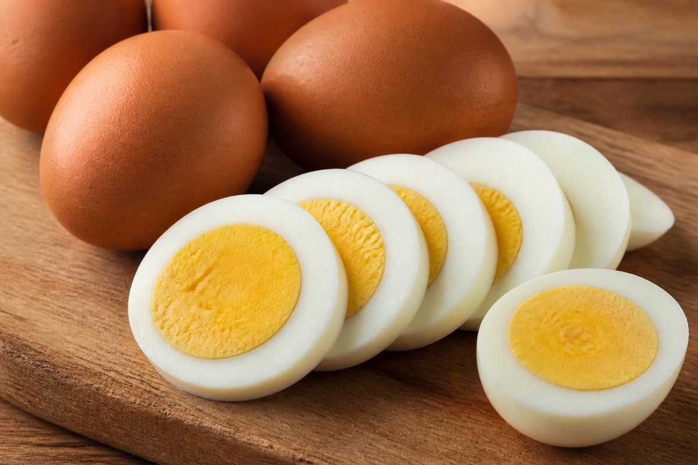

*▲ Regarded as nature's quintessential biological nutrient capsule, the egg (Gallus gallus domesticus) represents the gold standard of protein bioavailability (BV 100), supplying concentrated neuroprotective choline, macular carotenoids, and vital fat-soluble micronutrients.*

Within clinical dietetics and metabolic biochemistry, the **whole egg** stands as the definitive nutritional benchmark for protein quality and micronutrient density.

Scoring a perfect 100 on the international **Biological Value (BV)** index, egg protein delivers all nine essential amino acids (EAAs) in proportions that precisely mirror human physiological demands. 

Beyond its dense nitrogen matrix, the egg yolk (vitellus) houses dense reserves of **choline**—the indispensable biochemical substrate for the neurotransmitter acetylcholine and cell membrane phosphatidylcholine—alongside polar lipid-bound **lutein and zeaxanthin**, which demonstrate superior bioaccessibility compared to terrestrial plant sources.

Synthesizing analytical datasets from the USDA FoodData Central and landmark cardiovascular cohort trials, this treatise delineates the quantitative nutritional profile of eggs, their systemic metabolic mechanisms, and molecular culinary parameters.

---

## 1. Quantitative Nutritional Profile (Per 100g Raw Edible Mass, ~2 Large Eggs)

A 100-gram serving of whole raw eggs yields approximately 143 kcal (roughly 72 kcal per large 50g egg), providing an optimal equilibrium of bioavailable amino acids and unsaturated lipid fractions.

| Nutrient | Amount (per 100g) | Daily Value (% DV) |
| :--- | :--- | :--- |
| **Energy** | 143 kcal | 7.2% |
| **Carbohydrates** | 0.72 g | 0.3% |
| - Total Sugars | 0.37 g | Daily value not established |
| - Dietary Fiber | 0.00 g | 0.0% |
| **Protein** | 12.56 g | 25.1% |
| - Leucine (BCAA) | 1.09 g | Daily value not established |
| - Valine (BCAA) | 0.86 g | Daily value not established |
| - Isoleucine (BCAA) | 0.69 g | Daily value not established |
| **Total Fat** | 9.51 g | 12.2% |
| - Saturated Fat | 3.13 g | 15.7% |
| - Monounsaturated Fat (MUFA) | 3.66 g | Daily value not established |
| - Polyunsaturated Fat (PUFA) | 1.91 g | Daily value not established |
| **Choline** | 293.80 mg | 53.4% |
| **Cholesterol** | 372.00 mg | See note² |
| **Lutein + Zeaxanthin** | 503.00 mcg | Daily value not established |
| **Vitamin A (RAE)** | 160.00 mcg | 17.8% |
| **Vitamin D3 (Cholecalciferol)** | 2.00 mcg (82 IU) | 10.0% |
| **Vitamin B12 (Cobalamin)** | 1.11 mcg | 46.3% |
| **Riboflavin (Vitamin B2)** | 0.46 mg | 35.4% |
| **Folate (Vitamin B9)** | 47.00 mcg | 11.8% |
| **Selenium (Se)** | 30.70 mcg | 55.8% |
| **Iron (Fe)** | 1.75 mg | 9.7% |
| **Phosphorus (P)** | 198.00 mg | 15.8% |
| **Water** | 76.15 g | Special classification¹ |

*※ Source: USDA FoodData Central Analytical Repository.*  
*¹ Water functions as the primary physiological solvent stabilizing native ovalbumin tertiary structures.*  
*² Dietary cholesterol limits were removed from the USDA Dietary Guidelines following conclusive clinical evidence demonstrating minimal impact on circulating atherogenic LDL fractions.*

---

## 2. Four Clinically Validated Biological Benefits

### 1) Optimal Anabolic Myofibrillar Signaling via BV 100 Protein
Egg protein exhibits complete gastrointestinal assimilation and amino acid balance. Concentrated **leucine** within ovalbumin and vitellin stimulates the **mTORC1 (Mechanistic Target of Rapamycin Complex 1)** kinase signaling cascade, accelerating muscle protein synthesis (MPS) and counteracting age-associated sarcopenic wasting.

### 2) Choline-Driven Neurotransmission & Hepatic Lipid Clearance
Supplying over 50% of the daily choline requirement per 100g, eggs fuel the biosynthesis of **acetylcholine**, the fundamental neurotransmitter governing hippocampal synaptic plasticity and memory encoding. Simultaneously, choline serves as a methyl donor for betaine synthesis, facilitating hepatic very-low-density lipoprotein (VLDL) secretion to prevent non-alcoholic fatty liver infiltration.

### 3) Superior Retinal Carotenoid Bioaccessibility
Unlike plant-derived carotenoids trapped in fibrous matrices, egg yolk **lutein and zeaxanthin** are naturally dissolved within a lipid-phospholipid micellar matrix. Clinical trials confirm that egg yolk ingestion yields a 300% to 400% higher carotenoid plasma absorption rate, effectively augmenting macular pigment optical density (MPOD) to filter damaging high-energy blue photons.

### 4) Hepatic Cholesterol Homeostasis & Circulating Lipoprotein Modulation
The human body synthesizes approximately 80% of systemic cholesterol endogenously via the hepatic HMG-CoA reductase pathway. When exogenous dietary cholesterol increases from whole eggs, negative feedback mechanisms downregulate endogenous hepatic synthesis. Extensive epidemiological data, including Harvard cohort analyses, show that daily consumption of 1 to 2 eggs does not heighten ischemic cardiovascular risk, often shifting small, dense LDL particles into benign, large buoyant subfractions while elevating protective HDL.

---

## 3. Culinary Thermodynamics: Soft vs. Hard Boiled Bioavailability

- **Soft-Boiled Kinetics (6 to 7 minutes in simmering water):** Albumin achieves thermocoagulation while yolk vitellin retains a liquid phase. Heat-sensitive phospholipids, lutein, and choline maintain 100% molecular integrity, ensuring maximum kinetic gastric emptying and enzymatic bioavailability.
- **Hard-Boiled Thermodynamics (10 to 12 minutes):** Complete thermal denaturation neutralizes the anti-nutritional glycoprotein **avidin**, ensuring 100% bioaccessibility of biotin (vitamin B7). Extended gastric transit provides sustained satiety exceeding 4 hours.
- **Preventing Ferrous Sulfide Ring Formation:** Prolonged heating (>15 minutes) triggers a reaction between albumin hydrogen sulfide and yolk ionic iron, precipitating a greenish **ferrous sulfide ($FeS$)** ring. While harmless, it degrades delicate sulfur aromatics; immediate immersion in an ice bath halts this reaction instantly.

---

## 4. Potential Contraindications and Clinical Considerations

- **Avidin Glycoprotein in Raw Whites:** Ingesting excessive unpasteurized raw egg whites permits avidin to bind endogenous biotin with extraordinary affinity, inducing functional biotin deficiency manifested as alopecia and dermatitis. Thorough cooking neutralizes avidin completely.
- **Salmonella Enteritidis Risk:** Ensure adequate thermal processing (>70°C / 158°F) and adhere to cold-chain refrigeration to eliminate surface microbial contamination.

---

## 5. Synergistic Food Pairings for Maximum Bioavailability

- **[Tomato]({{ site.baseurl }}/en/posts/tomato-nutrition-benefits/)**: Egg yolk phospholipids augment the gastrointestinal lipophilic micellar solubilization of tomato lycopene by over 400%, creating an elite anti-inflammatory pairing.
- **[Spinach]({{ site.baseurl }}/en/posts/spinach-nutrition-benefits/)**: The bioavailable vitamin D and choline in eggs synergize with non-heme iron and folate in spinach to enhance erythropoiesis.
- **[Onion]({{ site.baseurl }}/en/posts/onion-nutrition-benefits/)**: Quercetin in onions scavenges oxidative metabolites and protects vascular endothelial function during dense protein metabolism.

---

## 6. Frequently Asked Questions (FAQ)

### Q1. Does eating egg yolks daily elevate circulating atherogenic cholesterol?
**A:** In healthy adults, empirical evidence demonstrates that consuming 1 to 3 whole eggs daily does not adversely alter the total cholesterol to HDL ratio. Hepatic feedback mechanisms balance systemic production, maintaining stable cardiovascular risk biomarkers.

### Q2. Is the dark greenish-grey ring around overcooked yolks toxic?
**A:** It is completely non-toxic. The discoloration is ferrous sulfide ($FeS$), formed when sulfur from the white reacts with iron in the yolk under prolonged high temperatures. Shocking boiled eggs in ice water eliminates ring formation.

### Q3. Do raw eggs provide superior protein bioavailability compared to cooked eggs?
**A:** No, clinical research indicates the exact opposite. Digestion studies demonstrate that cooked egg protein yields approximately 91% gastrointestinal bioavailability, whereas raw egg protein is only 51% bioavailable due to unrelaxed peptide structures.

---

## 7. Strategic Nutritional Summary

- **Biochemical Density:** Biological Value of 100, 12.56g protein per 100g, 294mg neuroprotective choline, and 503mcg eye-protective lutein/zeaxanthin.
- **Culinary Preparation:** Opt for soft-boiled (7 mins) to protect delicate yolk lipids and choline, or hard-boiled (10 mins) to fully denature avidin for maximum biotin retention.
- **Synergistic Co-Factors:** Combine with [Tomato]({{ site.baseurl }}/en/posts/tomato-nutrition-benefits/) for 4x lycopene absorption and [Spinach]({{ site.baseurl }}/en/posts/spinach-nutrition-benefits/) for enhanced cellular methylation.
