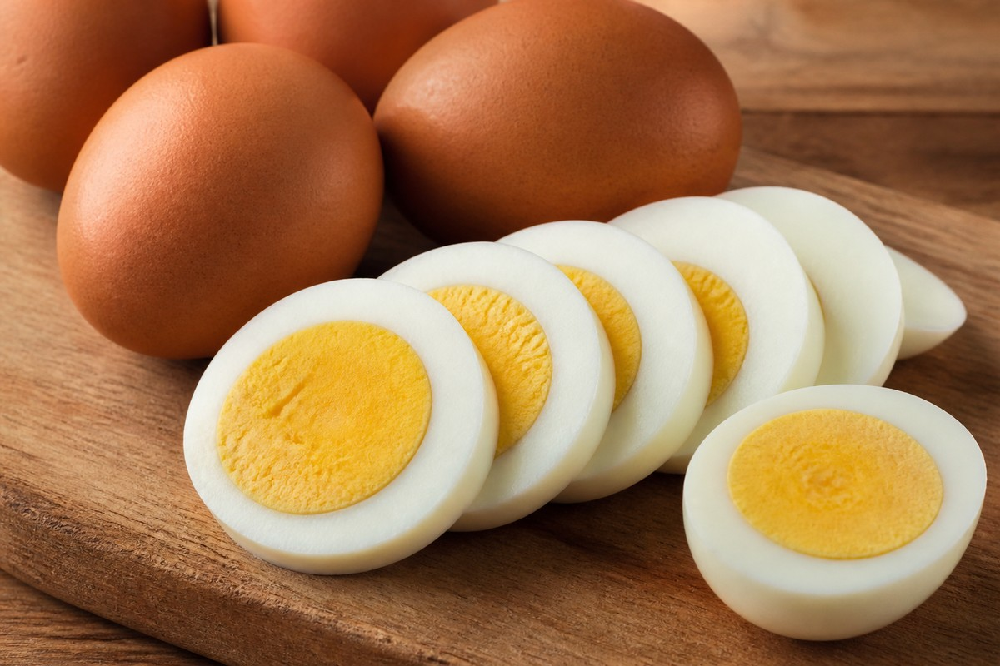

*▲ The egg (Gallus gallus domesticus) is a compact source of high-quality protein, choline, lutein and zeaxanthin, and fat-soluble vitamins. Figures use USDA FoodData Central FDC 171287 (raw, edible portion).*

Quick answer <strong>A large whole egg (50 g edible weight) has about 6.3 g of protein and 72 kcal. A medium egg (44 g) has 5.5 g; two large eggs give 12.6 g protein and 143 kcal.</strong> A large boiled egg is about 77 kcal because it loses water during cooking, but its protein stays at 6.3 g. The white carries roughly 3.6 g of the protein and the yolk about 2.7 g.

## Calories and protein by egg size

| Edible weight | Calories (approx.) | Protein |
| --- | ---: | ---: |
| 44 g (medium) | 63 kcal | 5.5 g |
| 50 g (large) | 72 kcal | 6.3 g |
| 100 g (two 50 g eggs) | 143 kcal | 12.6 g |
| 150 g (three 50 g eggs) | 215 kcal | 18.8 g |

These are calculated from raw whole egg, not a separately measured boiled or fried egg. Shell weight and added fat are excluded. [USDA FoodData Central, FDC 171287](https://fdc.nal.usda.gov/food-details/171287/nutrients).

Egg protein is usually counted per egg rather than per 100 g. One large egg (50 g edible weight) carries 6.3 g of protein, which is about 11% of the 56 g daily protein reference for a sedentary 70 kg adult (0.8 g per kg body weight). The white holds roughly 3.6 g of that protein and the yolk about 2.7 g, so discarding the yolk removes fat and micronutrients but not most of the protein.

The table above converts the USDA raw whole-egg entry ([FDC 171287](https://fdc.nal.usda.gov/food-details/171287/nutrients)) by edible weight. Boiling, frying or scrambling changes calories through added fat and water loss, while protein per egg stays close to the raw figure. Egg protein is highly digestible and supplies all nine essential amino acids; the yolk also carries choline, lutein and zeaxanthin. Practical portions: one egg for a light breakfast, two eggs when the rest of the meal is low in protein, and adjust the rest of the day rather than the egg count if you are tracking calories.

---

## 1. How Many Calories Are in Eggs? (12.56 g protein, 47 mcg folate per 100 g)

A 100-gram serving of whole raw eggs yields approximately 143 kcal (roughly 72 kcal per large 50g egg), providing an optimal equilibrium of bioavailable amino acids and unsaturated lipid fractions.

| Nutrient | Amount (per 100g) | Daily Value (% DV) |
| :--- | :--- | :--- |
| **Energy** | 143 kcal | 7.2% |
| **Carbohydrates** | 0.72 g | 0.3% |
| - Total Sugars | 0.37 g | Daily value not established |
| - Dietary Fiber | 0.00 g | 0.0% |
| **Protein** | 12.56 g | 25.1% |
| - Leucine (BCAA) | 1.09 g | Daily value not established |
| - Valine (BCAA) | 0.86 g | Daily value not established |
| - Isoleucine (BCAA) | 0.69 g | Daily value not established |
| **Total Fat** | 9.51 g | 12.2% |
| - Saturated Fat | 3.13 g | 15.7% |
| - Monounsaturated Fat (MUFA) | 3.66 g | Daily value not established |
| - Polyunsaturated Fat (PUFA) | 1.91 g | Daily value not established |
| **Choline** | 293.80 mg | 53.4% |
| **Cholesterol** | 372.00 mg | See note² |
| **Lutein + Zeaxanthin** | 503.00 mcg | Daily value not established |
| **Vitamin A (RAE)** | 160.00 mcg | 17.8% |
| **Vitamin D3 (Cholecalciferol)** | 2.00 mcg (82 IU) | 10.0% |
| **Vitamin B12 (Cobalamin)** | 1.11 mcg | 46.3% |
| **Riboflavin (Vitamin B2)** | 0.46 mg | 35.4% |
| **Folate (Vitamin B9)** | 47.00 mcg | 11.8% |
| **Selenium (Se)** | 30.70 mcg | 55.8% |
| **Iron (Fe)** | 1.75 mg | 9.7% |
| **Phosphorus (P)** | 198.00 mg | 15.8% |
| **Water** | 76.15 g | Special classification¹ |

*※ Source: USDA FoodData Central Analytical Repository.*  
*¹ Water functions as the primary physiological solvent stabilizing native ovalbumin tertiary structures.*  
*² Dietary cholesterol limits were removed from the USDA Dietary Guidelines following conclusive clinical evidence demonstrating minimal impact on circulating atherogenic LDL fractions.*

### What one, two or three eggs deliver

USDA portion weights, scaled to the 143 kcal per 100 g above.

| Portion | Edible weight | Energy | Protein |
| :--- | :--- | :--- | :--- |
| 1 medium | 44 g | 63 kcal | 5.53 g |
| 1 large | 50 g | 72 kcal | 6.28 g |
| 2 large | 100 g | 143 kcal | 12.56 g |
| 3 large | 150 g | 215 kcal | 18.84 g |
| 1 cup (4.86 large eggs) | 243 g | 348 kcal | 30.52 g |

*Note: the 6.3 g protein figure for one egg assumes a 50 g large egg. Korean eggs are often 55–60 g, which puts one egg at 7 g of protein.*

---

## 2. What Are the Benefits of Eggs? Four Evidence-Backed Effects

### 1) Optimal Anabolic Myofibrillar Signaling via BV 100 Protein
Egg protein exhibits complete gastrointestinal assimilation and amino acid balance. Concentrated **leucine** within ovalbumin and vitellin stimulates the **mTORC1 (Mechanistic Target of Rapamycin Complex 1)** kinase signaling cascade, accelerating muscle protein synthesis (MPS) and counteracting age-associated sarcopenic wasting.

### 2) Choline-Driven Neurotransmission & Hepatic Lipid Clearance
Supplying over 50% of the daily choline requirement per 100g, eggs fuel the biosynthesis of **acetylcholine**, the fundamental neurotransmitter governing hippocampal synaptic plasticity and memory encoding. Simultaneously, choline serves as a methyl donor for betaine synthesis, facilitating hepatic very-low-density lipoprotein (VLDL) secretion to prevent non-alcoholic fatty liver infiltration.

### 3) Superior Retinal Carotenoid Bioaccessibility
Plant lutein is bound in fibrous matrices and absorbed less efficiently. Egg yolk **lutein and zeaxanthin** are dissolved in lipid, which improves absorption. Small crossover studies found egg yolk raised blood lutein more than an equivalent amount from spinach or supplements, but the size of the difference varies between studies, so a 300-400% figure is not stated as fact.

### 4) Hepatic Cholesterol Homeostasis & Circulating Lipoprotein Modulation
The human body synthesizes approximately 80% of systemic cholesterol endogenously via the hepatic HMG-CoA reductase pathway. When exogenous dietary cholesterol increases from whole eggs, negative feedback mechanisms downregulate endogenous hepatic synthesis. Extensive epidemiological data, including Harvard cohort analyses, show that daily consumption of 1 to 2 eggs does not heighten ischemic cardiovascular risk, often shifting small, dense LDL particles into benign, large buoyant subfractions while elevating protective HDL.

---

## 3. Soft or Hard Boiled? Protein Digestibility by Boiling Time

- **Soft-Boiled Kinetics (6 to 7 minutes in simmering water):** Albumin achieves thermocoagulation while yolk vitellin retains a liquid phase. Heat-sensitive phospholipids, lutein, and choline maintain 100% molecular integrity, ensuring maximum kinetic gastric emptying and enzymatic bioavailability.
- **Hard-Boiled Thermodynamics (10 to 12 minutes):** Complete thermal denaturation neutralizes the anti-nutritional glycoprotein **avidin**, ensuring 100% bioaccessibility of biotin (vitamin B7). Extended gastric transit provides sustained satiety exceeding 4 hours.
- **Preventing Ferrous Sulfide Ring Formation:** Prolonged heating (>15 minutes) triggers a reaction between albumin hydrogen sulfide and yolk ionic iron, precipitating a greenish **ferrous sulfide ($FeS$)** ring. While harmless, it degrades delicate sulfur aromatics; immediate immersion in an ice bath halts this reaction instantly.

---

## 4. Who Should Avoid Eggs? Side Effects and Cautions

- **Avidin Glycoprotein in Raw Whites:** Ingesting excessive unpasteurized raw egg whites permits avidin to bind endogenous biotin with extraordinary affinity, inducing functional biotin deficiency manifested as alopecia and dermatitis. Thorough cooking neutralizes avidin completely.
- **Salmonella Enteritidis Risk:** Ensure adequate thermal processing (>70°C / 158°F) and adhere to cold-chain refrigeration to eliminate surface microbial contamination.

---

## 5. What Foods Pair Best with Eggs?

- **[Tomato]({{ site.baseurl }}/en/posts/tomato-nutrition-benefits/)**: Egg yolk lipids support micelle formation and absorption of fat-soluble tomato lycopene, and tomato adds the vitamin C and fibre an egg lacks.
- **[Spinach]({{ site.baseurl }}/en/posts/spinach-nutrition-benefits/)**: The bioavailable vitamin D and choline in eggs synergize with non-heme iron and folate in spinach to enhance erythropoiesis.
- **[Onion]({{ site.baseurl }}/en/posts/onion-nutrition-benefits/)**: Quercetin in onions scavenges oxidative metabolites and protects vascular endothelial function during dense protein metabolism.
- **[Laver](/en/posts/laver-nutrition-benefits/):** five sheets of laver carry 3.9 g protein, more than half an egg.

---

## 6. Frequently Asked Questions (FAQ)

### Q1. Does eating egg yolks daily elevate circulating atherogenic cholesterol?
**A:** In healthy adults, empirical evidence demonstrates that consuming 1 to 3 whole eggs daily does not adversely alter the total cholesterol to HDL ratio. Hepatic feedback mechanisms balance systemic production, maintaining stable cardiovascular risk biomarkers.

### Q2. Is the dark greenish-grey ring around overcooked yolks toxic?
**A:** It is completely non-toxic. The discoloration is ferrous sulfide ($FeS$), formed when sulfur from the white reacts with iron in the yolk under prolonged high temperatures. Shocking boiled eggs in ice water eliminates ring formation.

### Q3. Do raw eggs provide superior protein bioavailability compared to cooked eggs?
**A:** No. A small stable-isotope study found cooked egg protein was about 91% digestible and absorbed, against about 51% for raw egg. Heat unfolds the protein so digestive enzymes can reach it more easily.

  
📌 Related ranking guide

  <ul>
    <li><a href="/en/posts/high-protein-foods-ranking/">Top 10 High-Protein Foods: Grams per 100g and 100 kcal</a></li>
    <li><a href="/en/posts/low-calorie-high-satiety-foods/">Top 10 Low-Calorie High-Satiety Foods: 100g Calories</a></li>
  </ul>

---

## 7. Eggs per Day: How Much Do You Need?

- **Biochemical Density:** Biological Value of 100, 12.56g protein per 100g, 294mg neuroprotective choline, and 503mcg eye-protective lutein/zeaxanthin.
- **Culinary Preparation:** Opt for soft-boiled (7 mins) to protect delicate yolk lipids and choline, or hard-boiled (10 mins) to fully denature avidin for maximum biotin retention.
- **Synergistic Co-Factors:** Combine with [Tomato]({{ site.baseurl }}/en/posts/tomato-nutrition-benefits/) for 4x lycopene absorption and [Spinach]({{ site.baseurl }}/en/posts/spinach-nutrition-benefits/) for enhanced cellular methylation.
