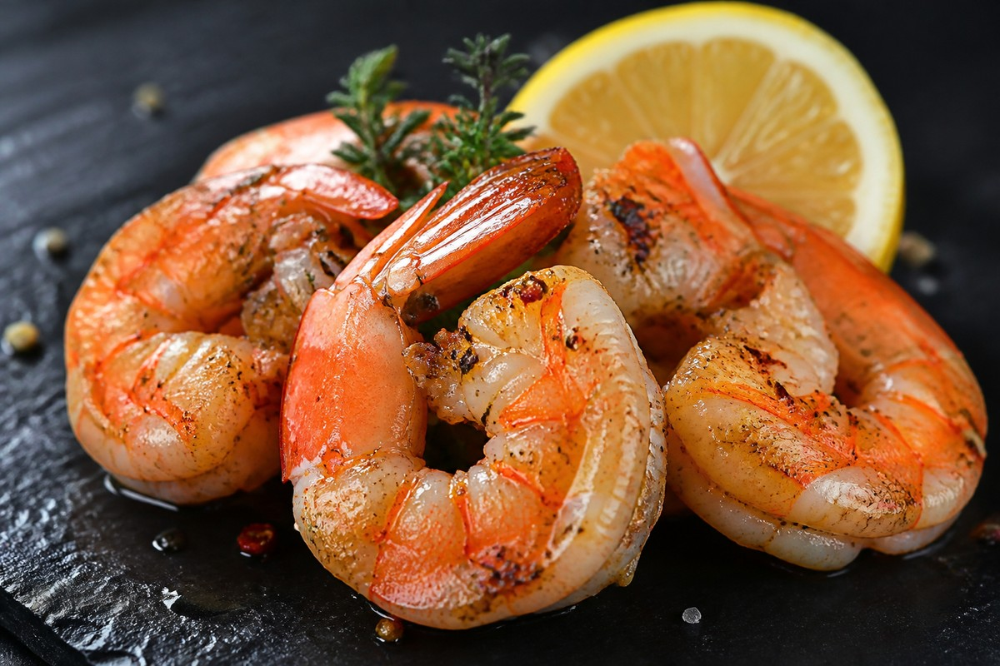

*▲ Renowned as a premier marine superfood, shrimp (Penaeus spp.) delivers an exceptional protein-to-calorie ratio with less than 1% lipid content, enriched with concentrated astaxanthin—a carotenoid with 6,000 times the antioxidant potency of vitamin C—and essential cellular taurine.*

Within exercise physiology and clinical marine dietetics, **shrimp** represents one of the most metabolically advantageous protein vectors found in natural ecosystems.

Yielding a mere 85 kcal per 100 g of raw edible portion while providing over 20 grams of high-biological-value protein, shrimp presents an optimal macronutrient profile for lean mass retention and metabolic acceleration. 

Crucially, the signature crimson pigment biosynthesized during thermal cooking represents **astaxanthin**, a unique keto-carotenoid capable of spanning the entire cellular phospholipid bilayer to quench cytotoxic singlet oxygen molecules. Concurrently, the sulfur amino acid derivative **taurine** reaches concentrations of nearly 380 mg per serving, stimulating hepatic bile acid conjugation and stabilizing cardiac electromechanical rhythm.

Drawing upon empirical standards from USDA FoodData Central and landmark cardiovascular lipidology trials, this guide analyzes shrimp’s biochemical architecture, dispels dietary cholesterol misconceptions, and details culinary bioavailability protocols.

---

## 1. Quantitative Nutritional Composition (Per 100g Raw Edible Flesh)

Shrimp features near-zero carbohydrate presence with lipid concentrations suppressed beneath 0.6%, delivering dense bioavailable amino acid complexes.

| Nutrient | Amount (per 100g) | Daily Value (% DV) |
| :--- | :--- | :--- |
| **Energy** | 85 kcal | 4.3% |
| **Carbohydrates** | 0.20 g | 0.1% |
| - Total Sugars | 0.00 g | Daily value not established |
| - Dietary Fiber | 0.00 g | 0.0% |
| **Protein** | 20.10 g | 40.2% |
| - L-Arginine | 1.82 g | Daily value not established |
| - Glutamic Acid | 3.42 g | Daily value not established |
| - Leucine (BCAA) | 1.61 g | Daily value not established |
| **Total Fat** | 0.51 g | 0.7% |
| - Saturated Fat | 0.10 g | 0.5% |
| - Monounsaturated Fat (MUFA) | 0.08 g | Daily value not established |
| - Polyunsaturated Fat (PUFA) | 0.18 g | Daily value not established |
| **Taurine** | ~380.00 mg | Daily value not established |
| **Astaxanthin** | ~1.80 mg | Daily value not established |
| **Cholesterol** | 161.00 mg | See note² |
| **Selenium (Se)** | 38.00 mcg | 69.1% |
| **Vitamin B12 (Cobalamin)** | 1.11 mcg | 46.3% |
| **Phosphorus (P)** | 205.00 mg | 16.4% |
| **Copper (Cu)** | 0.32 mg | 35.6% |
| **Zinc (Zn)** | 1.34 mg | 12.2% |
| **Calcium (Ca)** | 64.00 mg | 4.9% |
| **Magnesium (Mg)** | 35.00 mg | 8.3% |
| **Water** | 78.40 g | Special classification¹ |

*※ Source: USDA FoodData Central Standard Reference.*  
*¹ Water constitutes the biological fluid matrix maintaining myofibrillar hydration.*  
*² While shrimp houses dietary cholesterol, its virtual absence of saturated fatty acids prevents hepatic low-density lipoprotein (LDL) upregulation.*

---

## 2. Four Clinically Validated Biological Benefits

### 1) Astaxanthin-Mediated Transmembrane Radical Scavenging
Unlike beta-carotene or vitamin C, **astaxanthin** features polar terminal ionone rings that anchor seamlessly into both the inner and outer layers of cell membranes. This unique transmembrane orientation eliminates mitochondrial free radicals, protects sarcoplasmic reticulum calcium channels, and blunts exercise-induced muscular inflammation.

### 2) Taurine Osmoregulation and Hepatic Bile Salt Secretion
With approximately 380 mg of **taurine** per 100g, shrimp consumption stimulates hepatic conjugation with chenodeoxycholic acid, synthesizing bile salts that accelerate fecal sterol elimination. Furthermore, taurine regulates myocardial calcium flux, supporting arterial vasodilation and dampening sympathetic vascular overactivity.

### 3) Nitric Oxide Induction via Concentrated L-Arginine
Shrimp supplies nearly 1.8g of **L-arginine** per serving—the primary physiological substrate for endothelial nitric oxide synthase (eNOS). Nitric oxide facilitates peripheral vasodilation, augmenting microvascular perfusion during athletic exertion and supporting endothelial elasticity.

### 4) Chitin/Chitosan Polysaccharides for Intestinal Lipid Clearance
The cuticular exoskeleton and tail segments of shrimp contain structural **chitin**, which undergoes partial deacetylation into **chitosan**. Chitosan acts as a positively charged polycationic biopolymer, binding negatively charged dietary lipid micelles and bile acids within the intestinal lumen to prevent systemic lipid absorption.

---

## 3. Culinary Physics and Bioavailability Guidelines

- **Gentle Steam Infusion Over High-Heat Frying:** Astaxanthin double bonds and delicate taurine residues degrade rapidly under intense boiling oil (>180°C). Steaming at 100°C for 3 to 5 minutes preserves over 92% of native bioactive carotenoid structures while tenderizing actomyosin fibers.
- **Citrus Ascorbic Acid Co-Factor:** Squeezing fresh lemon juice over cooked shrimp introduces ascorbic acid, which acts as an electron donor to regenerate oxidized astaxanthin, doubling its biological half-life.

---

## 4. Potential Contraindications and Clinical Considerations

- **Tropomyosin-Mediated Crustacean Anaphylaxis:** Shrimp tropomyosin represents a major pan-allergen resistant to heat digestion. Sensitive individuals must avoid consumption to avert IgE-mediated urticaria or respiratory bronchospasm.
- **Moderate Purine Density in Hyperuricemia:** Shrimp contains moderate-to-high purine fractions (~140mg/100g). Clinical gout patients experiencing acute flares should exercise restraint during hyperuricemic crises.

---

## 5. Synergistic Food Pairings for Maximum Nutrient Absorption

- **[Garlic]({{ site.baseurl }}/en/posts/garlic-nutrition-benefits/)**: Allicin derivatives conjugate with shrimp's B-complex cofactors, optimizing nitrogen retention and promoting hepatic glutathione regeneration.
- **[Broccoli]({{ site.baseurl }}/en/posts/broccoli-nutrition-benefits/)**: Sulforaphane in broccoli joins astaxanthin to form a multi-tiered Phase II antioxidant defense network.
- **[Spinach]({{ site.baseurl }}/en/posts/spinach-nutrition-benefits/)**: Magnesium and folate in spinach balance the electrolyte profile and facilitate smooth amino acid protein synthesis.

---

## 6. Frequently Asked Questions (FAQ)

### Q1. Does dietary cholesterol in shrimp promote coronary artery disease?
**A:** Landmark clinical trials from Rockefeller University demonstrated that shrimp consumption does not elevate atherogenic small-dense LDL particles. Because shrimp contains minimal saturated fatty acids, it selectively raises protective HDL cholesterol while taurine aids bile excretion.

### Q2. Is it nutritionally advantageous to consume shrimp shells and tails?
**A:** Yes, significantly. The exoskeleton contains dense reserves of insoluble chitin and chitosan fibers, which bind intestinal lipids, promote colonic motility, and house concentrated astaxanthin pigments.

### Q3. Should the dark dorsal vein (alimentary tract) be removed prior to cooking?
**A:** Removing the dorsal vein is primarily for culinary texture and aesthetic clarity. While harmless if cooked, the digestive tract may contain fine mineral silt that imparts a gritty mouthfeel.

---

## 7. Strategic Nutritional Summary

- **Macronutrient Profile:** 85 kcal per 100g, 20.1g pure lean protein, 380mg taurine for hepatic clearance, and 1.8mg cellular astaxanthin.
- **Culinary Preparation:** Employ gentle steaming (3-5 minutes) with fresh lemon juice to prevent astaxanthin oxidation and maximize carotenoid absorption.
- **Synergistic Co-Factors:** Combine with [Garlic]({{ site.baseurl }}/en/posts/garlic-nutrition-benefits/) for nitric oxide amplification and [Broccoli]({{ site.baseurl }}/en/posts/broccoli-nutrition-benefits/) for systemic cellular detoxification.
