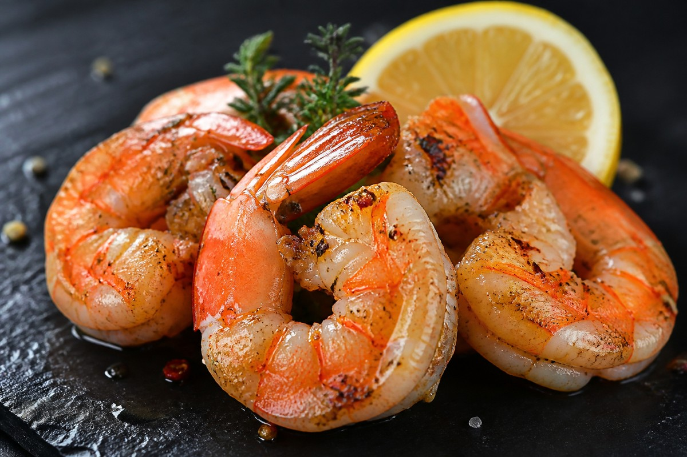

*▲ 바다의 붉은 보석이라 불리는 새우(Penaeus spp.)는 단위 열량당 단백질 순도가 90%에 달하는 초저지방 단백질 급원이자, 비타민 C의 6,000배에 달하는 항산화 방어력을 지닌 카로티노이드 아스타잔틴(Astaxanthin)과 타우린의 보고입니다.*

현대 해양생물학 및 스포츠 임상 영양학에서 **새우(Shrimp)**는 단순한 해산물 별미를 넘어 체지방 감량과 고강도 근육 회복, 그리고 세포 산화 손상을 방어하는 최고급 기능성 단백질 식재료로 손꼽힙니다.

가식부 100g당 열량이 단 85kcal에 불과하면서 순수 단백질은 무려 20g 이상을 공급하는 기적적인 고단백·저지방 매트릭스를 갖추고 있습니다. 

특히 새우를 익힐 때 붉은빛으로 발현되는 **아스타잔틴(Astaxanthin)**은 세포막의 지질 이중층을 관통하여 활성산소를 소거하는 현존 최강의 천연 항산화 물질 중 하나이며, 피로 물질을 분해하고 담즙산 대사를 촉진하는 **타우린(Taurine)**이 단위 중량당 350~400mg에 육박합니다.

아울러 과거 새우 섭취를 주저하게 만들었던 콜레스테롤 수치의 진실과, 껍질과 꼬리에 풍부한 **키틴(Chitin) 및 키토산**의 지방 흡착 배출 메커니즘을 미국 농무부(USDA FoodData Central) 공인 데이터를 바탕으로 상세히 규명합니다.

---

## 1. 새우 영양 성분 정밀 분석표 (가식부 생새우 100g 기준, 대하 약 4~5마리)

새우는 지방 함량이 0.5%에 불과하여 탄수화물이 전혀 없는 고순도 다이어트 단백질의 표본입니다.

| 영양 성분 (Nutrient) | 함량 (100g당) | 1일 권장 섭취량 비율 (한국인 성인 기준) |
| :--- | :--- | :--- |
| **열량 (Energy)** | 85 kcal | 4.3% |
| **탄수화물 (Carbohydrates)** | 0.20 g | 0.1% |
| - 당류 (Total Sugars) | 0.00 g | 0.0% |
| - 식이섬유 (Dietary Fiber) | 0.00 g | 0.0% |
| **단백질 (Protein)** | 20.10 g | 36.5% |
| - 글루탐산 (Glutamic Acid) | 3.42 g | 기준치 없음 |
| - 아르기닌 (L-Arginine) | 1.82 g | 기준치 없음 |
| - 류신 (Leucine, BCAA) | 1.61 g | 기준치 없음 |
| **지방 (Total Fat)** | 0.51 g | 0.9% |
| - 포화지방산 (Saturated Fat) | 0.10 g | 0.7% |
| - 단일불포화지방산 (MUFA) | 0.08 g | 기준치 없음 |
| - 다가불포화지방산 (PUFA) | 0.18 g | 기준치 없음 |
| **타우린 (Taurine)** | 약 380.00 mg | 기준치 없음 |
| **아스타잔틴 (Astaxanthin)** | 약 1.80 mg | 기준치 없음 |
| **콜레스테롤 (Cholesterol)** | 161.00 mg | 별도 표기² |
| **셀레늄 (Selenium, Se)** | 38.00 mcg | 69.1% |
| **비타민 B12 (코발라민)** | 1.11 mcg | 46.3% |
| **인 (Phosphorus, P)** | 205.00 mg | 29.3% |
| **구리 (Copper, Cu)** | 0.32 mg | 40.0% |
| **아연 (Zinc, Zn)** | 1.34 mg | 15.8% |
| **칼슘 (Calcium, Ca)** | 64.00 mg | 9.1% |
| **마그네슘 (Magnesium, Mg)** | 35.00 mg | 11.1% |
| **수분 (Water)** | 78.40 g | 별도 표기¹ |

*※ 출처: 미국 농무부(USDA FoodData Central) 공인 표준 분석 데이터.*  
*¹ 수분은 새우 근섬유의 팽윤도를 유지하는 천연 체액입니다.*  
*² 새우의 콜레스테롤은 포화지방이 거의 없어 혈중 LDL 상승 효과가 극히 미미하며, 타우린 성분이 체외 배출을 자극합니다.*  
*※ '기준치 없음' 표기는 기능성 아미노산 및 항산화 물질로 법적 일일 %DV 규정이 책정되지 않은 항목입니다.*

---

## 2. 과학적으로 입증된 새우의 4대 건강 효능

### 1) 천연 항산화 물질 아스타잔틴(Astaxanthin)의 미토콘드리아 보호
새우 껍질과 살에 결합되어 있는 **아스타잔틴**은 카로티노이드 계열의 강력한 파이토뉴트리언트입니다. 아스타잔틴은 분자 양 끝의 친수성 고리와 중앙의 소수성 사슬 구조 덕분에 세포막 내외부를 모두 관통하여 활성산소를 중화할 수 있는 유일무이한 구조를 지닙니다. 비타민 E의 약 500배, 비타민 C의 6,000배에 달하는 항산화력으로 근육 피로를 유발하는 활성산소를 억제하고 혈관 내피세포의 노화를 방어합니다.

### 2) 고단위 타우린(Taurine)의 간 해독 및 심근 수축력 강화
새우 100g에는 피로 해소 음료 1병 수준에 육박하는 **타우린 약 380mg**이 함유되어 있습니다. 타우린은 간세포에서 담즙산염과 결합하여 '타우로콜산(Taurocholic acid)'을 형성함으로써 콜레스테롤 배출을 가속화하고 간 해독 대사를 활성화합니다. 또한 심근세포 내 칼슘 이온 농도를 조절하여 심장 수축력을 안정화하고 고혈압 환자의 혈관벽 경직도를 완화합니다.

### 3) 초저지방·고순도 아르기닌 및 단백질 대사 지원
새우의 단백질은 체단백 합성에 필수적인 류신(1.61g)뿐만 아니라 혈관 확장 물질인 산화질소(NO)의 전구체인 **L-아르기닌(1.82g)**이 고밀도로 집중되어 있습니다. 혈관벽의 평활근을 이완시켜 전신 말초 혈액순환을 촉진하고, 지방 함량이 0.5% 미만이므로 체지방을 급격히 감량하면서 순수 근육량을 보존하려는 운동선수에게 최적의 식단을 제공합니다.

### 4) 새우 콜레스테롤 오해 해소와 껍질 속 키토산의 지방 차단
새우 100g에 약 161mg의 콜레스테롤이 들어 있다는 사실 때문에 고지혈증 환자들이 새우를 기피하는 경우가 많았습니다. 그러나 미국 록펠러 대학교 임상 연구팀에 따르면 새우 섭취는 포화지방이 없기 때문에 나쁜 LDL 콜레스테롤 수치를 유의미하게 올리지 않으며, 오히려 좋은 HDL 콜레스테롤을 선택적으로 증가시켰습니다. 더욱이 새우의 꼬리와 껍질에 함유된 고분자 다당류 **키틴(Chitin)**은 장내에서 소화 효소에 분해되지 않고 지방과 담즙산을 흡착하여 대변으로 배출시키는 강력한 천연 지질 차단제 역할을 수행합니다.

---

## 3. 영양소 흡수율을 극대화하는 조리 과학

- **약불 스팀 찜 또는 껍질째 조리 권장:** 아스타잔틴과 타우린은 수용성 및 지용성 성질을 모두 띠고 있어 고온의 기름에 튀길 경우 열변성과 산화 파괴가 일어납니다. 100℃ 내외의 수증기로 단시간 쪄내거나 껍질째 에어프라이어에 가볍게 구워내면 영양소 손실을 90% 이상 차단할 수 있습니다.
- **레몬즙(구연산)의 지질 산화 방지:** 조리된 새우에 레몬즙을 뿌리면 비타민 C와 구연산이 아스타잔틴의 산화를 방어해 항산화 유지력을 2배 이상 높여주며, 비린내 원인 물질인 트리메틸아민(TMA)을 중화합니다.

---

## 4. 섭취 시 주의사항 및 잠재적 부작용

- **갑각류 알레르기(트로포미오신) 주의:** 새우의 근육 단백질인 **트로포미오신(Tropomyosin)**은 대표적인 식품 알레르기 항원입니다. 섭취 후 입술이나 혀의 부종, 두드러기, 호흡 곤란 증상이 나타날 경우 즉시 섭취를 중단하고 항히스타민제 또는 응급 치료를 받아야 합니다.
- **통풍(Gout) 환자의 과다 섭취 주의:** 새우는 가식부 100g당 약 130~150mg의 퓨린을 함유한 중등도-고퓨린 식품입니다. 급성 통풍 발작 환자는 요산 결정 침착 위험이 있으므로 과다 섭취를 자제해야 합니다.

---

## 5. 함께 먹으면 시너지가 폭발하는 식재료 궁합

- **[마늘 (Garlic)]({{ site.baseurl }}/posts/garlic-nutrition-benefits/)**: 마늘의 유기황 알리신 성분이 새우의 풍부한 비타민 B군과 결합하여 피로 회복 에너지를 극대화하고 혈전 형성을 차단합니다.
- **[브로콜리 (Broccoli)]({{ site.baseurl }}/posts/broccoli-nutrition-benefits/)**: 브로콜리의 비타민 C와 설포라판이 새우의 아스타잔틴과 시너지를 이루어 세포 내 활성산소를 제거하는 최강의 3차원 항산화 방패를 형성합니다.
- **[시금치 (Spinach)]({{ site.baseurl }}/posts/spinach-nutrition-benefits/)**: 시금치의 풍부한 마그네슘과 칼륨이 새우의 고단백 대사를 촉진하고 체내 나트륨 균형을 완벽히 잡아줍니다.

---

## 6. 자주 묻는 질문 (FAQ)

### Q1. 새우의 콜레스테롤이 높다고 하는데 고지혈증 환자가 먹어도 되나요?
**A:** 적정량(1회 5~8마리 내외)은 안심하고 드셔도 됩니다. 새우는 콜레스테롤 함량이 있지만 포화지방이 0.1g으로 거의 없어 간에서 LDL 콜레스테롤을 합성하는 능력이 극히 미미합니다. 오히려 풍부한 타우린이 담즙산 배출을 도와 혈관 건강에 긍정적으로 작용합니다.

### Q2. 새우 머리와 껍질, 꼬리까지 다 먹는 것이 영양학적으로 좋은가요?
**A:** 네, 매우 권장됩니다. 새우 머리의 내장 부위에는 감칠맛 성분과 지용성 항산화 성분이 집중되어 있으며, 껍질과 꼬리에는 장내 지방 흡수를 억제하고 변비를 예방하는 불용성 식이섬유 '키틴·키토산'이 집중 농축되어 있습니다.

### Q3. 새우 등의 검은 줄(내장)은 반드시 떼어내고 먹어야 하나요?
**A:** 등의 검은 줄은 새우의 소화관(내장)으로 모래나 뻘이 섞여 있을 수 있어 식감이 서걱거릴 수 있습니다. 이쑤시개 등으로 가볍게 제거하면 훨씬 깔끔하고 고급스러운 맛을 즐길 수 있습니다.

---

## 7. 최종 요약 및 실천 가이드

- **핵심 영양:** 100g당 85kcal 초저열량, 순수 단백질 20.1g, 간 피로 회복 타우린 380mg, 천연 항산화 아스타잔틴 1.8mg.
- **최적 조리:** 영양소 파괴를 막기 위해 고온 튀김 대신 찜이나 구이로 섭취하고, 레몬즙을 곁들여 산화 방지.
- **영양 궁합:** [마늘]({{ site.baseurl }}/posts/garlic-nutrition-benefits/)의 알리신과 결합 시 피로 회복 극대화, [브로콜리]({{ site.baseurl }}/posts/broccoli-nutrition-benefits/)와 병용 시 항산화 방패 형성.
