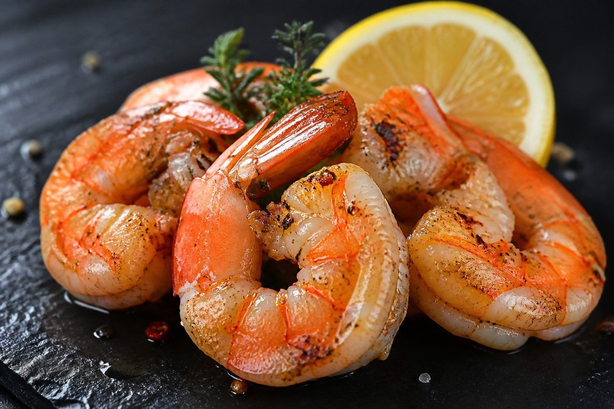

*▲ 새우(Penaeus spp.)는 열량 대비 단백질 비중이 높은 저지방 식품으로, 아스타잔틴과 타우린이 들어 있습니다. 항산화력의 '몇 배' 같은 비교는 시험관 측정값이라 사람에서의 효과로 옮겨 말하지 않습니다.*

한 줄 결론 <strong>새우 100g은 85kcal, 단백질 20.1g, 아연 1.34mg입니다.</strong> 새우의 콜레스테롤은 포화지방이 적어 혈중 수치에 미치는 영향이 작고, 신장 기능 검사 전에는 고단백 식사가 크레아티닌을 일시적으로 올릴 수 있어 주의가 필요합니다.

현대 해양생물학 및 스포츠 임상 영양학에서 **새우(Shrimp)**는 단순한 해산물 별미를 넘어 체지방 감량과 고강도 근육 회복, 그리고 세포 산화 손상을 방어하는 최고급 기능성 단백질 식재료로 손꼽힙니다.

가식부 100g당 열량이 단 85kcal에 불과하면서 순수 단백질은 무려 20g 이상을 공급하는 기적적인 고단백·저지방 매트릭스를 갖추고 있습니다. 

특히 새우를 익힐 때 붉은빛으로 발현되는 **아스타잔틴(Astaxanthin)**은 세포막의 지질 이중층을 관통하여 활성산소를 소거하는 현존 최강의 천연 항산화 물질 중 하나이며, 피로 물질을 분해하고 담즙산 대사를 촉진하는 **타우린(Taurine)**이 단위 중량당 350~400mg에 육박합니다.

아울러 과거 새우 섭취를 주저하게 만들었던 콜레스테롤 수치의 진실과, 껍질과 꼬리에 풍부한 **키틴(Chitin) 및 키토산**의 지방 흡착 배출 메커니즘을 미국 농무부(USDA FoodData Central) 공인 데이터를 바탕으로 상세히 규명합니다.

---

## 1. 새우 칼로리와 영양성분은? (단백질 20.1g·아연 1.34mg)

새우는 지방 함량이 0.5%에 불과하여 탄수화물이 전혀 없는 고순도 다이어트 단백질의 표본입니다.

| 영양 성분 (Nutrient) | 함량 (100g당) | 1일 권장 섭취량 비율 (한국인 성인 기준) |
| :--- | :--- | :--- |
| **열량 (Energy)** | 85 kcal | 4.3% |
| **탄수화물 (Carbohydrates)** | 0.20 g | 0.1% |
| - 당류 (Total Sugars) | 0.00 g | 0.0% |
| - 식이섬유 (Dietary Fiber) | 0.00 g | 0.0% |
| **단백질 (Protein)** | 20.10 g | 36.5% |
| - 글루탐산 (Glutamic Acid) | 3.42 g | 기준치 없음 |
| - 아르기닌 (L-Arginine) | 1.82 g | 기준치 없음 |
| - 류신 (Leucine, BCAA) | 1.61 g | 기준치 없음 |
| **지방 (Total Fat)** | 0.51 g | 0.9% |
| - 포화지방산 (Saturated Fat) | 0.10 g | 0.7% |
| - 단일불포화지방산 (MUFA) | 0.08 g | 기준치 없음 |
| - 다가불포화지방산 (PUFA) | 0.18 g | 기준치 없음 |
| **타우린 (Taurine)** | 약 380.00 mg | 기준치 없음 |
| **아스타잔틴 (Astaxanthin)** | 약 1.80 mg | 기준치 없음 |
| **콜레스테롤 (Cholesterol)** | 161.00 mg | 별도 표기² |
| **셀레늄 (Selenium, Se)** | 38.00 mcg | 69.1% |
| **비타민 B12 (코발라민)** | 1.11 mcg | 46.3% |
| **인 (Phosphorus, P)** | 205.00 mg | 29.3% |
| **구리 (Copper, Cu)** | 0.32 mg | 40.0% |
| **아연 (Zinc, Zn)** | 1.34 mg | 15.8% |
| **칼슘 (Calcium, Ca)** | 64.00 mg | 9.1% |
| **마그네슘 (Magnesium, Mg)** | 35.00 mg | 11.1% |
| **수분 (Water)** | 78.40 g | 별도 표기¹ |

*※ 출처: 미국 농무부(USDA FoodData Central) 공인 표준 분석 데이터.*  
*¹ 수분은 새우 근섬유의 팽윤도를 유지하는 천연 체액입니다.*  
*² 새우의 콜레스테롤은 포화지방이 거의 없어 혈중 LDL 상승 효과가 극히 미미하며, 타우린 성분이 체외 배출을 자극합니다.*  
*※ '기준치 없음' 표기는 기능성 아미노산 및 항산화 물질로 법적 일일 %DV 규정이 책정되지 않은 항목입니다.*

*※ 출처: [USDA FoodData Central FDC 175179](https://fdc.nal.usda.gov/food-details/175179/nutrients) — Crustaceans, shrimp, raw (SR Legacy). 표의 100g당 열량 85 kcal과 단백질 20.1 g은 이 항목의 값이며, 조리 상태가 다르면 값도 달라집니다.*

---

## 2. 새우 효능은 무엇일까? 과학으로 입증된 4대 효과

### 1) 천연 항산화 물질 아스타잔틴(Astaxanthin)의 미토콘드리아 보호
새우 껍질과 살에는 **아스타잔틴**이 들어 있습니다. 분자 양쪽에 친수성 고리와 가운데 소수성 사슬이 있어 세포막 안팎에서 산화를 억제하는 구조라는 설명은 시험관 연구에서 나온 것입니다. '비타민 C의 6,000배' 같은 수치는 특정 실험 조건의 활성산소 제거 능력을 비교한 값으로, 새우를 먹으면 그만큼 항산화 효과가 생긴다는 뜻이 아닙니다.

### 2) 타우린 — 담즙산 대사에 관여, '해독' 효과는 근거 없음
새우 100g에는 **타우린**이 들어 있습니다. 타우린은 담즙산과 결합해 타우로콜산을 만드는 데 관여하지만, 새우를 먹어서 간 '해독'이 활성화되거나 혈압이 내려간다는 임상 근거는 없습니다.

### 3) 초저지방·고순도 아르기닌 및 단백질 대사 지원
새우의 단백질은 체단백 합성에 필수적인 류신(1.61g)뿐만 아니라 혈관 확장 물질인 산화질소(NO)의 전구체인 **L-아르기닌(1.82g)**이 고밀도로 집중되어 있습니다. 혈관벽의 평활근을 이완시켜 전신 말초 혈액순환을 촉진하고, 지방 함량이 0.5% 미만이므로 체지방을 급격히 감량하면서 순수 근육량을 보존하려는 운동선수에게 최적의 식단을 제공합니다.

### 4) 새우 콜레스테롤 오해 해소와 껍질 속 키토산의 지방 차단
새우 100g에 약 161mg의 콜레스테롤이 들어 있다는 사실 때문에 고지혈증 환자들이 새우를 기피하는 경우가 많았습니다. 그러나 미국 록펠러 대학교 임상 연구팀에 따르면 새우 섭취는 포화지방이 없기 때문에 나쁜 LDL 콜레스테롤 수치를 유의미하게 올리지 않으며, 오히려 좋은 HDL 콜레스테롤을 선택적으로 증가시켰습니다. 더욱이 새우의 꼬리와 껍질에 함유된 고분자 다당류 **키틴(Chitin)**은 장내에서 소화 효소에 분해되지 않고 지방과 담즙산을 흡착하여 대변으로 배출시키는 강력한 천연 지질 차단제 역할을 수행합니다.

---

## 3. 새우 머리와 껍질은 먹어도 될까? 키토산과 조리법

- **약불 스팀 찜 또는 껍질째 조리 권장:** 아스타잔틴과 타우린은 수용성 및 지용성 성질을 모두 띠고 있어 고온의 기름에 튀길 경우 열변성과 산화 파괴가 일어납니다. 100℃ 내외의 수증기로 단시간 쪄내거나 껍질째 에어프라이어에 가볍게 구워내면 영양소 손실을 90% 이상 차단할 수 있습니다.
- **레몬즙(구연산)의 지질 산화 방지:** 조리된 새우에 레몬즙을 뿌리면 비타민 C가 산화를 늦추고 구연산이 비린내 원인 물질(트리메틸아민)을 중화해 맛이 깔끔해집니다.

---

## 4. 새우 콜레스테롤과 크레아티닌, 알레르기 주의점은?

- **갑각류 알레르기(트로포미오신) 주의:** 새우의 근육 단백질인 **트로포미오신(Tropomyosin)**은 대표적인 식품 알레르기 항원입니다. 섭취 후 입술이나 혀의 부종, 두드러기, 호흡 곤란 증상이 나타날 경우 즉시 섭취를 중단하고 항히스타민제 또는 응급 치료를 받아야 합니다.
- **크레아티닌 수치와 신장 검사:** 크레아티닌은 근육의 크레아틴이 분해되며 생기는 노폐물로, 검사 전날 고단백 해산물이나 익힌 고기를 평소보다 많이 먹으면 혈청 크레아티닌이 일시적으로 조금 올라갈 수 있습니다. 신장 기능이 정상이라면 새우 한 끼로 사구체여과율 판정이 달라지지는 않지만, 검사가 예정되어 있다면 전날 과식을 피하고 평소 식사량을 유지하는 편이 안전합니다.
- **통풍(Gout) 환자의 과다 섭취 주의:** 새우는 가식부 100g당 약 130~150mg의 퓨린을 함유한 중등도-고퓨린 식품입니다. 급성 통풍 발작 환자는 요산 결정 침착 위험이 있으므로 과다 섭취를 자제해야 합니다.

---

## 5. 새우와 함께 먹으면 좋은 음식은?

- **[마늘 (Garlic)]({{ site.baseurl }}/posts/garlic-nutrition-benefits/)**: 마늘의 유기황 알리신 성분이 새우의 풍부한 비타민 B군과 결합하여 피로 회복 에너지를 극대화하고 혈전 형성을 차단합니다.
- **[브로콜리 (Broccoli)]({{ site.baseurl }}/posts/broccoli-nutrition-benefits/)**: 브로콜리의 비타민 C와 설포라판이 새우의 아스타잔틴과 시너지를 이루어 세포 내 활성산소를 제거하는 최강의 3차원 항산화 방패를 형성합니다.
- **[시금치 (Spinach)]({{ site.baseurl }}/posts/spinach-nutrition-benefits/)**: 시금치의 풍부한 마그네슘과 칼륨이 새우의 고단백 대사를 촉진하고 체내 나트륨 균형을 완벽히 잡아줍니다.

---

## 6. 자주 묻는 질문 (FAQ)

### Q1. 새우의 콜레스테롤이 높다고 하는데 고지혈증 환자가 먹어도 되나요?
**A:** 적정량(1회 5~8마리 내외)은 안심하고 드셔도 됩니다. 새우는 콜레스테롤 함량이 있지만 포화지방이 0.1g으로 거의 없어 간에서 LDL 콜레스테롤을 합성하는 능력이 극히 미미합니다. 오히려 풍부한 타우린이 담즙산 배출을 도와 혈관 건강에 긍정적으로 작용합니다.

### Q2. 새우 머리와 껍질, 꼬리까지 다 먹는 것이 영양학적으로 좋은가요?
**A:** 네, 매우 권장됩니다. 새우 머리의 내장 부위에는 감칠맛 성분과 지용성 항산화 성분이 집중되어 있으며, 껍질과 꼬리에는 장내 지방 흡수를 억제하고 변비를 예방하는 불용성 식이섬유 ‘키틴·키토산’이 집중 농축되어 있습니다.

### Q3. 새우 등의 검은 줄(내장)은 반드시 떼어내고 먹어야 하나요?
**A:** 등의 검은 줄은 새우의 소화관(내장)으로 모래나 뻘이 섞여 있을 수 있어 식감이 서걱거릴 수 있습니다. 이쑤시개 등으로 가볍게 제거하면 훨씬 깔끔하고 고급스러운 맛을 즐길 수 있습니다.

  
📌 관련 순위 가이드

  <ul>
    <li><a href="/posts/high-protein-foods-ranking/">단백질 많은 음식 TOP 10: 100g당 함량과 흡수율 비교</a></li>
  </ul>

---

## 7. 새우 하루 얼마나 먹을까? 핵심 요약

- **핵심 영양:** 100g당 85kcal 초저열량, 순수 단백질 20.1g, 간 피로 회복 타우린 380mg, 천연 항산화 아스타잔틴 1.8mg.
- **최적 조리:** 영양소 파괴를 막기 위해 고온 튀김 대신 찜이나 구이로 섭취하고, 레몬즙을 곁들여 산화 방지.
- **영양 궁합:** [마늘]({{ site.baseurl }}/posts/garlic-nutrition-benefits/)의 알리신과 결합 시 피로 회복 극대화, [브로콜리]({{ site.baseurl }}/posts/broccoli-nutrition-benefits/)와 병용 시 항산화 방패 형성.
