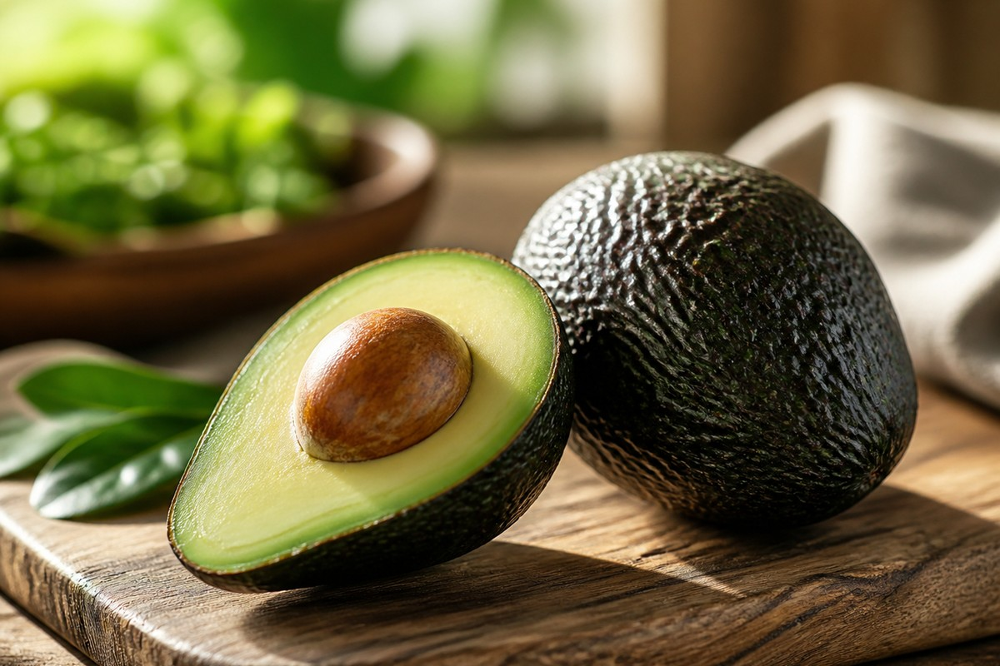

*▲ '숲속의 버터'로 불리는 아보카도(Persea americana)는 식물계에서 보기 드문 고농도 단일불포화지방산(올레산)과 바나나보다 풍부한 칼륨, 그리고 강력한 지용성 항산화물질인 루테인·비타민 E를 품은 기능성 슈퍼푸드입니다.*

현대 기능의학 및 대사영양학에서 **아보카도(Avocado)**는 당분 함량이 극도로 낮으면서 심혈관을 보호하는 양질의 지방질과 수용성·불용성 식이섬유가 완벽한 황금 비율을 이루는 독보적인 과채류로 손꼽힙니다.

일반적인 과일들이 과당(Fructose) 위주의 단순 탄수화물 구조를 띠는 반면, 아보카도는 전체 열량의 약 70% 이상이 올리브유의 핵심 지질인 **올레산(Oleic Acid, Omega-9)**을 비롯한 단일불포화지방산(MUFA)으로 구성되어 있습니다. 이 지방산은 혈관 내피 세포의 염증 반응을 억제하고 혈중 중성지방 및 저밀도 지단백질(LDL)의 산화를 원천 차단합니다.

뿐만 아니라 아보카도 100g에는 체내 과잉 나트륨을 삼투압 원리로 체외 배출시키는 **칼륨(Potassium)**이 약 485mg 함유되어 있어 칼륨의 대명사로 불리는 바나나(약 358mg)를 크게 압도합니다. 여기에 장내 미생물의 먹이가 되는 프리바이오틱스 식이섬유 6.7g과 황반을 지키는 **루테인(Lutein)**이 결합되어 대사증후군 개선에 이상적인 생체 솔루션을 제공합니다.

미국 농무부(USDA FoodData Central) 공인 분석 데이터를 토대로 아보카도의 분자 생화학적 영양 가치와 심혈관 임상 기전, 그리고 신선도를 극대화하는 후숙·보관 과학을 심층 분석합니다.

---

## 1. 아보카도 영양 성분 정밀 분석표 (가식부 생과 100g 기준, 중간 크기 약 1/2개)

아보카도는 100g당 약 160kcal의 에너지를 공급하며, 당류 함량이 1g 미만으로 인슐린 스파이크를 전혀 유발하지 않는 저혈당 지수(GI 15 이하) 식품입니다.

| 영양 성분 (Nutrient) | 함량 (100g당) | 1일 권장 섭취량 비율 (한국인 성인 기준) |
| :--- | :--- | :--- |
| **열량 (Energy)** | 160 kcal | 8.0% |
| **탄수화물 (Carbohydrates)** | 8.53 g | 2.6% |
| - 당류 (Total Sugars) | 0.66 g | 0.7% |
| - 식이섬유 (Dietary Fiber) | 6.70 g | 26.8% |
| **단백질 (Protein)** | 2.00 g | 3.6% |
| **지방 (Total Fat)** | 14.66 g | 27.1% |
| - 포화지방산 (Saturated Fat) | 2.13 g | 14.2% |
| - 단일불포화지방산 (MUFA, 올레산) | 9.80 g | 기준치 없음 |
| - 다가불포화지방산 (PUFA) | 1.82 g | 기준치 없음 |
| **칼륨 (Potassium, K)** | 485.00 mg | 13.9% |
| **마그네슘 (Magnesium, Mg)** | 29.00 mg | 9.2% |
| **엽산 (Folate, 비타민 B9)** | 81.00 mcg | 20.3% |
| **비타민 E (알파-토코페롤)** | 2.07 mg | 18.8% |
| **비타민 K1 (필로퀴논)** | 21.00 mcg | 30.0% |
| **비타민 C (아스코르브산)** | 10.00 mg | 10.0% |
| **비타민 B6 (피리독신)** | 0.26 mg | 17.3% |
| **루테인 + 제아잔틴** | 271.00 mcg | 기준치 없음 |
| **베타-시토스테롤 (Phytosterols)** | 76.00 mg | 기준치 없음 |
| **수분 (Water)** | 73.23 g | 별도 표기¹ |

*※ 출처: 미국 농무부(USDA FoodData Central) 공인 표준 분석 데이터.*  
*¹ 수분은 식물성 지질 입자를 안정화하고 부드러운 버터 질감을 형성하는 기본 매질입니다.*  
*※ '기준치 없음' 표기는 기능성 지질 및 식물영양소로 법적 %DV가 책정되지 않은 항목입니다.*

---

## 2. 과학적으로 입증된 아보카도의 4대 건강 효능

### 1) 단일불포화지방산(올레산)의 심혈관 내피 보호 및 LDL 산화 억제
아보카도 지질의 70% 이상을 차지하는 **올레산(Oleic Acid)**은 세포막의 유동성을 높이고 혈관 내피에서 산화질소(NO) 합성을 촉진합니다. 펜실베이니아 주립대학교의 무작위 대조 임상 연구(RCT)에 따르면, 1일 1개의 아보카도를 포함한 식단을 5주간 유지한 그룹은 대조군 대비 순환계에서 가장 위험한 소립자 산화 LDL(sdLDL) 입자 수가 유의미하게 감소했습니다. 또한 식물성 스테롤인 **베타-시토스테롤(Beta-sitosterol)**이 장관 내에서 동물성 콜레스테롤 흡수를 경쟁적으로 차단합니다.

### 2) 고농도 칼륨(485mg)과 마그네슘의 나트륨 배출 및 혈압 강하
현대인의 고나트륨 가공식품 섭취는 세포외액 삼투압을 높여 만성 고혈압을 유발합니다. 아보카도의 풍부한 칼륨은 신장 세뇨관에서 나트륨-칼륨 펌프(Na+/K+-ATPase)를 가동하여 체내에 정체된 나트륨과 수분을 소변으로 신속히 방출시킵니다. 여기에 혈관벽 평활근을 이완시키는 마그네슘이 시너지를 발휘하여 수축기 및 이완기 혈압을 안정화합니다.

### 3) 6.7g 고밀도 프리바이오틱스 식이섬유와 인슐린 감수성 개선
아보카도 100g에는 일일 권장량의 27%에 달하는 풍부한 식이섬유가 응축되어 있습니다. 이 중 약 70%의 불용성 섬유질은 장 연동 운동을 촉진하고, 30%의 수용성 섬유질은 장내 유익균에 의해 분해되어 **단쇄지방산(SCFA, 부티레이트)**을 생성합니다. 이는 GLP-1 호르몬 분비를 촉진해 식후 포만감을 4~5시간 연장하고 말초 조직의 인슐린 저항성을 유의미하게 개선합니다.

### 4) 지질 결합형 루테인·지용성 비타민 흡수율 극대화 촉매
아보카도에 함유된 **루테인과 제아잔틴**은 안구 망막의 황반 색소 밀도를 유지하여 황반변성을 방어합니다. 더욱 주목할 점은 아보카도가 다른 식재료의 영양 흡수를 돕는 '생체이용률 촉진제(Bioavailability Booster)' 역할을 한다는 사실입니다. 임상 저널에 따르면 녹황색 채소 샐러드에 아보카도를 곁들일 경우 채소 속 베타카로틴과 라이코펜의 장내 흡수율이 무려 4배에서 15배까지 급증합니다.

---

## 3. 완벽한 후숙 판별법 및 갈변 차단 보관 과학

- **촉각과 외피 색상을 이용한 후숙 판별:**
  - **초록색 & 단단함 (미후숙):** 상온(18~22℃)에서 3~5일간 에틸렌 가스를 방출하며 천천히 후숙시킵니다.
  - **짙은 녹갈색 & 살짝 탄력 있음 (골든 타임):** 꼭지 주변을 엄지로 가볍게 눌렀을 때 부드럽게 들어가고 꼭지가 쉽게 떨어지는 상태가 생과로 섭취하기 가장 신선한 최적기입니다.
  - **완전한 검정색 & 푹 꺼짐 (과후숙):** 내부 과육 섬유질이 산화되어 검은 줄이 생기고 산패 취가 발생하므로 즉시 소진해야 합니다.
- **후숙 가속화 및 냉장 보관 원칙:**
  - 빠른 후숙을 원할 경우 사과나 바나나와 함께 종이봉투에 밀봉하면 사과에서 분비되는 천연 에틸렌 가스가 아보카도의 숙성을 24~48시간 단축시킵니다.
  - 먹기 좋게 익은 아보카도는 즉시 냉장고 신선실(4~7℃)로 이동시키면 효소 반응이 둔화되어 3~4일간 최상의 상태가 유지됩니다.
- **남은 반쪽 과육의 갈변 방지 과학:** 아보카도 단면이 공기에 노출되면 폴리페놀 옥시다아제(PPO) 효소가 산소와 반응해 갈색 멜라닌 색소를 생성합니다. 산화를 차단하려면 **레몬즙이나 올리브유**를 단면에 얇게 도포한 뒤 랩으로 밀착 포장하거나, 양파 조각과 함께 밀폐 용기에 보관하면 양파의 유황 화합물이 산화 효소를 강력히 억제합니다.

---

## 4. 섭취 시 주의사항 및 잠재적 부작용

- **라텍스-과일 증후군(Latex-Fruit Syndrome) 알레르기:** 고무 라텍스 단백질에 알레르기가 있는 체질은 아보카도의 헤베인(Hevein) 유사 단백질에 교차 반응을 일으켜 구강 가려움증, 두드러기, 복통을 겪을 수 있으므로 주의해야 합니다.
- **고지질 특성에 따른 적정 섭취량:** 아보카도는 유익한 불포화지방산이지만 1개당 열량이 약 250~300kcal에 달합니다. 체중 감량 중인 성인이라면 하루 1/2개에서 최대 1개 이내로 섭취량을 조절하는 것이 권장됩니다.

---

## 5. 함께 먹으면 시너지가 폭발하는 식재료 궁합

- **[당근 (Carrot)]({{ site.baseurl }}/posts/carrot-nutrition-benefits/)**: 당근 속 지용성 항산화물질인 베타카로틴은 지방질이 없으면 체내 흡수율이 10% 미만에 불과합니다. 아보카도의 풍부한 올레산이 베타카로틴을 미셀(Micelle) 구조로 감싸 흡수율을 10배 이상 폭발적으로 끌어올립니다.
- **[달걀 (Egg)]({{ site.baseurl }}/posts/egg-nutrition-benefits/)**: 달걀의 고순도 단백질과 콜린, 아보카도의 불포화지방산과 식이섬유가 결합하여 완벽한 케토제닉·혈당 안정 식단을 완성합니다.
- **[토마토 (Tomato)]({{ site.baseurl }}/posts/tomato-nutrition-benefits/)**: 토마토의 지용성 카로티노이드인 라이코펜(Lycopene)이 아보카도의 지질 매질과 결합하여 심혈관 항염증 시너지를 발휘합니다.

---

## 6. 자주 묻는 질문 (FAQ)

### Q1. 아보카도는 지방이 많은데 다이어트 중에 먹어도 살이 안 찌나요?
**A:** 적정량을 섭취하면 오히려 다이어트에 크게 기여합니다. 아보카도의 지방은 체지방 축적을 유도하는 포화지방이 아닌 에너지 소비를 촉진하는 단일불포화지방산(올레산)이며, 6.7g의 풍부한 식이섬유가 식후 포만감을 장시간 유지시켜 식탐 호르몬인 그렐린 분비를 억제합니다. 하루 1/2개 섭취는 안전합니다.

### Q2. 덜 익은 딱딱한 아보카도를 냉장고에 바로 넣어도 되나요?
**A:** 절대 냉장고에 바로 넣으시면 안 됩니다. 아보카도는 수확 후 호흡을 통해 숙성되는 '후숙 과일'입니다. 덜 익은 상태에서 저온에 노출되면 냉해(Chilling Injury)를 입어 과육이 질겨지고 껍질이 고르게 익지 못한 채 속부터 검게 부패합니다. 반드시 실온에서 짙은 녹갈색으로 익힌 후 냉장 보관해야 합니다.

### Q3. 아보카도 속살에 생긴 검은 실 같은 줄은 먹어도 괜찮은가요?
**A:** 인체에 유해한 독소는 아닙니다. 아보카도 수분과 영양분을 공급하던 관다발(Vascular Bundles) 섬유 조직이 과숙되거나 냉해를 입어 갈변된 현상입니다. 곰팡이나 시큼한 산패 취가 없다면 숟가락으로 걷어내고 드셔도 무방하나, 신선도와 식감이 떨어지므로 가급적 가열 요리나 스무디로 활용하는 것이 좋습니다.

---

## 7. 최종 요약 및 실천 가이드

- **핵심 영양:** 100g당 올레산 9.8g, 칼륨 485mg, 식이섬유 6.7g, 비타민 E 2.07mg, 루테인 271mcg 농축.
- **후숙 원칙:** 딱딱한 초록색은 실온 보관, 엄지로 눌렀을 때 부드러운 녹갈색이 되면 즉시 섭취하거나 냉장실 보관.
- **영양 궁합:** [당근]({{ site.baseurl }}/posts/carrot-nutrition-benefits/)의 베타카로틴, [토마토]({{ site.baseurl }}/posts/tomato-nutrition-benefits/)의 라이코펜과 함께 섭취 시 지용성 파이토케미컬 흡수율 10배 극대화.
