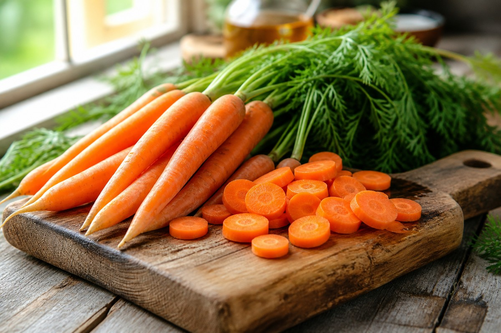

*▲ 주황빛 파이토케미컬이 많은 당근(Daucus carota)은 비타민 A 전구체인 베타카로틴(Beta-carotene)과 알파카로틴, 그리고 폴리아세틸렌 성분 팔카리놀(Falcarinol)을 함유한 대표적인 뿌리채소입니다. 영양 수치는 USDA FoodData Central FDC 170393(생것) 기준입니다.*

한 줄 결론 <strong>당근 100g은 41kcal, 식이섬유 2.8g, 칼륨 320mg입니다.</strong> 베타카로틴은 지용성이라 기름과 함께 익히면 흡수율이 크게 오르고, 생으로 먹을 때는 잘게 썰어 지방이 있는 식재료와 같이 먹는 편이 좋습니다.

**당근(Carrot)**은 베타카로틴을 많이 함유해 비타민 A(Provitamin A) 공급원으로 널리 쓰이는 뿌리채소입니다. 수치가 높다고 해서 결핍이 없는 사람의 시력이나 면역력이 특별히 좋아진다는 근거는 없습니다.

당근의 주황빛을 만드는 **베타카로틴(Beta-carotene)**은 소장 상피세포에서 효소(BCO1) 작용으로 활성형 비타민 A(레티놀)로 전환됩니다. 비타민 A는 어두운 곳에서 시각 적응을 돕는 **로돕신(Rhodopsin)** 합성에 필요합니다. 비타민 A가 부족하면 야맹증과 안구건조증이 생길 수 있지만, 이미 충분히 섭취하는 사람이 당근을 더 먹는다고 시력이 좋아지지는 않습니다.

당근 껍질 아래층에는 천연 폴리아세틸렌인 **팔카리놀(Falcarinol)**이 들어 있습니다. 세포 실험과 동물 연구에서 종양 세포 증식 억제가 보고됐지만, 사람을 대상으로 한 임상 연구는 없어 '당근이 암을 예방한다'고 말할 수는 없습니다. 수용성 펙틴과 칼륨은 식이섬유·미네랄 공급에 기여합니다.

미국 농무부 식품성분 자료(FDC 170393)를 기준으로 당근의 영양성분과 생식·가열 조리에 따른 차이를 살펴봅니다.

---

## 1. 당근 칼로리와 영양성분은? (식이섬유 2.8g·칼륨 320mg)

당근은 100g당 약 41kcal의 매우 가벼운 열량을 지니며, 수분 함량이 88%에 달해 다이어트 시 풍부한 부피감과 포만감을 선사합니다.

| 영양 성분 (Nutrient) | 함량 (100g당) | 1일 권장 섭취량 비율 (한국인 성인 기준) |
| :--- | :--- | :--- |
| **열량 (Energy)** | 41 kcal | 2.1% |
| **탄수화물 (Carbohydrates)** | 9.58 g | 3.0% |
| - 당류 (Total Sugars) | 4.74 g | 4.7% |
| - 식이섬유 (Dietary Fiber) | 2.80 g | 11.2% |
| **단백질 (Protein)** | 0.93 g | 1.7% |
| **지방 (Total Fat)** | 0.24 g | 0.4% |
| - 포화지방산 (Saturated Fat) | 0.04 g | 0.3% |
| - 단일불포화지방산 (MUFA) | 0.01 g | 기준치 없음 |
| - 다가불포화지방산 (PUFA) | 0.12 g | 기준치 없음 |
| **비타민 A (레티놀 활성 당량, RAE)** | 835.00 mcg RAE | 119.3% |
| **- 베타카로틴 (Beta-carotene)** | 8,285.00 mcg | 기준치 없음 |
| **- 알파카로틴 (Alpha-carotene)** | 3,477.00 mcg | 기준치 없음 |
| **루테인 + 제아잔틴** | 256.00 mcg | 기준치 없음 |
| **비타민 K1 (필로퀴논)** | 13.20 mcg | 18.9% |
| **칼륨 (Potassium, K)** | 320.00 mg | 9.1% |
| **비타민 C (아스코르브산)** | 5.90 mg | 5.9% |
| **비타민 B6 (피리독신)** | 0.14 mg | 9.3% |
| **팔카리놀 (Falcarinol)** | 검출 (고활성 천연 화합물) | 기준치 없음 |
| **수분 (Water)** | 88.29 g | 별도 표기¹ |

*※ 출처: [USDA FoodData Central FDC 170393](https://fdc.nal.usda.gov/food-details/170393/nutrients) — 당근, 생것(SR Legacy).*  

*¹ 수분은 당근의 아삭한 세포 팽압을 지탱하고 카로티노이드 결정체를 감싸는 기본 용매입니다.*  
*※ '기준치 없음' 표기는 기능성 파이토케미컬 및 지방산으로 법적 %DV가 책정되지 않은 항목입니다.*

### 1회 섭취량 환산: 당근 한 개·채 썬 한 컵은 몇 kcal인가?

당근은 크기 차이가 큰 채소입니다. USDA 1회 섭취량 자료의 무게로 환산했습니다.

| 섭취 단위 | 가식부 무게 | 열량 | 단백질 |
| :--- | :--- | :--- | :--- |
| 작은 것 1개 | 50 g | 20.5 kcal | 0.47 g |
| 중간 것 1개 | 61 g | 25 kcal | 0.57 g |
| 큰 것 1개 | 72 g | 29.5 kcal | 0.67 g |
| 채 썬 한 컵 | 128 g | 52.5 kcal | 1.19 g |

*※ 당근 한 개를 통째로 먹어도 25~30kcal이므로, 열량보다 눈여겨볼 것은 베타카로틴과 식이섬유입니다. 주스로 갈아 마시면 한 번에 3~4개가 들어가 열량이 세 배가 됩니다.*

---

## 2. 당근 효능은 무엇일까? 과학으로 입증된 4대 효과

### 1) 베타카로틴의 로돕신(Rhodopsin) 합성 및 시각 신경망 보호
당근의 베타카로틴은 체내에서 비타민 A로 전환될 수 있습니다. 비타민 A는 정상적인 시각 기능에 필요하지만 당근 섭취가 안구건조증을 예방하거나 치료한다는 의미는 아닙니다.

### 2) 팔카리놀(Falcarinol) — 세포·동물 실험 단계의 연구
당근의 **팔카리놀(Falcarinol)**과 **팔카린디올(Falcarindiol)**은 세포 실험과 동물(설치류) 연구에서 대장 점막의 비정상 세포 분열을 억제하는 방향으로 보고됐습니다. 사람을 대상으로 한 임상시험은 아직 없어, 당근 섭취로 대장 용종이나 대장암이 줄어든다는 결론은 나오지 않았습니다. 이 성분은 껍질 아래 표피층에 상대적으로 많이 들어 있어 껍질째 먹으면 섭취량이 늘어나는 정도로 이해하면 됩니다.

### 3) 수용성 펙틴과 담즙산 배출
당근의 수용성 식이섬유 **펙틴(Pectin)**은 장에서 젤을 형성해 담즙산 일부를 붙잡아 대변으로 배출합니다. 식이섬유 섭취를 늘리면 LDL 콜레스테롤이 다소 낮아질 수 있다는 연구가 있지만, 당근 하나로 혈청 지질이 정상화된다고 단정할 수는 없습니다. 전체 식사 구성과 함께 봐야 합니다.

### 4) 알파카로틴과 강력한 항산화 네트워크의 심혈관 내피 보호
당근에는 베타카로틴 외에 **알파카로틴(Alpha-carotene)**이 100g당 3,477mcg 들어 있습니다. 대규모 관찰연구(NHANES III)에서는 혈중 알파카로틴 농도가 높은 집단에서 심혈관 질환 사망률이 낮은 연관이 보고됐습니다. 다만 관찰연구는 인과관계를 증명하지 못하며, 알파카로틴이 혈관을 직접 보호한다고 확정된 것은 아닙니다.

---

## 3. 당근은 생으로 먹을까, 기름에 익힐까? 베타카로틴 흡수율

- **생당근:** 베타카로틴이 단단한 식물 세포벽(리그닌, 셀룰로오스) 안에 갇혀 있어 씹어 먹는 것만으로는 유리되는 양이 적습니다. 다만 인체 흡수율을 특정 %로 단정할 만한 합의된 값은 없습니다.
- **기름과 열을 가한 조리:** 당근을 얇게 채 썰거나 볶으면 세포벽이 무너져 카로티노이드가 더 많이 유리됩니다.
  - 식사에 포함된 지방은 카로티노이드 흡수에 도움이 될 수 있습니다. 흡수율은 조리 상태와 식사 구성에 따라 달라져 특정 배수로 단정할 수 없습니다.

---

## 4. 당근 부작용과 주의할 점은?

- **과다 섭취 시 카로틴혈증(Carotenemia):** 매일 당근을 과도하게 대량 섭취하면 배출되지 못한 베타카로틴이 피하지방층에 침착되어 손바닥, 발바닥, 콧등이 노랗게 변하는 카로틴혈증이 나타날 수 있습니다. 황달과 달리 안구 흰자위는 변색되지 않으며, 섭취량을 줄이면 며칠 내로 정상 피부색으로 완벽히 복원되는 무해한 가역적 현상입니다.
- **비타민 C 파괴 효소(아스코르비나아제):** 당근을 자르면 세포 내 효소인 **아스코르비나아제(Ascorbinase)**가 활성화되어 다른 채소나 과일의 비타민 C를 산화시킬 수 있습니다. 사과나 오이 등과 함께 조리할 때는 식초나 레몬즙을 몇 방울 첨가하여 pH를 산성으로 낮추거나, 당근을 살짝 데치면 효소가 불활성화되어 비타민 C를 안전하게 보존할 수 있습니다.

---

## 5. 당근과 함께 먹으면 좋은 음식은?

- **[아보카도 (Avocado)]({{ site.baseurl }}/posts/avocado-nutrition-benefits/)**: 당근의 지용성 베타카로틴과 아보카도의 풍부한 올레산 불포화지방산이 만나는 최고의 지질 유화 결합으로, 샐러드로 곁들여 먹을 때 카로티노이드 체내 생체이용률이 극대화됩니다.
- **[사과 (Apple)]({{ site.baseurl }}/posts/apple-nutrition-benefits/)**: 당근의 흙냄새를 사과의 상큼한 유기산이 중화하고, 당근의 비타민 A 전구체와 사과의 펙틴·퀘르세틴이 결합하여 위장 정화 및 피부 미용 시너지를 냅니다.
- **[달걀 (Egg)]({{ site.baseurl }}/posts/egg-nutrition-benefits/)**: 달걀노른자의 풍부한 레시틴 지질 성분이 당근의 카로티노이드 흡수를 촉진하고, 달걀에 부족한 프로비타민 A를 당근이 완벽히 보완합니다.

---

## 6. 자주 묻는 질문 (FAQ)

### Q1. 당근 껍질을 필러로 두껍게 벗겨내고 먹는 것이 위생상 더 좋은가요?
**A:** 껍질을 깎지 않고 잘 씻어 먹으면 카로티노이드와 폴리아세틸렌(팔카리놀)을 조금 더 섭취할 수 있습니다. 이 성분들은 표피층에 상대적으로 많기 때문입니다. 다만 껍질째 먹는다고 항암 효과가 생기는 것은 아니며, 흙은 부드러운 브러시로 문질러 씻으면 충분합니다. 껍질이 질기거나 흠이 많으면 벗겨도 영양 차이는 크지 않습니다.

### Q2. 당근을 주스로 매일 마셔도 혈당에 문제가 없나요?
**A:** 생당근은 대체로 혈당 반응이 크지 않은 편이지만, 연구마다 보고된 혈당지수(GI)가 달라(대략 16~60 범위) 단일 수치로 단정하기 어렵습니다. 착즙기로 섬유질을 걸러 즙만 마시면 당 흡수가 빨라질 수 있으므로, 당뇨가 있다면 한 번에 마시는 양을 줄이고 통째로 갈아 먹는 편이 낫습니다. 올리브유를 몇 방울 더하면 카로티노이드 흡수에 도움이 됩니다.

### Q3. 당근을 냉장고에 보관하면 왜 금방 검게 변하거나 물러지나요?
**A:** 당근은 수분 증발에 매우 취약한 뿌리채소입니다. 씻지 않은 상태에서 신문지나 키친타월로 한 개씩 감싸 수분을 차단한 뒤 지퍼백에 밀봉하여 냉장고 신선실에 ‘뿌리가 아래로 향하도록 세워서’ 보관하면 2~3주 이상 아삭한 수분감과 영양소를 완벽히 유지할 수 있습니다.

  
📌 관련 순위 가이드

  <ul>
    <li><a href="/posts/antioxidant-anti-aging-foods-guide/">항산화·노화 방지 음식 TOP 10: 폴리페놀·카로티노이드 순위</a></li>
  </ul>

---

## 7. 당근 하루 얼마나 먹을까? 핵심 요약

- **핵심 영양:** 100g당 베타카로틴 8,285mcg(비타민 A 119% 충족), 팔카리놀(표피층), 식이섬유 2.8g.
- **조리 비결:** 기호에 따라 생으로 먹거나 소량의 기름과 익혀 먹을 수 있습니다.
- **영양 궁합:** [아보카도]({{ site.baseurl }}/posts/avocado-nutrition-benefits/)의 올레산, [달걀]({{ site.baseurl }}/posts/egg-nutrition-benefits/)의 레시틴과 조리 시 비타민 A 생체이용률 극대화.

**추가 참고:** [미국 NIH 비타민 A 및 카로티노이드 자료](https://ods.od.nih.gov/factsheets/VitaminA-HealthProfessional/).
