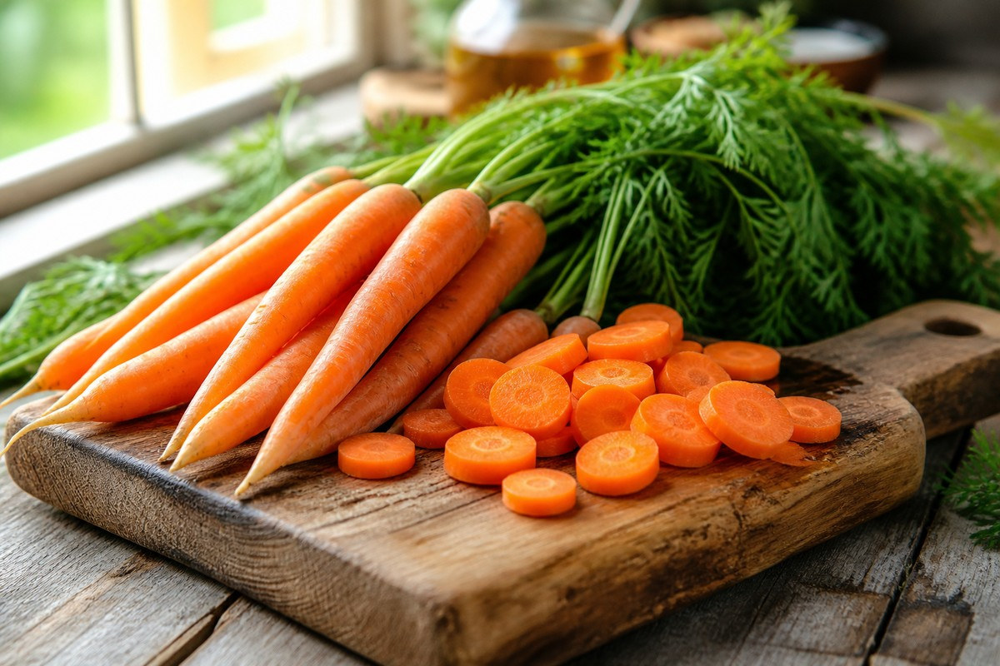

*▲ 주황빛 천연 파이토케미컬의 보고인 당근(Daucus carota)은 식물성 비타민 A 전구체인 베타카로틴(Beta-carotene)과 알파카로틴, 그리고 강력한 항종양 천연 폴리아세틸렌 성분인 팔카리놀(Falcarinol)을 풍부하게 함유한 대표적인 뿌리채소입니다.*

현대 예방의학 및 임상영양학에서 **당근(Carrot)**은 시각 신경계의 기능 유지와 상피 세포의 점막 면역력을 재건하는 가장 강력한 천연 비타민 A(Provitamin A) 공급원으로 평가받습니다.

당근의 짙은 주황빛을 결정짓는 핵심 색소인 **베타카로틴(Beta-carotene)**은 체내로 흡수된 후 소장 점막 상피세포에서 효소(BCO1) 작용을 거쳐 활성형 비타민 A(레티놀)로 정밀 전환됩니다. 이는 어두운 곳에서 시각 적응을 돕는 감광 단백질인 **로돕신(Rhodopsin)**의 재생을 촉진하여 야맹증을 예방하고, 안구 건조증 및 각막 손상을 방어합니다.

또한 당근 껍질 직하층에 고농도로 집적된 천연 살충 화합물인 **팔카리놀(Falcarinol)**은 대장 점막 세포의 비정상적인 종양 증식을 억제하고 염증성 사이토카인을 차단하는 항암 물질로 주목받고 있습니다. 여기에 수용성 펙틴과 풍부한 칼륨이 결합되어 혈관 탄력과 장내 미생물 환경을 동시에 안정화합니다.

미국 농무부(USDA FoodData Central) 공인 분석 데이터를 바탕으로 당근의 분자 영양학적 효능과 생당근 대비 기름 조리 시 흡수율이 10배 이상 폭발하는 지질 결합 원리, 그리고 신선도를 수개월간 유지하는 올바른 보관법을 정밀 분석합니다.

---

## 1. 당근 영양 성분 정밀 분석표 (가식부 생과 100g 기준, 중간 크기 약 1개)

당근은 100g당 약 41kcal의 매우 가벼운 열량을 지니며, 수분 함량이 88%에 달해 다이어트 시 풍부한 부피감과 포만감을 선사합니다.

| 영양 성분 (Nutrient) | 함량 (100g당) | 1일 권장 섭취량 비율 (한국인 성인 기준) |
| :--- | :--- | :--- |
| **열량 (Energy)** | 41 kcal | 2.1% |
| **탄수화물 (Carbohydrates)** | 9.58 g | 3.0% |
| - 당류 (Total Sugars) | 4.74 g | 4.7% |
| - 식이섬유 (Dietary Fiber) | 2.80 g | 11.2% |
| **단백질 (Protein)** | 0.93 g | 1.7% |
| **지방 (Total Fat)** | 0.24 g | 0.4% |
| - 포화지방산 (Saturated Fat) | 0.04 g | 0.3% |
| - 단일불포화지방산 (MUFA) | 0.01 g | 기준치 없음 |
| - 다가불포화지방산 (PUFA) | 0.12 g | 기준치 없음 |
| **비타민 A (레티놀 활성 당량, RAE)** | 835.00 mcg RAE | 119.3% |
| **- 베타카로틴 (Beta-carotene)** | 8,285.00 mcg | 기준치 없음 |
| **- 알파카로틴 (Alpha-carotene)** | 3,477.00 mcg | 기준치 없음 |
| **루테인 + 제아잔틴** | 256.00 mcg | 기준치 없음 |
| **비타민 K1 (필로퀴논)** | 13.20 mcg | 18.9% |
| **칼륨 (Potassium, K)** | 320.00 mg | 9.1% |
| **비타민 C (아스코르브산)** | 5.90 mg | 5.9% |
| **비타민 B6 (피리독신)** | 0.14 mg | 9.3% |
| **팔카리놀 (Falcarinol)** | 검출 (고활성 천연 화합물) | 기준치 없음 |
| **수분 (Water)** | 88.29 g | 별도 표기¹ |

*※ 출처: 미국 농무부(USDA FoodData Central) 공인 표준 분석 데이터.*  
*¹ 수분은 당근의 아삭한 세포 팽압을 지탱하고 카로티노이드 결정체를 감싸는 기본 용매입니다.*  
*※ '기준치 없음' 표기는 기능성 파이토케미컬 및 지방산으로 법적 %DV가 책정되지 않은 항목입니다.*

---

## 2. 과학적으로 입증된 당근의 4대 건강 효능

### 1) 베타카로틴의 로돕신(Rhodopsin) 합성 및 시각 신경망 보호
당근 100g만 섭취해도 성인 하루 비타민 A 필요량의 100% 이상을 거뜬히 충족합니다. 카로티노이드는 체내에서 레티날(Retinal)로 전환되어 망막 간상세포의 시각 감광 단백질인 **로돕신**과 결합합니다. 이는 야간 시력을 향상시키고 장시간 디지털 화면을 응시하는 현대인의 눈물막 파괴와 안구 건조증을 근본적으로 차단합니다.

### 2) 천연 폴리아세틸렌 팔카리놀(Falcarinol)의 대장 점막 세포 항암 작용
영국 뉴캐슬 대학교 농과대학 연구팀의 분자 약리학 연구에 따르면, 당근 속 천연 방어 물질인 **팔카리놀(Falcarinol)**과 **팔카린디올(Falcarindiol)**은 대장 상피 세포에서 비정상적인 종양 세포(폴립)의 분열을 억제하고 세포 자멸사(Apoptosis)를 유도합니다. 이 성분은 껍질 바로 밑 표피층에 집중되어 있으므로 깨끗이 세척 후 껍질째 섭취할 때 항암 생체 활성이 극대화됩니다.

### 3) 수용성 펙틴의 담즙산 흡착 및 혈중 LDL 콜레스테롤 강하
당근에 풍부한 수용성 식이섬유 **펙틴(Pectin)**은 장관 내에서 젤(Gel) 형태의 그물망을 형성합니다. 이 그물망은 간에서 콜레스테롤로 만들어진 담즙산을 흡착하여 대변으로 배출시킵니다. 인체는 손실된 담즙산을 보충하기 위해 혈중 순환 LDL 콜레스테롤을 끌어다 사용하므로 자연스럽게 혈청 지질 수치가 정상화되고 동맥경화 위험이 낮아집니다.

### 4) 알파카로틴과 강력한 항산화 네트워크의 심혈관 내피 보호
당근에는 베타카로틴 외에도 **알파카로틴(Alpha-carotene)**이 100g당 3,477mcg나 함유되어 있습니다. 미국 질병통제예방센터(CDC)의 대규모 역학 조사에 따르면 혈중 알파카로틴 농도가 높은 집단은 심혈관 질환으로 인한 조기 사망 위험이 통계적으로 유의미하게 낮았습니다. 강력한 활성산소 소거 능력이 혈관 내피 세포의 과산화 지질 손상을 원천 방어합니다.

---

## 3. 생당근 vs 기름 조리 당근의 베타카로틴 흡수율 생화학 비교

- **생당근 섭취 시 흡수율의 한계 (약 8~10%):**
  - 생당근의 베타카로틴은 단단한 식물 세포벽(리그닌, 셀룰로오스) 복합체 내부에 단단히 갇혀 있습니다.
  - 지용성 비타민 특성상 수용성 소화액에 녹지 못해 날것으로 씹어 먹을 경우 대부분 체외로 그대로 배설됩니다.
- **기름과 열을 가한 조리 시 흡수율의 대반전 (약 60~70% 이상):**
  - 당근을 얇게 채 썰거나 가열(Stir-frying)하면 단단한 식물 세포벽이 열에 의해 파괴되어 내부의 카로티노이드 분자가 방출됩니다.
  - 여기에 올리브유, 들기름 또는 [아보카도]({{ site.baseurl }}/posts/avocado-nutrition-benefits/) 같은 양질의 불포화지방산이 닿으면 지질 미셀(Micelle) 입자가 형성되어 장관 점막 상피 세포막을 통과하는 생체 흡수율이 **최대 8배에서 10배까지 폭발적으로 증가**합니다.

---

## 4. 섭취 시 주의사항 및 잠재적 부작용

- **과다 섭취 시 카로틴혈증(Carotenemia):** 매일 당근을 과도하게 대량 섭취하면 배출되지 못한 베타카로틴이 피하지방층에 침착되어 손바닥, 발바닥, 콧등이 노랗게 변하는 카로틴혈증이 나타날 수 있습니다. 황달과 달리 안구 흰자위는 변색되지 않으며, 섭취량을 줄이면 며칠 내로 정상 피부색으로 완벽히 복원되는 무해한 가역적 현상입니다.
- **비타민 C 파괴 효소(아스코르비나아제):** 당근을 자르면 세포 내 효소인 **아스코르비나아제(Ascorbinase)**가 활성화되어 다른 채소나 과일의 비타민 C를 산화시킬 수 있습니다. 사과나 오이 등과 함께 조리할 때는 식초나 레몬즙을 몇 방울 첨가하여 pH를 산성으로 낮추거나, 당근을 살짝 데치면 효소가 불활성화되어 비타민 C를 안전하게 보존할 수 있습니다.

---

## 5. 함께 먹으면 시너지가 폭발하는 식재료 궁합

- **[아보카도 (Avocado)]({{ site.baseurl }}/posts/avocado-nutrition-benefits/)**: 당근의 지용성 베타카로틴과 아보카도의 풍부한 올레산 불포화지방산이 만나는 최고의 지질 유화 결합으로, 샐러드로 곁들여 먹을 때 카로티노이드 체내 생체이용률이 극대화됩니다.
- **[사과 (Apple)]({{ site.baseurl }}/posts/apple-nutrition-benefits/)**: 당근의 흙냄새를 사과의 상큼한 유기산이 중화하고, 당근의 비타민 A 전구체와 사과의 펙틴·퀘르세틴이 결합하여 위장 정화 및 피부 미용 시너지를 냅니다.
- **[달걀 (Egg)]({{ site.baseurl }}/posts/egg-nutrition-benefits/)**: 달걀노른자의 풍부한 레시틴 지질 성분이 당근의 카로티노이드 흡수를 촉진하고, 달걀에 부족한 프로비타민 A를 당근이 완벽히 보완합니다.

---

## 6. 자주 묻는 질문 (FAQ)

### Q1. 당근 껍질을 필러로 두껍게 벗겨내고 먹는 것이 위생상 더 좋은가요?
**A:** 가급적 껍질을 깎지 않고 깨끗이 씻어 드시는 것이 훨씬 건강에 유익합니다. 당근의 항암 활성 성분인 팔카리놀과 베타카로틴은 껍질과 그 바로 아래 표피층에 가장 높은 밀도로 집중되어 있습니다. 부드러운 수세미나 채소 전용 브러시로 흙만 가볍게 문질러 씻어낸 후 껍질째 섭취하는 것을 권장합니다.

### Q2. 당근을 주스로 매일 마셔도 혈당에 문제가 없나요?
**A:** 생당근 자체는 혈당 지수(GI 35)가 낮지만, 착즙기로 불용성 섬유질을 완전히 걸러내고 즙만 마실 경우 당 흡수 속도가 빨라져 혈당을 급격히 올릴 수 있습니다. 당근을 갈아 마실 때는 착즙 대신 통째로 믹서에 갈아 올리브유 몇 방울을 떨어뜨려 드시는 것이 혈당 스파이크를 막고 영양 흡수를 높이는 비결입니다.

### Q3. 당근을 냉장고에 보관하면 왜 금방 검게 변하거나 물러지나요?
**A:** 당근은 수분 증발에 매우 취약한 뿌리채소입니다. 씻지 않은 상태에서 신문지나 키친타월로 한 개씩 감싸 수분을 차단한 뒤 지퍼백에 밀봉하여 냉장고 신선실에 '뿌리가 아래로 향하도록 세워서' 보관하면 2~3주 이상 아삭한 수분감과 영양소를 완벽히 유지할 수 있습니다.

---

## 7. 최종 요약 및 실천 가이드

- **핵심 영양:** 100g당 베타카로틴 8,285mcg (비타민 A 119% 충족), 항암 팔카리놀, 혈중 지질 개선 펙틴 2.8g.
- **조리 비결:** 생으로 먹기보다 올리브유·들기름에 가볍게 볶아 지용성 비타민 흡수율을 10배로 상승시킬 것.
- **영양 궁합:** [아보카도]({{ site.baseurl }}/posts/avocado-nutrition-benefits/)의 올레산, [달걀]({{ site.baseurl }}/posts/egg-nutrition-benefits/)의 레시틴과 조리 시 비타민 A 생체이용률 극대화.
