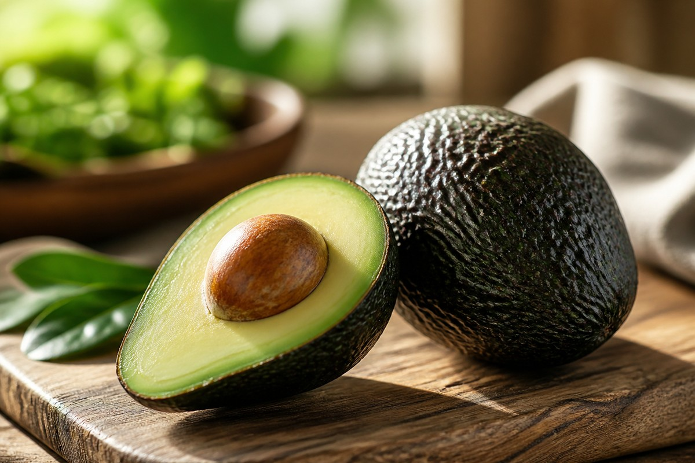

*▲ Regarded in nutritional science as 'nature’s butter', the Hass avocado (Persea americana) represents a unique botanical fruit characterized by high-density monounsaturated oleic acid, exceptional potassium concentrations surpassing bananas, and lipophilic carotenoid antioxidants.*

Within contemporary clinical nutrition and metabolic biochemistry, the **avocado** occupies a distinguished therapeutic position. Unlike conventional botanical fruits dominated by simple mono- and disaccharides, the avocado delivers over 70% of its caloric load in the form of cardioprotective lipid fractions.

Predominant among these is **oleic acid (18:1 cis-9)**, an omega-9 monounsaturated fatty acid (MUFA) renowned for stabilizing vascular endothelial membranes, attenuating systemic low-grade inflammation, and suppressing the atherogenic oxidation of low-density lipoproteins (LDL).

Furthermore, a standard 100-gram edible portion supplies approximately 485 mg of **potassium**, significantly exceeding equivalent servings of bananas (358 mg). Coupled with 6.7 grams of gut-microbiome-modulating prebiotic fiber and retinal-protective **lutein**, the avocado serves as an elite functional food matrix for counteracting metabolic syndrome and insulin resistance.

Drawing from authoritative analytical datasets in the USDA FoodData Central and landmark peer-reviewed randomized controlled trials (RCTs), this treatise examines the quantitative lipidomics of the avocado, its physiological mechanisms, and optimal culinary preservation biochemistry.

---

## 1. Quantitative Nutritional Profile (Per 100g Raw Hass Avocado Edible Mass)

A 100-gram serving of raw Hass avocado yields approximately 160 kcal, exhibiting an exceptionally low glycemic impact (GI < 15) with less than 1 gram of total sugars.

| Nutrient | Amount (per 100g) | Daily Value (% DV) |
| :--- | :--- | :--- |
| **Energy** | 160 kcal | 8.0% |
| **Carbohydrates** | 8.53 g | 3.1% |
| - Total Sugars | 0.66 g | Daily value not established |
| - Dietary Fiber | 6.70 g | 23.9% |
| **Protein** | 2.00 g | 4.0% |
| **Total Fat** | 14.66 g | 18.8% |
| - Saturated Fat | 2.13 g | 10.7% |
| - Monounsaturated Fat (MUFA, Oleic) | 9.80 g | Daily value not established |
| - Polyunsaturated Fat (PUFA) | 1.82 g | Daily value not established |
| **Potassium (K)** | 485.00 mg | 10.3% |
| **Magnesium (Mg)** | 29.00 mg | 6.9% |
| **Folate (Vitamin B9)** | 81.00 mcg | 20.3% |
| **Vitamin E (Alpha-tocopherol)** | 2.07 mg | 13.8% |
| **Vitamin K1 (Phylloquinone)** | 21.00 mcg | 17.5% |
| **Vitamin C (Ascorbic Acid)** | 10.00 mg | 11.1% |
| **Vitamin B6 (Pyridoxine)** | 0.26 mg | 15.3% |
| **Lutein + Zeaxanthin** | 271.00 mcg | Daily value not established |
| **Beta-sitosterol (Phytosterols)** | 76.00 mg | Daily value not established |
| **Water** | 73.23 g | Special classification¹ |

*※ Source: USDA FoodData Central Analytical Repository.*  
*¹ Water constitutes the stabilizing continuous aqueous phase maintaining delicate lipid emulsification in intact avocado parenchyma.*

---

## 2. Four Clinically Validated Biological Benefits

### 1) Monounsaturated Oleic Acid & Endothelial Atheroprotection
Monounsaturated oleic acid preserves arterial endothelial integrity by upregulating endothelial nitric oxide synthase (eNOS) and reducing vascular cell adhesion molecule-1 (VCAM-1) expression. Rigorous clinical trials from Pennsylvania State University demonstrated that an avocado-enriched diet significantly lowered circulating concentrations of small, dense oxidized LDL (oxLDL) particles. In tandem, intrinsic **beta-sitosterol** competitively inhibits intestinal micellar absorption of exogenous cholesterol, reinforcing systemic lipid homeostasis.

### 2) High Potassium Density & Vasodilatory Osmoregulation
Elevated sodium-to-potassium dietary ratios represent a major driver of essential hypertension. Supplying 485 mg of bioavailable potassium per 100g, avocado consumption stimulates the renal tubular sodium-potassium ATPase pump, promoting natriuresis. Co-occurring magnesium ions act as natural calcium channel blockers, modulating vascular smooth muscle tension and dampening peripheral arterial resistance.

### 3) 6.7g Prebiotic Fiber & Postprandial Glycemic Attenuation
With 6.7 grams of dietary fiber per 100 grams, avocados supply an optimal ratio of 70% insoluble to 30% soluble fiber. Colonic fermentation of the soluble pectin fraction yields protective short-chain fatty acids (SCFAs), notably butyrate and propionate. These signaling molecules trigger intestinal L-cell secretion of glucagon-like peptide-1 (GLP-1) and peptide YY (PYY), delaying gastric emptying, curbing appetite, and enhancing peripheral insulin sensitivity.

### 4) Catalytic 'Nutrient Booster' for Fat-Soluble Carotenoids
Beyond intrinsic retinal-protective **lutein and zeaxanthin**, the lipid emulsion within avocado pulp exhibits a profound 'nutrient booster' effect. Clinical pharmacokinetics published in *The Journal of Nutrition* demonstrated that co-ingesting avocado with carotenoid-rich vegetables amplified intestinal provitamin A (beta-carotene) absorption by up to 15-fold. The hydrophobic carotenoid molecules dissolve directly into avocado-derived lipid droplets, forming highly absorbable mixed micelles.

---

## 3. Postharvest Ripening Kinetics & Molecular Storage Chemistry

- **Sensory and Physical Ripening Stages:**
  - **Bright Emerald & Firm (Unripe):** Store at ambient room temperature (18–22°C / 65–72°F) for 3 to 5 days. Climacteric respiration and natural endogenous ethylene gas will facilitate starch-to-sugar conversion and softening.
  - **Deep Purplish-Black & Yielding (Peak Maturity):** The fruit yields gently to slight thumb pressure near the pedicel (stem). At this juncture, the lipid profile and sensory aromatics achieve optimal organoleptic balance.
  - **Dull Pitch Black & Sunken (Overmature):** Parenchymal cell breakdown leads to oxidative degradation, internal vascular browning, and rancid off-notes.
- **Accelerating Ripening:** Enclosing firm avocados within a paper bag alongside an ethylene-emitting agent (such as an apple or banana) concentrates gaseous phytohormones, reducing ripening duration by 24 to 48 hours.
- **Preventing Enzymatic Polyphenol Oxidase (PPO) Browning:** Slicing exposes cellular polyphenol oxidases to atmospheric oxygen, catalyzing the polymerization of phenols into dark quinones and melanins. To arrest this reaction, coat the exposed cut surface with an acidic barrier (lemon or lime juice, which lowers pH below PPO enzymatic thresholds) or a thin film of extra virgin olive oil, then wrap tightly in impermeable barrier film. Alternatively, storing the half with sliced raw onion provides volatile sulfur gases that inhibit PPO activity.

---

## 4. Potential Contraindications and Clinical Considerations

- **Latex-Fruit Syndrome:** Individuals with known immunoglobulin E (IgE)-mediated latex allergies may display cross-reactivity to class I chitinases and hevein-like protein domains within avocados, potentially provoking oral allergy symptoms, urticaria, or bronchospasm.
- **Caloric and Lipophilic Density:** While predominantly composed of cardioprotective fats, an entire medium-to-large avocado delivers 250 to 320 kcal. Individuals undergoing strict energy-restricted dietary interventions should moderate consumption to half an avocado (approximately 75–100g) per serving.

---

## 5. Synergistic Food Pairings for Maximum Bioavailability

- **[Carrot]({{ site.baseurl }}/en/posts/carrot-nutrition-benefits/)**: Carotenoids in raw carrots possess poor gastrointestinal bioaccessibility. The monounsaturated lipid matrix of avocado solubilizes fat-soluble beta-carotene, elevating systemic absorption by up to 1000%.
- **[Egg]({{ site.baseurl }}/en/posts/egg-nutrition-benefits/)**: Combining the BV 100 complete protein and choline of whole eggs with the oleic acid and fiber of avocado establishes an elite ketogenic and low-glycemic metabolic breakfast.
- **[Tomato]({{ site.baseurl }}/en/posts/tomato-nutrition-benefits/)**: Lipophilic lycopene from tomatoes incorporates smoothly into avocado micellar lipid droplets, maximizing systemic vascular anti-inflammatory protection.

---

## 6. Frequently Asked Questions (FAQ)

### Q1. Will the high fat content in avocados cause weight gain during a calorie-controlled diet?
**A:** In randomized metabolic trials, moderate avocado consumption (half a fruit daily) does not promote weight gain and frequently aids weight management. Its monounsaturated fatty acids exhibit higher postprandial fat oxidation rates compared to saturated fats, while the dense 6.7g fiber matrix sustains satiety and reduces subsequent meal caloric intake.

### Q2. Can I store rock-hard, unripe avocados directly in the refrigerator?
**A:** No. Placing unripe avocados in the refrigerator induces chilling injury (temperatures below 5°C / 41°F arrest normal climacteric ripening enzymes). The flesh becomes rubbery, fails to soften uniformly, and turns greyish-black internally upon subsequent exposure to warmth. Always ripen at room temperature first before refrigerating.

### Q3. Are the dark stringy fibers inside an avocado safe to consume?
**A:** Yes, they are entirely non-toxic. These dark strands represent mature vascular bundles (xylem and phloem tissue) that transported water and minerals during fruit development. While structurally tough and visually unappealing due to enzymatic oxidation, they present no pathological risk and can simply be scooped away.

---

## 7. Key Takeaways and Practical Summary

- **Core Nutritional Density:** 160 kcal, 9.8g oleic acid, 485mg potassium, 6.7g dietary fiber, and 2.07mg vitamin E per 100g.
- **Culinary Handling:** Ripen at room temperature until peel turns dark green-black; refrigerate only after maturity; apply citrus juice or olive oil to cut surfaces to arrest PPO browning.
- **Bioavailability Synergy:** Pair with [Carrot]({{ site.baseurl }}/en/posts/carrot-nutrition-benefits/) and [Tomato]({{ site.baseurl }}/en/posts/tomato-nutrition-benefits/) to multiply fat-soluble carotenoid absorption up to fifteenfold.
