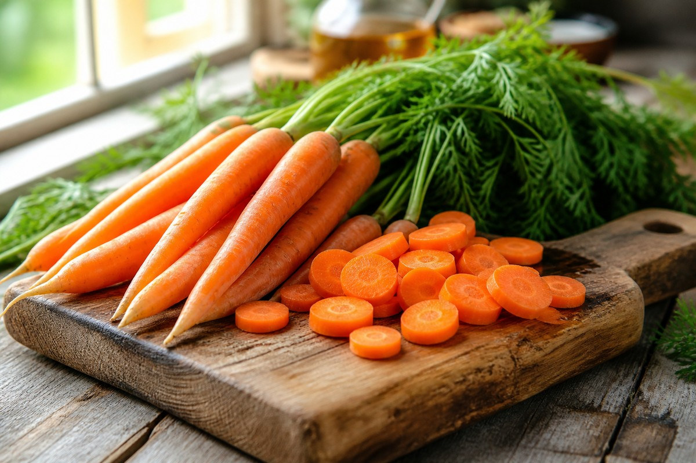

*▲ Revered across clinical dietetics as nature's premier provitamin A reservoir, the domesticated carrot (Daucus carota subsp. sativus) supplies therapeutic concentrations of lipophilic beta- and alpha-carotenes, gastroprotective pectins, and bioactive polyacetylenes like falcarinol.*

Within preventative oncology and visual physiology, the **carrot** serves as an indispensable dietary cornerstone. Characterized by its intense orange chromoplast pigmentation, this root vegetable delivers exceptional concentrations of **beta-carotene** alongside structural **alpha-carotene**.

Upon intestinal absorption, these provitamin A carotenoids undergo enzymatic central cleavage via beta-carotene 15,15'-oxygenase (BCO1) within enterocytes, yielding active **retinal**. This biochemical intermediate couples with opsin to synthesize **rhodopsin**, the fundamental visual photopigment of retinal rod photoreceptors responsible for scotopic vision and dark adaptation.

Beyond visual biochemistry, intact carrots house high-affinity natural polyacetylenic oxylipins—predominantly **falcarinol [heptadeca-1,9-dien-4,6-diyn-3-ol]** and falcarindiol. Concentrated within the outer periderm and phloem tissue, falcarinol exerts potent anti-proliferative actions against neoplastic cell growth in the colonic epithelium.

Synthesizing analytical datasets from the USDA FoodData Central and landmark peer-reviewed pharmacokinetic trials, this treatise delineates the quantitative nutritional profile of carrots, their clinical health outcomes, and the culinary thermal kinetics required to unlock lipophilic carotenoid bioavailability.

---

## 1. Quantitative Nutritional Profile (Per 100g Raw Mature Carrot Edible Mass)

A standard 100-gram serving of raw mature carrots provides an exceptionally light caloric burden of 41 kcal, with an 88% aqueous volume that provides pronounced postprandial satiety.

| Nutrient | Amount (per 100g) | Daily Value (% DV) |
| :--- | :--- | :--- |
| **Energy** | 41 kcal | 2.1% |
| **Carbohydrates** | 9.58 g | 3.5% |
| - Total Sugars | 4.74 g | Daily value not established |
| - Dietary Fiber | 2.80 g | 10.0% |
| **Protein** | 0.93 g | 1.9% |
| **Total Fat** | 0.24 g | 0.3% |
| - Saturated Fat | 0.04 g | 0.2% |
| - Monounsaturated Fat (MUFA) | 0.01 g | Daily value not established |
| - Polyunsaturated Fat (PUFA) | 0.12 g | Daily value not established |
| **Vitamin A (RAE)** | 835.00 mcg | 92.8% |
| **- Beta-carotene** | 8,285.00 mcg | Daily value not established |
| **- Alpha-carotene** | 3,477.00 mcg | Daily value not established |
| **Lutein + Zeaxanthin** | 256.00 mcg | Daily value not established |
| **Vitamin K1 (Phylloquinone)** | 13.20 mcg | 11.0% |
| **Potassium (K)** | 320.00 mg | 6.8% |
| **Vitamin C (Ascorbic Acid)** | 5.90 mg | 6.6% |
| **Vitamin B6 (Pyridoxine)** | 0.14 mg | 8.2% |
| **Falcarinol** | Present (bioactive polyacetylene) | Daily value not established |
| **Water** | 88.29 g | Special classification¹ |

*※ Source: USDA FoodData Central Analytical Repository.*  
*¹ Intracellular water maintains cell turgor pressure and stabilizes carotenoid pigment crystals embedded in chromoplast matrices.*

---

## 2. Four Clinically Validated Biological Benefits

### 1) Enzymatic BCO1 Cleavage & Retinal Rhodopsin Resynthesis
Carrots deliver 8,285 mcg of beta-carotene per 100 grams, supplying nearly 100% of the recommended daily intake of vitamin A in its non-toxic provitamin form. In the brush border of the small intestine, BCO1 cleaves beta-carotene symmetrically into two retinal molecules. Retinal is transported to the retinal pigment epithelium to sustain the visual cycle, accelerating dark adaptation, preventing night blindness (nyctalopia), and inhibiting corneal epithelial xerosis.

### 2) Polyacetylene Falcarinol & Colorectal Chemoprevention
Extensive research from Newcastle University demonstrated that the natural fungal defense compound **falcarinol** markedly suppresses aberrant crypt foci (ACF) formation in the mammalian large intestine. Mechanistically, falcarinol modulates the Keap1-Nrf2 stress-response pathway, inducing phase II cytoprotective enzymes while triggering targeted apoptosis in preneoplastic enterocytes without harming healthy mucosa.

### 3) Soluble Pectin Fiber & Bile Acid Sequestration
The 2.8 grams of dietary fiber in carrots consists of roughly 50% soluble pectin. Within the intestinal lumen, hydrated pectin forms an amorphous viscous gel that binds circulating conjugated bile acids, preventing their reabsorption in the terminal ileum. This forces the liver to upregulate low-density lipoprotein (LDL) receptors and draw on systemic cholesterol reserves to replenish the bile acid pool, reducing serum atherogenic cholesterol.

### 4) Alpha-Carotene Density & Vascular Endothelial Resilience
Beyond beta-carotene, carrots are among the densest dietary sources of **alpha-carotene** (3,477 mcg per 100g). Large-scale longitudinal cohort studies, such as the Third National Health and Nutrition Examination Survey (NHANES III), established that elevated serum alpha-carotene levels correlate strongly with reduced all-cause and cardiovascular mortality, conferring superior quenching kinetics against reactive oxygen species (ROS) in vascular smooth muscle.

---

## 3. Raw vs. Lipid-Co-ingested Culinary Thermodynamics & Bioavailability

- **The Bioavailability Paradox of Raw Carrots (<10%):**
  - In raw carrots, carotenoids reside in crystalline form entrapped within dense cellulose and pectin cell-wall matrices.
  - Because human digestive enzymes lack cellulases, masticating raw carrots liberates less than 10% of total carotenoids into absorbable micellar phases.
- **Thermal Processing & Lipid Solubilization (>60–70%):**
  - Gentle thermal cooking (such as steaming or sautéing) denatures cell-wall polymers, breaking down the rigid pectin skeleton and releasing crystalline carotenoid aggregates.
  - Adding unsaturated lipids—such as extra virgin olive oil, eggs, or [Avocado]({{ site.baseurl }}/en/posts/avocado-nutrition-benefits/)—provides the indispensable hydrophobic solvent required for mixed micelle assembly. Clinical pharmacokinetic trials show that consuming cooked carrots with dietary fat increases serum beta-carotene absorption by up to 10-fold.

---

## 4. Potential Contraindications and Clinical Considerations

- **Benign Carotenemia:** Prolonged, excessive daily consumption of carrots or concentrated carrot juice can saturate hepatic storage and enterocyte cleavage capacity. Excess circulating carotenes deposit within the lipid-rich stratum corneum, manifesting as a yellowish-orange pigmentation on the palms, soles, and nasolabial folds. This condition is physiologically benign and completely reversible upon dietary moderation, distinguishable from hepatic jaundice by the complete absence of scleral icterus.
- **Ascorbinase Oxidation:** Mechanically crushing or grating raw carrots activates the endogenous enzyme **ascorbinase (ascorbate oxidase)**, which accelerates the oxidation of ascorbic acid (vitamin C) in mixed vegetable salads. Applying mild heat or adding acidic dressings (vinegar or lemon juice, pH < 4.0) denatures ascorbinase, preserving intrinsic vitamin C.

---

## 5. Synergistic Food Pairings for Maximum Bioavailability

- **[Avocado]({{ site.baseurl }}/en/posts/avocado-nutrition-benefits/)**: The monounsaturated oleic acid matrix in avocado pulp provides the ideal non-polar vehicle to incorporate hydrophobic beta-carotene into absorbable digestive micelles.
- **[Egg]({{ site.baseurl }}/en/posts/egg-nutrition-benefits/)**: Dietary phospholipids (lecithin) in egg yolk synergize with carrot carotenoids to optimize enterocyte uptake and support systemic ocular health.
- **[Apple]({{ site.baseurl }}/en/posts/apple-nutrition-benefits/)**: The complementary malic acid and quercetin in fresh apples mitigate raw carrot astringency while offering synergistic pectin fiber for bowel motility.

---

## 6. Frequently Asked Questions (FAQ)

### Q1. Should I peel carrots before cooking or eat them with the skin intact?
**A:** Whenever possible, wash thoroughly and consume carrots with their skin intact. Bioactive falcarinol and carotenoids concentrate predominantly within the outermost periderm and underlying phloem tissues. Peeling removes up to 30% of these anti-inflammatory polyacetylenes and antioxidants. A gentle vegetable brush removes soil while preserving the dense outer nutrient layer.

### Q2. Does drinking fresh carrot juice provide the same benefits as whole carrots?
**A:** Centrifugal or masticating juicing removes insoluble cellulose and hemicellulose fibers, accelerating the rate of sugar absorption and potentially triggering rapid postprandial glucose excursions. Blending whole carrots or consuming lightly cooked root portions retains prebiotic fibers and sustains steady glycemic control.

### Q3. Why do carrots turn slimy or black during domestic refrigerator storage?
**A:** Carrots are highly susceptible to moisture-induced rot and postharvest transpiration. Storing unwashed carrots individually wrapped in absorbent paper towels inside an airtight container prevents ambient condensation. Placing them vertically mimics their natural root orientation, maintaining cellular turgor and crispness for over three weeks.

---

## 7. Key Takeaways and Practical Summary

- **Core Nutritional Density:** 41 kcal, 8,285mcg beta-carotene (93% DV Vitamin A), 3,477mcg alpha-carotene, and 2.8g fiber per 100g.
- **Culinary Optimization:** Cook lightly and pair with plant lipids to elevate provitamin A bioavailability by tenfold.
- **Bioavailability Synergy:** Combine with [Avocado]({{ site.baseurl }}/en/posts/avocado-nutrition-benefits/) or [Egg]({{ site.baseurl }}/en/posts/egg-nutrition-benefits/) for optimal micellar lipid solubilization.
