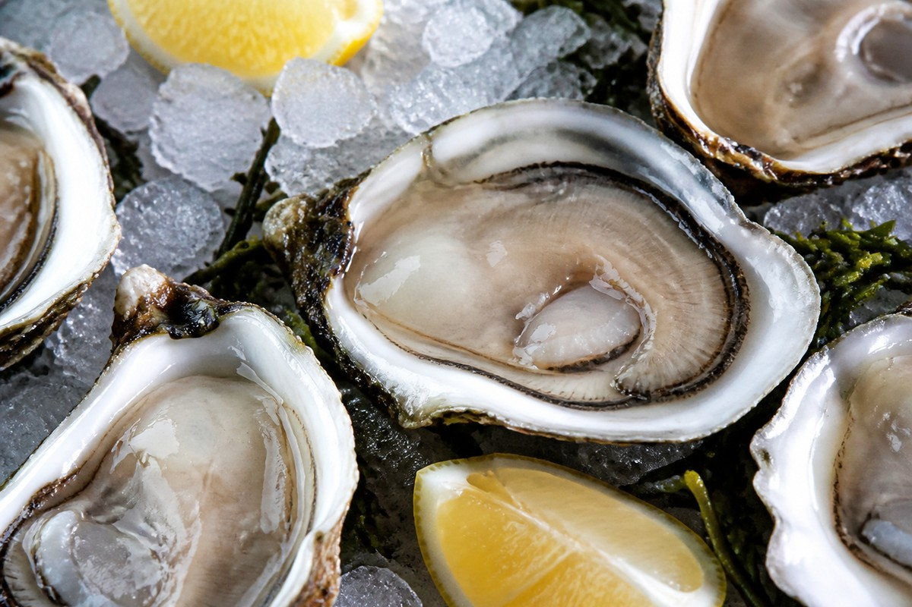

*▲ Regarded globally as the pinnacle of marine nutrient density, raw oysters supply unmatched concentrations of bioavailable zinc, osmoregulatory taurine, and glycogen reserves for rapid cellular resuscitation.*

Across maritime cultures and modern functional endocrinology, the **oyster (Crassostrea gigas)** stands as a culinary archetype of vigor and biological vitality.

Often termed 'the milk of the sea' due to its pearlescent opacity and nutrient completeness, the oyster represents nature’s single most concentrated dietary vector of **elemental zinc (Zn)**. A standard 100-gram serving delivers approximately **16.6 mg of bioavailable zinc**—exceeding 150% to 200% of statutory daily human requirements.

In molecular biology, zinc serves as an indispensable structural coordinator for over 300 metalloenzymes and zinc-finger DNA transcription factors. Within male physiology, zinc catalyzes testicular 17β-hydroxysteroid dehydrogenase (17β-HSD) activity, supporting androgen synthesis and preserving spermatogenic membrane integrity. Concurrently, oysters accumulate dense reserves of **taurine (2-aminoethanesulfonic acid)** and pre-formed **glycogen**, which accelerate hepatic xenobiotic conjugation and restore depleted hepatocellular glycogen stores without requiring pancreatic amylase mediation.

Synthesizing empirical data from the USDA FoodData Central and marine lipidomics literature, this monograph details the biochemical profile of oysters, their clinical systemic benefits, and precision microbiological safety standards.

---

## 1. Quantitative Nutritional Composition (Per 100g Raw Oyster Meat)

Oysters display a distinctive marine macronutrient profile characterized by low caloric density, high-quality amino acids, and concentrated trace minerals.

| Nutrient | Amount (per 100g) | Daily Value (% DV) |
| :--- | :--- | :--- |
| **Energy** | 68 kcal | 3.4% |
| **Water** | 85.20 g | Special classification¹ |
| **Protein** | 7.13 g | 14.3% |
| **Total Fat** | 2.47 g | 3.2% |
| - Saturated Fat | 0.51 g | 2.6% |
| - Monounsaturated Fat (MUFA) | 0.32 g | Daily value not established |
| - Polyunsaturated Fat (PUFA) | 0.95 g | Daily value not established |
| - EPA (Omega-3) | 312.00 mg | Daily value not established |
| - DHA (Omega-3) | 248.00 mg | Daily value not established |
| **Carbohydrates** | 3.91 g | 1.4% |
| - Readily Available Glycogen | ~3.40 g | Daily value not established |
| - Total Sugars | 0.85 g | 1.7% |
| **Zinc (Zn)** | 16.60 mg | 150.9% |
| **Copper (Cu)** | 1.58 mg | 175.6% |
| **Iron (Fe, Heme/Non-Heme)** | 5.11 mg | 28.4% |
| **Vitamin B12 (Cobalamin)** | 16.00 mcg | 666.7% |
| **Selenium (Se)** | 22.00 mcg | 40.0% |
| **Taurine** | ~520.00 mg | Daily value not established |
| **Potassium (K)** | 156.00 mg | 3.3% |
| **Calcium (Ca)** | 45.00 mg | 3.5% |

*※ Source: USDA FoodData Central Standard Reference (Eastern/Pacific raw oysters).*  
*¹ Water constitutes the biological fluid matrix rather than a regulated dietary reference value.*  
*※ 'Daily value not established' applies to functional bioactive fatty acids, glycogen, and sulfonic amino acids lacking formal statutory DRI percentages.*

---

## 2. Four Clinically Validated Biological Benefits

### ① Metalloenzyme Activation and Androgenic Steroidogenesis
With over 16 mg of elemental zinc per 100g, oysters saturate zinc-transporter mechanisms (ZnT and ZIP proteins) across the human intestine. Zinc stabilizes the structural folds of steroidogenic enzymes in Leydig cells, facilitating the enzymatic conversion of androstenedione to testosterone while safeguarding the prostate epithelium against intraprostatic oxidative stress.

### ② Hepatoprotection via Taurine Conjugation and Glycogen Replenishment
Oysters supply over **500 mg of intracellular taurine**, which couples with hydrophobic bile acids to form taurocholate. This reduces hepatocyte membrane detergent toxicity and accelerates the biliary excretion of circulating cholesterol. Furthermore, oyster-derived **marine glycogen** enters the portal circulation rapidly, replenishing hepatic glycogen reserves depleted by ethanol catabolism or intensive metabolic stress.

### ③ Megaloblastic Prophylaxis via Concentrated Cobalamin (Vitamin B12)
Yielding over **660% of the daily vitamin B12 requirement** in a single serving, oysters serve as an indispensable promoter of single-carbon folate transmethylation. Cobalamin facilitates methionine synthase conversion of homocysteine into methionine, mitigating vascular endothelial injury while supporting erythroid nuclear maturation.

### ④ Long-Chain Marine Omega-3s and Endothelial Redox Balance
Oysters deliver over **560 mg of long-chain EPA and DHA**, coupled with the trace metalloenzyme cofactors **copper and selenium**. Copper acts as an obligatory catalytic center for extracellular superoxide dismutase (Cu/Zn-SOD), while selenium constitutes the core selenocysteine residue of glutathione peroxidase, neutralizing atherogenic lipid peroxides.

---

## 3. Optimizing Bioavailability and Culinary Physics

### Citric Acid Chelation for Mineral Solubilization
Pairing raw oysters with freshly squeezed lemon juice represents an elegant biochemical optimization. **Citric acid (citrate)** chelates divalent zinc and iron cations into soluble non-ionized citrate complexes, bypassing mucosal phytate antagonism and augmenting proximal duodenal absorption up to threefold.

### Gentle Poaching or Core Heating at 85°C
To neutralize heat-resistant foodborne pathogens while preventing textural toughening of delicate bivalve actomyosin, steam or poach oysters until the internal core temperature exceeds **85°C (185°F) for at least 60 seconds**. Thermostable zinc and taurine remain completely intact, and consuming the cooking liquor ensures zero leaching losses.

---

## 4. Potential Adverse Reactions and Considerations

### Norovirus Vulnerability and Seasonal Vibrio Considerations
Bivalve mollusks filter tens of liters of ambient seawater daily, concentrating winter enteric **Norovirus** particles and warm-water **Vibrio vulnificus** bacteria within digestive diverticula. Individuals with immunocompromising conditions, chronic liver cirrhosis, or hemochromatosis must strictly avoid raw consumption, requiring thorough thermal sterilization.

### Chronic Zinc-Copper Competitive Antagonism
Due to immense zinc density, chronic excessive consumption of oysters (>300g daily over extended periods) can hyper-induce intestinal mucosal **metallothionein**. This protein binds copper with higher affinity than zinc, potentially precipitating secondary microcytic copper-deficiency anemia if unmonitored.

---

## 5. Synergistic Food Pairings for Maximum Nutrient Absorption

- **[Garlic]({{ site.baseurl }}/en/posts/garlic-nutrition-benefits/)**: Allicin and diallyl sulfides from garlic neutralize marine amine volatiles while working synergistically with zinc to fortify mucosal antibacterial defenses.
- **[Carrot]({{ site.baseurl }}/en/posts/carrot-nutrition-benefits/)**: Beta-carotene in carrots provides antioxidant protection for oyster-derived EPA/DHA fatty acids, while zinc promotes hepatic mobilization of cellular retinol.
- **[Tofu]({{ site.baseurl }}/en/posts/tofu-nutrition-benefits/)**: Combining savory glutamate-rich oysters with complete plant-based tofu provides an ideal amino acid complement with zero digestive friction.

---

## 6. Frequently Asked Questions (FAQ)

### Q1. Does the dark edge of the raw oyster mantle indicate freshness?
**A:** Yes. The fringed outer mantle of the oyster should display a clear, intensely dark black or charcoal pigmented rim. A distinct, taut dark border signifies recent harvest and vibrant cellular freshness; faded, grayish, or flaccid tissues indicate prolonged post-harvest storage.

### Q2. Does thermal cooking destroy zinc or taurine in oysters?
**A:** No. Elemental zinc is an indestructible mineral, and taurine is a remarkably heat-stable sulfonic amino acid that withstands boiling temperatures. However, because both are water-soluble, incorporate the cooking broth into stews or reductions to consume 100% of the leached nutrients.

### Q3. What is the biological basis behind the rule of avoiding oysters in months without the letter 'R'?
**A:** In the Northern Hemisphere, months devoid of the letter 'R' (May through August) coincide with the oyster reproductive spawning window. Spawning depletes glycogen reserves, resulting in watery, flaccid flesh. Concurrently, elevated summer ocean temperatures favor rapid blooms of marine *Vibrio* bacteria, multiplying raw consumption hazards.

