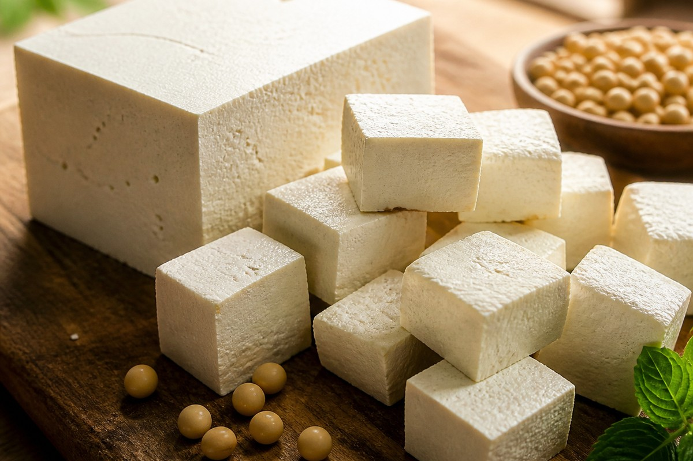

*▲ Produced by curdling fresh soymilk and pressing the curds, firm tofu serves as an ideal zero-cholesterol, complete plant protein containing all nine essential amino acids alongside dense calcium reserves.*

Quick answer <strong>Regular calcium-sulfate tofu has 76 kcal and 8.08 g protein per 100 g; 300 g gives an estimated 228 kcal and 24.2 g protein.</strong> This is one USDA reference food, not all firm tofu or brands.

## Tofu calories and protein by portion weight

| Weight | Calories (approx.) | Protein |
| --- | ---: | ---: |
| 100 g | 76 kcal | 8.1 g |
| 150 g | 114 kcal | 12.1 g |
| 200 g | 152 kcal | 16.2 g |
| 300 g | 228 kcal | 24.2 g |

Based on [USDA regular tofu prepared with calcium sulfate, FDC 172476](https://fdc.nal.usda.gov/food-details/172476/nutrients). Firm tofu, silken tofu and brands may differ; use the actual package weight and label.

In the fields of preventive cardiology and nutritional biochemistry, **tofu (bean curd)** stands as one of the most rigorously investigated plant-derived functional foods.

Tofu is made by coagulating a soybean extract, and processing removes much of the fibre and trypsin inhibitor found in whole soybeans, so its protein is easier to digest than whole beans. There is no agreed figure for comparing tofu with whole soybeans as a percentage, so no multiple is claimed. Tofu supplies plant protein with all nine essential amino acids.

Beyond delivering complete essential amino acids, tofu functions as nature’s densest nutritional vector of **soy isoflavones (genistein and daidzein)**. These diphenolic compounds display selective estrogen receptor modulator (SERM) properties, attenuating osteoclastic bone resorption in estrogen-deficient postmenopausal states while protecting arterial endothelial architecture. Furthermore, the storage globulins **glycinin and beta-conglycinin** stimulate hepatic low-density lipoprotein (LDL) clearance through transcription factor modulation.

The nutrition table uses USDA's regular calcium-sulfate tofu entry; other varieties differ.

---

## 1. How Many Calories Are in Tofu? (8.08 g protein, 350 mg calcium per 100 g)

The following table describes regular calcium-sulfate tofu, not a universal firm-tofu value.

| Nutrient | Amount (per 100g) | Daily Value (% DV) |
| :--- | :--- | :--- |
| **Energy** | 76 kcal | 3.8% |
| **Water** | 84.60 g | Special classification¹ |
| **Protein** | 8.08 g | 16.2% |
| - Leucine (BCAA) | 0.65 g | Daily value not established |
| - Arginine | 0.64 g | Daily value not established |
| **Total Fat** | 4.78 g | 6.1% |
| - Saturated Fat | 0.69 g | 3.5% |
| - Monounsaturated Fat (MUFA) | 1.05 g | Daily value not established |
| - Polyunsaturated Fat (PUFA) | 2.70 g | Daily value not established |
| - Cholesterol | 0.00 mg | 0.0% |
| **Carbohydrates** | 1.87 g | 0.7% |
| - Total Sugars | 0.50 g | 1.0% |
| - Dietary Fiber | 0.30 g | 1.1% |
| **Calcium (Ca)** | 350.00 mg | 26.9% |
| **Iron (Fe)** | 5.36 mg | 29.8% |
| **Magnesium (Mg)** | 58.00 mg | 13.8% |
| **Phosphorus (P)** | 121.00 mg | 9.7% |
| **Potassium (K)** | 121.00 mg | 2.6% |
| **Zinc (Zn)** | 0.80 mg | 7.3% |
| **Total Isoflavones (Aglycone equivalents)** | 23.50 mg | Daily value not established |

*Source: [USDA FoodData Central, regular tofu prepared with calcium sulfate, FDC 172476](https://fdc.nal.usda.gov/food-details/172476/nutrients).*
*¹ Water constitutes the biological hydration matrix rather than a regulated dietary intake value.*  
*※ 'Daily value not established' applies to functional bioactive lipids, amino acids, and polyphenols devoid of formal statutory DRI percentage baselines.*

---

## 2. What Are the Benefits of Tofu? Four Evidence-Backed Effects

### ① Hepatic SREBP-2 Activation and Serum LDL-C Reduction
Soy storage globulins, particularly the **7S (beta-conglycinin) and 11S (glycinin)** fractions, disrupt intestinal micellar cholesterol solubilization, enhancing fecal neutral sterol excretion. Concurrently, these biopeptides upregulate sterol regulatory element-binding protein 2 (**SREBP-2**) in hepatocytes, increasing cell-surface **LDL-receptor (LDL-R)** transcription. This accelerates systemic clearance of circulating atherogenic apolipoprotein B-100 particles.

### ② Selective Estrogen Receptor Modulation (SERM) and Skeletal Preservation
The primary soy isoflavone **genistein** exhibits high-affinity binding to **Estrogen Receptor beta (ER-β)**. In postmenopausal physiology characterized by ovarian hypoestrogenism, genistein downregulates receptor activator of nuclear factor-kappa B ligand (**RANKL**), suppressing excessive osteoclastic bone demineralization while stimulating osteoblastic alkaline phosphatase synthesis.

### ③ Non-Dairy Calcium Bioavailability and Skeletal Mineralization
This USDA reference food contains 350 mg calcium per 100 g. Calcium content varies by coagulant and manufacturing; eating tofu does not establish prevention or treatment of bone disease.

### ④ Cytoprotective Saponins and Endothelial Nitric Oxide Synthesis
Tofu contains **soyasaponins**, which reduce lipid peroxidation in laboratory experiments. Tofu also has a high arginine-to-lysine ratio, and arginine is the substrate for endothelial nitric oxide synthase, but whether tofu lowers peripheral arterial resistance in people is not established.

---

## 3. Does Cooking Change Tofu Nutrition? Grilling vs Simmering

### Gentle Blanching and Hydrothermal Activation
Firm tofu achieves maximal textural tenderness and protein digestibility when simmered for 90 to 120 seconds in lightly salted water. This osmotic pre-treatment expels residual bitter coagulant brine while gently hydrating internal soy globulin networks.

### Co-Ingestion with Lipophilic Carotenoid Vegetables
Although low in saturated fats, tofu possesses an ideal polyunsaturated lipid emulsion matrix. Sautéing tofu alongside carotenoid-rich botanicals (such as carrots or tomatoes) enhances intestinal micellization and systemic absorption of lipophilic provitamin A and lycopene up to tenfold.

---

## 4. Who Should Avoid Tofu? Side Effects and Cautions

### Dietary Oxalate Management in Calcium-Oxalate Nephrolithiasis
Tofu contains moderate levels of soluble and insoluble plant oxalates derived from raw soybeans. Individuals with established idiopathic hyperoxaluria or recurrent calcium-oxalate kidney stone diatheses should consume tofu alongside ample hydration (minimum 2.5 L daily) and avoid combining it with concentrated spinach purees.

### Goitrogenic Considerations in Severe Iodine Insufficiency
In vitro research suggests that supraphysiological concentrations of unfermented isoflavones may inhibit thyroid peroxidase (TPO) catalyzed iodination. In populations maintaining adequate dietary iodine (via seaweed, iodized salt, or seafood), standard tofu consumption does not impair thyroxine biosynthesis.

---

## 5. Storing and Portioning Tofu

- **[Carrot]({{ site.baseurl }}/en/posts/carrot-nutrition-benefits/)**: The polyunsaturated lipid emulsion in tofu accelerates the intestinal micellization and mucosal absorption of carrot-derived beta-carotene and falcarinol.
- **[Egg]({{ site.baseurl }}/en/posts/egg-nutrition-benefits/)**: Combining plant-based tofu with whole egg proteins creates a synergistic amino acid balance, bridging mutual limiting amino acids (methionine and lysine) to achieve a biological score of 100.
- **[Tomato]({{ site.baseurl }}/en/posts/tomato-nutrition-benefits/)**: Natural malic and citric acids in tomatoes enhance gastric hydrochloric acid production, speeding peptic digestion of dense soy globulins while promoting lycopene bioavailability.

---

## 6. Frequently Asked Questions (FAQ)

### Q1. Does daily tofu consumption cause feminization or gynecomastia in men?
**A:** No. Extensive clinical meta-analyses demonstrate that soy isoflavones do not alter bioavailable serum testosterone, free testosterone, or estrogen levels in men. Isoflavones possess weak, selective receptor affinities (1/1,000th of endogenous estradiol) and actually exhibit protective actions against benign prostatic hyperplasia.

### Q2. How does firm tofu compare nutritionally to silken or soft tofu?
**A:** Firm tofu undergoes vigorous hydraulic pressing, discarding excess whey water. Consequently, firm tofu delivers nearly twice the protein, calcium, and iron density per 100 grams compared to high-moisture silken or soft tofu varieties.

### Q3. Does freezing tofu truly alter its nutritional density?
**A:** Freezing does not synthesize new nutrients, but it physically transforms water into ice crystals, creating a porous sponge structure. Upon thawing and pressing, expelling this water condenses dry-matter nutrients, multiplying protein density per unit volume up to fivefold.

  
📌 Related ranking guide

  <ul>
    <li><a href="/en/posts/high-protein-foods-ranking/">Top 10 High-Protein Foods: Grams per 100g and 100 kcal</a></li>
    <li><a href="/en/posts/low-calorie-high-satiety-foods/">Top 10 Low-Calorie High-Satiety Foods: 100g Calories</a></li>
    <li><a href="/en/posts/natto-nutrition-benefits/">Natto Nutrition: 212 Calories, Vitamin K2 MK-7, Nattokinase</a></li>
  </ul>

