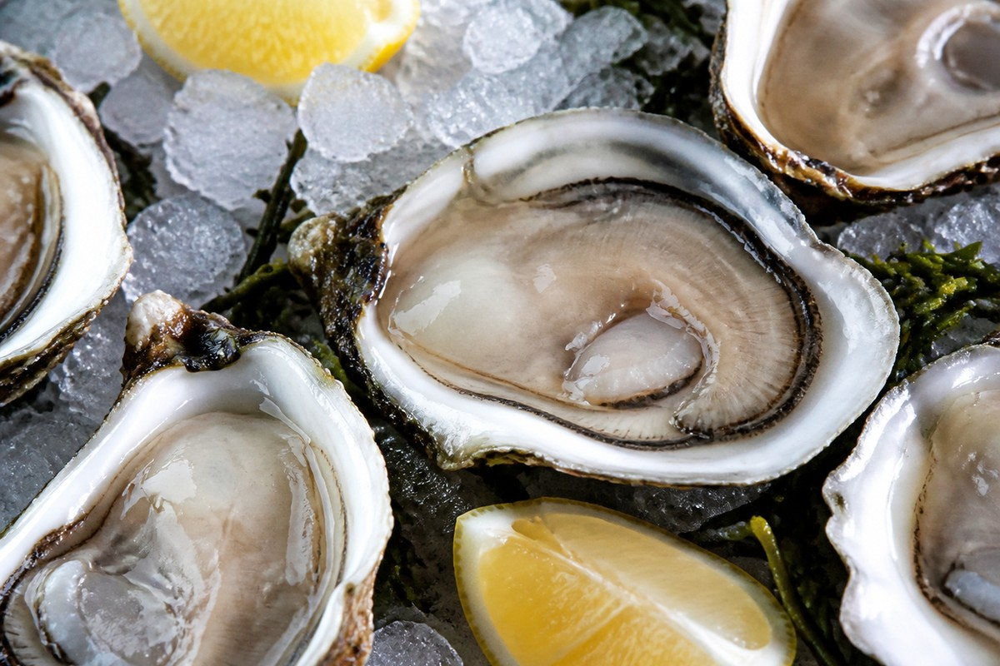

*▲ '바다의 완전식품'이자 '바다의 우유'로 불리는 굴(Oyster)은 전 식품군 중 압도적인 아연(Zinc) 함량과 고농도 타우린, 간에 즉각 활력을 불어넣는 글리코겐이 응축된 해양 생화학의 정점입니다.*

가을부터 겨울철(11월~2월)에 걸쳐 살이 차오르는 **굴(Oyster)**은 동서양을 막론하고 고대 로마 황제들과 나폴레옹, 카사노바가 사랑한 천연 자양강장 슈퍼푸드입니다.

굴이 '바다의 우유'라는 찬사를 받는 이유는 우유처럼 뽀얀 유백색 육질뿐만 아니라, 인체 대사 조절에 필수적인 미량 미네랄과 아미노산이 경이로운 비율로 녹아들어 있기 때문입니다. 특히 굴 100g에는 성인 남녀 일일 권장량의 **200~300%에 육박하는 천연 생체이용성 아연(Zinc)**이 함유되어 있어, 자연계의 모든 단일 식재료를 압도합니다.

아연은 DNA 전사 인자인 아연 핑거(Zinc Finger) 단백질의 필수 구성체이며, 남성의 테스토스테론 합성 효소를 촉진하고 정자 형성 및 전립선 상피세포를 보호합니다. 또한 굴의 특유의 단맛을 내는 고밀도 **글리코겐(Glycogen)**은 섭취 즉시 포도당으로 분해되어 간의 피로를 씻어내며, 함황 아미노산인 **타우린(Taurine)**은 담즙산 합성을 촉진하여 혈중 콜레스테롤을 배출하고 간세포막의 산화를 방어합니다.

미국 농무부(USDA) 및 해양수산 표준 분석 데이터를 기초로 굴의 정밀 영양 성분 프로필과 4대 핵심 효능, 노로바이러스 걱정 없는 안전한 섭취 과학을 종합 분석합니다.

---

## 1. 굴 영양 성분 정밀 분석표 (가열 조리 전 생굴 육질 100g 기준)

굴은 수분 85%와 함께 저지방 양질의 단백질, 그리고 극소량 섭취로도 일일 미네랄 요구량을 초과 달성하는 초고농축 미량영양소의 보고입니다.

| 영양 성분 (Nutrient) | 함량 (100g당) | 1일 권장 섭취량 비율 (한국인 성인 기준) |
| :--- | :--- | :--- |
| **열량 (Energy)** | 68 kcal | 3.4% |
| **수분 (Water)** | 85.20 g | 별도 표기¹ |
| **단백질 (Protein)** | 7.13 g | 13.0% |
| **지방 (Total Fat)** | 2.47 g | 4.6% |
| - 포화지방산 (Saturated Fat) | 0.51 g | 3.4% |
| - 단일불포화지방산 (MUFA) | 0.32 g | 기준치 없음 |
| - 다가불포화지방산 (PUFA) | 0.95 g | 기준치 없음 |
| - EPA (오메가-3) | 312.00 mg | 기준치 없음 |
| - DHA (오메가-3) | 248.00 mg | 기준치 없음 |
| **탄수화물 (Carbohydrates)** | 3.91 g | 1.2% |
| - 글리코겐 (Glycogen) | 약 3.40 g | 기준치 없음 |
| - 당류 (Total Sugars) | 0.85 g | 0.9% |
| **아연 (Zinc, Zn)** | 16.60 mg | 195.3% |
| **구리 (Copper, Cu)** | 1.58 mg | 197.5% |
| **철분 (Iron, Fe)** | 5.11 mg | 42.6% |
| **비타민 B12 (코발라민)** | 16.00 mcg | 666.7% |
| **셀레늄 (Selenium, Se)** | 22.00 mcg | 40.0% |
| **타우린 (Taurine)** | 약 520.00 mg | 기준치 없음 |
| **칼륨 (Potassium, K)** | 156.00 mg | 4.5% |
| **칼슘 (Calcium, Ca)** | 45.00 mg | 6.4% |

*※ 출처: 미국 농무부(USDA FoodData Central) 표준 분석 데이터.*  
*¹ 수분은 체액 항상성 유지를 위한 기본 용매로 분류됩니다.*  
*※ '기준치 없음' 표기는 기능성 아미노산·지방산 및 대사산물로 DRI상 일일 권장 백분율(%DV)이 법적으로 규정되지 않은 항목입니다.*

---

## 2. 과학적으로 입증된 굴의 4대 건강 효능

### ① 천연 아연 기반 테스토스테론 생합성 및 면역 세포 증식
굴 100g에는 일일 요구량의 2배에 달하는 **16.6mg 이상의 아연**이 이온화된 형태로 결합되어 있어 합성 영양제 대비 장내 흡수율이 탁월합니다. 아연은 정소 내 라이디히 세포(Leydig cell)의 테스토스테론 전환 효소(17β-HSD)를 자극하여 호르몬 합성을 촉진하고, 정자의 운동성과 세포막 안정성을 보존합니다. 또한 T림프구와 자연살해(NK) 세포의 클론 증식을 지휘하여 바이러스 감염에 대한 1차 면역 방어선을 강화합니다.

### ② 타우린과 글리코겐의 강력한 간세포 해독 및 숙취 해소 작용
굴에 농축된 **500mg 이상의 타우린**은 간세포 내 담즙산염과 결합하여 타우로콜산(Taurocholic acid)을 형성합니다. 이는 간 내 독성 담즙산 축적을 억제하고 혈중 중성지방과 LDL 콜레스테롤 배설을 가속합니다. 아울러 소화 효소를 거치지 않고 혈류로 직행하는 고품질 **글리코겐**은 간의 글리코겐 저장고를 신속히 재충전하여 알코올 분해 시 소모되는 간세포 ATP 에너지를 즉각 복구합니다.

### ③ 비타민 B12와 헴철(Heme Iron)의 적혈구 조혈 시너지
굴 100g은 성인 일일 요구량의 무려 **6.6배(16.0mcg)에 달하는 비타민 B12**와 5.1mg의 철분을 동시에 제공합니다. 비타민 B12는 엽산(Folate) 대사를 중개하여 골수 세포에서 거대적모구 빈혈(Pernicious Anemia) 없이 건강한 정상 적혈구가 성숙 분열하도록 돕고, 말초 신경계 수초(Myelin sheath) 탈락을 방지합니다.

### ④ 오메가-3와 구리·셀레늄의 심혈관 내피세포 항산화 방어선
굴은 해산물 특유의 긴 사슬 오메가-3 지방산인 **EPA와 DHA를 560mg** 함유하고 있습니다. 여기에 체내 슈퍼옥사이드 디스뮤타아제(Cu/Zn-SOD)의 필수 보조인자인 **구리(Cu)**와 글루타치온 과산화효소의 주성분인 **셀레늄(Se)**이 결합하여 혈관 내피세포의 산화 스트레스를 무력화하고 혈전 생성을 차단합니다.

---

## 3. 유효 성분 흡수율을 극대화하는 섭취 가이드

### 레몬즙(구연산)과의 결합으로 아연·철분 킬레이트 흡수율 극대화
생굴에 레몬즙을 뿌려 먹는 것은 단순한 미식의 조화가 아니라 정밀한 생화학적 섭취법입니다. 레몬의 **구연산(Citric Acid)**은 굴에 함유된 난용성 아연과 철분을 가용성 구연산염 킬레이트 복합체로 변환시켜 소장 십이지장 점막에서의 미네랄 흡수율을 2~3배 이상 폭발적으로 증대시킵니다. 또한 강한 산성이 굴 표면의 유해 세균을 살균하고 비린내 원인 염기를 중화합니다.

### 무즙을 활용한 불순물 흡착 및 85℃ 가열 조리
생굴을 세척할 때 굵은 소금 대신 강판에 간 무즙에 5분간 버무려두면 무의 디아스타아제 효소와 섬유질 입자가 굴 주름 사이의 미세 뻘과 중금속, 불순물을 완벽히 흡착하여 굴의 탄력을 보존합니다.

---

## 4. 섭취 시 주의사항 및 잠재적 부작용

### 겨울철 노로바이러스(Norovirus) 감염 위험과 중심온도 가열
겨울철 굴 섭취 시 가장 주의해야 할 것은 패류 여과 섭식 과정에서 내장에 농축되는 노로바이러스입니다. 노로바이러스는 영하 20℃에서도 생존하며 알코올이나 소금물로 사멸되지 않습니다. 면역력이 약한 어린이나 임산부, 노약자는 반드시 굴 중심부 온도를 **85℃ 이상에서 1분 이상** 충분히 가열 조리(굴국, 굴찜, 굴전)하여 섭취해야 식중독을 완벽히 차단할 수 있습니다.

### 고농도 아연 과다 섭취에 따른 구리 결핍 주의
굴은 아연 함량이 워낙 압도적이므로 하루에 수십 개(300~500g 이상)를 매일 연속해서 장기 섭취할 경우 장내 금속 결합 단백질인 메탈로티오네인(Metallothionein)이 과잉 유도되어 구리(Cu) 흡수가 방해받고 면역 저하가 올 수 있습니다. 하루 5~8알(약 100~150g) 내외로 적정량을 즐기는 것이 가장 이상적입니다.

---

## 5. 최종 요약 및 실천 팁

1. **자연계 최고의 천연 아연 보고:** 100g만으로 일일 아연의 200%를 충족하여 남성호르몬과 면역을 수호합니다.
2. **간 피로를 씻어내는 타우린과 글리코겐:** 담즙산 배설 촉진과 신속한 에너지 재충전으로 숙취와 피로를 해소합니다.
3. **레몬즙 결합과 가열 조리:** 구연산으로 미네랄 흡수율을 높이고, 장염 위험이 있을 때는 85℃ 이상 가열하여 안전하게 섭취하십시오.

---

## 6. 함께 먹으면 시너지가 폭발하는 식재료 궁합

- **[마늘 (Garlic)]({{ site.baseurl }}/posts/garlic-nutrition-benefits/)**: 마늘의 알리신 성분이 굴 특유의 비린내를 완벽히 잡고, 비타민 B1 흡수를 촉진하며 굴의 아연과 함께 면역 살균 시너지를 배가합니다.
- **[당근 (Carrot)]({{ site.baseurl }}/posts/carrot-nutrition-benefits/)**: 당근의 지용성 항산화제 베타카로틴이 굴의 오메가-3 산화를 방어하고, 굴의 아연이 체내 비타민 A 대사를 활성화하여 상피세포 재생을 돕습니다.
- **[두부 (Tofu)]({{ site.baseurl }}/posts/tofu-nutrition-benefits/)**: 굴의 글루탐산 감칠맛과 타우린이 담백한 식물성 두부 단백질과 결합하여 소화 흡수가 가장 완벽한 고단백 자양강장 보양탕을 완성합니다.

---

## 7. 자주 묻는 질문 (FAQ)

### Q1. 생굴 껍질에 붙어 있는 날개(검은 테두리) 부분이 검을수록 싱싱한 건가요?
**A:** 네, 맞습니다. 굴 가장자리의 쪼글쪼글한 검은 테두리는 외투막(Mantle) 부위로, 이 테두리 색이 선명하고 짙은 검은색을 띨수록 바다에서 갓 채취한 신선한 상태입니다. 선도가 떨어질수록 테두리 색이 흐려지고 살이 탄력을 잃고 퍼지게 됩니다.

### Q2. 굴을 익혀 먹으면 열 때문에 핵심 영양소인 아연이나 타우린이 파괴되나요?
**A:** 무기질인 아연과 유기산인 타우린은 열에 매우 안정적인 화합물로 100℃ 가열 조리에도 파괴되지 않습니다. 다만 수용성 비타민과 타우린이 국물로 우러나오므로, 굴국이나 찜 조리 시 배어 나온 국물까지 함께 드셔야 영양 손실 없이 100% 섭취할 수 있습니다.

### Q3. 여름철에는 왜 "R자가 들어가지 않은 달에는 굴을 먹지 말라"고 하나요?
**A:** 영어 철자에 'R'이 들어가지 않는 5월(May)부터 8월(August)은 굴의 산란기입니다. 산란기의 굴은 영양분이 알을 낳는 데 집중되어 살이 마르고 글리코겐이 급감하여 맛이 떨어지며, 체내에 독소(베네루핀 등)를 생성하거나 수온 상승으로 비브리오균 패혈증 위험이 급증하기 때문입니다.

