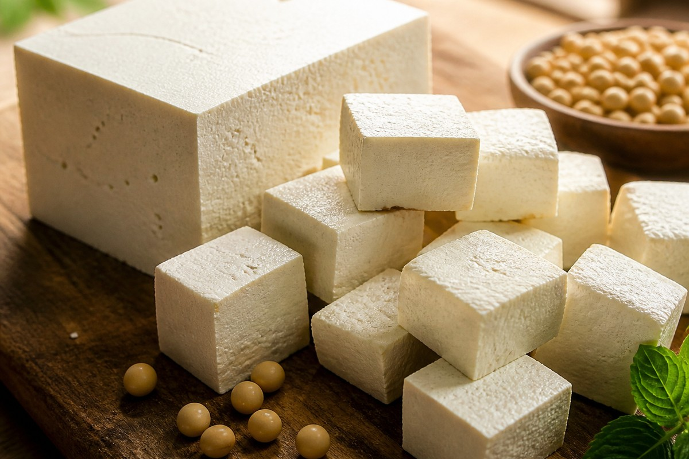

*▲ 응고제를 통해 대두의 영양을 응축한 두부(Tofu)는 동물성 포화지방과 콜레스테롤 부담 없이 필수아미노산 9종을 완벽히 공급하는 대표적인 고단백 완전식품입니다.*

한 줄 결론 <strong>황산칼슘으로 응고한 일반 두부 100g은 76kcal·단백질 8.08g, 300g 한 모는 약 228kcal·24.2g입니다.</strong> 제품의 수분과 응고제에 따라 달라지므로 포장지 영양표를 우선 확인하세요.

## 두부 반 모·한 모 칼로리와 단백질

| 무게 | 칼로리(약) | 단백질 |
| --- | ---: | ---: |
| 100g | 76kcal | 8.1g |
| 150g (300g 제품의 반 모) | 114kcal | 12.1g |
| 200g | 152kcal | 16.2g |
| 300g (예시 한 모) | 228kcal | 24.2g |

[USDA 일반 두부, 황산칼슘 응고, FDC 172476](https://fdc.nal.usda.gov/food-details/172476/nutrients) 기준 환산값입니다. 한 모는 고정된 중량이 아니며 부침용·찌개용·순두부와 제품별 성분이 다릅니다. 실제 영양표와 중량을 우선합니다.

예로부터 '밭에서 나는 쇠고기'로 불려온 **두부(Tofu)**는 대두(Soybean)의 수용성 단백질을 추출하여 응고·압착시킨 동양의 지혜이자 현대 임상 영양학에서 가장 주목받는 식물성 슈퍼푸드입니다.

두부는 콩의 섬유질과 트립신 인히비터가 제조 과정에서 상당 부분 제거되어, 콩을 통째로 먹을 때보다 단백질 소화가 수월합니다. 다만 '두부 95%, 콩 65%'처럼 정확한 수치로 비교할 만한 합의된 값은 없어 배수로 단정하지 않습니다. 두부 단백질은 필수아미노산 9종을 갖춘 식물성 단백질 공급원입니다.

두부의 **이소플라본(Isoflavone: 제니스테인, 다이드제인)**은 에스트로겐과 구조가 비슷해 폐경 후 여성의 골밀도에 도움이 될 수 있다는 연구가 있으나, 골다공증을 예방한다고 단정할 수는 없습니다. 대두 단백질을 포화지방 대신 섭취하면 LDL 콜레스테롤이 다소 낮아질 수 있습니다(미국 FDA 건강강조표시의 근거가 된 효과).

미국 농무부(USDA FoodData Central)의 표준 영양 분석 데이터를 바탕으로 두부의 정밀 영양 성분 프로필과 4대 건강 효능, 흡수율을 높이는 조리 과학 및 주의사항을 상세히 분석합니다.

---

## 1. 두부 칼로리와 영양성분은? (단백질 8.08g·칼슘 350mg)

두부는 100g당 80kcal 내외의 낮은 열량 대비 포만감이 높고, 포화지방과 당류가 극히 적은 고영양·저밀도 다이어트 단백질원입니다.

| 영양 성분 (Nutrient) | 함량 (100g당) | 1일 권장 섭취량 비율 (한국인 성인 기준) |
| :--- | :--- | :--- |
| **열량 (Energy)** | 76 kcal | 3.8% |
| **수분 (Water)** | 84.60 g | 별도 표기¹ |
| **단백질 (Protein)** | 8.08 g | 14.7% |
| - 류신 (Leucine, BCAA) | 0.65 g | 기준치 없음 |
| - 아르기닌 (Arginine) | 0.64 g | 기준치 없음 |
| **지방 (Total Fat)** | 4.78 g | 8.9% |
| - 포화지방산 (Saturated Fat) | 0.69 g | 4.6% |
| - 단일불포화지방산 (MUFA) | 1.05 g | 기준치 없음 |
| - 다가불포화지방산 (PUFA) | 2.70 g | 기준치 없음 |
| - 콜레스테롤 (Cholesterol) | 0.00 mg | 0.0% |
| **탄수화물 (Carbohydrates)** | 1.87 g | 0.6% |
| - 당류 (Total Sugars) | 0.50 g | 0.5% |
| - 식이섬유 (Dietary Fiber) | 0.30 g | 1.2% |
| **칼슘 (Calcium, Ca)** | 350.00 mg | 50.0% |
| **철분 (Iron, Fe)** | 5.36 mg | 44.7% |
| **마그네슘 (Magnesium, Mg)** | 58.00 mg | 18.4% |
| **인 (Phosphorus, P)** | 121.00 mg | 17.3% |
| **칼륨 (Potassium, K)** | 121.00 mg | 3.5% |
| **아연 (Zinc, Zn)** | 0.80 mg | 9.4% |
| **대두 이소플라본 (Total Isoflavones)** | 23.50 mg | 기준치 없음 |

*출처: [USDA FoodData Central, 일반 두부(황산칼슘 응고), FDC 172476](https://fdc.nal.usda.gov/food-details/172476/nutrients).*
*¹ 수분은 체액 항상성 유지를 위한 기본 용매로 분류됩니다.*  
*※ '기준치 없음' 표기는 기능성 아미노산·지방산 및 파이토케미컬로 DRI상 일일 권장 백분율(%DV)이 법적으로 규정되지 않은 항목입니다.*

### 1회 섭취량 환산: 두부 1/4모·1/2모·한 모는 몇 kcal인가?

국내에서 두부는 무게로 사지만 먹을 때는 모 단위로 셉니다. 부침용·찌개용 한 모를 300g으로 보고 환산했습니다(제품마다 250~400g).

| 섭취 단위 | 가식부 무게 | 열량 | 단백질 |
| :--- | :--- | :--- | :--- |
| 1/4모 | 75 g | 57 kcal | 6.06 g |
| 1/2모 | 150 g | 114 kcal | 12.12 g |
| 한 모 | 300 g | 228 kcal | 24.24 g |
| 반 컵(USDA 124g) | 124 g | 94.2 kcal | 10.02 g |

*※ 두부 한 모(300g)를 혼자 다 먹으면 228kcal·단백질 24g입니다. 한 끼 단백질을 20g 안팎으로 잡는다면 **한 모의 3분의 1~2분의 1**이 적당합니다. 물기를 빼면 무게가 줄지만 영양소 총량은 그대로입니다.*

---

## 2. 두부 효능은 무엇일까? 과학으로 입증된 4대 효과

### ① 간세포 LDL 수용체 상향 조절 및 혈관 지질 프로필 개선
두부 단백질의 핵심 펩타이드인 **글리시닌과 콘글리시닌**은 장내에서 콜레스테롤의 미셀 흡수를 방해하고 담즙산 배설을 촉진합니다. 동시에 간세포 표면의 **SREBP-2 전사 인자**를 자극하여 LDL 수용체(LDL-Receptor) 발현을 증가시킵니다. 이는 혈류 속 초저밀도 지단백(LDL)을 간으로 빠르게 회수·분해시켜 동맥경화반(Atheroma) 형성을 억제하고 혈관 내피세포의 유연성을 보존합니다.

### ② 식물성 에스트로겐(이소플라본) 기반 골밀도 유지 및 골다공증 방어
두부에 고농도로 함유된 **제니스테인(Genistein)**과 **다이드제인(Daidzein)**은 체내 에스트로겐 수용체 베타(ER-β)에 선택적으로 결합합니다. 폐경기 이후 난소 기능 저하로 에스트로겐이 고갈되면 뼈를 파괴하는 파골세포(Osteoclast)가 과도하게 활성화되는데, 이소플라본은 파골세포 분화 인자인 RANKL 신호를 차단하고 조골세포(Osteoblast)의 골기질 단백질 합성을 촉진하여 척추와 대퇴골의 골밀도 손실을 방어합니다.

### ③ 고농도 식물성 칼슘과 마그네슘의 이상적인 신경·근육 균형
이 데이터의 일반 두부는 100g당 칼슘 350mg입니다. 응고제와 제조 방식에 따라 칼슘 함량은 크게 달라집니다. 두부를 먹는다고 골질환이나 석회화를 예방한다고 단정할 수 없습니다.

### ④ 대두 사포닌 — 시험관 연구 단계
**대두 사포닌(Soyasaponin)**은 시험관 실험에서 지질 과산화를 억제하는 것으로 보고됐습니다. 사람이 두부를 먹었을 때 면역세포가 활성화되거나 돌연변이 세포 증식이 억제된다는 임상 결과는 없습니다. 두부의 실제 이점은 양질의 단백질과 칼슘 공급입니다.

---

## 3. 두부 영양은 조리법에 따라 달라질까? 굽기·끓이기 비교

### 가볍게 데치거나 찌는 수분 가열 조리 권장
두부는 이미 제조 과정에서 가열 살균 및 단백질 변성 과정을 거쳤으므로 생식으로도 소화가 우수합니다. 그러나 끓는 물에 소금을 한 꼬집 넣고 1~2분간 가볍게 데치면 응고된 단백질 매트릭스가 팽윤되어 식감이 부드러워지고 삼투압에 의해 불필요한 간수 잔여물이 배출되어 순수한 단백질 소화율이 극대화됩니다.

### 기름을 활용한 지용성 카로티노이드 채소와의 복합 조리
두부 자체는 포화지방이 거의 없지만 불포화지방산이 풍부합니다. 당근, 토마토, 시금치 등 지용성 비타민(A, E, 라이코펜, 루테인)이 풍부한 식재료와 함께 올리브유에 살짝 부쳐내면 식물성 단백질과 미세영양소의 흡수율이 동시에 상승합니다.

---

## 4. 두부 부작용과 주의할 점은?

### 요로결석 및 통풍 환자의 과량 섭취 주의
두부에는 대두 원물에서 유래한 미량의 수산(Oxalate)과 퓨린(Purine)이 포함되어 있습니다. 하루 1모(약 300g) 이상의 두부를 매일 과다하게 섭취하면서 수분 섭취가 부족할 경우 수산칼슘 결석의 위험이 증가할 수 있습니다. 결석 병력이 있거나 급성 통풍 환자는 하루 반 모(150g) 이내로 섭취량을 조절하고 충분한 물을 마셔야 합니다.

### 갑상선 기능 저하증 환자의 요오드 결핍 주의
대두 이소플라본은 갑상선 호르몬 합성을 담당하는 TPO(갑상선 과산화효소) 활성을 일부 저해할 가능성이 제기되어 있습니다. 체내 요오드가 결핍된 상태에서 과량의 두부를 섭취하면 갑상선종 위험이 생길 수 있으므로, 미역·다시마·김 등 해조류와 균형 있게 섭취하는 것이 바람직합니다.

---

## 5. 두부 하루 얼마나 먹을까? 핵심 요약

1. **식물성 단백질 공급원:** 콜레스테롤 0mg, 포화지방 부담이 적고 필수아미노산 9종과 칼슘을 공급합니다.
2. **골밀도와 혈관 지질을 지키는 이소플라본:** 제니스테인의 파골세포 억제와 간세포 LDL 수용체 활성화로 전신 대사를 개선합니다.
3. **가벼운 데침과 해조류·채소 병용:** 불필요한 잔여 염을 배출하고 요오드와 지용성 비타민을 결합하여 영양 시너지를 완성하십시오.

---

## 6. 두부와 함께 먹으면 좋은 음식은?

- **[당근 (Carrot)]({{ site.baseurl }}/posts/carrot-nutrition-benefits/)**: 당근의 카로티노이드는 지방을 포함한 식사에서 흡수에 도움을 받을 수 있지만 일정 배수의 효과를 보장하지 않습니다.
- **[달걀 (Egg)]({{ site.baseurl }}/posts/egg-nutrition-benefits/)**: 식물성 단백질의 두부와 동물성 단백질의 달걀이 만나면 상호 제한 아미노산(메티오닌-라이신)을 완벽히 보완하는 아미노산 스코어 100의 황금 밸런스를 달성합니다.
- **[토마토 (Tomato)]({{ site.baseurl }}/posts/tomato-nutrition-benefits/)**: 토마토의 라이코펜은 지용성이라 지방과 함께 먹을 때 흡수가 좋아지고, 토마토의 유기산이 두부의 담백한 풍미를 살려 줍니다.
- **[낫토 (Natto)](/posts/natto-nutrition-benefits/):** 같은 콩 단백질이지만 발효로 비타민K2와 나토키나아제가 더해진 식품입니다.

---

## 7. 자주 묻는 질문 (FAQ)

### Q1. 남성이 두부를 많이 먹으면 여성호르몬 수치가 올라가 여유증이나 탈모가 생기나요?
**A:** 근거가 부족한 걱정입니다. 두부 이소플라본은 체내 에스트로겐보다 수용체 활성이 훨씬 약하고, 임상 연구에서 통상적인 두부 섭취가 남성의 테스토스테론 수치를 의미 있게 바꿨다는 결과는 없습니다. 다만 ‘전립선 비대증과 탈모를 예방한다’는 효과도 아직 증명되지 않았습니다. 호르몬 질환이 있거나 약을 복용 중이라면 과량 섭취보다는 주치의와 상의하는 편이 좋습니다.

### Q2. 찌개용 두부와 부침용(단단한) 두부는 영양학적으로 어떤 차이가 있나요?
**A:** 수분 함량과 응고제에 따라 차이가 납니다. 단단한 부침용 두부는 압착으로 수분을 더 제거해 100g당 단백질이 연두부·순두부보다 높고, 칼슘은 응고제(황산칼슘 등)를 쓰는지에 따라 크게 달라집니다. 제품마다 차이가 있으니 포장의 영양정보를 확인하는 편이 정확합니다.

### Q3. 얼린 두부(동결 두부)를 먹으면 단백질 함량이 몇 배로 늘어난다는데 사실인가요?
**A:** 영양소가 늘어나는 것이 아니라 수분이 빠져나가 단위 중량당 밀도가 높아지는 원리입니다. 얼린 두부는 수분이 얼음 결정을 이루며 다공성 구조가 되고, 해동하면 물이 빠져 부피당 단백질·칼슘이 진해집니다. 늘어나는 정도는 얼리는 방식과 수분량에 따라 달라, ‘5~6배’처럼 정해진 배수는 없습니다.

  
📌 관련 순위 가이드

  <ul>
    <li><a href="/posts/high-protein-foods-ranking/">단백질 많은 음식 TOP 10: 100g당 함량과 흡수율 비교</a></li>
    <li><a href="/posts/low-calorie-high-satiety-foods/">저칼로리 포만감 다이어트 음식 TOP 10: 100g 비교</a></li>
  </ul>

