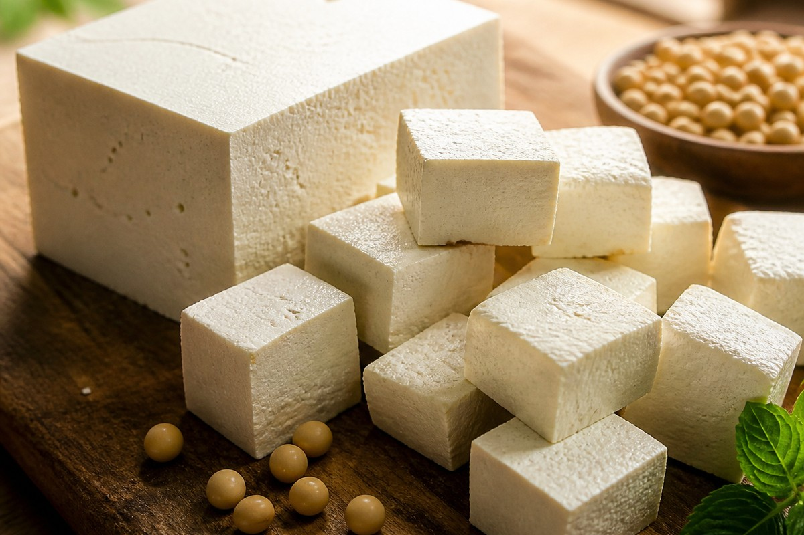

*▲ 응고제를 통해 대두의 영양을 응축한 두부(Tofu)는 동물성 포화지방과 콜레스테롤 부담 없이 필수아미노산 9종을 완벽히 공급하는 대표적인 고단백 완전식품입니다.*

예로부터 '밭에서 나는 쇠고기'로 불려온 **두부(Tofu)**는 대두(Soybean)의 수용성 단백질을 추출하여 응고·압착시킨 동양의 지혜이자 현대 임상 영양학에서 가장 주목받는 식물성 슈퍼푸드입니다.

두부는 제조 과정에서 콩의 조섬유질과 소화 저해 물질(트립신 인히비터)이 대부분 제거되어 대두 원물(소화 흡수율 약 65%) 대비 **소화 흡수율이 무려 95% 이상**으로 비약적으로 상승합니다. 수분을 제외한 고형분의 약 50% 이상이 양질의 식물성 단백질로 구성되어 있으며, 체내 합성이 불가능한 필수아미노산(EAA) 9종을 고루 갖추고 있습니다.

특히 두부에 풍부한 파이토케미컬인 **이소플라본(Isoflavone: 제니스테인, 다이드제인)**은 여성호르몬 에스트로겐과 유사한 분자 구조를 지녀 폐경 후 여성의 파골세포 활성을 억제해 골다공증을 예방하고 심혈관계 탄력을 증진합니다. 또한 대두 단백질의 주성분인 **글리시닌(Glycinin)**과 **베타-콘글리시닌(β-conglycinin)**은 간세포의 LDL 수용체를 활성화하여 혈중 나쁜 콜레스테롤을 선택적으로 낮춥니다.

미국 농무부(USDA FoodData Central)의 표준 영양 분석 데이터를 바탕으로 두부의 정밀 영양 성분 프로필과 4대 건강 효능, 흡수율을 높이는 조리 과학 및 주의사항을 상세히 분석합니다.

---

## 1. 두부 영양 성분 정밀 분석표 (가열 조리 전 생물 100g 기준, 단단한 부침용 두부)

두부는 100g당 80kcal 내외의 낮은 열량 대비 포만감이 높고, 포화지방과 당류가 극히 적은 고영양·저밀도 다이어트 단백질원입니다.

| 영양 성분 (Nutrient) | 함량 (100g당) | 1일 권장 섭취량 비율 (한국인 성인 기준) |
| :--- | :--- | :--- |
| **열량 (Energy)** | 76 kcal | 3.8% |
| **수분 (Water)** | 84.60 g | 별도 표기¹ |
| **단백질 (Protein)** | 8.08 g | 14.7% |
| - 류신 (Leucine, BCAA) | 0.65 g | 기준치 없음 |
| - 아르기닌 (Arginine) | 0.64 g | 기준치 없음 |
| **지방 (Total Fat)** | 4.78 g | 8.9% |
| - 포화지방산 (Saturated Fat) | 0.69 g | 4.6% |
| - 단일불포화지방산 (MUFA) | 1.05 g | 기준치 없음 |
| - 다가불포화지방산 (PUFA) | 2.70 g | 기준치 없음 |
| - 콜레스테롤 (Cholesterol) | 0.00 mg | 0.0% |
| **탄수화물 (Carbohydrates)** | 1.87 g | 0.6% |
| - 당류 (Total Sugars) | 0.50 g | 0.5% |
| - 식이섬유 (Dietary Fiber) | 0.30 g | 1.2% |
| **칼슘 (Calcium, Ca)** | 350.00 mg | 50.0% |
| **철분 (Iron, Fe)** | 5.36 mg | 44.7% |
| **마그네슘 (Magnesium, Mg)** | 58.00 mg | 18.4% |
| **인 (Phosphorus, P)** | 121.00 mg | 17.3% |
| **칼륨 (Potassium, K)** | 121.00 mg | 3.5% |
| **아연 (Zinc, Zn)** | 0.80 mg | 9.4% |
| **대두 이소플라본 (Total Isoflavones)** | 23.50 mg | 기준치 없음 |
| **대두 사포닌 (Soyasaponins)** | 약 65.00 mg | 기준치 없음 |

*※ 출처: 미국 농무부(USDA FoodData Central) 표준 분석 데이터 (단단한 두부 Firm Tofu 기준).*  
*¹ 수분은 체액 항상성 유지를 위한 기본 용매로 분류됩니다.*  
*※ '기준치 없음' 표기는 기능성 아미노산·지방산 및 파이토케미컬로 DRI상 일일 권장 백분율(%DV)이 법적으로 규정되지 않은 항목입니다.*

---

## 2. 과학적으로 입증된 두부의 4대 건강 효능

### ① 간세포 LDL 수용체 상향 조절 및 혈관 지질 프로필 개선
두부 단백질의 핵심 펩타이드인 **글리시닌과 콘글리시닌**은 장내에서 콜레스테롤의 미셀 흡수를 방해하고 담즙산 배설을 촉진합니다. 동시에 간세포 표면의 **SREBP-2 전사 인자**를 자극하여 LDL 수용체(LDL-Receptor) 발현을 증가시킵니다. 이는 혈류 속 초저밀도 지단백(LDL)을 간으로 빠르게 회수·분해시켜 동맥경화반(Atheroma) 형성을 억제하고 혈관 내피세포의 유연성을 보존합니다.

### ② 식물성 에스트로겐(이소플라본) 기반 골밀도 유지 및 골다공증 방어
두부에 고농도로 함유된 **제니스테인(Genistein)**과 **다이드제인(Daidzein)**은 체내 에스트로겐 수용체 베타(ER-β)에 선택적으로 결합합니다. 폐경기 이후 난소 기능 저하로 에스트로겐이 고갈되면 뼈를 파괴하는 파골세포(Osteoclast)가 과도하게 활성화되는데, 이소플라본은 파골세포 분화 인자인 RANKL 신호를 차단하고 조골세포(Osteoblast)의 골기질 단백질 합성을 촉진하여 척추와 대퇴골의 골밀도 손실을 방어합니다.

### ③ 고농도 식물성 칼슘과 마그네슘의 이상적인 신경·근육 균형
천연 응고제(황산칼슘)로 굳혀낸 단단한 두부 100g에는 성인 일일 권장량의 절반에 달하는 **350mg의 칼슘**이 농축되어 있습니다. 우유를 마시면 복통이나 설사를 겪는 유당불내증 환자에게 두부는 완벽한 고흡수 칼슘 공급원입니다. 또한 두부의 풍부한 **마그네슘(58mg)**은 칼슘이 혈관이나 신장에 석회화되지 않고 뼈 기질로 직행하도록 돕는 촉매 역할을 합니다.

### ④ 항산화 대두 사포닌의 장벽 보호 및 항암 면역 활성화
두부에 잔존하는 **대두 사포닌(Soyasaponin)**은 장내 유해 지질 과산화물의 생성을 차단하고 세포막의 손상을 억제합니다. 사포닌 분자는 체내 대식세포와 자연살해(NK) 세포의 탐식 능력을 자극하여 돌연변이 세포의 비정상적 증식을 억제하고 장내 유익균의 증식을 돕는 프리바이오틱 작용을 수행합니다.

---

## 3. 유효 성분 흡수율을 극대화하는 섭취 가이드

### 가볍게 데치거나 찌는 수분 가열 조리 권장
두부는 이미 제조 과정에서 가열 살균 및 단백질 변성 과정을 거쳤으므로 생식으로도 소화가 우수합니다. 그러나 끓는 물에 소금을 한 꼬집 넣고 1~2분간 가볍게 데치면 응고된 단백질 매트릭스가 팽윤되어 식감이 부드러워지고 삼투압에 의해 불필요한 간수 잔여물이 배출되어 순수한 단백질 소화율이 극대화됩니다.

### 기름을 활용한 지용성 카로티노이드 채소와의 복합 조리
두부 자체는 포화지방이 거의 없지만 불포화지방산이 풍부합니다. 당근, 토마토, 시금치 등 지용성 비타민(A, E, 라이코펜, 루테인)이 풍부한 식재료와 함께 올리브유에 살짝 부쳐내면 식물성 단백질과 미세영양소의 흡수율이 동시에 상승합니다.

---

## 4. 섭취 시 주의사항 및 잠재적 부작용

### 요로결석 및 통풍 환자의 과량 섭취 주의
두부에는 대두 원물에서 유래한 미량의 수산(Oxalate)과 퓨린(Purine)이 포함되어 있습니다. 하루 1모(약 300g) 이상의 두부를 매일 과다하게 섭취하면서 수분 섭취가 부족할 경우 수산칼슘 결석의 위험이 증가할 수 있습니다. 결석 병력이 있거나 급성 통풍 환자는 하루 반 모(150g) 이내로 섭취량을 조절하고 충분한 물을 마셔야 합니다.

### 갑상선 기능 저하증 환자의 요오드 결핍 주의
대두 이소플라본은 갑상선 호르몬 합성을 담당하는 TPO(갑상선 과산화효소) 활성을 일부 저해할 가능성이 제기되어 있습니다. 체내 요오드가 결핍된 상태에서 과량의 두부를 섭취하면 갑상선종 위험이 생길 수 있으므로, 미역·다시마·김 등 해조류와 균형 있게 섭취하는 것이 바람직합니다.

---

## 5. 최종 요약 및 실천 팁

1. **소화 흡수율 95%의 식물성 단백질:** 콜레스테롤 0mg, 포화지방 부담 없이 9종 필수아미노산과 고농도 칼슘을 공급합니다.
2. **골밀도와 혈관 지질을 지키는 이소플라본:** 제니스테인의 파골세포 억제와 간세포 LDL 수용체 활성화로 전신 대사를 개선합니다.
3. **가벼운 데침과 해조류·채소 병용:** 불필요한 잔여 염을 배출하고 요오드와 지용성 비타민을 결합하여 영양 시너지를 완성하십시오.

---

## 6. 함께 먹으면 시너지가 폭발하는 식재료 궁합

- **[당근 (Carrot)]({{ site.baseurl }}/posts/carrot-nutrition-benefits/)**: 당근의 지용성 베타카로틴이 두부의 건강한 불포화지방산과 만나 흡수율이 10배 폭발하며, 두부의 칼슘과 당근의 항산화 성분이 점막 세포를 강화합니다.
- **[달걀 (Egg)]({{ site.baseurl }}/posts/egg-nutrition-benefits/)**: 식물성 단백질의 두부와 동물성 단백질의 달걀이 만나면 상호 제한 아미노산(메티오닌-라이신)을 완벽히 보완하는 아미노산 스코어 100의 황금 밸런스를 달성합니다.
- **[토마토 (Tomato)]({{ site.baseurl }}/posts/tomato-nutrition-benefits/)**: 토마토의 지용성 항암 물질 라이코펜이 두부의 지질 성분에 녹아 흡수율이 극대화되며, 상큼한 유기산이 담백한 두부의 풍미를 높여줍니다.

---

## 7. 자주 묻는 질문 (FAQ)

### Q1. 남성이 두부를 많이 먹으면 여성호르몬 수치가 올라가 여유증이나 탈모가 생기나요?
**A:** 의학적으로 근거 없는 낭설입니다. 두부의 이소플라본은 체내 실제 에스트로겐 호르몬 대비 활성도가 1/1,000 이하로 매우 낮으며, 오히려 남성호르몬 디하이드로테스토스테론(DHT)의 과도한 생성을 억제하여 전립선 비대증과 탈모 예방에 긍정적인 영향을 줍니다. 하루 1~2모 섭취는 호르몬 불균형을 유발하지 않습니다.

### Q2. 찌개용 두부와 부침용(단단한) 두부는 영양학적으로 어떤 차이가 있나요?
**A:** 수분 함량과 칼슘 농도에서 큰 차이가 납니다. 단단한 부침용 두부는 압착을 강하게 하여 수분을 많이 제거했기 때문에 100g당 단백질과 칼슘 함량이 찌개용 연두부나 순두부보다 약 1.5~2배가량 높습니다. 단백질과 칼슘 집중 보충을 원하시면 부침용 두부가 유리합니다.

### Q3. 얼린 두부(동결 두부)를 먹으면 단백질 함량이 몇 배로 늘어난다는데 사실인가요?
**A:** 원물 자체가 마법처럼 늘어나는 것은 아니며, 수분이 빠져나가면서 단위 중량당 영양 밀도가 응축되는 원리입니다. 두부를 얼리면 내부 수분이 얼음 결정이 되며 다공성 구조를 형성하고 해동 시 수분이 빠져나가 단백질 밀도가 생두부 대비 단위 부피당 최대 5~6배까지 농축되어 다이어트 식단에 매우 훌륭합니다.

