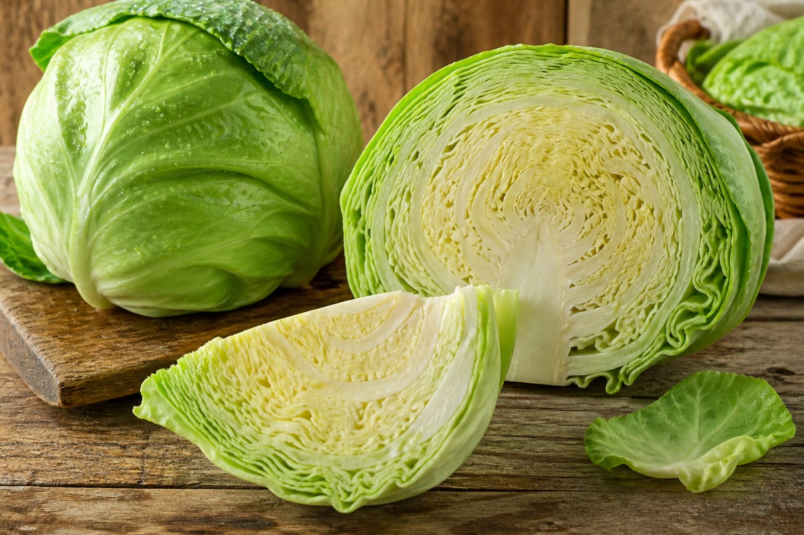

*▲ 고대 로마 시대부터 '가난한 자들의 의사'로 불려온 양배추(Cabbage)는 위장 점막 재생 물질인 S-메틸메티오닌(비타민 U)과 강력한 항암·항균 파이토케미컬 설포라판이 집약된 대표적인 소화기 치유 식재료입니다.*

위장 질환으로 고통받는 현대인에게 가장 먼저 권장되는 **양배추(Cabbage, Brassica oleracea var. capitata)**는 단순한 채소를 넘어 소화기 내과 및 기능성 영양학에서 천연 점막 보호제로 공인된 십자화과(Cruciferous) 슈퍼푸드입니다.

1950년대 스탠퍼드 대학교 의과대학 가넷 체니(Garnett Cheney) 박사의 임상 연구를 통해 발견된 **비타민 U(S-Methylmethionine sulfonium)**는 위장관 상피세포의 핵산 및 단백질 생합성을 직접 촉진하고 위벽을 감싸는 뮤신(Mucin) 분비를 촉진하여 소화성 위·십이지장 궤양의 자연 치유 속도를 비약적으로 단축시켰습니다.

또한 양배추의 세포벽이 파쇄될 때 글루코라파닌이 미로시나아제 효소와 반응하여 생성되는 아이소싸이오사이아네이트 화합물인 **설포라판(Sulforaphane)**은 위암의 주요 유발 인자인 **헬리코박터 파일로리(Helicobacter pylori)**의 생장을 억제하고 간의 해독 페이즈 II(Phase II) 효소를 유도합니다. 여기에 출혈성 궤양의 지혈과 골밀도 유지에 필수적인 **지용성 비타민 K1(필로퀴논)**이 100g당 76mcg(일일 권장량의 63%)에 달해 위장 출혈 예방과 전신 혈관 건강을 동시에 지원합니다.

미국 농무부(USDA FoodData Central)의 표준 분석 데이터를 바탕으로 양배추의 정밀 영양 성분 프로필과 4대 건강 효능, 영양 손실 없는 조리 과학 및 주의사항을 상세히 분석합니다.

---

## 1. 양배추 영양 성분 정밀 분석표 (생물 100g 기준, 녹색 결구양배추)

양배추는 100g당 25kcal라는 극히 낮은 칼로리 속에 수분, 복합 식이섬유, 비타민 C, 비타민 K, 그리고 항궤양 유황 아미노산 유도체를 응축하고 있습니다.

| 영양 성분 (Nutrient) | 함량 (100g당) | 1일 권장 섭취량 비율 (한국인 성인 기준) |
| :--- | :--- | :--- |
| **열량 (Energy)** | 25 kcal | 1.3% |
| **수분 (Water)** | 92.18 g | 별도 표기¹ |
| **단백질 (Protein)** | 1.28 g | 2.3% |
| **지방 (Total Fat)** | 0.10 g | 0.2% |
| - 포화지방산 (Saturated Fat) | 0.034 g | 0.2% |
| - 단일불포화지방산 (MUFA) | 0.017 g | 기준치 없음 |
| - 다가불포화지방산 (PUFA) | 0.017 g | 기준치 없음 |
| - 콜레스테롤 (Cholesterol) | 0.00 mg | 0.0% |
| **탄수화물 (Carbohydrates)** | 5.80 g | 1.8% |
| - 당류 (Total Sugars) | 3.20 g | 3.2% |
| - 식이섬유 (Dietary Fiber) | 2.50 g | 10.0% |
| **비타민 C (Ascorbic Acid)** | 36.60 mg | 36.6% |
| **비타민 K1 (Phylloquinone)** | 76.00 mcg | 63.3% |
| **엽산 (Vitamin B9, Folate)** | 43.00 mcg | 10.8% |
| **칼륨 (Potassium, K)** | 170.00 mg | 4.9% |
| **칼슘 (Calcium, Ca)** | 40.00 mg | 5.7% |
| **마그네슘 (Magnesium, Mg)** | 12.00 mg | 3.8% |
| **인 (Phosphorus, P)** | 26.00 mg | 3.7% |
| **철분 (Iron, Fe)** | 0.47 mg | 3.9% |
| **비타민 U (S-메틸메티오닌)** | 약 18.20 mg | 기준치 없음 |
| **설포라판 유래 글루코시놀레이트** | 약 42.00 mg | 기준치 없음 |

*※ 출처: 미국 농무부(USDA FoodData Central) 표준 분석 데이터 (Cabbage, raw 기준).*  
*¹ 수분은 점막 조직 상피의 탄력성과 소화액 분비를 지지하는 생체 용매입니다.*  
*※ '기준치 없음' 표기는 기능성 유황 화합물 및 파이토케미컬로 DRI상 일일 권장 백분율(%DV)이 법적으로 규정되지 않은 항목입니다.*

---

## 2. 과학적으로 입증된 양배추의 4대 건강 효능

### ① 비타민 U(S-메틸메티오닌)의 위 점막 재생 및 소화성 궤양 치유
양배추의 대표적인 생리활성 물질인 **비타민 U(S-Methylmethionine sulfonium, MMS)**는 손상된 위장관 점막 상피세포에서 단백질 메틸화(Methylation) 반응을 촉진하여 점막 상피 조직의 재생 사이클을 정상화합니다. 또한 위 점액질인 **뮤신(Mucin)**의 분비를 상향 조절하여 위산(HCl)과 펩신의 단백 분해 공격으로부터 위벽 기저막을 물리·화학적으로 방어함으로써 만성 위염과 위식도 궤양의 회복을 유도합니다.

### ② 설포라판의 헬리코박터 파일로리 억제 및 Nrf2 간 해독 활성화
양배추 속 **글루코라파닌**이 미로시나아제에 의해 분해되어 생성되는 **설포라판(Sulforaphane)**은 강력한 천연 항균 물질입니다. 설포라판은 위 점막 상피에 기생하는 헬리코박터균의 우레아제(Urease) 효소 활성을 직접 억제하여 균의 생존을 차단합니다. 동시에 인체 세포 내 **Nrf2 전사 인자**를 핵 내로 이동시켜 글루타티온 S-전이효소(GST) 등 2단계 간 해독 효소의 합성을 유도함으로써 체내 발암 물질을 무독화 배출시킵니다.

### ③ 비타민 K1(필로퀴논)의 모세혈관 지혈과 골밀도 카르복실화 지원
양배추 100g에는 일일 권장량의 63%를 초과하는 **76mcg의 비타민 K1**이 농축되어 있습니다. 비타민 K는 간에서 프로트롬빈 등 혈액 응고 인자의 합성을 도와 위염이나 궤양으로 손상된 미세혈관의 출혈을 신속히 지혈합니다. 또한 조골세포에서 분비되는 오스테오칼신 단백질을 감마-카르복실화(Gla)하여 혈액 속 칼슘이 뼈 기질로 단단히 결합하도록 유도함으로써 골다공증을 예방합니다.

### ④ 불용성·수용성 식이섬유 복합체의 장내 마이크로바이옴 정상화
양배추 100g당 2.5g의 풍부한 복합 식이섬유는 장내 유익균인 비피도박테리움과 락토바실러스의 핵심 먹이(프리바이오틱스)로 작용합니다. 장내 발효 과정에서 생성되는 단쇄지방산(SCFA: 아세트산, 부티르산)은 대장 점막 상피세포에 직접 에너지를 공급하고 장관 투과성(장 누수 증후군)을 억제하여 전신 염증 반응을 낮춥니다.

---

## 3. 유효 성분 흡수율을 극대화하는 섭취 가이드

### 열에 약한 비타민 U와 미로시나아제를 보존하는 저온 조리
비타민 U와 설포라판 생성 효소인 미로시나아제는 열에 대단히 취약하여 섭씨 60도 이상에서 장시간 가열하거나 끓일 경우 80% 이상 활성이 소실됩니다. 따라서 위 건강 목적의 섭취 시 가급적 생으로 얇게 채 썰어 샐러드로 섭취하거나, 익혀 먹을 경우 찜기에서 3분 이내로 가볍게 스팀 조리하는 것이 생체이용률을 극대화하는 비결입니다.

### 지용성 비타민 K 흡수를 위한 불포화 식물성 오일 결합
양배추에 풍부한 비타민 K1과 카로티노이드는 기름에 녹는 지용성 미세영양소입니다. 생양배추 샐러드에 올리브유, 들기름 또는 아보카도 오일을 1작은술 곁들이면 소장 융모에서 담즙산과 미셀(Micelle)을 완벽히 형성하여 비타민 K의 생체 흡수율이 최대 3배 이상 급상승합니다.

---

## 4. 섭취 시 주의사항 및 잠재적 부작용

### 과민성대장증후군(IBS) 환자의 가스 팽만감
양배추는 라피노오스(Raffinose)와 프룩탄 등 소화 효소로 분해되지 않는 고FODMAP 당류를 함유하고 있습니다. 대장 내 세균에 의해 급격히 발효되면서 수소와 메탄가스를 다량 발생시킬 수 있으므로, 복부 팽만이나 과민성대장증후군을 앓는 분은 한 번에 100g 이내로 나누어 가볍게 익혀 드시는 것이 좋습니다.

### 갑상선 질환자의 고이트로겐(Goitrogen) 영향
십자화과 채소에는 갑상선 호르몬 합성에 필요한 요오드의 흡수를 일부 방해할 수 있는 고이트로겐 성분이 미량 함유되어 있습니다. 갑상선 기능 저하증 환자가 매일 생양배추를 대량(수 kg) 섭취하는 것은 피해야 하며, 가볍게 데치거나 쪄서 섭취하면 고이트로겐 활성이 불활성화되어 안전하게 영양을 누릴 수 있습니다.

---

## 5. 최종 요약 및 실천 팁

1. **위장 점막을 복구하는 비타민 U:** S-메틸메티오닌이 위벽 세포 재생과 뮤신 분비를 촉진합니다.
2. **헬리코박터균을 방어하는 설포라판:** 십자화과 고유의 효소 반응으로 강력한 항균·항암 해독 작용을 수행합니다.
3. **가벼운 스팀과 식물성 오일 조합:** 3분 이내 저온 조리와 올리브유 드레싱으로 유효 성분을 온전히 흡수하십시오.

---

## 6. 함께 먹으면 시너지가 폭발하는 식재료 궁합

- **[사과 (Apple)]({{ site.baseurl }}/posts/apple-nutrition-benefits/)**: 사과의 수용성 펙틴과 유기산이 양배추의 비타민 U와 결합하여 손상된 소화기 점막을 이중으로 코팅 치유하고 특유의 풋내를 상큼하게 잡아줍니다.
- **[두부 (Tofu)]({{ site.baseurl }}/posts/tofu-nutrition-benefits/)**: 소화가 편한 식물성 고단백 두부와 위벽을 보호하는 양배추의 비타민 K가 결합하여 궤양 회복기 환자의 완벽한 저자극 회복 식단을 완성합니다.
- **[마늘 (Garlic)]({{ site.baseurl }}/posts/garlic-nutrition-benefits/)**: 마늘의 유황 화합물 알리신과 양배추의 설포라판이 만나 간의 글루타티온 해독 시스템을 극대화하고 강력한 항염 면역 시너지를 발휘합니다.

---

## 7. 자주 묻는 질문 (FAQ)

### Q1. 양배추즙(주스)으로 마시는 것과 생양배추를 직접 씹어 먹는 것은 어떤 차이가 있나요?
**A:** 생양배추를 치아로 꼭꼭 씹어 먹을 때 식물 세포벽이 파괴되며 미로시나아제 효소가 활성화되어 설포라판 생성량이 극대화됩니다. 시판 가열 양배추즙은 고온 살균 과정에서 비타민 U와 미로시나아제가 열변성되어 유효 성분이 감소할 수 있습니다. 위장 치유 효능을 온전히 얻으려면 생양배추를 갈아 즉시 마시거나 생으로 채 썰어 섭취하는 것이 가장 이상적입니다.

### Q2. 양배추의 단단한 심지 부분도 영양가가 있나요, 아니면 버려야 하나요?
**A:** 절대 버려서는 안 됩니다. 양배추 잎보다 단단한 중심부 심지(Core) 부위에 위 점막 재생 성분인 비타민 U와 수용성 식이섬유, 비타민 C 농도가 약 1.5~2배 이상 높게 밀집되어 있습니다. 심지가 질겨 씹기 어렵다면 믹서기에 사과나 바나나와 함께 곱게 갈아 스무디로 섭취하면 풍부한 영양을 그대로 흡수할 수 있습니다.

### Q3. 역류성 식도염 환자가 양배추를 매일 먹어도 안전한가요?
**A:** 매우 안전하며 임상적으로 강력히 권장됩니다. 양배추의 비타민 U와 비타민 K는 하부 식도 점막에 생긴 미세 궤양과 염증의 재생을 촉진하고 위산 자극을 완화합니다. 다만 찬 성질의 생양배추를 공복에 과량 섭취 시 가스 팽만을 느낄 수 있으므로 가볍게 찌거나 미온수와 함께 천천히 섭취하는 것을 권장합니다.

